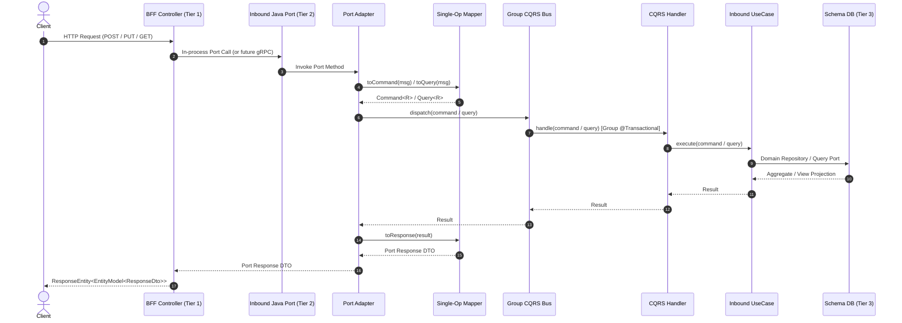

# R2. Layered Architecture and CQRS-Light

Load when adding or changing an HTTP use case, command/query flow, or layer responsibility.

## Layers

| Layer | Location | Responsibility |
|---|---|---|
| BFF Controller | `app/{bff}/api/rest/controller/` | HTTP in/out. Persona-tailored DTOs. Delegates to Java ports (`*Port`) or BFF application services. Returns `ResponseEntity<EntityModel<T>>` or `ResponseEntity<PagedModel<EntityModel<T>>>`. No business logic. |
| BFF Service | `app/{bff}/service/` | Orchestrates multi-port calls across domain groups for complex BFF-specific screen requirements. No direct database or bus access. |
| Inbound Java Port | `app/{group}/{domain}/port/message/*Port.java` | Universal headless service interface (Tier 2). Embeds request/response record DTOs. Drop-in replacement for future gRPC stubs. |
| Inbound Port Adapter | `app/{group}/{domain}/internal/adapter/inbound/message/*PortAdapter.java` | Implements Java port interface. Maps port messages via single-operation MapStruct mappers and dispatches to group-scoped CQRS bus (or use cases). |
| Port Mapper | `app/{group}/{domain}/internal/adapter/inbound/message/mapper/*PortMapper.java` | Single-operation MapStruct abstract class: strictly handles one command/query operation via `toCommand(...)` / `toQuery(...)` and `toResponse(...)`. |
| CQRS Handler | `app/{group}/{domain}/internal/command/handler/` and `query/handler/` | CQRS adapter: `@Component` implementing `CommandHandler<C,R>` / `QueryHandler<Q,R>` with group transactional annotations; delegates to inbound `*UseCase.execute(...)`. |
| Group CQRS Bus | `app/{group}/internal/config/{Group}BusConfig.java` | Group-scoped `CommandBus` and `QueryBus` bean definitions with in-memory registry of group handlers. |
| Use Case | `{bc}-application/port/inbound/*UseCase` + `{bc}-application/service/*Service` | Framework-agnostic use case orchestration. Wired via `{Bc}UseCaseConfig`. |
| Policy | `{name}-domain/.../policy/` or domain service | Encodes domain business rules. See `domain/policies.md`. |
| Domain | `{name}-domain/` | Pure domain aggregates and entities. Framework-agnostic. Outbound write ports: `port/outbound/{Domain}Repository`. |
| Application | `{name}-application/` | Commands, queries, inbound/outbound ports, read models, use case services. |
| Persistence Adapter | `{bc}-adapter-persistence/` | Outbound persistence adapters, Spring Data JPA repositories, Criteria Specifications, outbox producers. Targets isolated PostgreSQL schema. |

## 3-Tier Service Communication Protocol & CQRS Data Flow

1. **BFF Ingress (Tier 1)**: Client sends HTTP request. BFF Controller delegates strictly to the Universal Java Port interface (`*Port`).
2. **Inbound Adapter (Tier 2)**: Port Adapter (`*PortAdapter`) invokes dedicated single-operation MapStruct mapper (`toCommand` / `toQuery`).
3. **Group Bus Dispatch**: Dispatches via group-scoped `CommandBus` / `QueryBus` (e.g. `merchandisingCommandBus`, `accountCommandBus`).
4. **CQRS Handler**: Handler demarcates group transactional boundary (`@MerchandisingTransactional`, `@AccountTransactional`) and executes inbound `*UseCase`.
5. **Persistence (Tier 3)**: UseCase loads/saves aggregate via `{Domain}Repository` or reads view via `{Domain}QueryPort` against the isolated schema.
6. **Response Mapping**: Single-operation mapper converts Result to port Response DTO (`toResponse`). Controller assembles HATEOAS representation.

## CQRS Separation & Group Isolation Rules

- **Strict Pipeline Independence**: The Command pipeline (write) and Query pipeline (read) are strictly isolated. They must not mess with each other.
- **Group-Scoped Bus Isolation**:
  - No global bus injection. Every adapter and handler must bind to its group-scoped bus bean (e.g. `@Qualifier("channelCommandBus")`, `@Qualifier("channelQueryBus")`).
  - Handlers belonging to one domain group must never be registered with another group's bus.
- **CommandService / Write Adapter Cannot Query**: `CommandService` and write port adapters MUST NOT inject, invoke, or dispatch via `QueryBus`, nor call `QueryService` or perform queries. Any aggregate state required for command processing must be retrieved inside the **use case** via its domain repository, or provided in the command payload.
- **QueryService / Read Adapter Cannot Mutate**: `QueryService` and read port adapters MUST NOT inject, invoke, or dispatch via `CommandBus`, nor call `CommandService`. They are strictly read-only and side-effect free.
- **No Cross-Calling**: Command and Query services/adapters must never inject or call one another.
- **Controller Boundary**: Controllers exist **only** within Platform BFFs (`sellercentral`, `marketplace`). They MUST NOT inject `CommandBus`, `QueryBus`, handlers, use cases, ports, or repositories directly.
- **Query Handlers Read via Query Ports**: Query use cases and `QueryHandler` classes MUST NOT inject domain write `*Repository` ports or load full aggregates. Reads go through `*QueryPort` returning view records.
