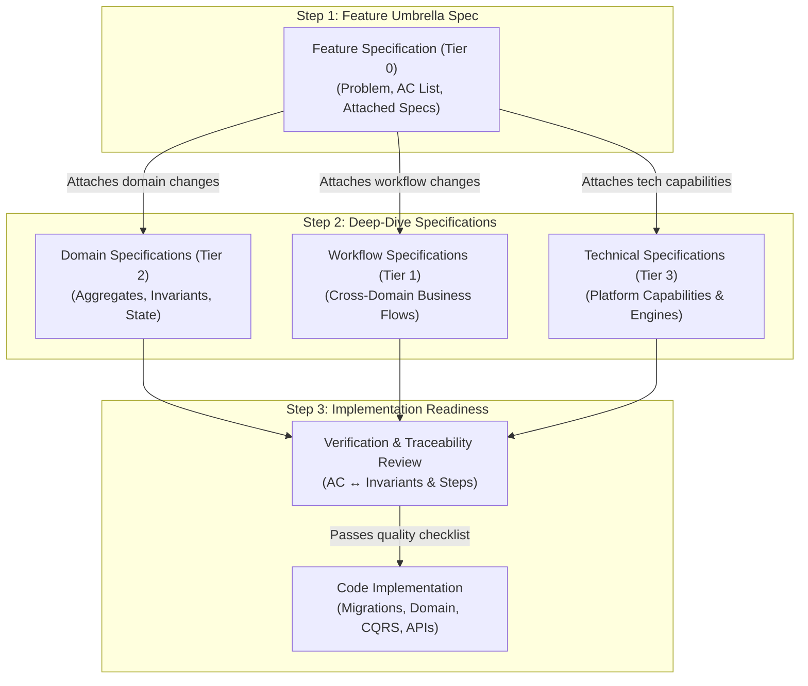

# Specification Authoring Guide (Pre-Implementation Guidance)

Use this guide and skill whenever initiating a new feature or architectural change before code implementation begins.

## Pre-Implementation Workflow

---

## The 4 Specification Types & Templates

| Specification | Tier | Focus | Template Location | Target File Placement |
| :--- | :---: | :--- | :--- | :--- |
| **Feature Spec** | 0 | Problem statement, Acceptance Criteria (ACs), Attached Specs | `grab/docs/templates/feature-spec-template.md` | `grab/docs/spec/features/feat_{xxx}-{kebab-name}.md` |
| **Domain Spec** | 2 | Domain Aggregate Model (boundaries, invariants, lifecycle states) | `grab/docs/templates/domain-spec-template.md` | `grab/docs/spec/domain/{domain}/architecture/{aggregate}-domain-spec.md` |
| **Workflow Spec** | 1 | Cross-Domain Business Flow (steps, events, compensations) | `grab/docs/templates/workflow-spec-template.md` | `grab/docs/spec/workflows/{kebab-case-workflow-name}.md` |
| **Tech Spec** | 3 | Technical Platform Capability (architecture, internal engine, config) | `grab/docs/templates/tech-spec-template.md` | `grab/docs/spec/system/{kebab-case-tech-name}-tech-spec.md` |

---

## Golden Authoring Rules

1. **Explain with diagrams, not massive text blocks:** Keep paragraphs under 3 sentences. Replace long explanations with clear Mermaid flowcharts, sequence diagrams, and state machines.
2. **Cap diagram complexity:** Cap diagrams at ~7–9 nodes. Do not create tangled webs; split diagrams into focused views when necessary.
3. **Use role names in diagrams:** In diagrams, use logical participant and architectural roles (e.g. `Workflow Coordinator`, `Pricing Service`, `Outbox Poller`), **never** framework classes, Java types, or table schema names.
4. **Precise tables:** Use concise tables for invariants, steps, events, properties, and configuration. Keep each cell to 1 clear, unambiguous sentence.
5. **Strict boundaries:** In Domain Specs, show composition inside an aggregate root vs. ID-only references across aggregates and contexts. Never show direct cross-aggregate navigation.
6. **Normative contracts:** In Tech Specs and Acceptance Criteria, define non-negotiable rules using RFC 2119 keywords (`MUST`, `MUST NOT`, `REQUIRED`).
7. **Traceability:** Every criterion in a Feature Spec's Acceptance Criteria MUST correspond to a concrete invariant in a Domain Spec, a step in a Workflow Spec, or a requirement in a Tech Spec.

---

## Pre-Implementation Checklist

When authoring specifications before coding:
1. **Step 1:** Create the Feature file in `grab/docs/spec/features/` using `feature-spec-template.md`. Detail the problem/pain points and define unambiguous Acceptance Criteria.
2. **Step 2:** Attach related specifications for domain changes (Domain Specs), cross-domain workflows (Workflow Specs), and technical platform capabilities (Tech Specs).
3. **Step 3:** Ensure bidirectional links between Feature, Domain, Workflow, and Tech specs.
4. **Step 4:** Validate that every Acceptance Criterion maps directly to domain invariants, workflow steps, or tech contracts.
