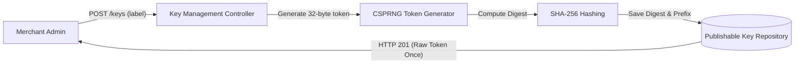

# Feature: Sales-Channel Key Lifecycle Management

> **System Design:** [Multi-Regional Contextual Product Discovery](../system-design/001-multi_regional_contextual_discovery_system_design.md)

---

## 1. What & Why

### What does this feature do?

This feature provides secure generation, storage, listing, and revocation of publishable keys bound to sales channels. It generates 32-byte cryptographically secure random tokens (`pk_live_...`), returns the raw token only once upon creation, stores only irreversible SHA-256 digests in the database, and supports concurrent key rotation without service interruption.

### Why is it needed?

Public storefront browse endpoints require revocable channel identification without granting administrative or merchant privileges. Without this feature, clients rely on unauthenticated and spoofable `salesChannelId` query parameters, exposing private merchant catalogs to enumeration and unauthorized scraping.

### What's in scope / out of scope?

| In Scope | Out of Scope |
|:---------|:-------------|
| Cryptographic 32-byte token generation with `pk_` prefix | Secret admin API keys with write privileges |
| One-time disclosure of raw tokens upon HTTP 201 creation | Request-time shopping context resolution (covered in Feat 2) |
| SHA-256 digest persistence and safe prefix display (`pk_` + 8 chars) | Merchant user authentication and credential management |
| Authenticated channel-scoped creation, paged listing, and revocation | Upstream product catalog publication or price updates |
| Non-destructive concurrent key rotation per channel | Regional mapping or currency assignments |

---

## 2. Acceptance Criteria

> This feature is **done** when all criteria below pass. Each criterion must be testable — no vague language.

| # | Criteria | How to Verify |
|:--|:---------|:--------------|
| AC-1 | Token creation MUST use 32 cryptographically random bytes encoded as unpadded URL-safe Base64 after `pk_`; persisted digests MUST be unique across all channels. | Automated unit tests asserting token format, byte entropy, and database unique constraint verification on digests. |
| AC-2 | Creation MUST return the raw token once with HTTP 201; later reads and logs MUST NOT expose raw tokens or stored digests, and metadata MUST use the safe `pk_` plus eight-character prefix. | API integration tests asserting raw token disclosure on creation, masking on GET queries, and log assertion checks. |
| AC-3 | Authenticated creation, paged listing, and revocation MUST return 201, 200, and 204 respectively; repeated revocation MUST preserve its original timestamp. | REST API integration tests asserting HTTP status codes and idempotency of revocation timestamps. |
| AC-4 | Merchant callers MUST hold the relevant key-read or key-write authority and own the channel; platform management MUST require key-admin authority, and forbidden operations MUST return 403. | Security permission tests verifying RBAC rules and multi-tenant channel ownership enforcement. |
| AC-5 | A channel MUST allow multiple active keys with trimmed, nonblank labels of at most 100 characters; revoking one key MUST NOT revoke another. | Integration tests creating multiple active keys per channel and asserting isolated revocation state. |
| AC-6 | A publishable key MUST grant only channel-scoped public read identity; invalid or revoked credentials MUST yield a generic 401 and MUST NOT confer management rights. | Edge filter integration tests asserting HTTP 401 on expired/malformed tokens and rejection of management routes. |

---

## 3. Solution Design

### How does this feature work?

> Show the key architectural flow for this feature. This is the "zoomed-in" view of the relevant part of the System Design.

### Key Design Decisions

| Decision | Choice | Rationale |
|:---------|:-------|:----------|
| Token Storage Security | Irreversible SHA-256 digest | Guarantees defense-in-depth: database compromises or logs cannot leak usable credentials. |
| Key Rotation Model | Concurrent active keys per channel | Enables merchants to roll out new tokens across storefront deployments without downtime or race conditions. |
| Identity Prefix | `pk_` prefix + safe 8-character display | Prevents misconfiguration, allows rapid identification in operational logs, and ensures raw tokens remain private. |

---

## 4. Implementation Specifications

> These are the detailed blueprints developers code against. Each spec covers one aspect of this feature's implementation.

### Domain Specs (Data Models & Business Rules)

- [Publishable Key Domain Spec](../spec/domain/sales-channel/architecture/publishable-key-domain-spec.md)

### Workflow Specs (Process Flows)

- None; key lifecycle operations are synchronous transactional CRUD commands.

### Tech Specs (Technology Decisions & Rules)

- [Publishable Key Lifecycle Tech Spec](../spec/system/publishable-key-lifecycle-tech-spec.md)
