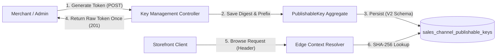

# Sales-Channel Key Lifecycle & Authenticated Management
## Sales Channel · Identity & Access · Storefront Query

### Problem Statement:
Storefront clients require channel-scoped public credentials to identify commercial surfaces without exposing merchant login credentials or administrator privileges. Existing platform capabilities lack a secure token generation and rotation lifecycle, schema persistence with one-way digest protection, and role-based management APIs.

### Acceptance Criteria
- **AC-01 — V2 Database Schema Migration:** The system MUST execute Flyway migration `V2__create_sales_channel_publishable_keys.sql` creating table `sales_channel_publishable_keys` with a foreign key to `sales_channels(uuid)`, unique index on `token_digest`, and query index on `sales_channel_id`.
- **AC-02 — Cryptographic Key Generation:** Token generation MUST produce a 32-byte cryptographically secure random token formatted as URL-safe Base64 prefixed with `pk_` (`pk_[A-Za-z0-9_-]{43}`).
- **AC-03 — One-Way SHA-256 Digest & Display Prefix:** The system MUST store only a 64-character hex SHA-256 digest (`token_digest`) and an 8-character display prefix (`display_prefix`); raw plaintext tokens MUST NOT be persisted, logged, or queryable after initial creation.
- **AC-04 — Management REST API Endpoints:** The sales channel module MUST expose authenticated REST endpoints: `POST /api/v1/sales-channels/channels/{salesChannelId}/publishable-keys` (returns 201 with plaintext token once), `GET .../publishable-keys` (returns 200 with paged metadata), and `DELETE .../publishable-keys/{keyId}` (returns 204 setting `revoked_at`).
- **AC-05 — Security Manifest Revision 2 (RBAC):** Key management endpoints MUST enforce role-based access control where merchant sellers require `KEY_READ` and `KEY_WRITE` permissions scoped strictly to their owned channels, platform administrators require `KEY_ADMIN`, and unauthorized cross-channel operations MUST return `403 Forbidden`.
- **AC-06 — Non-Destructive Multi-Key Rotation:** A sales channel MUST support multiple concurrent active publishable keys with merchant labels of at most 100 characters, enabling zero-downtime credential rotation before revoking legacy keys.

### Key Lifecycle States

| State | Definition | Storefront Evaluation | Transition Event |
| :--- | :--- | :--- | :--- |
| **ACTIVE** | Key is created with `revoked_at IS NULL`. | Permitted to resolve active channel. | Creation via `POST`. |
| **REVOKED** | Key has `revoked_at` populated. | Rejected with generic `401 Unauthorized`. | Revocation via `DELETE`. |

### Related Specifications

#### Domain Specifications (if domain models, aggregate roots, or invariants change)
- [Publishable Key Domain Specification](../spec/domain/sales-channel/architecture/publishable-key-domain-spec.md)
- [Sales Channel Domain Specification](../spec/domain/sales-channel/architecture/sales-channel-domain-spec.md)

#### Workflow Specifications (if cross-domain business flows, choreography, or sagas change)
- [Default Sales Channel Provisioning Workflow](../spec/workflows/default-sales-channel-provisioning-workflow.md)

#### Technical Specifications (if platform capabilities, read models, or security mechanisms change)
- [API Security & Authentication Tech Specification](../spec/system/api-security-tech-spec.md)
- [Security Manifest Consistency Tech Specification](../spec/system/security-manifest-consistency-tech-spec.md)
- [Shopping Context Resolution Tech Specification](../spec/system/shopping-context-resolution-tech-spec.md)
