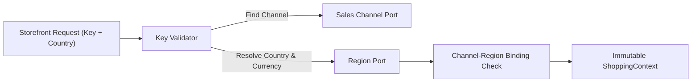

# Feature: Edge Shopping-Context Resolution

> **System Design:** [Multi-Regional Contextual Product Discovery](../system-design/001-multi_regional_contextual_discovery_system_design.md)

---

## 1. What & Why

### What does this feature do?

This feature intercepts inbound public storefront requests at the ingress boundary, validates the `X-Publishable-Key` header, resolves geographic country parameters against regional market boundaries, and constructs an immutable 5-tuple `ShoppingContext` (`salesChannelId`, `regionId`, `countryCode`, `currencyCode`, `locale`) before queries reach catalog read models.

### Why is it needed?

Allowing clients to pass untrusted channel identifiers or currencies directly into search endpoints enables channel spoofing and cross-border currency manipulation. Resolving context deterministically at the edge ensures that market eligibility and settlement currencies are authoritatively established before query execution.

### What's in scope / out of scope?

| In Scope | Out of Scope |
|:---------|:-------------|
| Cryptographic `X-Publishable-Key` validation and channel lookup | Issuing or revoking publishable keys (covered in Feat 1) |
| ISO 3166-1 country code parsing and validation | Product catalog projection filtering (covered in Feat 4) |
| Channel default region fallback when country is omitted | Evaluating price rules or calculating totals (covered in Feat 3) |
| Separating regional commercial eligibility (`regionServed`) from context | Storefront response serialization and HAL links (covered in Feat 5) |
| Strict RFC 7807 error responses (`400`, `401`, `422`) | Upstream currency rate conversions |

---

## 2. Acceptance Criteria

> This feature is **done** when all criteria below pass. Each criterion must be testable — no vague language.

| # | Criteria | How to Verify |
|:--|:---------|:--------------|
| AC-1 | Resolution MUST produce an immutable channel, region, optional country, authoritative currency, and optional locale values, with region-served eligibility retained separately. | Automated unit tests asserting `ShoppingContext` immutability and field integrity. |
| AC-2 | Missing, malformed, unknown, or revoked keys MUST yield the same 401 response; a valid key for a disabled channel MUST yield 400 before product reads. | Integration tests executing HTTP requests against edge filter with various key states. |
| AC-3 | An explicit country MUST be trimmed, uppercased, and validated; malformed or unknown ISO codes MUST yield 400, while valid countries lacking an active region MUST yield 422. | API parameter validation tests asserting RFC 7807 problem details across invalid and unmapped ISO codes. |
| AC-4 | Omitted country MUST use the channel's enabled default binding and active Region while retaining null country; missing, mismatched, inactive, or unserved defaults MUST yield 422. | Integration tests omitting `countryCode` and verifying fallback to channel default region. |
| AC-5 | Country membership MUST be exclusive, currency MUST come from Region, and a channel MUST have at most one enabled default whose replacement is atomic. | Domain invariant tests asserting single-region country ownership and unique channel defaults. |
| AC-6 | An explicit valid active market unserved by the channel MUST retain its context with `regionServed=false`; resolution MUST NOT substitute a default market or authorize purchase. | Integration tests verifying unserved country queries return valid context flagged as `regionServed=false`. |
| AC-7 | Resolution MUST use published read capabilities, MUST NOT access another context's storage, and MUST NOT mutate source state. | Architectural Modulith tests verifying outbound SPI boundaries and read-only transaction attributes. |

---

## 3. Solution Design

### How does this feature work?

> Show the key architectural flow for this feature. This is the "zoomed-in" view of the relevant part of the System Design.

### Key Design Decisions

| Decision | Choice | Rationale |
|:---------|:-------|:----------|
| Resolution Phase | Pre-query edge resolution | Rejects invalid or unauthenticated requests before database queries execute, preventing DDoS and resource exhaustion. |
| Unserved Market Policy | Explicit `regionServed=false` flag (no silent fallback) | Preserves shopper context without masquerading another market's catalog or prices, maintaining pricing transparency. |
| Error Contract | RFC 7807 Problem Details | Provides uniform, machine-readable error structures (`401`, `400`, `422`) without leaking internal domain architecture. |

---

## 4. Implementation Specifications

> These are the detailed blueprints developers code against. Each spec covers one aspect of this feature's implementation.

### Domain Specs (Data Models & Business Rules)

- [Sales Channel Domain Spec](../spec/domain/sales-channel/architecture/sales-channel-domain-spec.md)
- [Region Domain Spec](../spec/domain/region/architecture/region-domain-spec.md)

### Workflow Specs (Process Flows)

- None; context resolution is a stateless request-filter pipeline step.

### Tech Specs (Technology Decisions & Rules)

- [Shopping Context Resolution Tech Spec](../spec/system/shopping-context-resolution-tech-spec.md)
