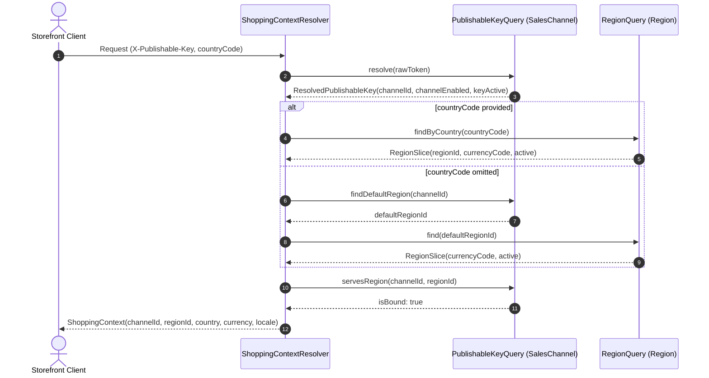

# Edge Shopping-Context Resolution & Shared Ports
## Sales Channel · Region · Storefront Query

### Problem Statement:
Storefront queries cannot safely resolve market currency, regional channel eligibility, or customer country context without a dedicated edge resolver. Accepting unauthenticated channel query parameters allows catalog scraping across channels, while ad-hoc currency derivation violates module boundaries and breaks multi-regional isolation.

### Acceptance Criteria
- **AC-01 — Shared PublishableKeyQuery Port:** Sales Channel MUST export a shared query port and provider adapter resolving token digests to `ResolvedPublishableKey(salesChannelId, channelEnabled, keyActive)` without exposing internal persistence entities.
- **AC-02 — Immutable ShoppingContext Value Object:** The discovery application layer MUST define an immutable `ShoppingContext` value object containing `salesChannelId`, `regionId`, `countryCode`, `currencyCode`, and `locale`.
- **AC-03 — Inbound Context Resolution Service:** `ResolveShoppingContextUseCase` and service MUST coordinate token validation, verify channel active status, resolve member region and settlement currency via `RegionQuery`, and verify `ChannelRegion` binding.
- **AC-04 — Country Fallback & Default Region:** When `countryCode` is omitted, the resolver MUST look up the channel's enabled default region and retain `countryCode=null`; it MUST NOT infer a primary country from a region. When `countryCode` is supplied, it MUST map to that specific active region.
- **AC-05 — Outbound SPIs & Modular Adapters:** Storefront discovery MUST interact with Sales Channel and Region bounded contexts exclusively through outbound SPIs and published shared interfaces in `store/`.
- **AC-06 — Sealed ProblemDetail Error Taxonomy:** The resolver MUST map domain failures to sealed RFC 7807 `ProblemDetail` structures with uniform error codes:
  - `401 Unauthorized`: Missing, malformed, unknown, or revoked publishable key (generic constant message).
  - `400 Bad Request`: The resolved channel is disabled. An active but unserved region is retained as `regionServed=false` for later availability handling.
  - `400 Bad Request`: Supplying decommissioned `salesChannelId` parameter or malformed request structure.
  - `422 Unprocessable Entity`: Country code not mapped to any active region, or the channel default region is missing, inactive, mismatched, or no longer served.

### Error Taxonomy Mapping

| Error Condition | HTTP Status | ProblemDetail Title | Detail Message |
| :--- | :--- | :--- | :--- |
| Missing/Invalid/Revoked Key | `401 Unauthorized` | Invalid Publishable Key | "Invalid or revoked publishable key" |
| Unserved Region Binding | `200` (resolution result) | Region eligibility | `regionServed=false`; later discovery returns `NOT_AVAILABLE_IN_REGION` |
| Decommissioned Channel Param | `400 Bad Request` | Unsupported Parameter | "Query parameter salesChannelId is not supported; use X-Publishable-Key" |
| Malformed or unknown ISO country code | `400 Bad Request` | Invalid Country | "Country code is invalid" |
| Valid country without an active Region | `422 Unprocessable` | Unmapped Country | "Country code is not associated with any active region" |

HTTP enforcement of the publishable-key header and rejection of the legacy `salesChannelId` selector belongs to the phase 5 storefront endpoint cutover. This phase exposes the resolver through CQRS and does not change the production product endpoints.

### Related Specifications

#### Domain Specifications (if domain models, aggregate roots, or invariants change)
- [Publishable Key Domain Specification](../spec/domain/sales-channel/architecture/publishable-key-domain-spec.md)
- [Sales Channel Domain Specification](../spec/domain/sales-channel/architecture/sales-channel-domain-spec.md)
- [Region Domain Specification](../spec/domain/region/architecture/region-domain-spec.md)

#### Workflow Specifications (if cross-domain business flows, choreography, or sagas change)
- [Browse and Discover Products Workflow](../spec/workflows/browse-and-discover-products-workflow.md)

#### Technical Specifications (if platform capabilities, read models, or security mechanisms change)
- [Shopping Context Resolution Tech Specification](../spec/system/shopping-context-resolution-tech-spec.md)
- [Exception Handling Tech Specification](../spec/system/exception-handling-tech-spec.md)
- [Storefront Query Tech Specification](../spec/system/storefront-query-tech-spec.md)
