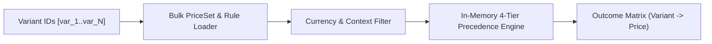

# Feature: Vectorized Batch Regional Pricing

> **System Design:** [Multi-Regional Contextual Product Discovery](../system-design/001-multi_regional_contextual_discovery_system_design.md)

---

## 1. What & Why

### What does this feature do?

This feature executes single-trip, high-throughput price evaluations for multiple product variants at request time. It loads variant-to-price-set associations and candidate price rules in bulk, evaluates an in-memory 4-tier rule precedence ranking (`Channel + Region > Region > Channel > Base`), and returns explicit priced or unpriced outcomes for every requested variant while preserving strict currency isolation.

### Why is it needed?

Evaluating prices individually causes severe $N+1$ database query loops on catalog browse pages. Conversely, pre-materializing all combinations of channel, region, and currency causes combinatorial storage explosion ($O(P \times C \times R)$) and triggers massive database re-indexing storms whenever prices or exchange rates update. Vectorized request-time evaluation resolves prices dynamically in under 15ms without write amplification.

### What's in scope / out of scope?

| In Scope | Out of Scope |
|:---------|:-------------|
| Bulk price evaluation for arbitrary $N$ variants in a single call | Cart checkout price calculations or coupon/voucher promotions |
| 4-tier rule precedence ranking algorithm in memory | Dynamic foreign exchange rate conversions |
| Deduplication of variant IDs and shared `PriceSet` references | Managing catalog presentation facts or media (covered in Feat 4) |
| Strict currency and market isolation (e.g., dual-USD regional separation) | Constructing storefront response DTOs and URLs (covered in Feat 5) |
| Preserving configured zero amounts versus unpriced null amounts | Modifying or mutating transactional price rules |

---

## 2. Acceptance Criteria

> This feature is **done** when all criteria below pass. Each criterion must be testable — no vague language.

| # | Criteria | How to Verify |
|:--|:---------|:--------------|
| AC-1 | One batch MUST accept variant IDs, channel, region, currency, and positive quantity and return an explicit priced or unpriced outcome for every distinct requested variant. | Automated integration tests executing batch quotes with variant outcome assertions. |
| AC-2 | Variant links and candidate prices MUST be read in bulk and preferences once; persistence round trips MUST remain bounded for a supported page without per-variant quote loops. | Query-count verification tests asserting bounded database queries for any page size. |
| AC-3 | Empty input MUST return no outcomes without persistence reads; duplicate variants and shared price sets MUST be evaluated once using one evaluation instant. | Unit tests asserting zero persistence interactions on empty input and single evaluations on duplicate IDs. |
| AC-4 | Eligible candidates MUST rank channel plus region above region, channel, and base, in that order; quantity, campaign, rule, time, and deterministic price-synthesis behavior MUST be preserved. | Unit tests covering all 4 precedence tiers and rule tie-breaking combinations. |
| AC-5 | Regions sharing a currency MUST remain independent; unmatched variants MUST have null prices without currency substitution or fabricated zero, while configured zero MUST remain valid. | Multi-region tests sharing currency (e.g., USD) asserting strict isolation and distinct zero vs null states. |
| AC-6 | Operational pricing failures MUST propagate as service failures and MUST NOT be reported as absent price configurations. | Fault injection tests verifying exception propagation and preventing unpriced masks during outages. |

---

## 3. Solution Design

### How does this feature work?

> Show the key architectural flow for this feature. This is the "zoomed-in" view of the relevant part of the System Design.

### Key Design Decisions

| Decision | Choice | Rationale |
|:---------|:-------|:----------|
| Evaluation Strategy | In-memory vectorized batch execution | Prevents Cartesian storage growth while guaranteeing sub-15ms response times across browse pages. |
| Rule Precedence Model | 4-tier specificity (`Channel+Region > Region > Channel > Base`) | Provides deterministic merchant control, allowing global defaults with granular regional overrides. |
| Currency Boundary | Strict currency isolation (no automatic fallback) | Prevents legal and financial compliance violations caused by cross-currency price conversions. |

---

## 4. Implementation Specifications

> These are the detailed blueprints developers code against. Each spec covers one aspect of this feature's implementation.

### Domain Specs (Data Models & Business Rules)

- [Pricing Domain Spec](../spec/domain/pricing/architecture/pricing-domain-spec.md)

### Workflow Specs (Process Flows)

- None; batch pricing is a stateless calculation engine query.

### Tech Specs (Technology Decisions & Rules)

- [Batch Regional Pricing Tech Spec](../spec/system/batch-regional-pricing-tech-spec.md)
