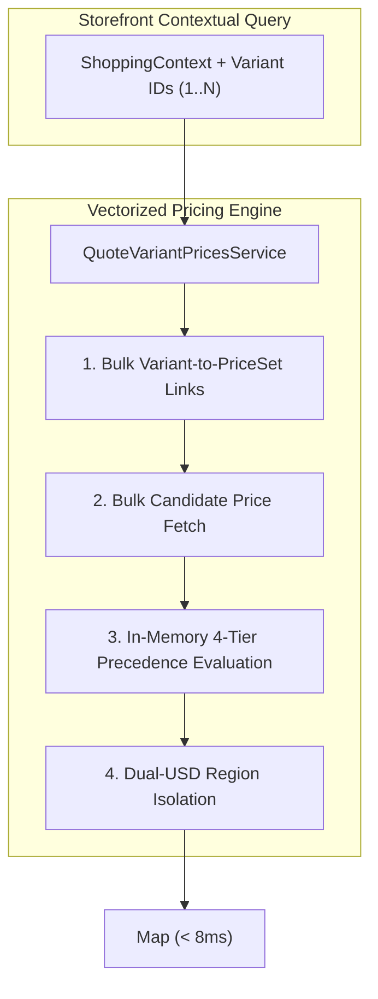

# Vectorized Batch Regional Pricing Engine
## Pricing · Storefront Query

### Problem Statement:
Storefront product listings require quoting prices for dozens of variants per page under specific market contexts. Invoking single-variant price quote use cases in a loop causes $N+1$ database queries and severe latency spikes, while materializing regional prices in search documents triggers combinatorial storage explosion and write amplification.

### Acceptance Criteria
- **AC-01 — Shared Batch Port Extension:** The Pricing module MUST extend `PricingQuoteQuery` with `quoteBatch(BatchQuoteRequest request)` returning `BatchQuoteResult` containing `Map<String, QuotedPrice>` indexed by variant ID.
- **AC-02 — Application Query Model:** The pricing application layer MUST provide `QuoteVariantPricesQuery` encapsulating a deduplicated collection of variant IDs, currency code, quantity, sales channel ID, and region ID.
- **AC-03 — Bounded Database Reads:** `QuoteVariantPricesService` MUST resolve variant-to-price-set links and candidate price rows in bulk database queries; it MUST NOT invoke single-variant quote operations in a loop.
- **AC-04 — 4-Tier Pricing Rule Precedence:** Candidate prices MUST be evaluated in-memory according to strict specificity order:
  $$\text{Channel + Region Override} > \text{Region Override} > \text{Channel Override} > \text{Base Currency Price}$$
- **AC-05 — Same-Currency Regional Isolation:** The engine MUST cleanly isolate markets sharing identical currency codes (such as dual-USD regions); pricing rules configured for one region MUST NOT leak to another region.
- **AC-06 — Deterministic Missing Price Outcomes:** Variants without valid price rules in the requested regional currency MUST return an explicit unpriced / null quote; the engine MUST NOT fallback to a different currency or default to zero amount.

### Rule Precedence Matrix

| Specificity Tier | Channel Constraint | Region Constraint | Evaluation Priority |
| :--- | :--- | :--- | :--- |
| **Tier 1: Channel + Region** | Matches `salesChannelId` | Matches `regionId` | Priority 1 (Highest) |
| **Tier 2: Region Override** | Wildcard / All Channels | Matches `regionId` | Priority 2 |
| **Tier 3: Channel Override** | Matches `salesChannelId` | Wildcard / All Regions | Priority 3 |
| **Tier 4: Base Currency** | Wildcard / All Channels | Wildcard / All Regions | Priority 4 (Lowest) |

### Related Specifications

#### Domain Specifications (if domain models, aggregate roots, or invariants change)
- [Pricing Domain Specification](../spec/domain/pricing/architecture/pricing-domain-spec.md)
- [Region Domain Specification](../spec/domain/region/architecture/region-domain-spec.md)

#### Workflow Specifications (if cross-domain business flows, choreography, or sagas change)
- [Browse and Discover Products Workflow](../spec/workflows/browse-and-discover-products-workflow.md)

#### Technical Specifications (if platform capabilities, read models, or security mechanisms change)
- [Batch Regional Pricing Tech Specification](../spec/system/batch-regional-pricing-tech-spec.md)
- [Storefront Query Tech Specification](../spec/system/storefront-query-tech-spec.md)
