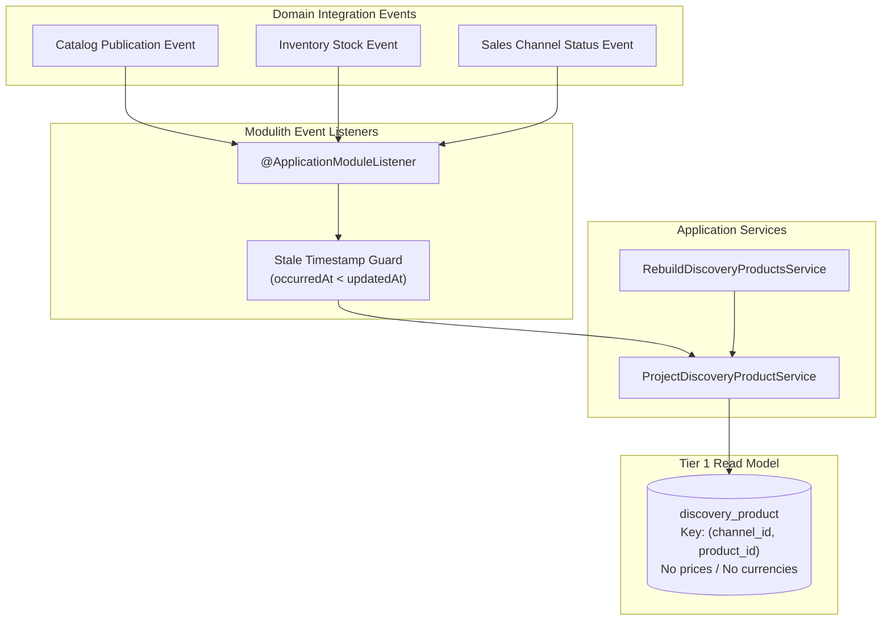

# Discovery Wiring & Projection Reconciliation
## Storefront Query · Catalog · Inventory · Sales Channel

### Problem Statement:
Storefront product discovery use cases and projection maintenance are currently unimplemented stubs returning null. Legacy projections store static prices and currencies that amplify re-indexing writes during price adjustments and prevent single channels from serving multiple currencies.

### Acceptance Criteria
- **AC-01 — Collection Search Query Service:** The system MUST implement `SearchBuyableOffersService` to query Tier 1 projection documents matching the sales channel and filter criteria, supporting pagination, keyword search, and category navigation.
- **AC-02 — Product Detail Lookup Service:** The system MUST implement `GetBuyableOfferBySlugService` to retrieve product details by channel ID and slug; missing or unpublished products MUST return `404 OfferNotFound`.
- **AC-03 — Currency-Agnostic Tier 1 Projection:** `ProjectDiscoveryProductService` MUST persist presentation facts (title, slug, description, thumbnail, options, variant SKUs, inventory tracking flags) keyed strictly by `(sales_channel_id, product_id)` without regional currencies, prices, or static buyability flags.
- **AC-04 — Spring Modulith Event-Driven Projections:** The discovery module MUST register `@ApplicationModuleListener` handlers to consume catalog publications, product variant updates, and inventory stock changes, asynchronously projecting changes to affected channel documents.
- **AC-05 — Stale Event & Idempotency Protection:** Event consumers MUST compare `event.occurredAt` against `projection.updatedAt`; events with strictly older timestamps MUST be safely discarded to prevent out-of-order event drift.
- **AC-06 — Zero-Downtime Projection Rebuild Service:** `RebuildDiscoveryProductsService` MUST scan active catalog publications in configurable bounded batches, reconcile missing or drifted projection rows, and purge orphaned projections for deleted products without service interruption.

### Tier 1 Projection Attributes

| Attribute Category | Persisted Fields (Tier 1 Facts) | Excluded Fields (Delegated to Tier 2) |
| :--- | :--- | :--- |
| **Identity & Scope** | `sales_channel_id`, `product_id`, `slug`, `version` | `region_id`, `country_code` |
| **Catalog Presentation** | `title`, `description`, `thumbnail`, `options_json` | `currency_code` |
| **Variant Facts** | `variant_id`, `sku`, `title`, `option_values_json` | `calculated_amount`, `original_amount` |
| **Inventory State** | `manage_inventory`, `allow_backorder`, `in_stock`, `stock_qty` | `price_rules`, `campaign_id` |
| **Commercial State** | `is_published`, `product_status` | `min_price`, `max_price`, `availability_status` |

### Related Specifications

#### Domain Specifications (if domain models, aggregate roots, or invariants change)
- [Catalog Product Domain Specification](../spec/domain/catalog/architecture/product-domain-spec.md)
- [Product Publication Domain Specification](../spec/domain/catalog/architecture/product-publication-domain-spec.md)
- [Inventory Item Domain Specification](../spec/domain/inventory/architecture/inventory-item-domain-spec.md)
- [Sales Channel Domain Specification](../spec/domain/sales-channel/architecture/sales-channel-domain-spec.md)

#### Workflow Specifications (if cross-domain business flows, choreography, or sagas change)
- [Browse, Project, and Rebuild Discovery Products Workflow](../spec/workflows/browse-and-discover-products-workflow.md)

#### Technical Specifications (if platform capabilities, read models, or security mechanisms change)
- [Storefront Query Tech Specification](../spec/system/storefront-query-tech-spec.md)
- [Transactional Outbox Tech Specification](../spec/system/transactional-outbox-tech-spec.md)
