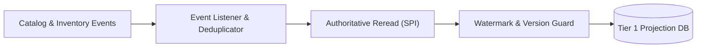

# Feature: Discovery Wiring & Projection Reconciliation

> **System Design:** [Multi-Regional Contextual Product Discovery](../system-design/001-multi_regional_contextual_discovery_system_design.md)

---

## 1. What & Why

### What does this feature do?

This feature establishes the Tier 1 read model for product discovery. It maintains denormalized, currency-agnostic, and region-agnostic catalog presentation facts (titles, slugs, media, options, variant hierarchies, and stock badges) keyed by `(sales_channel_id, product_id)`. It asynchronously consumes events from Catalog and Inventory, provides atomic concurrency control, and includes a durable, checkpointed rebuild coordinator.

### Why is it needed?

Persisting regional pricing and currency amounts into materialized search documents causes massive write amplification and re-indexing storms whenever prices, taxes, or exchange rates change. Decoupling presentation facts from volatile prices creates a high-performance read model that scales independently and remains completely immune to pricing updates.

### What's in scope / out of scope?

| In Scope | Out of Scope |
|:---------|:-------------|
| Denormalized facts-only `discovery_product` projection schema | Persisting prices, currencies, price ranges, or buyability |
| Event consumers for Catalog (publication, updates) and Inventory | Evaluating regional price rules (covered in Feat 3) |
| Deduplication of incoming events and stale-event timestamp protection | Dynamic price enrichment or response serialization (covered in Feat 5) |
| Atomic projection updates and optimistic concurrency control | Authenticating public incoming requests (covered in Feat 2) |
| Checkpointed, resumable two-stage background rebuild coordinator | Transactional mutations to source catalog or inventory tables |
| Literal keyword search, exact category filtering, and pagination | Upstream catalog authoring workflows |

---

## 2. Acceptance Criteria

> This feature is **done** when all criteria below pass. Each criterion must be testable — no vague language.

| # | Criteria | How to Verify |
|:--|:---------|:--------------|
| AC-1 | Discovery MUST retain catalog, publication, channel, and inventory facts per channel/product pair and MUST NOT persist or return prices, currencies, ranges, or commercial buyability through its factual query boundary. | Database schema inspections and repository unit tests asserting the absence of price-related columns. |
| AC-2 | Search and detail MUST require an enabled channel, active parent, and active published variant; stock MUST NOT hide products, and literal keyword matching, exact category filtering, pagination, and product-ID order MUST be consistent. | Automated query tests verifying keyword matching, filter parameters, deterministic ordering, and out-of-stock product visibility. |
| AC-3 | Source events MUST trigger deduplicated target resolution and current authoritative rereads; presentation and routed-stock selection MUST be deterministic, and pricing changes MUST NOT refresh these facts. | Event listener integration tests confirming selective updates and asserting that pricing events are ignored. |
| AC-4 | Projection and exact variant membership MUST commit atomically with expected-version protection; stale events MUST be ignored, equal timestamps reconciled, and transient conflicts MUST receive at most three total fresh-transaction attempts. | Concurrency tests verifying out-of-order event rejection, optimistic lock checking, and transaction retry limits. |
| AC-5 | Final unpublication or deletion MUST retain a tombstone and watermark while clearing slug and variants; current publication MUST be rechecked before invalidation. | Lifecycle integration tests verifying tombstone creation and slug reuse freedom after unpublication. |
| AC-6 | Rebuild MUST be opt-in and process bounded publication then existing-projection stages; writes and checkpoints MUST commit together, resume after failure, and preserve newer live updates. | Automated recovery tests interrupting rebuild executions and asserting seamless resumption from persisted checkpoints. |
| AC-7 | Fresh initialization MUST enforce channel/product and channel/slug uniqueness plus exact variant and SKU lookup with local references only; existing databases MUST NOT be reset or treated as fresh installations. | Flyway migration tests asserting idempotent schema execution and local foreign key constraints. |

---

## 3. Solution Design

### How does this feature work?

> Show the key architectural flow for this feature. This is the "zoomed-in" view of the relevant part of the System Design.

### Key Design Decisions

| Decision | Choice | Rationale |
|:---------|:-------|:----------|
| Projection Content | Currency-agnostic presentation facts only | Eliminates re-indexing storms during price updates and minimizes storage footprint ($O(P \times C)$). |
| Consistency Model | Asynchronous eventual consistency with watermarks | Decouples read availability from transactional writes while preventing stale event overwrites. |
| Rebuild Strategy | Two-stage resumable coordinator with persistent checkpoints | Allows complete background repairs in production without downtime, data loss, or high memory overhead. |

---

## 4. Implementation Specifications

> These are the detailed blueprints developers code against. Each spec covers one aspect of this feature's implementation.

### Domain Specs (Data Models & Business Rules)

- None; this feature is an asynchronous read-model projection.

### Workflow Specs (Process Flows)

- [Browse, Project, and Rebuild Discovery Facts](../spec/workflows/browse-and-discover-products-workflow.md)

### Tech Specs (Technology Decisions & Rules)

- [Storefront Query and Discovery Facts](../spec/system/storefront-query-tech-spec.md)
- [Discovery Facts-Only Projection](../spec/system/discovery-facts-only-projection-tech-spec.md)
- [Discovery Event-Driven Reconciliation](../spec/system/discovery-event-reconciliation-tech-spec.md)
- [Discovery Projection Concurrency Control](../spec/system/discovery-concurrency-control-tech-spec.md)
- [Discovery Rebuild Coordinator](../spec/system/discovery-rebuild-coordinator-tech-spec.md)
- [Discovery Search Specification & Visibility](../spec/system/discovery-search-visibility-tech-spec.md)
