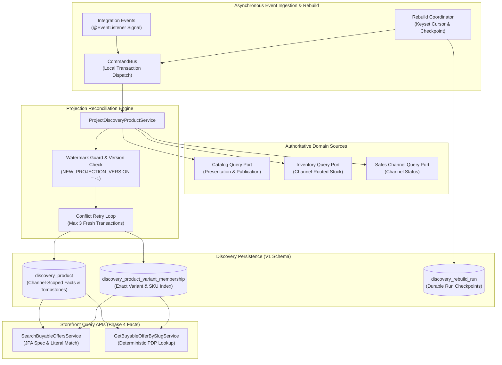

# Discovery Wiring, Projection Reconciliation, and Rebuild
## Storefront Query · Catalog · Inventory · Sales Channel

### Problem Statement:
Coupling pricing, currency, and regional buyability into materialized discovery projection rows causes combinatorial write amplification across price updates, exchange rate shifts, and market reconfigurations. In a multi-regional commerce platform, storing prices directly in search documents leads to index thrashing and stale quotes. Furthermore, serving storefront browse and product detail queries without deterministic source reconciliation and out-of-order event protection risks data corruption from race conditions, while uncoordinated projection rebuilds either block application startup or drop concurrent live event updates.

Existing platform capabilities lack:
1. A strictly currency-agnostic, facts-only CQRS read model decoupled from Pricing.
2. Injected JPA search specifications supporting exact variant/category filtering and literal keyword escaping (`%`, `_`, `\`).
3. Out-of-band event-driven reconciliation that queries authoritative source ports (`Catalog`, `Inventory`, `Sales Channel`), handles tombstoning, and guards update watermarks.
4. A durable, checkpointed keyset-paginated rebuild coordinator that resumes safely across restarts without dropping live updates.

### Acceptance Criteria
- **AC-01 — Facts-Only Projection Document Contract:** The projection persistence layer (`discovery_product` and `discovery_product_variant_membership`) MUST store solely currency-agnostic catalog presentation and inventory facts per `(sales_channel_id, product_id)` pair: channel, product, merchant, and category identifiers; product title, slug, description, thumbnail, options, and status; publication membership; channel status; derived stock badge; update watermark; and optimistic-lock version. Variant JSON facts MUST include variant ID, SKU, title, status, option values, available quantity, inventory management, backorder configuration, and factual stock state. The discovery projection and its queries MUST NOT persist, request, or return currency codes, monetary amounts, compare-at prices, price ranges, or commercial buyability (which remain Phase 5 request-time composition).
- **AC-02 — Injected Search Specification & Visibility Invariants:** Storefront query read services (`SearchBuyableOffersService`, `GetBuyableOfferBySlugService`) MUST query projections using an injected JPA specification with case-insensitive literal keyword matching (treating `%`, `_`, and `\` literally against title/description), exact category filtering, pagination, and deterministic ordering by product ID. Visible products MUST require an `ENABLED` channel, an `ACTIVE` parent product, and at least one `ACTIVE` published variant. Stock levels MUST NOT control visibility (sold-out or depleted products remain visible on PDP lookups). Invisible or non-existent products MUST fail with `404 OfferNotFound`.
- **AC-03 — Out-of-Band Source Reconciliation & Event Handling:** Modulith `@EventListener` handlers for Catalog, Inventory, and Sales Channel integration events MUST dispatch local commands via `CommandBus` to resolve affected product-channel pairs and re-read authoritative facts from source query ports (`CatalogQueryPort`, `InventoryQueryPort`, `ChannelQueryPort`) in separate read transactions. Integration events MUST act strictly as refresh signals rather than sources of truth. Product presentation MUST deterministically select the first nonblank description by ID and the first usable media URL by rank then ID. Channel inventory MUST sum eligible, non-negative quantities from active channel-linked locations, without inventing stock for untracked variants.
- **AC-04 — Atomic Persistence, Versioning & Tombstone Management:** Saves MUST execute in a single discovery transaction verifying expected version and replacing relational variant memberships (`discovery_product_variant_membership`) by deleting existing mappings before inserting new rows. New projections MUST carry `NEW_PROJECTION_VERSION` (`-1`) to assert expected absence prior to database version `0`. Events strictly older than the stored watermark MUST be discarded; equal timestamps MUST reconcile against current source facts. Optimistic locking conflicts and concurrent insertion collisions MUST retry up to 3 times in fresh transactions; slug collisions, provider failures, and exhausted retries MUST propagate. Final unpublication or deletion MUST persist a tombstone (clearing slug and variants, setting publication `false`, retaining row and watermark).
- **AC-05 — Durable Keyset-Paginated Rebuild Coordinator:** The system MUST provide an opt-in, background startup rebuild coordinator (`storefrontquery.rebuild.on-startup=false`, positive batch size defaulting to `100`) running on a managed executor. The coordinator MUST record progress in `discovery_rebuild_run` (run ID, start watermark, stage, cursor, processed/invalidated counts, optimistic version) across sequential stages: `PUBLICATIONS` (keyset-paging Catalog publications) and `EXISTING_PROJECTIONS` (keyset-paging existing projection rows to refresh or invalidate). Each command MUST commit its bounded batch and checkpoint atomically in one transaction. Unfinished runs MUST resume from their checkpoint upon application restart, and the run-start watermark MUST prevent overwriting live event updates. Completed runs and tombstones MUST be retained.
- **AC-06 — Fresh-Start V1 Relational Schema:** Database schema migration `V1__create_discovery_product.sql` MUST establish the initial tables (`discovery_product`, `discovery_product_variant_membership`, and `discovery_rebuild_run`) with unique constraints on `(sales_channel_id, product_id)` and `(sales_channel_id, slug)`, exact relational indexes on `variant_id` and `sku`, and local foreign keys only (no cross-module database foreign keys). The migration MUST NOT include legacy data backfill, dual-read/write logic, or automatic database resets.

### Source Event Signal & Reconciliation Mapping

| Event Signal Family | Source Module | Affected Pairs Resolution | Discovery Reconciliation Action |
| :--- | :--- | :--- | :--- |
| **Publication Membership** | Catalog | Targeted channel or all channels for product | Re-read catalog publication & presentation; reconcile facts or persist tombstone. |
| **Product / Variant Lifecycle** | Catalog | All existing channel rows for product | Re-read product status & variants; update visibility and active variant counts. |
| **Presentation (Title / Media / Desc)** | Catalog | All existing channel rows for product | Select first nonblank description (by ID) & first usable media URL (by rank/ID). |
| **Stock Movement & Route Changes** | Inventory | Exact SKU matches & routed channel locations | Re-read merchant/SKU routed stock; recompute available quantity & stock badge. |
| **Sales Channel Status Change** | Sales Channel | All existing channel projections for channel | Re-read channel status; toggle projection channel enabled flag. |
| **Pricing Rule Changes** | Pricing | None (ignored) | Strictly ignored in Phase 4; prices are resolved at request time in Phase 5. |

### Rebuild Execution Stages

| Stage | Keyset Query Scope | Action per Item | Checkpoint Transition |
| :--- | :--- | :--- | :--- |
| **`PUBLICATIONS`** | Keyset page across distinct active Catalog `(channelId, productId)` pairs | Re-read sources, project facts, atomic variant membership insert | Advance cursor & processed count; transition to `EXISTING_PROJECTIONS` on exhaustion. |
| **`EXISTING_PROJECTIONS`** | Keyset page across existing `discovery_product` rows | Refresh current facts; recheck publication before invalidating stale rows | Advance cursor, processed count & invalidated count; transition to `COMPLETED`. |
| **`COMPLETED`** | None | Retain completed run metadata and tombstones; stop coordinator loop | Terminal stage; run record retained for audit and observability. |

### Related Specifications

#### Workflow Specifications
- [Browse, Project, and Rebuild Discovery Facts Workflow](../spec/workflows/browse-and-discover-products-workflow.md)

#### Technical Specifications — Per-Decision Architecture Specs
- [Discovery Facts-Only Projection](../spec/system/discovery-facts-only-projection-tech-spec.md) — Currency-agnostic CQRS read model; pricing excluded from materialized projections
- [Discovery Event-Driven Reconciliation](../spec/system/discovery-event-reconciliation-tech-spec.md) — Events as refresh signals; 19-event-to-6-command mapping; watermark guard
- [Discovery Projection Concurrency Control](../spec/system/discovery-concurrency-control-tech-spec.md) — Optimistic locking, NEW_PROJECTION_VERSION sentinel, bounded retry loop
- [Discovery Rebuild Coordinator](../spec/system/discovery-rebuild-coordinator-tech-spec.md) — Two-stage keyset-paginated rebuild; checkpoint atomicity; rebuild-vs-live safety
- [Discovery Search Specification & Visibility](../spec/system/discovery-search-visibility-tech-spec.md) — JPA Criteria visibility invariants; literal keyword escaping; PDP 404

#### Technical Specifications — Architecture Umbrella & System Design
- [Storefront Query and Discovery Facts Tech Specification](../spec/system/storefront-query-tech-spec.md) — Umbrella tech spec for Phase 4 factual read paths
- [Multi-Regional Contextual Discovery System Design (SSD-001)](../system-design/001-multi_regional_contextual_discovery_system_design.md) — Overall program architecture (§Phrase 4)

#### Downstream Specifications (Phase 5 Contextual Composition)
- [Storefront API Cutover & Response Contract Refactoring (feat_007)](./feat_007-storefront-api-cutover-contract-refactoring.md) — Downstream consumer composing Phase 4 facts with regional pricing and key authentication
- [Storefront Contextual Cutover & Response Contract Tech Specification](../spec/system/storefront-contextual-cutover-tech-spec.md) — Phase 5 request-time composition contract
