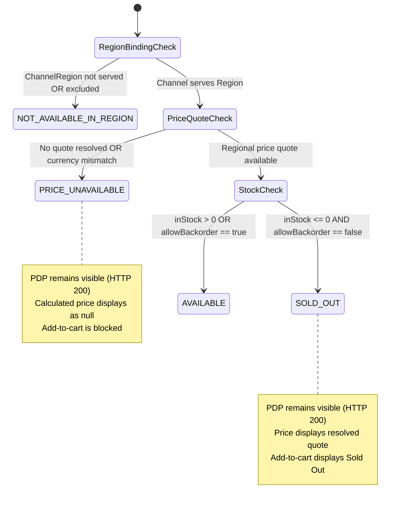

# Storefront API Cutover & Response Contract Refactoring
## Storefront Query · Sales Channel · Pricing

### Problem Statement:
Storefront browse endpoints accept unauthenticated `salesChannelId` query parameters, return legacy flat document responses with stale prices, and lack explicit commercial availability reason codes. When products run out of stock or lack regional pricing, they return misleading `0.00` amounts or ephemeral `404 Not Found` errors that degrade SEO ranking and break user bookmarks.

### Acceptance Criteria
- **AC-01 — Mandatory Key Header & Parameter Rejection:** Storefront product endpoints (`GET /api/v1/storefront-query/products` and `.../{slug}`) MUST require the `X-Publishable-Key` header; any request supplying legacy `salesChannelId` query parameters MUST be rejected with `400 Bad Request`.
- **AC-02 — Restructured BuyableOfferResponse Schema:** The response contract MUST cut over to the restructured schema exposing resolved market context (`salesChannelId`, `regionId`, `countryCode`, `currencyCode`, `locale`), presentation details, dynamic price ranges, and an array of contextual variants.
- **AC-03 — Variant Availability Precedence State Machine:** Each variant MUST report an explicit `availabilityStatus` determined strictly by the state machine precedence:
  $$\text{NOT\_AVAILABLE\_IN\_REGION} \rightarrow \text{PRICE\_UNAVAILABLE} \rightarrow \text{SOLD\_OUT} \rightarrow \text{AVAILABLE}$$
- **AC-04 — Dynamic Request-Time Price Ranges:** Product `minPrice` and `maxPrice` MUST be recalculated dynamically at request time from variants with valid regional quotes; if no variants are priced in the resolved currency, both values MUST be `null` (never `0.00`).
- **AC-05 — SEO Resilience & Stable PDP Access:** Products with depleted inventory or unpriced variants MUST remain accessible with `HTTP 200 OK` on direct PDP slug queries; only missing, deleted, or unpublished products return `404 OfferNotFound`.
- **AC-06 — HATEOAS Link Assembly & CDN Cache Isolation:** Collection navigation links MUST preserve `countryCode`, `locale`, and pagination parameters while omitting secret keys; responses MUST include `Cache-Control: no-store` to prevent CDN cross-region cache contamination.

### Commercial Availability States

| Status Code | Conditions | Customer Experience | Add to Cart |
| :--- | :--- | :--- | :--- |
| **`AVAILABLE`** | Region served, price quoted, in-stock (or backorder allowed). | Price displayed, ready to purchase. | Allowed |
| **`SOLD_OUT`** | Region served, price quoted, tracked inventory depleted (`<= 0`). | "Sold Out" badge displayed with price. | Blocked |
| **`PRICE_UNAVAILABLE`** | Region served, no price rule configured in market currency. | Price shown as null / unpriced. | Blocked |
| **`NOT_AVAILABLE_IN_REGION`** | Channel does not serve region or variant excluded. | "Not available in your country" badge. | Blocked |

### Related Specifications

#### Domain Specifications (if domain models, aggregate roots, or invariants change)
- [Publishable Key Domain Specification](../spec/domain/sales-channel/architecture/publishable-key-domain-spec.md)
- [Sales Channel Domain Specification](../spec/domain/sales-channel/architecture/sales-channel-domain-spec.md)
- [Region Domain Specification](../spec/domain/region/architecture/region-domain-spec.md)
- [Pricing Domain Specification](../spec/domain/pricing/architecture/pricing-domain-spec.md)

#### Workflow Specifications (if cross-domain business flows, choreography, or sagas change)
- [Browse and Discover Products Workflow](../spec/workflows/browse-and-discover-products-workflow.md)

#### Technical Specifications (if platform capabilities, read models, or security mechanisms change)
- [Shopping Context Resolution Tech Specification](../spec/system/shopping-context-resolution-tech-spec.md)
- [Batch Regional Pricing Tech Specification](../spec/system/batch-regional-pricing-tech-spec.md)
- [Storefront Query Tech Specification](../spec/system/storefront-query-tech-spec.md)
