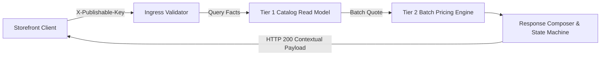

# Feature: Storefront API Cutover & Contract Refactoring

> **System Design:** [Multi-Regional Contextual Product Discovery](../system-design/001-multi_regional_contextual_discovery_system_design.md)

---

## 1. What & Why

### What does this feature do?

This feature establishes the public storefront query contract for product discovery. It composes Tier 1 catalog presentation facts with Tier 2 batch pricing results on the fly, enforces mandatory `X-Publishable-Key` header authentication while rejecting legacy query parameters, evaluates a 4-state variant availability precedence machine, dynamically derives price ranges, and returns stable HTTP 200 responses to protect search engine rankings.

### Why is it needed?

Passing `salesChannelId` as a query parameter exposes merchant channels to unauthorized discovery and scraping. Furthermore, returning binary 404 errors when inventory runs out or regional prices are unconfigured destroys SEO rankings and invalidates shopper bookmarks. A stable HTTP 200 contract with granular availability states ensures URL stability and provides a transparent shopping experience.

### What's in scope / out of scope?

| In Scope | Out of Scope |
|:---------|:-------------|
| Key-only authentication via `X-Publishable-Key` header | Materializing regional prices in search tables (covered in Feat 3) |
| Rejection of legacy `salesChannelId` query parameters with HTTP 400 | Ingress shopping-context resolution mechanics (covered in Feat 2) |
| Request-time dynamic composition of Tier 1 facts and Tier 2 prices | Event-driven catalog projection updates (covered in Feat 4) |
| 4-state availability state machine under HTTP 200 | Checkout workflows or payment processing |
| Dynamic calculation of `min_price` and `max_price` ranges | Direct database modifications to inventory or pricing rules |
| HAL link generation and `Cache-Control: no-store` caching policy | Shopping cart management |

---

## 2. Acceptance Criteria

> This feature is **done** when all criteria below pass. Each criterion must be testable — no vague language.

| # | Criteria | How to Verify |
|:--|:---------|:--------------|
| AC-1 | Product collection and slug endpoints MUST require `X-Publishable-Key` and reject any `salesChannelId` query parameter with 400, including empty or repeated values. | Automated REST API tests verifying header requirement and HTTP 400 rejection upon parameter tampering. |
| AC-2 | Offers MUST expose resolved market context, product facts, contextual variants, nullable decimal-string amounts, and boolean buyability without exposing credentials or internal domain objects. | Response schema validation tests asserting clean DTO structure and exclusion of sensitive identifiers. |
| AC-3 | Variants MUST evaluate unserved region, unavailable price, tracked stock exhaustion without backorder, then availability; untracked inventory MUST NOT be treated as sold out merely because quantity is zero. | State machine unit tests verifying the 4 states and untracked inventory flag handling. |
| AC-4 | Ranges MUST use valid quotes for visible variants in the resolved currency, including sold-out variants; no valid quotes MUST yield null ranges, and configured zero MUST remain a real price. | Price range derivation tests covering partial pricing, configured zero amounts, and unpriced items. |
| AC-5 | Visible sold-out, unpriced, and region-unavailable products MUST return 200; missing, deleted, unpublished, inactive, or otherwise invisible detail products MUST return 404. | HTTP status assertion tests against PDP endpoints across stock, pricing, and publication states. |
| AC-6 | Each nonempty served page or detail request MUST quote all distinct visible variants once at quantity one; empty pages and unserved regions MUST skip pricing. | Integration tests asserting Pricing Service invocation counts during browse page requests. |
| AC-7 | HAL links MUST preserve applicable market, filter, and pagination inputs without keys or legacy channel selectors; contextual responses MUST include `Cache-Control: no-store`. | Header and link generation assertions on paged collection responses. |
| AC-8 | Composition MUST NOT mutate source state or disguise provider outages as unpriced, sold-out, or missing products. | Fault injection tests verifying exception propagation and read-only behavior. |

---

## 3. Solution Design

### How does this feature work?

> Show the key architectural flow for this feature. This is the "zoomed-in" view of the relevant part of the System Design.

### Key Design Decisions

| Decision | Choice | Rationale |
|:---------|:-------|:----------|
| Storefront Availability Model | Stable HTTP 200 with granular availability states | Protects SEO indexing and shopper bookmarks from 404 drops when items temporarily sell out. |
| Ingress Authentication | Header-only `X-Publishable-Key` | Prevents token leakage in browser history, proxy access logs, and referral headers. |
| Cache Control | `Cache-Control: no-store` | Prevents CDN caches from serving wrong currency or regional price offers across geographic borders. |

---

## 4. Implementation Specifications

> These are the detailed blueprints developers code against. Each spec covers one aspect of this feature's implementation.

### Domain Specs (Data Models & Business Rules)

- None; this feature is an external query adapter and presentation composer.

### Workflow Specs (Process Flows)

- [Browse Contextual Storefront Offers](../spec/workflows/browse-contextual-storefront-offers-workflow.md)

### Tech Specs (Technology Decisions & Rules)

- [Storefront Contextual Cutover & Response Contract](../spec/system/storefront-contextual-cutover-tech-spec.md)
