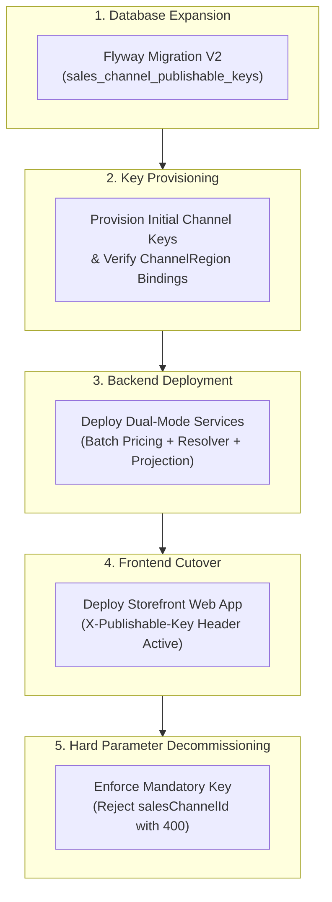

# Automated Verification & Zero-Downtime Rollout
## Storefront Query · Platform · Quality Assurance · Security

### Problem Statement:
Transitioning from single-channel static documents to multi-regional contextual discovery introduces cross-module dependencies, schema changes, and security boundaries. Releasing these changes without automated verification suites and a phased zero-downtime cutover strategy risks service downtime, token leaks, and broken storefront clients.

### Acceptance Criteria
- **AC-01 — Multi-Tenant Key Security Slice Tests:** Automated security slice tests MUST verify that raw tokens are never persisted or returned in lookups, SHA-256 digests are unique, and invalid or revoked keys uniformly yield generic `401 Unauthorized` responses without timing leaks.
- **AC-02 — Context Resolution Edge & Failure Suite:** Integration tests MUST verify context resolution edge conditions: omitted country resolving channel default, explicit country resolving settlement currency, unserved region returning `403 Forbidden`, and unknown country returning `422 Unprocessable Entity`.
- **AC-03 — Multi-Regional Quote & Dual-USD Isolation Suite:** Testcontainers integration tests MUST verify that Singapore requests resolve SGD quotes while Malaysia requests resolve MYR quotes for the same channel, and dual-USD regional markets evaluate independent pricing rules without crossover.
- **AC-04 — Spring Modulith Architectural Verification:** The test suite MUST execute `ApplicationModules.of(CommerceApplication.class).verify()` and assert zero cyclical dependencies, zero illegal package accesses, and compliant cross-module shared port usage.
- **AC-05 — Five-Stage Zero-Downtime Rollout Execution:** The release MUST proceed through the verified 5-stage deployment sequence:
  1. *Schema Migration*: Deploy Flyway V2 without downtime.
  2. *Key Provisioning*: Generate publishable keys for active Website and Marketplace channels.
  3. *Backend Dual-Mode*: Deploy contextual query and batch pricing capabilities.
  4. *Frontend Cutover*: Deploy storefront application configured with `X-Publishable-Key`.
  5. *Decommissioning*: Enforce mandatory key and reject legacy `salesChannelId` queries with 400.
- **AC-06 — Production Readiness & Recovery Checklist:** Pre-deployment verification MUST satisfy the R21 checklist, establish auditable baseline metrics, verify backward compatibility during the transitional window, and document compensation procedures before production traffic cutover.

### Verification Matrix & Release Gates

| Gate ID | Verification Scope | Test Tooling | Pass Condition |
| :--- | :--- | :--- | :--- |
| **V-01** | Publishable Key Cryptography | Unit / Hash Slice | SHA-256 digests verified; raw tokens never stored. |
| **V-02** | Context Resolution & Error Codes | MockMvc HTTP | 401 generic, 403 unserved, 422 unmapped, 400 legacy. |
| **V-03** | Multi-Region Quotes & Dual-USD | Testcontainers PostgreSQL | Clean market price isolation under same currency code. |
| **V-04** | Architectural Boundaries | Spring Modulith / ArchUnit | `ApplicationModules.verify()` passes with zero errors. |
| **V-05** | Zero-Downtime Rollout Sequence | Staging Pipeline | 5-stage execution verified without downtime or dropped reads. |

### Related Specifications

#### Domain Specifications (if domain models, aggregate roots, or invariants change)
- [Publishable Key Domain Specification](../spec/domain/sales-channel/architecture/publishable-key-domain-spec.md)
- [Sales Channel Domain Specification](../spec/domain/sales-channel/architecture/sales-channel-domain-spec.md)
- [Region Domain Specification](../spec/domain/region/architecture/region-domain-spec.md)
- [Pricing Domain Specification](../spec/domain/pricing/architecture/pricing-domain-spec.md)

#### Workflow Specifications (if cross-domain business flows, choreography, or sagas change)
- [Browse and Discover Products Workflow](../spec/workflows/browse-and-discover-products-workflow.md)
- [Default Sales Channel Provisioning Workflow](../spec/workflows/default-sales-channel-provisioning-workflow.md)

#### Technical Specifications (if platform capabilities, read models, or security mechanisms change)
- [Contextual Discovery Rollout Tech Specification](../spec/system/contextual-discovery-rollout-tech-spec.md)
- [Shopping Context Resolution Tech Specification](../spec/system/shopping-context-resolution-tech-spec.md)
- [Batch Regional Pricing Tech Specification](../spec/system/batch-regional-pricing-tech-spec.md)
