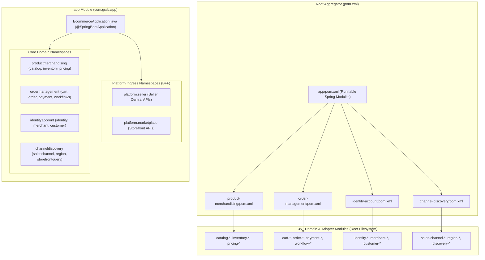

<!-- TEMPLATE INSTRUCTIONS
─────────────────────────────────────────────────────────────────
This document bridges the System Design (002) to implementation details
for Feature 1: Industrial Project Structure Organization & 4 Composite Service POMs.
─────────────────────────────────────────────────────────────────
-->

# Feature: Industrial Project Structure Organization & Runnable App Module

> **System Design:** [Ecommerce Platform Services and Domain Architecture System Design](../system-design/002-ecommerce_platform_services_and_domain_architecture_system_design.md)

---

## 1. What & Why

### What does this feature do?

This feature establishes an industrial, modular Maven project structure that replaces the monolithic `store` module with a clean runnable module named `app` (`grab/app`). It introduces **4 Composite Service POMs** (`product-merchandising`, `order-management`, `identity-account`, `channel-discovery`) at the repository root that group the 35+ fine-grained domain libraries into high-cohesion clusters. The new `app` module imports exclusively these 4 Composite POMs, and its internal Java code (`com.grab.app`) is organized into matching domain namespaces alongside dedicated Platform Ingress BFF namespaces (`platform.seller` and `platform.marketplace`).

### Why is it needed?

- **Direct Dependency Sprawl**: The legacy `store/pom.xml` directly imports 25+ domain modules, creating tight coupling and making it impossible to see or enforce boundaries between services.
- **Flat Package Sprawl**: Currently, 14 domain packages (`cart`, `catalog`, `customer`, `identity`, `inventory`, `merchant`, `order`, `payment`, `pricing`, `region`, `saleschannel`, `shared`, `storefrontquery`, `workflows`) live flat under `com.grab.store`, causing severe architectural erosion and preventing Spring Modulith from verifying domain isolation.
- **Safe Runnable Application Seam**: Introducing `app` as a clean, dedicated application runner decouples modern platform evolution from the legacy `store` module, providing a clean baseline for subsequent service-level database consolidation (Feature 2) and contract ports (Feature 3).

### What's in scope / out of scope?

| In Scope | Out of Scope |
|:---------|:-------------|
| Creation of 4 Composite Service POMs at root (`product-merchandising`, `order-management`, `identity-account`, `channel-discovery`). | Physically relocating or renaming the 35+ existing domain and adapter directories in the repository root. |
| Declaration of dependency aggregations in each Composite POM covering their respective domain, application, and persistence adapter modules. | Consolidating the 13 PostgreSQL databases and HikariCP connection pools (handled in [Feature 2](../features/feat_010-service-level-database-consolidation.md)). |
| Creation of the runnable `app` Maven module (`app/pom.xml`) depending solely on the 4 Composite POMs and core framework dependencies. | Defining Hexagonal Contract Port interfaces and immutable DTO records (handled in [Feature 3](../features/feat_011-four-core-domains-contract-ports.md)). |
| Implementation of `com.grab.app.EcommerceApplication` as the Spring Boot / Spring Modulith main entrypoint. | Implementing Seller Central and Marketplace BFF security filters and controllers (handled in Features 4 & 5). |
| Internal package organization under `com.grab.app`: `platform.seller`, `platform.marketplace`, `productmerchandising`, `ordermanagement`, `identityaccount`, `channeldiscovery`, and `shared`. | Deleting the legacy `store` module immediately (both coexist during the migration phase). |
| Spring Modulith architectural verification test (`ApplicationModularityTests.java`) validating zero cyclic dependencies across domain clusters. | Extracting domains into remote standalone microservices over network/gRPC. |
| Root `pom.xml` updates to register the 4 Composite POMs and `app` in the Maven reactor. | Modifying domain business entities or Flyway migration scripts. |

---

## 2. Acceptance Criteria

> This feature is **done** when all criteria below pass. Each criterion must be testable — no vague language.

| # | Criteria | How to Verify |
|:--|:---------|:--------------|
| **AC-1** | **Composite POM Aggregation**: The 4 Composite POMs (`product-merchandising/pom.xml`, `order-management/pom.xml`, `identity-account/pom.xml`, `channel-discovery/pom.xml`) build and aggregate all 35+ existing domain, application, and persistence-adapter libraries. | Run `mvn clean compile -pl product-merchandising,order-management,identity-account,channel-discovery` from root; build exits with `BUILD SUCCESS`. |
| **AC-2** | **App Module Dependency Isolation**: `app/pom.xml` declares dependencies **only** on the 4 Composite POMs (`product-merchandising`, `order-management`, `identity-account`, `channel-discovery`) and core framework libraries. Zero direct dependencies on individual domain modules (`cart-domain`, `catalog-application`, etc.) exist in `app/pom.xml`. | Inspect `app/pom.xml` and verify `mvn dependency:tree -pl app` shows all domain modules resolving transitively through the 4 composite POMs. |
| **AC-3** | **Runnable Main Application**: `com.grab.app.EcommerceApplication` initializes successfully with Spring Boot and Spring Modulith, serving as the runnable application entrypoint instead of `store`. | Run `mvn spring-boot:run -pl app` or execute `EcommerceApplicationTests`; the Spring application context starts up with `ActiveProfiles` and binds to the configured server port. |
| **AC-4** | **Domain & Platform Namespacing**: Code within `app/src/main/java/com/grab/app` is partitioned into 4 domain namespaces (`productmerchandising`, `ordermanagement`, `identityaccount`, `channeldiscovery`), 2 platform BFF namespaces (`platform.seller`, `platform.marketplace`), and `shared`. | Verify file tree structure under `app/src/main/java/com/grab/app` matches the Virtualized Layout in Section 3. |
| **AC-5** | **Spring Modulith Boundary Verification**: Automated architecture test `ApplicationModularityTests` runs `ApplicationModules.of(EcommerceApplication.class).verify()` and passes with 0 cyclic dependencies and 0 unauthorized cross-package references. | Execute `mvn test -Dtest=ApplicationModularityTests -pl app`; test suite passes without violations. |
| **AC-6** | **Root Maven Reactor Integrity**: Root `pom.xml` includes `<module>product-merchandising</module>`, `<module>order-management</module>`, `<module>identity-account</module>`, `<module>channel-discovery</module>`, and `<module>app</module>`. | Execute `mvn clean test-compile` from the root directory; all modules in the reactor compile successfully. |

---

## 3. Solution Design

### How does this feature work?



### Virtualized Monorepo File Layout

```text
grab-ecommerce/
├── pom.xml                                           # Root Parent & Aggregator POM
│
├── product-merchandising/                            # COMPOSITE SERVICE POM (Cluster 1)
│   └── pom.xml                                       # Aggregates: catalog-*, inventory-*, pricing-*
├── order-management/                                 # COMPOSITE SERVICE POM (Cluster 2)
│   └── pom.xml                                       # Aggregates: cart-*, order-*, payment-*, workflow-*
├── identity-account/                                 # COMPOSITE SERVICE POM (Cluster 3)
│   └── pom.xml                                       # Aggregates: identity-*, merchant-*, customer-*
├── channel-discovery/                                # COMPOSITE SERVICE POM (Cluster 4)
│   └── pom.xml                                       # Aggregates: sales-channel-*, region-*, discovery-*
│
├── app/                                              # RUNNABLE SPRING MODULITH APPLICATION (Replaces store)
│   ├── pom.xml                                       # Imports ONLY 4 Composite POMs + Framework
│   ├── src/main/resources/
│   │   ├── application.yml                           # Main Modulith configuration
│   │   └── application-local.yml
│   └── src/main/java/com/grab/app/
│       ├── EcommerceApplication.java                 # Spring Boot Main Entrypoint
│       │
│       ├── platform/                                 # PLATFORM INGRESS (BFF APIs)
│       │   ├── seller/                               # Seller Central BFF (Backs grab-web)
│       │   │   ├── controller/                       # /seller/v1/*
│       │   │   ├── security/                         # Merchant JWT & RBAC Context Filter
│       │   │   └── dto/                              # Seller-tailored DTOs
│       │   └── marketplace/                          # Marketplace Public BFF (Backs Storefronts)
│       │       ├── controller/                       # /store/v1/*
│       │       ├── security/                         # X-Publishable-Key (SHA-256) Filter
│       │       └── dto/                              # Storefront-tailored DTOs
│       │
│       ├── productmerchandising/                     # CORE DOMAIN 1: Product & Merchandising
│       │   ├── catalog/                              # Ingress config, controllers, event listeners
│       │   ├── inventory/
│       │   └── pricing/
│       │
│       ├── ordermanagement/                          # CORE DOMAIN 2: Order Management
│       │   ├── cart/
│       │   ├── order/
│       │   ├── payment/
│       │   └── workflows/
│       │
│       ├── identityaccount/                          # CORE DOMAIN 3: Identity & Accounts
│       │   ├── identity/
│       │   ├── merchant/
│       │   └── customer/
│       │
│       ├── channeldiscovery/                         # CORE DOMAIN 4: Channel & Discovery
│       │   ├── saleschannel/
│       │   ├── region/
│       │   └── storefrontquery/
│       │
│       └── shared/                                   # Shared web utilities, exceptions, outbox
│
├── store/                                            # LEGACY APPLICATION (Retained during migration)
│   └── ...
│
└── [35+ existing domain, app, and adapter modules remain in root]
```

### Key Design Decisions

| Decision | Choice | Rationale |
|:---------|:-------|:----------|
| **Runnable Module Name** | `app` (replacing `store`) | The term `store` conflates the application runner with a sales channel or storefront. `app` is the industry standard for the executable Spring Boot entrypoint in multi-module monorepos, clarifying that it runs the whole platform. |
| **Virtual Composite POMs vs Physical Relocation** | Virtual Composite POMs | Moving 35+ module folders into physical subfolders creates massive git churn, breaks active developer branches, and disrupts CI pipelines. Composite POMs deliver the exact same dependency encapsulation with zero filesystem movement. |
| **Coexistence Strategy** | Parallel `app` and `store` modules | Keeping `store` intact during initial construction allows verifying `app` incrementally without breaking ongoing development or regression testing. `store` will be deprecated and removed once traffic cuts over. |
| **Modularity Engine** | Spring Modulith | Spring Modulith validates package-level boundaries at test time, preventing unintended cross-domain imports before they reach production. |

---

## 4. Implementation Specifications

> Blueprints developers code against for this feature:

### Domain Specs (Data Models & Business Rules)

- none

### Workflow Specs (Process Flows)

- none

### Tech Specs (Technology Decisions & Rules)

- [Product & Merchandising Namespace Tech Spec](../spec/system/product-merchandising-namespace-tech-spec.md)
- [Order Management Namespace Tech Spec](../spec/system/order-management-namespace-tech-spec.md)
- [Identity & Accounts Namespace Tech Spec](../spec/system/identity-account-namespace-tech-spec.md)
- [Channel & Discovery Namespace Tech Spec](../spec/system/channel-discovery-namespace-tech-spec.md)
- [Transactional Outbox Tech Spec](../spec/system/transactional-outbox-tech-spec.md)
