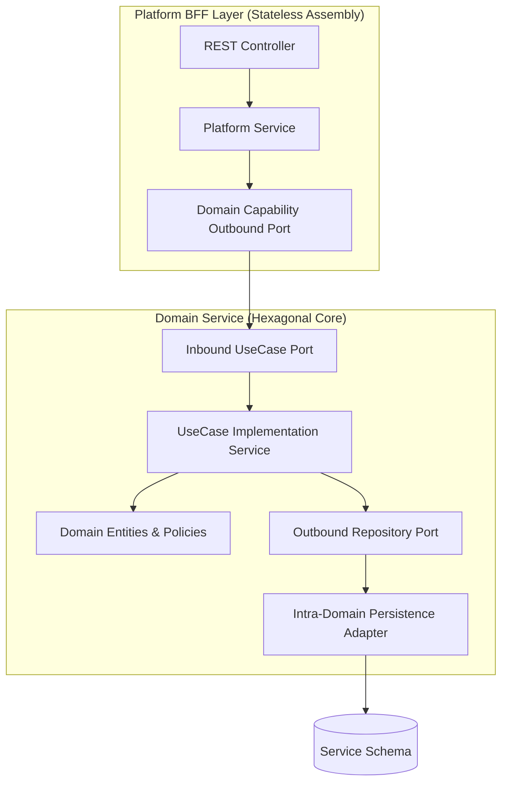

# Feature: Modular Hexagonal Package Structure

> **System Design:** [E-Commerce Service Architecture & Platform Modernization](../system-design/002-ecommerce_service_architecture_system_design.md)

---

## 1. What & Why

### What does this feature do?

This feature establishes an autonomous, hexagonal package structure for all e-commerce domain services (`catalog`, `order`, `account`, `channel`) and platform Backend-for-Frontend (BFF) layers (`sellercentral`, `marketplace`). It strictly isolates pure domain logic, application use cases, persistence adapters, and platform web assemblies, enabling independent scalability and clean future physical microservice extraction.

### Why is it needed?

Without rigid package boundaries, monolithic applications inevitably degrade into circular dependencies, cross-context bleeding, and framework lock-in. Enforcing hexagonal layering guarantees that domain business logic remains agnostic to Spring and JPA, persistence adapters remain strictly intra-domain, and platform BFFs interact only through explicit use cases and capability ports.

### What's in scope / out of scope?

| In Scope | Out of Scope |
|:---------|:-------------|
| Domain service grouping: `com.grab.app.catalog` (catalog, inventory, pricing) | Relational database schema isolation and connection pooling (covered in Feat 010) |
| Domain service grouping: `com.grab.app.order` (cart, order, payment) | Runtime bus dispatching and CQRS pipeline mechanics (covered in Feat 011) |
| Domain service grouping: `com.grab.app.account` (identity, merchant, customer) | Business domain entity attributes and state lifecycles (defined in Domain Specs) |
| Domain service grouping: `com.grab.app.channel` (saleschannel, region, discovery) | Physical Docker or Kubernetes deployment pipelines |
| Platform BFF layers: `com.grab.app.platform.seller` and `marketplace` (stateless, no persistence) | Infrastructure hosting and cloud network topologies |
| Standard hexagonal package conventions (`application`, `adapter.persistence`, `internal`, `port`) | Frontend React/Next.js client code |

---

## 2. Acceptance Criteria

| # | Criteria | How to Verify |
|:--|:---------|:--------------|
| AC-1 | Pure domain modules (`{domain}-domain`) MUST be completely framework-agnostic, containing zero Spring, JPA, or Jackson annotations. | Automated ArchUnit architecture test asserting forbidden package imports in all `*-domain` packages. |
| AC-2 | Application layers (`{domain}-application`) MUST expose inbound use case ports (`port/inbound/*UseCase`) and outbound ports (`port/outbound/*`), containing no persistence implementation logic. | ArchUnit package containment tests verifying that application interfaces do not reference JPA or persistence adapters. |
| AC-3 | Persistence adapter modules (`{domain}-adapter-persistence`) MUST only contain intra-domain persistence logic, JPA entities, and repository adapters; cross-domain repository imports MUST be prohibited. | ArchUnit tests ensuring persistence packages never import classes from other domain modules. |
| AC-4 | Platform BFF modules (`com.grab.app.platform.seller`, `marketplace`) MUST NOT contain any persistence packages (`adapter.persistence`) or direct database access. | Code structure linting and ArchUnit tests asserting that platform packages contain only application/web layers. |
| AC-5 | Cross-domain integration events MUST reside in published shared packages and be consumed via typed listeners; direct access to other modules' `internal/` packages MUST be rejected. | Spring Modulith module verification test (`@ApplicationModuleTests`) asserting clean boundary rules. |
| AC-6 | The root application boot module MUST assemble domain group services and platform BFFs without introducing circular compile-time dependencies. | Maven/Gradle multi-module build verification confirming dependency DAG without cycles. |

---

## 3. Solution Design

### How does this feature work?

> The diagram below illustrates the hexagonal separation of domain services and the stateless composition of platform BFF layers.

### Key Design Decisions

| Decision | Choice | Rationale |
|:---------|:-------|:----------|
| **Layering Model** | Hexagonal Architecture (Ports & Adapters) | Decouples business rules from database frameworks, web protocols, and infrastructure drivers. |
| **BFF Segregation** | Dedicated Platform Modules without Persistence | Ensures platform APIs aggregate capabilities tailored to user personas (seller vs shopper) without data storage coupling. |
| **Package Encapsulation** | Strict `internal/` Package Isolation | Hides implementation details and prevents other modules from bypassing public capability interfaces. |

---

## 4. Implementation Specifications

### Domain Specs (Data Models & Business Rules)

- None; this feature defines architectural package boundaries. Domain aggregates (e.g., Product, Cart, Order, Customer) are specified in their respective domain specifications under `grab/docs/spec/domain/`.

### Workflow Specs (Process Flows)

- None; package structure is a static architectural constraint.

### Tech Specs (Technology Decisions & Rules)

- [Hexagonal Modular Service Packaging Tech Spec](../spec/system/hexagonal-modular-service-packaging-tech-spec.md)
