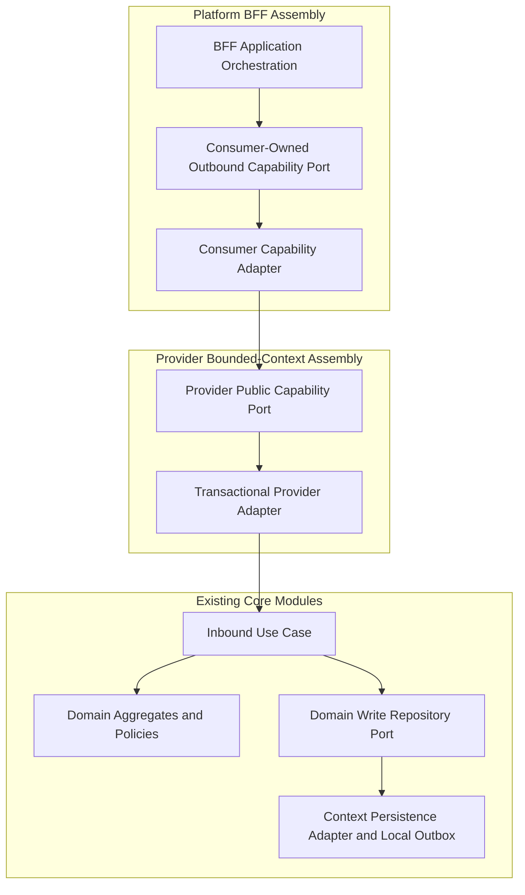

# Feature: Modular Hexagonal Package Structure

> **System Design:** [E-Commerce Service Architecture & Platform Modernization](../system-design/002-ecommerce_service_architecture_system_design.md)

---

## 1. What & Why

### What does this feature do?

This feature replaces the current `store` assembly with bootstrap in `com.grab.app`, context assemblies in `com.grab.app.<group>.<context>`, a dedicated cross-domain workflow context assembly in `com.grab.app.workflows`, and BFF assemblies in `com.grab.app.platform.seller` and `com.grab.app.platform.marketplace`. The four groups (`catalog`, `order`, `account`, `channel`) organize future deployments while existing domain, application, and persistence module packages remain unchanged.

The initial runtime remains a modular monolith. Every bounded context retains its own transaction and outbox ownership; physical extraction, rather than package restructuring alone, enables independent deployment and scaling.

### Why is it needed?

The current assembly couples startup, platform ingress, and context wiring. Explicit composition and verified context boundaries make later service-group extraction possible without moving business rules into transport or persistence infrastructure.

Grouping contexts MUST NOT permit cross-context repository access or merge their transaction managers and outboxes. Seller APIs and discovery remain the completed business capabilities in scope; this feature does not implement unfinished commerce workflows.

### What's in scope / out of scope?

| In Scope | Out of Scope |
|:---------|:-------------|
| Context assemblies under `com.grab.app.catalog` (catalog, inventory, pricing) | Relational schema allocation and connection configuration (covered in Feat 010) |
| Context assemblies under `com.grab.app.order` (cart, order, payment) | Runtime bus dispatching and CQRS pipeline implementation (covered in Feat 011) |
| Context assemblies under `com.grab.app.account` (identity, merchant, customer) | New business entities or unfinished business workflows |
| Context assemblies under `com.grab.app.channel` (saleschannel, region, discovery) | Physical Docker or Kubernetes deployments and data cutover |
| Workflow context assembly under `com.grab.app.workflows` (replaces `store/workflows`, preserving dedicated `workflowsTransactionManager` and outbox) | Infrastructure hosting and cloud network topologies |
| BFF assemblies `com.grab.app.platform.seller` and `com.grab.app.platform.marketplace` (stateless, communicating with workflows and domains via outbound ports) | Frontend implementation and changes to existing endpoint or payload contracts |
| Existing core domain/application/persistence packages and context-local `internal/`, `port/`, and `api/` boundaries | Implementing remote transport, transaction changes, or outbox delivery mechanics in this packaging feature |
| Bootstrap in `com.grab.app`, nested context discovery, and removal of the legacy `store` assembly | |

---

## 2. Acceptance Criteria

| # | Criteria | How to Verify |
|:--|:---------|:--------------|
| AC-1 | Pure domain modules MUST remain framework-agnostic and retain domain write repository ports; their packages MUST NOT acquire deployment-group prefixes. | ArchUnit forbidden-dependency checks and comparison of core package declarations before and after assembly migration. |
| AC-2 | Application modules MUST expose inbound use cases, intra-context query ports, and consumer-owned outbound capability ports without importing provider assembly implementations or persistence adapters. | ArchUnit checks on application imports and port ownership. |
| AC-3 | Persistence adapters MUST remain intra-context, retaining their existing core packages and accessing only owned tables and their context's outbox. | ArchUnit dependency checks and persistence ownership review covering repository/entity references. |
| AC-4 | BFF assemblies MUST NOT own persistence or domain transactions; controllers MUST delegate through CommandService/QueryService and assemblers. | ArchUnit checks for forbidden BFF persistence dependencies, transaction annotations, and controller injection types. |
| AC-5 | Cross-context calls MUST use published provider ports or integration events; provider adapters MUST delegate only to inbound use cases, and consumers MUST NOT import another context's `internal/` packages. | Modulith verification and ArchUnit checks covering consumer adapters, provider adapters, and named-interface dependencies. |
| AC-6 | Bootstrap in `com.grab.app` MUST compose groups and BFFs without business logic or cyclic module dependencies; core modules MUST NOT depend on bootstrap. | Maven dependency-graph checks and ArchUnit bootstrap dependency checks. |
| AC-7 | Module discovery MUST recognize each `com.grab.app.<group>.<context>` as a bounded-context boundary, including boundaries between contexts in the same group. | Assert the discovered module set and verify forbidden same-group dependencies are rejected; do not rely on an empty or group-only verification result. |
| AC-8 | The target assembly MUST replace the legacy `store` module and package references, including startup configuration, tests, and shared-contract imports. | Build/dependency inspection, source-reference checks excluding historical documentation, and application startup verification. |
| AC-9 | Assembly wiring MUST preserve a datasource, transaction manager, and distinct outbox table for each context; group membership MUST NOT merge these resources. | Spring context wiring assertions; transaction/outbox integration checks are specified and implemented through Features 010 and 011. |
| AC-10 | Shared integration contracts MUST have an explicit relocated public package, with `shared` remaining OPEN and cross-context link facades exposed through owner `api` named interfaces. | Modulith named-interface checks, contract import checks, and compatibility review of persisted event type identifiers before relocation. |
| AC-11 | An extraction-ready group assembly MUST load with its selected contexts and explicit external capability/event adapters without loading unrelated groups. | Focused startup test using external adapter substitutes and assertions on loaded context beans and module dependencies. |
| AC-12 | Cross-domain workflows MUST reside in the dedicated `com.grab.app.workflows` context assembly with their own transaction manager and outbox; Platform BFFs MUST communicate with workflows strictly through outbound port interfaces without owning workflow state. | ArchUnit checks verifying no workflow persistence or engine beans inside platform BFFs, and verifying BFF controllers invoke workflows through outbound ports. |

---

## 3. Solution Design

### How does this feature work?

> Bootstrap composes grouped context assemblies and stateless BFFs; core domain, application, and persistence modules retain their existing packages. The diagram shows the capability boundary after BFF HTTP/CQRS dispatch, not a controller-to-port shortcut.

For HTTP ingress, controllers delegate to CommandService/QueryService, the local bus, and a handler before application orchestration. For shared-interface ingress, the provider adapter begins the provider context's transaction and invokes its use case directly; it does not dispatch the provider bus, and BFF orchestration does not open a domain transaction around the call.

Within `com.grab.app.<group>.<context>`, public capability interfaces live in `port/`, provider adapters in `internal/api/adapter/`, consumer adapters in `internal/adapter/`, and public HATEOAS facades in `api/`. Shared integration events target `com.grab.app.shared.events.<context>` with `com.grab.app.shared` remaining OPEN; core domain events stay in their domain modules.

The bootstrap and module-verification configuration MUST explicitly discover nested contexts and platform modules. Group package nesting is organizational and MUST NOT bypass context-level dependency checks; configuration for an extracted group must select only its own contexts and explicit external adapters.

For the product/discovery interaction, catalog persistence commits product state and its outbox record atomically, and discovery updates its projection in an independent transaction. Features 010 and 011 must verify producer rollback, discovery failure recovery, and duplicate delivery; later remote transport must preserve these boundaries without requiring changes to domain logic.

### Key Design Decisions

| Decision | Choice | Rationale |
|:---------|:-------|:----------|
| **Layering Model** | Preserve Existing Hexagonal Core Modules | Keeps domain write repositories in domain, use cases/query ports in application, and persistence implementations outside both. |
| **Bootstrap & Grouping** | `com.grab.app` Bootstrap with `com.grab.app.<group>.<context>` Assemblies | Replaces the current `store` assembly while separating deployment composition from core package identity. |
| **BFF Segregation** | Stateless `seller` and `marketplace` Assemblies | Provides client-specific APIs without domain persistence ownership or direct provider implementation dependencies. |
| **Workflow Context Encapsulation** | Dedicated `com.grab.app.workflows` Context with Port Interfaces | Separates multi-domain saga orchestration, checkpoints, and outbox state from stateless BFFs; BFFs trigger workflows via outbound ports without acquiring transaction ownership. |
| **Package Encapsulation** | Context-Level `internal/` Boundaries and Published Contracts | Keeps contexts independently verifiable even when they belong to the same future service group. |
| **Transaction & Outbox Ownership** | One Owner per Bounded Context | Allows contexts to share hosting or schemas without acquiring cross-context atomicity assumptions. |
| **Extraction Strategy** | Separate Boot Assemblies and Replaceable Transport Adapters | Prepares group extraction while leaving remote delivery, operational isolation, and data cutover to explicit later work. |

---

## 4. Implementation Specifications

### Domain Specs (Data Models & Business Rules)

- None

### Workflow Specs (Process Flows)

- None; package structure is a static architectural constraint.

### Tech Specs (Technology Decisions & Rules)

- [Hexagonal Modular Service Packaging Tech Spec](../spec/system/hexagonal-modular-service-packaging-tech-spec.md)