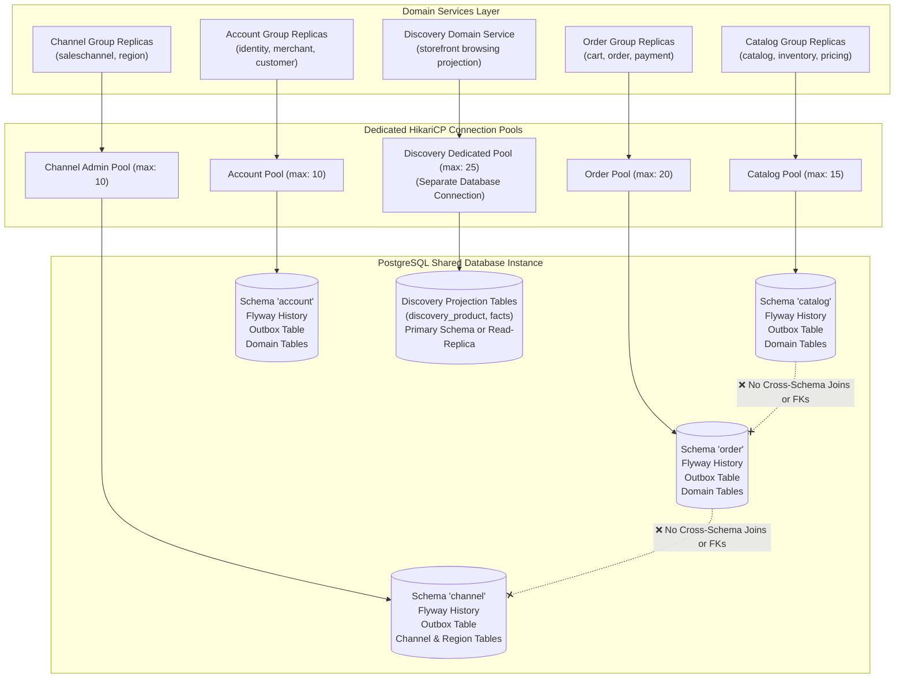

# Feature: Multi-Schema Database Isolation & Connection Budgeting

> **System Design:** [E-Commerce Service Architecture & Platform Modernization](../system-design/002-ecommerce_service_architecture_system_design.md)

---

## 1. What & Why

### What does this feature do?

This feature establishes multi-schema database isolation and connection pool budgeting across domain services on a shared database instance. Domain services within the `catalog` (`catalog`, `inventory`, `pricing`), `order` (`cart`, `order`, `payment`), and `account` (`identity`, `merchant`, `customer`) groups share their respective group schemas (`catalog`, `"order"`, `account`). In the `channel` group, `saleschannel` and `region` share schema `'channel'`, while the `discovery` domain service utilizes a dedicated separate database connection (`DiscoveryHikariPool`) for search projections. Furthermore, it enforces exclusive table ownership, zero cross-schema foreign keys or joins, and strict mathematical connection budgeting across service replicas and rolling deployments.

### Why is it needed?

In a shared monolithic database, a spike in traffic or an unindexed query in one module (such as search or catalog browsing) can consume all available database connections, starving critical transactional write flows like order placement and payments. Moreover, without schema boundaries and dedicated migration streams, database tables become tightly coupled through cross-context joins and foreign keys, preventing zero-downtime schema evolution and independent service migration.

### What's in scope / out of scope?

| In Scope | Out of Scope |
|:---------|:-------------|
| Dedicated schemas: `catalog`, `"order"` (quoted SQL identifier), `account`, `channel` | Automated physical database instance provisioning (Terraform / Cloud SQL) |
| Shared schema pooling for `catalog`, `order`, `account`, and `channel` (admin) | Automated database replication and read-replica routing |
| Dedicated separate database connection and pool (`DiscoveryHikariPool`) for `discovery` | Business aggregate data migration scripts between legacy and new schemas |
| Isolated Flyway migration history tables (`flyway_schema_history`) per schema | Application-level caching (Redis cache invalidation strategies) |
| Mathematical connection budgeting formula (accounting for replicas & rolling deployments) | Business entity schema definitions (managed in domain migrations) |
| Prohibition of cross-schema joins, foreign keys, and distributed transactions | NoSQL or document store configuration |
| Atomic transactional outbox table persistence within each service's local transaction | Frontend React / Next.js client state |

---

## 2. Acceptance Criteria

| # | Criteria | How to Verify |
|:--|:---------|:--------------|
| AC-1 | Domain services in `catalog`, `order`, and `account` groups MUST share their respective group schemas (`catalog`, `"order"`, `account`); in `channel`, `saleschannel` and `region` MUST share schema `'channel'`. | Spring context startup tests verifying persistence unit configurations and schema assignments. |
| AC-2 | The `discovery` domain service in the `channel` group MUST configure a dedicated separate database connection (`DiscoveryHikariPool`), isolating search queries from administrative channel connections. | Datasource configuration test verifying distinct `DataSource` and `HikariPool` bean instances for channel and discovery. |
| AC-3 | The schema name `"order"` MUST be enclosed in quoted identifiers in all configuration and Flyway migration scripts to prevent SQL syntax collisions with the SQL reserved keyword `ORDER`. | Database initialization and Flyway migration integration tests against PostgreSQL. |
| AC-4 | Each schema MUST execute its own isolated Flyway migration pipeline with a dedicated history table (e.g., `flyway_schema_history` inside its own schema). | Testcontainers PostgreSQL integration tests verifying independent migration execution. |
| AC-5 | Foreign keys, joins, and database-level constraints across schemas MUST NOT exist; relationships across bounded contexts MUST be maintained via identifier references only. | Automated PostgreSQL schema linting script asserting zero cross-schema foreign keys in `information_schema`. |
| AC-6 | Total budgeted database connections across all service replicas and rolling deployment overlaps MUST NOT exceed the maximum server connection limit minus operational reserves. | Configuration validation test enforcing max connection budget formula: $\sum (N_{\text{replicas}} \times 2 \times \text{poolSize}) \le \text{MaxDBConnections} - \text{Reserve}$. |
| AC-7 | Every transactional outbox entry MUST be written to the service's own outbox table within the same local database transaction as the business aggregate state mutation. | Transaction rollback integration tests verifying that if aggregate persistence fails, the outbox record is also rolled back. |
| AC-8 | Overriding a service's database URL or credentials MUST NOT require configuration changes in any other domain service. | Configuration isolation test spinning up an individual domain service targeting an override database URL. |

---

## 3. Solution Design

### How does this feature work?

> The diagram below shows domain service groups sharing schemas on the shared PostgreSQL instance, with `discovery` operating on a dedicated separate database connection pool.

### Key Design Decisions

| Decision | Choice | Rationale |
|:---------|:-------|:----------|
| **Database Architecture** | Schema-per-Service Group on Shared Database Instance | Provides logical isolation and zero-downtime migration readiness while minimizing initial database hosting costs. |
| **Discovery Connection Isolation** | Dedicated Separate Connection (`DiscoveryHikariPool`) | Prevents public storefront browsing and search spikes from exhausting connections needed for channel administration and key rotation. |
| **Configuration Hierarchy** | Two-Tier Group Defaults with Per-Domain Overrides | Domain services share group schemas by default, but allow any domain to override its connection, schema, or physical instance. |
| **Connection Pooling** | Independent HikariCP Pools per Service / Override | Prevents connection pool starvation; a traffic burst in catalog browsing cannot exhaust checkout database connections. |
| **Migration Management** | Isolated Flyway Streams per Schema | Allows teams to evolve and migrate service schemas independently without blocking or synchronizing with other teams. |
| **Cross-Context Integrity** | ID References Only (No DB Foreign Keys) | Enforces autonomous service boundaries and ensures services can be physically split into distinct databases without schema refactoring. |

---

## 4. Implementation Specifications

### Domain Specs (Data Models & Business Rules)

- None; this feature governs relational infrastructure and connection pooling. Aggregate data structures are specified in module-level domain specifications.

### Workflow Specs (Process Flows)

- None; database connection management and migration executions are platform infrastructure mechanisms.

### Tech Specs (Technology Decisions & Rules)

- [Multi-Schema Database Isolation & Connection Budgeting Tech Spec](../spec/system/multi-schema-database-isolation-tech-spec.md)
- [Catalog Service Group Persistence Tech Spec](../spec/system/catalog-service-group-persistence-tech-spec.md)
- [Order Service Group Persistence Tech Spec](../spec/system/order-service-group-persistence-tech-spec.md)
- [Account Service Group Persistence Tech Spec](../spec/system/account-service-group-persistence-tech-spec.md)
- [Channel Service Group Persistence Tech Spec](../spec/system/channel-service-group-persistence-tech-spec.md)
