<!-- TEMPLATE INSTRUCTIONS
─────────────────────────────────────────────────────────────────
This document bridges the System Design (002) to implementation details
for Feature 2: Service-Level Database & Connection Pool Consolidation in Spring Modulith.
─────────────────────────────────────────────────────────────────
-->

# Feature: Service-Level Database & Connection Pool Consolidation in Spring Modulith

> **System Design:** [Ecommerce Platform Services and Domain Architecture System Design](../system-design/002-ecommerce_platform_services_and_domain_architecture_system_design.md)

---

## 1. What & Why

### What does this feature do?

This feature consolidates the legacy 13 independent PostgreSQL databases and 13 HikariCP connection pools into **4 Core Service Cluster Databases & Connection Pools** (`product_merchandising`, `order_management`, `identity_account`, and `channel_discovery`) in the runnable `app` module. 

Critically, it implements the **"Shared-by-Default with Dedicated-Override"** persistence architecture:
1. **Default Mode (Modular Monolith)**: Domains belonging to a cluster (e.g., `catalog`, `inventory`, and `pricing` under `product_merchandising`) share a single optimized HikariCP connection pool and PostgreSQL database instance, isolated via private PostgreSQL schemas (`catalog`, `inventory`, `pricing`) and dedicated Flyway migration history tables.
2. **Dedicated Override Mode (Selective Scale / Microservice Extraction)**: Any individual domain can be declaratively reconfigured via environment properties (e.g., `INVENTORY_DATASOURCE_DEDICATED=true` and `INVENTORY_DATASOURCE_URL=...`) to point to an independent database instance and dedicated connection pool without changing any Java entity mappings or business logic.

### Why is it needed?

- **Connection Pool Saturation**: Running 13 separate Hikari pools in a single JVM consumes up to 130 active connections ($13 \times 10$). Standard PostgreSQL configurations default to a `max_connections` limit of 100; during horizontal pod autoscaling or traffic bursts, database connections are immediately exhausted.
- **Resource & Memory Waste**: Maintaining 13 separate connection pools leads to excessive idle connection threads, buffer allocations, and connection validation overhead in the JVM.
- **Microservice Extraction Alignment**: In microservice evolution, services are not split into 13 micro-apps; they are split into cohesive service groups (Product Merchandising, Order Management, Identity, Discovery). Grouping data storage at this service cluster level aligns the database topology with the target microservice boundaries.
- **Zero Cross-Domain Joins**: Consolidating to 4 database instances while strictly enforcing private PostgreSQL schemas and banning cross-schema foreign keys provides the sweet spot: high hardware efficiency today with guaranteed zero-friction microservice extraction tomorrow.

### What's in scope / out of scope?

| In Scope | Out of Scope |
|:---------|:-------------|
| Configuration of 4 shared HikariCP connection pools in `app` (`product_merchandising`, `order_management`, `identity_account`, `channel_discovery`). | Physically modifying entity definitions (`@Entity`) or Spring Data repository interfaces in the 35+ domain libraries. |
| PostgreSQL schema namespacing for table isolation (`catalog`, `inventory`, `pricing`, `cart`, `order`, etc.). | Distributed two-phase commit (2PC / XA) transactions across domains (handled asynchronously via Transactional Outbox). |
| Declarative per-domain datasource override mechanism (`@ConditionalOnProperty` / `ObjectProvider<DataSource>` and hierarchical YAML properties). | Cross-schema foreign keys or SQL joins (strictly forbidden by architectural rules and ArchUnit verification). |
| Independent Flyway migration history tables (`flyway_schema_history_<domain>`) per domain namespace. | Modifying domain business logic or REST controllers. |
| Unified `JpaTransactionManager` and `EntityManagerFactory` configurations per cluster with conditional routing. | Extracting domains into remote standalone microservices over network/gRPC. |
| Docker Compose infrastructure updates providing the consolidated PostgreSQL database instances and schemas. | Altering frontend or Platform Ingress BFF controllers. |
| Integration tests validating schema isolation, migrations, and dedicated override behavior using Testcontainers. | |

---

## 2. Acceptance Criteria

> This feature is **done** when all criteria below pass. Each criterion must be testable — no vague language.

| # | Criteria | How to Verify |
|:--|:---------|:--------------|
| **AC-1** | **Connection Pool Consolidation**: In default mode, the runnable `app` initializes exactly 4 HikariCP connection pools (one per cluster: `HikariPool-ProductMerchandising`, `HikariPool-OrderManagement`, `HikariPool-IdentityAccount`, `HikariPool-ChannelDiscovery`), reducing baseline connections from 130 down to 40–80 total. | Inspect HikariCP JMX/actuator metrics at `/actuator/metrics/hikaricp.connections.idle` and verify only 4 active pools are registered during standard application startup. |
| **AC-2** | **PostgreSQL Schema Isolation**: Within each consolidated database instance, tables are partitioned into isolated PostgreSQL schemas matching their domain name (e.g. `catalog.products`, `inventory.stock_levels`, `pricing.price_lists`). Zero tables reside in the default `public` schema. | Inspect PostgreSQL `information_schema.tables` after startup; verify tables are strictly partitioned into schemas `catalog`, `inventory`, `pricing`, `cart`, `order`, `payment`, `workflows`, `identity`, `merchant`, `customer`, `saleschannel`, `region`, and `discovery`. |
| **AC-3** | **Zero Cross-Schema Foreign Keys**: Foreign keys across domain schemas (e.g. from `pricing.price_lists` to `catalog.products`) are strictly forbidden and non-existent. | Query `information_schema.table_constraints` for foreign key relationships; verify 0 constraints span across distinct database schemas. |
| **AC-4** | **Domain-Specific Database Overridability**: Any subdomain (e.g., `inventory`) can be configured via environment properties (`INVENTORY_DATASOURCE_DEDICATED=true`, `INVENTORY_DATASOURCE_URL=...`) to route to an independent database instance and connection pool without code modifications. | Execute integration test `DedicatedDataSourceOverrideIntegrationTest`; verify `inventory` operations execute against an independent containerized database instance while `catalog` and `pricing` remain on the shared instance. |
| **AC-5** | **Independent Flyway Versioning**: Each domain executes its Flyway migrations using an independent schema history table (e.g., `flyway_schema_history_catalog`, `flyway_schema_history_inventory`), allowing isolated rollouts and independent migration versioning. | Query PostgreSQL schema for history tables; verify each schema contains its own isolated `flyway_schema_history_<domain>` table with successful migration records. |
| **AC-6** | **Transactional Boundary Autonomy**: Each domain operations run inside their respective local `JpaTransactionManager`. Outbox events are persisted atomically within the local transaction, with zero dependency on distributed XA transactions. | Run domain write integration tests (e.g., product creation with outbox publication); verify local commits succeed atomically and outbox entries are generated. |
| **AC-7** | **Docker Compose Environment Alignment**: Local `docker-compose.yml` provisions the 4 consolidated PostgreSQL databases with automated schema initialization scripts. | Run `docker compose up -d`; verify all 4 database instances (`grab-product-db`, `grab-order-db`, `grab-identity-db`, `grab-channel-db`) become healthy and accessible. |

---

## 3. Solution Design

### How does this feature work?

```mermaid
flowchart TD
    subgraph AppRunner ["Runnable Application: app (com.grab.app)"]
        subgraph Cluster1 ["1. Product & Merchandising Cluster"]
            PM_DS["Shared HikariCP Pool<br/>(productMerchandisingSharedDataSource)"]
            Inv_Dedicated["Conditional Dedicated Pool<br/>(inventoryDedicatedDataSource)"]
            
            Cat_EMF["Catalog EMF<br/>(schema: catalog)"]
            Prc_EMF["Pricing EMF<br/>(schema: pricing)"]
            Inv_EMF["Inventory EMF<br/>(schema: inventory)"]
        end

        subgraph Cluster2 ["2. Order Management Cluster"]
            OM_DS["Shared HikariCP Pool<br/>(orderManagementSharedDataSource)"]
            Cart_EMF["Cart EMF"]
            Order_EMF["Order EMF"]
            Pay_EMF["Payment EMF"]
            Wf_EMF["Workflows EMF"]
        end

        subgraph Cluster3 ["3. Identity & Accounts Cluster"]
            IA_DS["Shared HikariCP Pool<br/>(identityAccountSharedDataSource)"]
            Id_EMF["Identity EMF"]
            Merch_EMF["Merchant EMF"]
            Cust_EMF["Customer EMF"]
        end

        subgraph Cluster4 ["4. Channel & Discovery Cluster"]
            CC_DS["Channel Context Pool<br/>(channelContextDataSource)"]
            Disc_DS["Discovery Dedicated Pool<br/>(discoveryProductDataSource)"]
            Chan_EMF["SalesChannel EMF"]
            Reg_EMF["Region EMF"]
            Disc_EMF["DiscoveryProduct EMF"]
        end
    end

    subgraph DatabaseTier ["PostgreSQL Infrastructure Tier"]
        DB_PM[("product_merchandising DB<br/>Schemas: catalog, pricing")]
        DB_INV[("dedicated_inventory DB<br/>(Optional Dedicated Instance)")]
        DB_OM[("order_management DB<br/>Schemas: cart, order, payment, workflows")]
        DB_IA[("identity_account DB<br/>Schemas: identity, merchant, customer")]
        DB_CC[("channel_context DB<br/>Schemas: saleschannel, region")]
        DB_DISC[("discovery DB<br/>(Dedicated for DiscoveryProduct Aggregate)")]
    end

    Cat_EMF --> PM_DS
    Prc_EMF --> PM_DS
    Inv_EMF -.->|"Default Mode"| PM_DS
    Inv_EMF ==>|"Dedicated Override Mode"| Inv_Dedicated

    PM_DS --> DB_PM
    Inv_Dedicated ==> DB_INV

    Cart_EMF --> OM_DS
    Order_EMF --> OM_DS
    Pay_EMF --> OM_DS
    Wf_EMF --> OM_DS
    OM_DS --> DB_OM

    Id_EMF --> IA_DS
    Merch_EMF --> IA_DS
    Cust_EMF --> IA_DS
    IA_DS --> DB_IA

    Chan_EMF --> CC_DS
    Reg_EMF --> CC_DS
    CC_DS --> DB_CC

    Disc_EMF ==> Disc_DS
    Disc_DS ==> DB_DISC
```

---

### Domain to Cluster Mapping & Schema Partitioning

| Core Domain Cluster | Grouped Sub-Domains | Target PostgreSQL Database | Isolated PostgreSQL Schemas | Dedicated Flyway Table |
|:--------------------|:--------------------|:---------------------------|:----------------------------|:-----------------------|
| **1. Product & Merchandising** | `catalog`, `inventory`, `pricing` | `product_merchandising` | `catalog`, `inventory`, `pricing` | `flyway_schema_history_catalog` `flyway_schema_history_inventory` `flyway_schema_history_pricing` |
| **2. Order Management** | `cart`, `order`, `payment`, `workflows` | `order_management` | `cart`, `order`, `payment`, `workflows` | `flyway_schema_history_cart` `flyway_schema_history_order` `flyway_schema_history_payment` `flyway_schema_history_workflows` |
| **3. Identity & Accounts** | `identity`, `merchant`, `customer` | `identity_account` | `identity`, `merchant`, `customer` | `flyway_schema_history_identity` `flyway_schema_history_merchant` `flyway_schema_history_customer` |
| **4. Channel & Discovery** | `saleschannel`, `region` *and* **`discoveryProduct`** | **`channel_context`** (for `saleschannel` & `region`) *and* **`discovery`** (Dedicated for `discoveryProduct`) | `saleschannel`, `region` *and* `discovery` | `flyway_schema_history_saleschannel` `flyway_schema_history_region` `flyway_schema_history_discovery` |

---

### Key Design Decisions

| Decision | Choice | Rationale |
|:---------|:-------|:----------|
| **Consolidation Target** | 4 Service Cluster Databases (instead of 1 Monolithic DB or 13 fine-grained DBs) | Matches industry-standard domain clustering (Product Merchandising, Order Management, Identity, Discovery). Reduces connection overhead by 65% while keeping failure blast radius strictly partitioned. |
| **Table Separation Mechanism** | PostgreSQL Schema Namespacing (`schema = "..."`) | Isolates tables cleanly within the database instance. Prevents table naming collisions (e.g. `catalog.items` vs `order.items`) and eliminates cross-domain foreign key risks without incurring the infrastructure overhead of 13 separate databases. |
| **Override Mechanism** | Spring `@ConditionalOnProperty` + `ObjectProvider<DataSource>` | Allows zero-code switching between shared cluster pool and dedicated instance. If a high-volume domain like `inventory` requires a dedicated AWS RDS instance, it can be spun up purely through configuration. |
| **Flyway Schema History** | Independent History Table per Domain (`flyway_schema_history_<domain>`) | Ensures Flyway migrations for different subdomains remain completely independent and can be applied or rolled back without locking or contaminating another domain's migration log. |
| **Cross-Domain Consistency** | Transactional Outbox + Eventual Consistency (No XA / 2PC) | Avoids distributed locking and high-latency two-phase commit overhead. Domains commit changes locally to their own schema/database and dispatch integration events asynchronously. |

---

## 4. Implementation Specifications

> Blueprints developers code against for this feature:

### Domain Specs (Data Models & Business Rules)

- none

### Workflow Specs (Process Flows)

- none

### Tech Specs (Technology Decisions & Rules)

- [Service-Level Database Consolidation Tech Spec](../spec/system/service-level-database-consolidation-tech-spec.md)
- [Product & Merchandising Database Tech Spec](../spec/system/product-merchandising-database-tech-spec.md)
- [Order Management Database Tech Spec](../spec/system/order-management-database-tech-spec.md)
- [Identity & Accounts Database Tech Spec](../spec/system/identity-account-database-tech-spec.md)
- [Channel & Discovery Database Tech Spec](../spec/system/channel-discovery-database-tech-spec.md)
- [Transactional Outbox Tech Spec](../spec/system/transactional-outbox-tech-spec.md)

