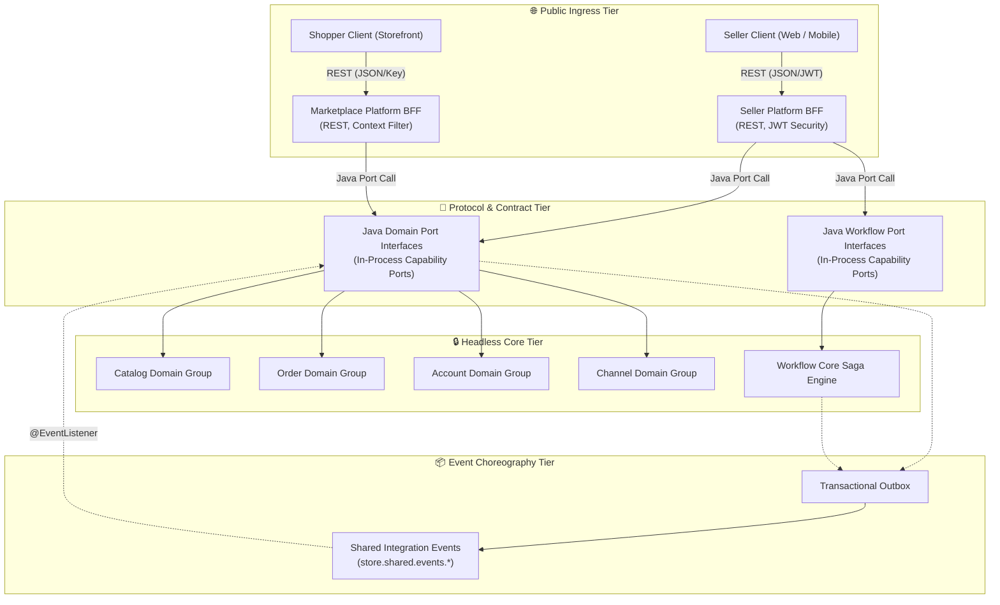

# Feature: BFF-to-Domain Communication Protocol & Controller Contract Migration

> **System Design:** [Service Communication & Protocol System Design](../system-design/003-service_communication_and_protocol_system_design.md)

---

## 1. What & Why

### What does this feature do?

This feature establishes a standardized, decoupled communication protocol across the platform ingress layers and core business services. It extracts HTTP REST controllers out of internal domain and workflow packages into dedicated Platform Backend-for-Frontend (BFF) layers—**Seller Platform BFF** and **Marketplace Platform BFF**. In their place, core domain services (`catalog`, `order`, `account`, `channel`) and the **Workflow Core** engine expose pure, framework-agnostic **Java port interfaces** (`port.message`). 

These port interfaces provide high-speed, zero-latency in-process execution while establishing an explicit, framework-agnostic capability contract between platform ingress and headless core domain services. Cross-service asynchronous side-effects are decoupled using the Transactional Outbox pattern and centralized integration events in the shared module.

### Why is it needed?

Exposing HTTP REST controllers directly from domain persistence packages couples domain business logic to Spring WebMvc, Jackson serialization annotations, and HTTP transport concerns. This prevents headless domain testing, creates duplicated and fragmented route security, leads to client-side network chatty-ness, and makes extracting domain groups or the workflow engine into independent microservices virtually impossible without rewriting the entire codebase. Decoupling ingress presentation from core execution via port interfaces and outbox events establishes strict architectural boundaries and protects domain integrity.

### What's in scope / out of scope?

| In Scope | Out of Scope |
|:---------|:-------------|
| Moving REST controllers from domain packages into dedicated Platform BFFs (`Seller Platform BFF` and `Marketplace Platform BFF`) | Frontend React / Next.js web application UI implementation |
| Inbound Java port interfaces (`com.grab.app.{group}.{domain}.port.message`) for core domains | Physical Kubernetes cluster ingress controller / service mesh provisioning |
| Inbound saga port interfaces (`com.grab.app.workflow.port.message`) for workflow execution | Direct schema-level DDL migrations (governed by persistence isolation) |
| Inbound adapters translating port invocations to isolated domain `CommandBus` / `QueryBus` | Modifying aggregate business rules or entity lifecycle states |
| Centralized security configuration at BFF perimeters (`SellerSecurityConfig`, `MarketplaceSecurityConfig`) | Third-party payment gateway integration implementation |
| Inbound message adapters with MapStruct mappers translating port DTOs to CQRS records | Remote RPC frameworks and network service mesh runtime infrastructure |
| Transactional Outbox integration event contracts under `com.grab.store.shared.events.{module}` | External CDN caching infrastructure deployment |

---

## 2. Acceptance Criteria

> This feature is **done** when all criteria below pass. Each criterion is strictly testable.

| # | Criteria | How to Verify |
|:--|:---------|:--------------|
| AC-1 | Core domain packages (`catalog`, `order`, `account`, `channel`) and Workflow Core (`workflow`) MUST NOT import or contain any Spring MVC REST controller annotations (`@RestController`, `@RequestMapping`, `@GetMapping`, `@PostMapping`). | Architecture test via ArchUnit asserting zero Spring WebMvc imports within core domain and workflow packages. |
| AC-2 | All external merchant HTTP REST endpoints MUST be hosted exclusively within the Seller Platform BFF (`com.grab.app.platform.seller`) and enforce centralized JWT authentication and authorization (`SellerSecurityConfig`). | MockMvc integration test against `/api/seller/**` asserting 401 Unauthorized for unauthenticated requests and 200/201 for valid JWT bearer tokens. |
| AC-3 | All external shopper HTTP REST endpoints MUST be hosted exclusively within the Marketplace Platform BFF (`com.grab.app.platform.marketplace`) and enforce edge shopping context and publishable key validation. | MockMvc integration test against `/api/marketplace/**` verifying header validation (`X-Sales-Channel-Key`, `X-Region-Id`) and storefront response wrapping. |
| AC-4 | Domain group services MUST expose all synchronous capabilities through pure Java port interfaces (`com.grab.app.{group}.{domain}.port.message`) using immutable record parameter and response types without web annotations. | Compilation inspection and unit tests verifying that port interfaces have zero dependencies on `org.springframework.web` and use Java `record` types exclusively. |
| AC-5 | Workflow saga executions MUST be triggered and queried exclusively via `com.grab.app.workflow.port.message` interfaces, decoupling workflow orchestration from HTTP endpoints. | Unit and integration tests executing saga workflows through port message interfaces without invoking HTTP endpoints. |
| AC-6 | Inbound port adapters in domain groups MUST translate port calls into CQRS commands/queries and route them to their isolated service `CommandBus` or `QueryBus`. | Unit tests asserting that inbound message adapters dispatch commands/queries to the appropriate local CQRS bus. |
| AC-7 | All synchronous port interfaces in `com.grab.app.{group}.{domain}.port.message` MUST use pure Java interfaces and immutable Java records with zero runtime dependencies on Spring Web, RPC frameworks, or serialization annotations. | ArchUnit package boundary verification confirming zero Spring Web or RPC framework dependencies in `port.message` packages. |
| AC-8 | Cross-module asynchronous communications MUST be published as immutable records under `com.grab.store.shared.events.{module}` via the Transactional Outbox, with zero direct cross-group repository or service bean dependencies. | ArchUnit package boundary verification confirming zero direct dependencies between domain groups, with all cross-domain coordination flowing via shared event records. |

---

## 3. Solution Design

### How does this feature work?

> The feature establishes a three-tier communication hierarchy: public REST ingress at the Platform BFFs, synchronous pure Java port interfaces to core services, and asynchronous event choreography via the Transactional Outbox.

### Key Design Decisions

| Decision | Choice | Rationale |
|:---------|:-------|:----------|
| **BFF Ingress Separation** | Distinct Seller and Marketplace Platform BFF modules | Separates back-office administrative concerns from consumer-facing shopping flows; isolates security perimeters and prevents cross-persona contamination. |
| **Synchronous Service Protocol** | Framework-pure In-Process Java Port Interfaces | Provides zero-overhead in-memory method invocation in the modular monolith while enforcing compile-time type safety and strict hexagonal decoupling without remote RPC overhead. |
| **Security Boundary Enforcement** | Unified at Platform BFF Perimeter | Eliminates fragmented security annotations across domain controllers; domain core services remain headless and agnostic of web authentication mechanisms. |
| **Domain Bus Isolation** | Dedicated per-group CQRS Command and Query Buses | Preserves strict CQRS isolation; platform callers cannot bypass use case handlers or directly query write repositories. |
| **Asynchronous Orchestration** | Transactional Outbox + Shared Module Integration Events | Guarantees at-least-once event delivery for cross-domain side-effects without distributed transactions (2PC) or cross-schema joins. |

---

## 4. Implementation Specifications

> These detailed tech specifications blueprint the technology decisions, communication protocols, interface contracts, and implementation rules for each architectural component.

### Domain Specs (Data Models & Business Rules)

- None; this feature governs ingress routing, communication protocols, and contract boundaries. Business domain entity lifecycles are defined in module-level domain specifications.

### Workflow Specs (Process Flows)

- None; this feature establishes the communication protocol and ingress contracts for workflow triggers. Multi-step saga process flows are governed by individual workflow specifications.

### Tech Specs (Technology Decisions & Rules)

- [Seller Platform Communication Protocol Tech Spec](../spec/system/seller-platform-communication-protocol-tech-spec.md)
- [Marketplace Platform Communication Protocol Tech Spec](../spec/system/marketplace-platform-communication-protocol-tech-spec.md)
- [Group Services Communication Protocol Tech Spec](../spec/system/group-services-communication-protocol-tech-spec.md)
- [Workflow Service Communication Protocol Tech Spec](../spec/system/workflow-service-communication-protocol-tech-spec.md)

