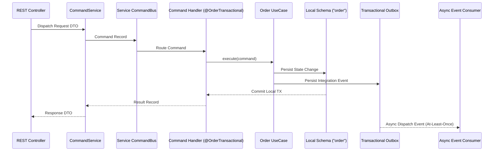

# Feature: Decoupled Service Communication & CQRS Pipeline

> **System Design:** [E-Commerce Service Architecture & Platform Modernization](../system-design/002-ecommerce_service_architecture_system_design.md)

---

## 1. What & Why

### What does this feature do?

This feature establishes decoupled, resilient synchronous and asynchronous communication pipelines across domain services and platform BFFs. It implements isolated per-service `CommandBus` and `QueryBus` instances, enforces a strict ingress pipeline (**Controller → CommandService/QueryService → Bus → Handler → UseCase**), defines explicit platform capability ports with swappable in-process or HTTP transport adapters, and mandates durable integration event publishing via the transactional outbox. It also establishes distributed checkout coordination rules within the Order service.

### Why is it needed?

Unconstrained communication patterns in modular systems lead to direct handler-to-handler calls, leaking database transactions across network boundaries, cross-service command dispatching, and accidental synchronous tight-coupling. Enforcing strict CQRS separation and explicit capability ports guarantees that internal domain implementations remain fully encapsulated, mutations and queries remain strictly isolated, and services can transition seamlessly from modular monolith invocations to distributed network calls without rewriting domain logic.

### What's in scope / out of scope?

| In Scope | Out of Scope |
|:---------|:-------------|
| Dedicated per-service `CommandBus` and `QueryBus` registration | Implementation of distributed network service meshes (Istio/Envoy) |
| Standardized ingress: Controller → Service → Bus → Handler → UseCase | Third-party payment gateway integration specifics |
| Explicit Platform BFF capability ports and transport adapter interfaces | Business pricing rules or catalog search ranking algorithms |
| Transactional outbox asynchronous integration event publishing | External partner API integrations |
| Strict CQRS isolation (CommandService cannot query; QueryService cannot mutate) | User interface styling or client frontend state management |
| Distributed checkout coordination rules in Order (reservation, saga, compensation) | Hardware cluster provisioning |

---

## 2. Acceptance Criteria

| # | Criteria | How to Verify |
|:--|:---------|:--------------|
| AC-1 | Each service instance MUST instantiate its own `CommandBus` and `QueryBus`, registering handlers exclusively from its own internal bounded contexts; cross-service bus dispatching MUST be prohibited. | ArchUnit tests and Spring component scanning tests verifying no cross-module handler registrations. |
| AC-2 | Ingress requests MUST follow the strict pipeline: **Controller → CommandService/QueryService → Bus → Handler → UseCase**; controllers MUST NOT inject the bus, handlers, repositories, or use cases directly. | Automated static architecture tests enforcing controller dependency injection boundaries. |
| AC-3 | `CommandService` MUST NOT inject, invoke, or dispatch via `QueryBus` or call `QueryService`; `QueryService` MUST NOT inject, invoke, or dispatch via `CommandBus` or call `CommandService`. | ArchUnit tests verifying zero dependency linkages between Command and Query service classes. |
| AC-4 | Database transactions (`@Transactional`) MUST be demarcated on CQRS Handlers or Provider Adapters; transactions MUST NOT extend across remote HTTP or RPC calls. | Transaction demarcation tests and code inspection ensuring no `@Transactional` on controllers, services, or remote client adapters. |
| AC-5 | Platform BFFs MUST interact with domain services solely through public capability ports (`port/`); transport adapters MUST map external DTOs to immutable command/query records without exposing internal Java classes. | Interface and DTO serialization tests verifying that internal aggregate types are never serialized to public contracts. |
| AC-6 | Asynchronous integration events MUST be written to the transactional outbox table within the same transaction as the business state change, guaranteeing at-least-once delivery; consumers MUST handle duplicate delivery idempotently. | Outbox test verifying atomic event persistence and idempotent consumer processing upon duplicate event dispatch. |
| AC-7 | Order checkout coordination MUST manage inventory reservations, idempotent payment processing, and compensating rollbacks within the Order boundary without distributed 2PC transactions. | End-to-end checkout integration test simulating inventory reservation failure and asserting compensating order cancellation. |

---

## 3. Solution Design

### How does this feature work?

> The diagram below illustrates the decoupled communication flow from a Platform BFF through the strict CQRS ingress pipeline to the isolated domain service and asynchronous outbox event relay.

### Key Design Decisions

| Decision | Choice | Rationale |
|:---------|:-------|:----------|
| **Ingress Pattern** | Controller → Service → Bus → Handler → UseCase | Provides clear separation of concerns, decouples HTTP serialization from business execution, and enforces uniform validation. |
| **CQRS Isolation** | Strict Pipeline Independence | Prevents command side-effects from polluting query models and eliminates read-lock contention on write models. |
| **BFF Adapter Strategy** | Port-and-Adapter with Swappable Transports | Enables direct in-memory delegation when deployed as a modular monolith, and seamless HTTP/gRPC delegation when deployed as microservices. |
| **Distributed Coordination** | Orchestrated Saga with Compensating Actions in Order | Replaces brittle distributed transactions (2PC) with reliable local transactions and compensating rollbacks. |

---

## 4. Implementation Specifications

### Domain Specs (Data Models & Business Rules)

- None; this feature defines communication protocols and CQRS mechanics. Business entities are specified in domain-specific specs (e.g. `order-domain-spec`, `cart-domain-spec`).

### Workflow Specs (Process Flows)

- Cross-domain business workflows orchestrating these communication mechanisms (such as `order-checkout-coordination-workflow`) are defined in `grab/docs/spec/workflows/`.

### Tech Specs (Technology Decisions & Rules)

- [Decoupled Service Communication & CQRS Tech Spec](../spec/system/decoupled-service-communication-cqrs-tech-spec.md)
- [Transactional Outbox Tech Spec](../spec/system/transactional-outbox-tech-spec.md)
