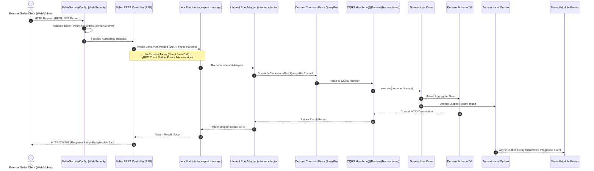
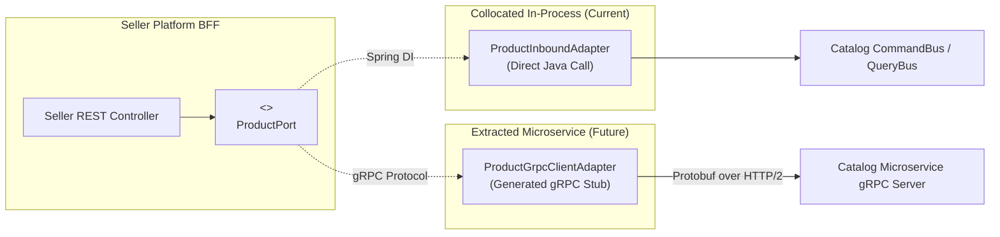

# Feature: BFF-to-Domain Communication Protocol & Controller Contract Migration

> **System Design:** [E-Commerce Service Architecture & Platform Modernization](../system-design/002-ecommerce_service_architecture_system_design.md)

---

## 1. What & Why

### What does this feature do?

This feature establishes the official communication protocol and contract boundary between the **Platform BFF (Seller Platform BFF)** and the underlying **Domain Groups** (`catalog`, `order`, `account`, `channel`). It delivers a comprehensive two-part architectural transformation:

1. **Domain Inbound Port Interface Conversion (Part 1)**: All existing domain REST controllers are converted into clean, framework-agnostic Java port interfaces residing under `com.grab.app.{group}.{domain}.port.message`. Domain modules no longer expose Spring MVC `@RestController` endpoints or HTTP routing annotations.
2. **Seller Platform BFF REST Controllers (Part 2)**: Equivalent REST controllers are created within the Seller Platform BFF (`com.grab.seller...`) exposing the exact REST API contracts previously hosted by domain controllers. These Seller controllers receive external HTTP REST calls, invoke the domain Java port interfaces in-process today, and return REST/HATEOAS responses.
3. **Centralized Security in Seller Web Configuration**: HTTP authentication filters, JWT validation, role-based authorization (`@PreAuthorize`), and permission checks are housed exclusively within the Seller Platform web configuration (`SellerSecurityConfig`), decoupling domain business code from web security frameworks.
4. **Future gRPC Migration Protocol**: The Java port interfaces define the exact service contract that will map directly to gRPC/Protobuf service stubs when domain groups are extracted into independent microservices, requiring zero code changes in Seller REST controllers.
5. **Shared Integration Events Centralization**: All cross-domain integration events (`*IntegrationEvent`) and listener contracts are moved into the `shared` module (`store/src/main/java/com/grab/store/shared/events/{module}/`), standardizing event-driven choreography.

### Why is it needed?

Hosting Spring MVC `@RestController` endpoints directly inside domain modules couples domain packages to HTTP transport mechanisms, Jackson JSON serialization annotations, Spring WebMvc links, and web security filters. When client requirements change or when microservice extraction begins, domain logic must be untangled from controller layers. 

Converting domain controllers into Java port interfaces and establishing the Seller BFF as the sole REST ingress layer isolates domain groups, encapsulates business pipelines, and provides a seamless migration path from in-process Java method calls to gRPC network calls.

### What's in scope / out of scope?

| In Scope | Out of Scope |
|:---------|:-------------|
| Conversion of all domain REST controllers into Java port interfaces (`com.grab.app.{group}.{domain}.port.message`) | Marketplace Platform customer mobile API controller contracts (governed by Marketplace spec) |
| Creation of equivalent REST controllers in Seller Platform BFF (`com.grab.seller...`) | Frontend UI client component implementations (React/Vue) |
| In-process dependency injection from Seller controllers to domain Java port interfaces | Live gRPC server deployment (architecture is gRPC-ready, but runs in-process today) |
| Centralized web security, authentication, and authorization rules in Seller BFF web config | Distributed identity provider infrastructure (Okta/Keycloak hosting) |
| Relocation of cross-domain integration events to `shared` module | Database DDL and Flyway migrations (governed by feat_010) |
| Internal domain CQRS pipeline delegation via `CommandBus`/`QueryBus` from inbound port adapters | |

---

## 2. Acceptance Criteria

> This feature is **done** when all criteria below pass. Each criterion is testable with clear verification methods.

| # | Criteria | How to Verify |
|:--|:---------|:--------------|
| AC-1 | **BFF REST Ingress Exclusivity**: Platform BFF (`com.grab.seller`) MUST be the sole REST HTTP ingress layer for seller clients; domain group modules (`com.grab.app.*`) MUST NOT declare Spring MVC `@RestController` or `@RequestMapping` annotations. | Static analysis and ArchUnit test asserting zero `@RestController` classes inside `com.grab.app.*`. |
| AC-2 | **Domain Port Interface Conversion**: Every existing domain REST controller MUST be converted into a clean, framework-agnostic Java port interface residing in `com.grab.app.{group}.{domain}.port.message`. | Interface inspection verifying presence of typed methods for all command and query operations without Spring WebMvc annotations. |
| AC-3 | **Seller REST Controller Contract Parity**: REST controllers in Seller Platform BFF MUST provide 100% path, verb, parameter, request DTO, and response DTO contract parity with the previous domain REST endpoints. | OpenAPI/Swagger diff and Spring MockMvc integration tests asserting exact URL, HTTP status code, and payload compatibility. |
| AC-4 | **In-Process to gRPC Migration Readiness**: Seller REST controllers MUST depend strictly on Java port interfaces; collocated in-process today, with inbound adapters swappable for gRPC client stubs in microservices without modifying Seller controller code. | Code inspection and ArchUnit test asserting Seller controllers only inject `port.message.*` interfaces. |
| AC-5 | **Centralized Security in Seller Web Config**: All HTTP web security filters, JWT token authentication, and `@PreAuthorize` role/permission checks MUST be configured in `com.grab.seller.config.SellerSecurityConfig`; domain modules MUST NOT contain HTTP security dependencies. | Security test suite validating unauthenticated request rejection (401/403) at the Seller BFF boundary and zero Spring Security web imports in domain modules. |
| AC-6 | **Relocation of Integration Events to Shared**: All cross-domain integration events (`*IntegrationEvent`) and listener contracts MUST be relocated to `store/src/main/java/com/grab/store/shared/events/{module}/` in the shared module. | Maven build and package scan verifying all integration events reside exclusively in `shared.events`. |
| AC-7 | **Internal Domain CQRS Delegation**: Inbound port adapters in domain modules MUST translate port method invocations into immutable `Command` and `Query` records, dispatching through the domain group's isolated `CommandBus` or `QueryBus`. | Unit and handler tests asserting proper bus dispatching and execution within domain transactional boundaries. |

---

## 3. Solution Design

### How does this feature work?

> The architecture separates the public HTTP REST boundary (Seller Platform BFF) from the internal domain capability contracts (Java Port Interfaces), establishing an in-process protocol today that transitions directly to gRPC stubs in future microservices.



---

### Part 1: Domain Controller to Inbound Java Port Conversion

Every existing domain REST controller in `store/` is converted into a framework-agnostic Java port interface residing under `com.grab.app.{group}.{domain}.port.message`. These interfaces define typed methods without any Spring Web annotations (`@RestController`, `@GetMapping`, `@PostMapping`, `@RequestBody`, `@PathVariable` are removed).

#### Domain Port Conversion Catalog

| Service Group | Bounded Context | Existing Domain REST Controller | Target Java Port Interface | Key Port Capabilities |
|:---|:---|:---|:---|:---|
| **Catalog** | `catalog` | `ProductController` | `ProductPort` | `getProduct()`, `getProductBySlug()`, `listProducts()`, `createProduct()`, `updateProduct()`, `deleteProduct()`, `updateStatus()`, `syncVariants()` |
| **Catalog** | `catalog` | `CategoryController` | `CategoryPort` | `getCategory()`, `listCategories()`, `createCategory()`, `updateCategory()`, `deleteCategory()` |
| **Catalog** | `catalog` | `CatalogMediaController` | `CatalogMediaPort` | `uploadMedia()`, `getMedia()`, `deleteMedia()` |
| **Catalog** | `catalog` | `VariantOptionController` | `VariantOptionPort` | `listOptions()`, `createOption()`, `updateOption()`, `deleteOption()` |
| **Catalog** | `catalog` | `VariantTypeController` | `VariantTypePort` | `listTypes()`, `createType()`, `updateType()`, `deleteType()` |
| **Catalog** | `inventory` | `InventoryController` | `InventoryPort` | `getItem()`, `listItems()`, `adjustStock()`, `reserveStock()`, `releaseStock()` |
| **Catalog** | `inventory` | `LocationController` | `LocationPort` | `getLocation()`, `listLocations()`, `createLocation()`, `updateLocation()` |
| **Catalog** | `inventory` | `BinController` | `BinPort` | `getBin()`, `listBins()`, `createBin()`, `updateBin()` |
| **Catalog** | `inventory` | `ZoneController` | `ZonePort` | `getZone()`, `listZones()`, `createZone()`, `updateZone()` |
| **Catalog** | `inventory` | `AllocationController` | `AllocationPort` | `allocateStock()`, `deallocateStock()` |
| **Catalog** | `inventory` | `ReorderSuggestionController` | `ReorderSuggestionPort` | `getReorderSuggestions()` |
| **Catalog** | `pricing` | `PriceListController` | `PriceListPort` | `getPriceList()`, `listPriceLists()`, `createPriceList()`, `updatePriceList()`, `deletePriceList()` |
| **Catalog** | `pricing` | `PriceSetController` | `PriceSetPort` | `getPriceSet()`, `createPriceSet()`, `updatePriceSet()` |
| **Catalog** | `pricing` | `PricePreferenceController` | `PricePreferencePort` | `getPreferences()`, `updatePreferences()` |
| **Catalog** | `pricing` | `VariantPriceSetLinkController` | `VariantPriceSetLinkPort` | `linkVariantPrice()`, `unlinkVariantPrice()` |
| **Account** | `identity` | `AuthController` | `AuthPort` | `authenticate()`, `refreshToken()`, `logout()`, `register()` |
| **Account** | `identity` | `ProfileController` | `ProfilePort` | `getCurrentUserSession()`, `updateProfile()` |
| **Account** | `identity` | `UserAdminController` | `UserAdminPort` | `getUser()`, `listUsers()`, `updateUserStatus()`, `assignRole()` |
| **Account** | `identity` | `RoleAdminController` | `RoleAdminPort` | `listRoles()`, `createRole()`, `updateRolePermissions()` |
| **Account** | `identity` | `AccessAdminController` | `AccessAdminPort` | `assignAccess()`, `revokeAccess()`, `listAccessAssignments()` |
| **Account** | `identity` | `AccessInvitationController` | `AccessInvitationPort` | `sendInvitation()`, `acceptInvitation()`, `revokeInvitation()` |
| **Account** | `merchant` | `MerchantController` | `MerchantPort` | `getMerchant()`, `listMerchants()`, `createMerchant()`, `updateMerchant()` |
| **Account** | `merchant` | `MerchantMemberController` | `MerchantMemberPort` | `listMembers()`, `addMember()`, `removeMember()`, `updateMemberRole()` |
| **Account** | `merchant` | `StorefrontController` | `StorefrontPort` | `getStorefront()`, `createStorefront()`, `updateStorefront()` |
| **Account** | `merchant` | `MerchantAdminController` | `MerchantAdminPort` | `verifyMerchant()`, `suspendMerchant()`, `auditMerchant()` |
| **Channel** | `saleschannel` | `SalesChannelController` | `SalesChannelPort` | `getChannel()`, `listChannels()`, `createChannel()`, `updateChannel()`, `deleteChannel()` |
| **Channel** | `saleschannel` | `PublishableKeyController` | `PublishableKeyPort` | `generatePublishableKey()`, `listKeys()`, `revokeKey()` |
| **Channel** | `region` | `RegionController` | `RegionPort` | `getRegion()`, `listRegions()`, `createRegion()`, `updateRegion()` |
| **Channel** | `discovery` | `StorefrontProductController` | `DiscoveryProductPort` | `searchProducts()`, `getProductDetail()` |
| **Order** | `cart` | `CartController` | `CartPort` | `getCart()`, `addItem()`, `updateItem()`, `removeItem()`, `clearCart()` |
| **Order** | `order` | `OrderController` | `OrderPort` | `getOrder()`, `listOrders()`, `createOrder()`, `cancelOrder()`, `fulfillOrder()` |
| **Order** | `payment` | `PaymentController` | `PaymentPort` | `authorizePayment()`, `capturePayment()`, `refundPayment()` |

---

### Part 2: Seller Platform BFF REST Controllers & Web Security

The Seller Platform BFF (`com.grab.seller`) creates REST controllers that preserve 100% contract compatibility with external seller applications. These controllers inject the domain Java port interfaces directly.

#### Seller REST Controller Inventory

```
com.grab.seller
├── config/
│   └── SellerSecurityConfig.java                  # Centralized HTTP Security, JWT & Route Guards
├── catalog/
│   ├── SellerProductController.java               # Endpoints: /api/v1/catalog/products/**
│   ├── SellerCategoryController.java              # Endpoints: /api/v1/catalog/categories/**
│   └── SellerMediaController.java                 # Endpoints: /api/v1/catalog/media/**
├── inventory/
│   ├── SellerInventoryController.java             # Endpoints: /api/v1/inventory/items/**
│   ├── SellerLocationController.java              # Endpoints: /api/v1/inventory/locations/**
│   └── SellerReorderController.java               # Endpoints: /api/v1/inventory/reorder-suggestions/**
├── pricing/
│   ├── SellerPriceListController.java             # Endpoints: /api/v1/pricing/price-lists/**
│   └── SellerPriceSetController.java              # Endpoints: /api/v1/pricing/price-sets/**
├── merchant/
│   ├── SellerMerchantController.java              # Endpoints: /api/v1/merchants/accounts/**
│   ├── SellerMemberController.java                # Endpoints: /api/v1/merchants/{id}/members/**
│   └── SellerStorefrontController.java            # Endpoints: /api/v1/merchants/storefronts/**
├── channel/
│   ├── SellerSalesChannelController.java          # Endpoints: /api/v1/sales-channels/channels/**
│   └── SellerPublishableKeyController.java        # Endpoints: /api/v1/sales-channels/channels/{id}/publishable-keys/**
└── auth/
    ├── SellerAuthController.java                  # Endpoints: /api/v1/identity/auth/**
    └── SellerProfileController.java               # Endpoints: /api/v1/identity/session/**
```

#### Centralized Web Security Architecture in Seller Config

Security authorization is declared entirely in `SellerSecurityConfig`:

```java
@Configuration
@EnableWebSecurity
@EnableMethodSecurity(prePostEnabled = true)
public class SellerSecurityConfig {

    @Bean
    public SecurityFilterChain sellerSecurityFilterChain(HttpSecurity http) throws Exception {
        return http
            .csrf(AbstractHttpConfigurer::disable)
            .sessionManagement(sm -> sm.sessionCreationPolicy(SessionCreationPolicy.STATELESS))
            .authorizeHttpRequests(auth -> auth
                // Public authentication endpoints
                .requestMatchers("/api/v1/identity/auth/**").permitAll()
                // Merchant administrative endpoints
                .requestMatchers("/api/v1/admin/**").hasRole("PLATFORM_ADMIN")
                // General Seller Platform endpoints
                .requestMatchers("/api/v1/catalog/**").hasAnyRole("SELLER", "STORE_MANAGER", "PLATFORM_ADMIN")
                .requestMatchers("/api/v1/inventory/**").hasAnyRole("SELLER", "WAREHOUSE_STAFF", "PLATFORM_ADMIN")
                .requestMatchers("/api/v1/pricing/**").hasAnyRole("SELLER", "PRICING_MANAGER", "PLATFORM_ADMIN")
                .requestMatchers("/api/v1/merchants/**").hasAnyRole("SELLER", "PLATFORM_ADMIN")
                .requestMatchers("/api/v1/sales-channels/**").hasAnyRole("SELLER", "PLATFORM_ADMIN")
                .anyRequest().authenticated()
            )
            .addFilterBefore(jwtAuthenticationFilter(), UsernamePasswordAuthenticationFilter.class)
            .build();
    }
}
```

Method-level security is placed directly on Seller REST controller actions:
```java
@RestController
@RequestMapping("/api/v1/catalog/products")
@RequiredArgsConstructor
public class SellerProductController {

    private final ProductPort productPort;
    private final ProductModelAssembler modelAssembler;

    @PostMapping
    @PreAuthorize("hasAuthority('catalog:product:create')")
    public ResponseEntity<EntityModel<ProductResponse>> createProduct(
            @Valid @RequestBody CreateProductRequest request) {
        ProductResponse response = productPort.createProduct(request);
        return ResponseEntity.created(linkTo(methodOn(SellerProductController.class)
                .getProduct(response.id())).toUri())
                .body(modelAssembler.toModel(response));
    }
}
```

---

### Part 3: Future gRPC Migration Architecture

The Java port interfaces represent a strict **protocol contract**. When domain groups are extracted into separate microservices, the transition requires zero modifications to Seller REST controllers:



#### Protocol Migration Comparison

| Concern | In-Process Modular Monolith (Today) | Extracted Microservice (Future) |
|:---|:---|:---|
| **Contract Definition** | Java Interface (`ProductPort.java`) | Protocol Buffer (`product_service.proto`) |
| **Seller BFF Controller** | Injects `ProductPort` | Injects `ProductPort` (Unchanged!) |
| **BFF Adapter** | In-process bean (`ProductInboundAdapter`) | gRPC client stub (`ProductGrpcClientAdapter`) |
| **Transport** | In-memory JVM pointer invocation ($\approx 0$ ms) | HTTP/2 multiplexed binary Protobuf ($1$–$5$ ms) |
| **Security Layer** | Handled at Seller BFF (`SellerSecurityConfig`) | mTLS between BFF and Domain Microservices |

---

### Part 4: Shared Integration Events Centralization

All cross-domain integration events (`*IntegrationEvent`) and listener contracts are relocated to `store/src/main/java/com/grab/store/shared/events/{module}/`:

```
store/src/main/java/com/grab/store/shared/events/
├── catalog/
│   ├── ProductCreatedIntegrationEvent.java
│   ├── ProductUpdatedIntegrationEvent.java
│   └── ProductStatusChangedIntegrationEvent.java
├── inventory/
│   ├── StockAdjustedIntegrationEvent.java
│   └── StockReservedIntegrationEvent.java
├── pricing/
│   └── PriceListActivatedIntegrationEvent.java
├── order/
│   ├── OrderPlacedIntegrationEvent.java
│   ├── OrderCancelledIntegrationEvent.java
│   └── PaymentAuthorizedIntegrationEvent.java
├── merchant/
│   ├── MerchantRegisteredIntegrationEvent.java
│   └── MerchantStatusUpdatedIntegrationEvent.java
└── saleschannel/
    └── PublishableKeyRevokedIntegrationEvent.java
```

Consuming modules listen to these events via Spring's `@EventListener`:
```java
@Component
public class InventoryOrderEventListener {

    @EventListener
    public void onOrderPlaced(OrderPlacedIntegrationEvent event) {
        // Adjust stock in inventory schema asynchronously
    }
}
```

---

### Key Design Decisions

| Decision | Choice | Rationale |
|:---|:---|:---|
| **External Ingress Protocol** | REST API on Seller BFF Only | Provides clean HTTP/JSON contract for web and mobile frontends; isolates domains from HTTP dependencies. |
| **Internal Communication Protocol** | Pure Java Port Interfaces | Enforces loose coupling and provides direct, zero-overhead in-memory execution today. |
| **Microservice Extraction Strategy** | gRPC Stubs replacing Java Adapters | Allows swapping transport from JVM memory to gRPC without changing Seller REST controllers or DTOs. |
| **Security Location** | Seller Web Configuration (`SellerSecurityConfig`) | Centralizes token validation and authorization at the ingress boundary, keeping domain groups framework-pure. |
| **Event Centralization** | Centralized in `shared.events.{module}` | Guarantees clear event schemas across modular monolith boundaries without circular module dependencies. |

---

## 4. Implementation Specifications

### Domain Specs (Data Models & Business Rules)

- None; this feature governs the BFF-to-domain communication protocol, controller-to-port migration, and event routing. Business entities are governed by their respective domain specs.

### Workflow Specs (Process Flows)

- Cross-domain business workflows coordinating these communication mechanisms (such as `order-checkout-coordination-workflow`) are defined in `grab/docs/spec/workflows/`.

### Tech Specs (Technology Decisions & Rules)

- [BFF-to-Domain Communication Protocol & CQRS Tech Spec](../spec/system/decoupled-service-communication-cqrs-tech-spec.md)
- [Transactional Outbox Tech Spec](../spec/system/transactional-outbox-tech-spec.md)
