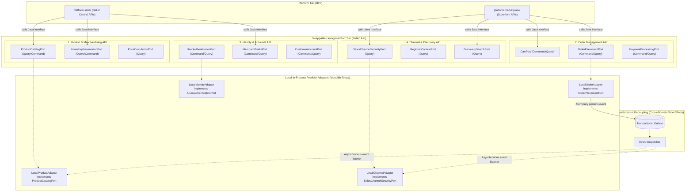

<!-- TEMPLATE INSTRUCTIONS
─────────────────────────────────────────────────────────────────
This document bridges the System Design (002) to implementation details
for Feature 3: Four Core Domains Swappable Contract Ports.
─────────────────────────────────────────────────────────────────
-->

# Feature: Four Core Domains Swappable Contract Ports

> **System Design:** [Ecommerce Platform Services and Domain Architecture System Design](../system-design/002-ecommerce_platform_services_and_domain_architecture_system_design.md)

---

## 1. What & Why

### What does this feature do?

This feature establishes strict **Hexagonal Port Interfaces** (`*QueryPort`, `*CommandPort`) and **immutable DTO records** across the 4 Core Ecommerce Domains (`Product & Merchandising`, `Order Management`, `Identity & Accounts`, `Channel & Discovery`). It replaces legacy direct Spring bean injection, internal repository exposure, and JPA entity leakage between platform ingress/BFFs and domains with formal interface seams.

In the Modular Monolith (`app`), each contract port is implemented by a **Local In-Process Provider Adapter** that delegates to the domain's internal application use cases. Crucially, all cross-domain write side-effects are decoupled using Spring Application Events and the **Transactional Outbox**, ensuring that when any core domain is extracted into a standalone microservice tomorrow, swapping the local adapter with a remote gRPC or REST client adapter requires **zero code changes** in consumer code.

### Why is it needed?

- **Direct Bean & Entity Leakage**: In the legacy `store` module, controllers and cross-domain classes directly inject internal Spring beans, `@Repository` interfaces, and Hibernate `@Entity` models. Calling methods like `product.getVariants().get(0)` causes lazy-loading `LazyInitializationException` failures outside transaction boundaries and creates tight coupling.
- **Architectural Erosion & Circular Dependencies**: Without explicit contract boundaries, business logic crosses domains unchecked (e.g., cart directly querying catalog repositories or pricing calculating taxes by directly accessing regional tables), creating circular dependencies that prevent modular testing.
- **Microservice Extraction Barrier**: If domain extraction requires refactoring dozens of calling controllers and updating client code, microservice migration becomes a risky and expensive rewrite. Swappable ports provide clean extraction seams where network adapters can be plugged in transparently.
- **Enforcing CQRS Separation**: Decoupling write commands from read queries at the port level ensures high-throughput storefront reads (e.g., discovery searches) do not lock transactional write pipelines.

### What's in scope / out of scope?

| In Scope | Out of Scope |
|:---------|:-------------|
| Definition of public API port interfaces (`*QueryPort`, `*CommandPort`) in public packages (`com.grab.app.<domain>.api`). | Physically deploying microservices or running gRPC/REST network calls between domains (this feature builds the in-process seams). |
| Definition of immutable Java DTO records (`record`) for all method arguments and return types. | Rewriting core domain internal business logic or state machines inside `*-domain` libraries. |
| Implementation of Local In-Process Provider Adapters under `com.grab.app.<domain>.internal.adapter` delegating to application use cases. | Creating frontend UI views or modifying React code in `grab-web`. |
| Decoupling cross-domain write paths using Spring Application Events and Transactional Outbox integration events. | Implementing Seller Central or Marketplace security filters and authentication tokens (handled in Features 4 & 5). |
| Elimination of all cross-domain `@Repository`, `@Entity`, and internal use case bean imports across platform and domain packages. | Modifying PostgreSQL schema DDL or Flyway migration scripts (handled in Feature 2). |
| ArchUnit architectural tests verifying that external callers import exclusively from public `api` packages. | |

---

## 2. Acceptance Criteria

> This feature is **done** when all criteria below pass. Each criterion must be testable — no vague language.

| # | Criteria | How to Verify |
|:--|:---------|:--------------|
| **AC-1** | **Public Port Interfaces & DTO Contracts**: Public Java interface ports (`*QueryPort`, `*CommandPort`) and immutable `record` DTOs are declared in public `api` packages for all 4 core domains (`productmerchandising.api`, `ordermanagement.api`, `identityaccount.api`, `channeldiscovery.api`). Zero JPA entities (`@Entity`) are exposed in port signatures. | Inspect public `api` package signatures across all 4 domains; verify all input parameters and return types are Java `record` types or scalar primitives. |
| **AC-2** | **Local In-Process Provider Adapters**: Each public port interface has a registered Spring `@Component` adapter in that domain's `internal` package implementing the interface and delegating to internal use cases. | Execute Spring context load test; verify all port beans (`ProductCatalogPort`, `OrderPlacementPort`, etc.) autowire successfully to their local adapters. |
| **AC-3** | **Zero Cross-Domain Entity / Repository Wiring**: Classes in Platform Ingress (`platform.seller`, `platform.marketplace`) and other core domains inject strictly port interfaces. No direct `@Autowired` references to foreign `@Repository`, `@Entity`, or `internal` classes exist. | Run `mvn test -Dtest=MicroserviceSeamArchUnitTest -pl app`; verify 0 forbidden package import violations. |
| **AC-4** | **Asynchronous Cross-Domain Write Decoupling**: Inter-domain mutations (e.g. Order Placed $\rightarrow$ Reserve Inventory, Catalog Published $\rightarrow$ Rebuild Discovery Offer) do not invoke synchronous cross-domain command ports. Mutations are published as domain events and written to the Transactional Outbox table atomically. | Execute checkout saga integration test; verify inventory allocation and discovery projection update execute asynchronously via outbox events without synchronous inter-domain bean calls. |
| **AC-5** | **Remote Swappability Verification**: Port interfaces and DTOs are validated to be transport-agnostic (serializable, no Hibernate proxies, scalar IDs). A mock gRPC/REST remote adapter can replace the local adapter without altering the calling BFF or platform controller code. | Execute unit test swapping local provider adapter with a mock remote client adapter; verify calling controller executes identically with zero code refactoring. |
| **AC-6** | **Spring Modulith Module Verification**: Spring Modulith's `ApplicationModules.of(EcommerceApplication.class).verify()` passes, confirming that external access to each domain is restricted to its designated exposed API ports. | Run `mvn test -Dtest=ApplicationModularityTests -pl app`; verification succeeds with 0 boundary breaches. |

---

## 3. Solution Design

### How does this feature work?



---

### Core Domain Port Inventory

| Domain Cluster | Port Interface | Type | Primary Responsibilities | Consumers |
|:---------------|:---------------|:-----|:-------------------------|:----------|
| **1. Product & Merchandising** | `ProductCatalogPort` | Query & Command | Create/update products, manage categories, retrieve product details by ID/slug, publish catalog items. | `platform.seller` |
| | `InventoryReservationPort` | Query & Command | Check stock availability, reserve inventory items for checkout, replenish stock. | `platform.seller`, `ordermanagement` (via Event) |
| | `PriceCalculationPort` | Query | Resolve regional prices, calculate discounts, fetch price lists. | `platform.marketplace`, `ordermanagement` |
| **2. Order Management** | `CartPort` | Query & Command | Create/get shopping cart, add/remove items, apply promo codes, checkout readiness validation. | `platform.marketplace` |
| | `OrderPlacementPort` | Command & Query | Convert cart to order aggregate, track order lifecycle state, cancel orders, query customer/merchant orders. | `platform.marketplace`, `platform.seller` |
| | `PaymentProcessingPort` | Command & Query | Authorize payments, record Cash On Delivery (COD) collections, issue refunds. | `platform.marketplace`, `platform.seller` |
| **3. Identity & Accounts** | `UserAuthenticationPort` | Command & Query | Authenticate seller/customer credentials, validate JWT tokens, verify RBAC permissions. | `platform.seller`, `platform.marketplace` |
| | `MerchantProfilePort` | Command & Query | Manage merchant registration, KYC verification, store profile settings. | `platform.seller` |
| | `CustomerAccountPort` | Command & Query | Manage customer profiles, address book entries, default shipping destinations. | `platform.marketplace` |
| **4. Channel & Discovery** | `SalesChannelSecurityPort` | Query | Validate `X-Publishable-Key` (SHA-256), retrieve channel locales, verify channel status. | `platform.marketplace` |
| | `RegionalContextPort` | Query | Resolve currency, tax rules, and country by IP or geographic channel code. | `platform.marketplace` |
| | `DiscoverySearchPort` | Query | High-throughput search, faceted category browsing, contextual offer queries. | `platform.marketplace` |

---

### In-Process Adapter vs. Future Remote Adapter Seam

```text
[Platform Ingress: platform.marketplace]
          │
          ▼ (Injects public interface)
   OrderPlacementPort
          │
          ├── [Today: In-Process]  ────────► LocalOrderPlacementAdapter ──► OrderApplicationService
          │                                  (Spring Modulith Monolith)
          │
          └── [Tomorrow: Microservice] ────► RemoteOrderPlacementGrpcClient ──► (Network: gRPC)
                                             (Zero changes in platform.marketplace)
```

---

### Key Design Decisions

| Decision | Choice | Rationale |
|:---------|:-------|:----------|
| **Inter-Service Communication Style** | Hexagonal Ports & Adapters | Encapsulates domain logic behind stable interfaces. Enables running everything in-process within a single JVM today, while making extraction to microservices a purely infrastructural change. |
| **Data Contract Type** | Immutable Java `record` DTOs | Prevents caller code from modifying domain state outside boundary methods. Guarantees zero `LazyInitializationException` risks because records hold flat, serializable values rather than ORM proxies. |
| **Cross-Domain Mutation Strategy** | Transactional Outbox Events (No Cross-Domain Command Ports) | Invoking command ports synchronously across domains re-introduces distributed transactions (2PC) and tight temporal coupling. Outbox events keep domain write paths completely autonomous. |
| **Local Adapter Placement** | `com.grab.app.<domain>.internal.adapter` | Keeps the implementation hidden inside the domain's internal package, ensuring external callers can only reference the public port interface. |
| **Framework Independence** | Ports declared with pure Java types | Port interfaces contain zero Spring MVC, HTTP, or persistence annotations, making them transport-agnostic and reusable across gRPC, REST, CLI, or test runners. |

---

## 4. Implementation Specifications

> Blueprints developers code against for this feature:

### Domain Specs (Data Models & Business Rules)

- none

### Workflow Specs (Process Flows)

- none

### Tech Specs (Technology Decisions & Rules)

- [Four Core Domains Contract Ports Tech Spec](../spec/system/four-core-domains-contract-ports-tech-spec.md)
