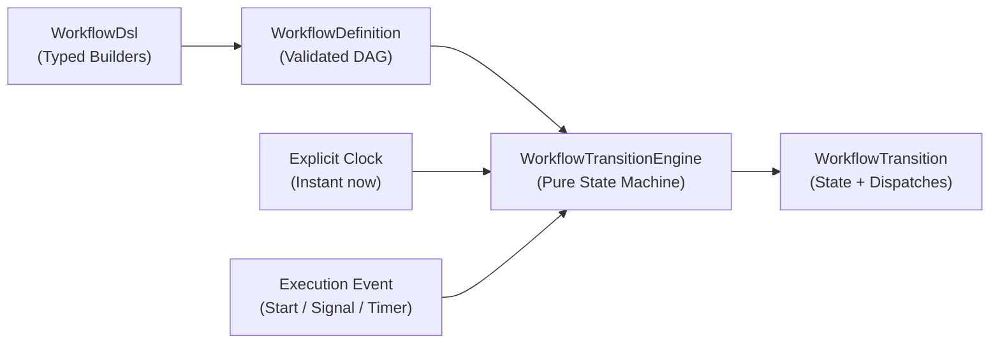

# Feature: Pure Java Workflow DSL & Deterministic Engine

> **System Design:** [Workflow Orchestration & Durable Saga Runtime System Design](../system-design/004-workflow_orchestration_system_design.md)

---

## 1. What & Why

### What does this feature do?

This feature provides a pure, framework-agnostic Java domain-specific language (DSL) and a deterministic transition engine for authoring and evaluating distributed e-commerce sagas. It enables developers to define complex, type-safe execution graphs—including sequential steps, conditional paths (`choice`), parallel branches with joins, timers (`delay`), correlated external signals (`waitForSignal`), and compensating actions (`compensate`). The engine executes as a pure state machine driven by an explicit clock, with automated reverse topological compensation planning upon task failures.

### Why is it needed?

Multi-step e-commerce workflows (e.g., product creation across catalog, inventory, and pricing) require coordinating operations across isolated service-group schemas without distributed two-phase commit (2PC) locks. Previous sequential-only implementations could not support parallel operations, lacked compile-time graph validation, and suffered from unpredictable, unmanaged rollbacks during partial failures. This feature guarantees that all workflows are statically verified before registration, transition deterministically without side-effects in the engine, and execute compensations in strict reverse dependency order.

### What's in scope / out of scope?

| In Scope | Out of Scope |
|:---------|:-------------|
| Pure Java DSL in `framework` (`task`, `sequence`, `choice`, `parallel`, `delay`, `waitForSignal`, `compensate`) | Runtime visual workflow modelers or BPMN XML authoring |
| Statically compiled graph validation (reachability, join validity, all-path output matching, cycle detection) | Dynamic runtime graph modification or arbitrary looping |
| Pure, deterministic state machine (`WorkflowTransitionEngine`) evaluated against an explicit clock | System clock reads (`Instant.now()`) inside the transition engine |
| Dependency-aware compensation planner (`CompensationPlanner`) computing reverse topological DAGs | Direct database access or outbox I/O inside the `framework` module |
| Canonical SHA-256 fingerprint hashing for start payloads and signal messages | Network transport protocols or HTTP serialization formats |

---

## 2. Acceptance Criteria

> This feature is **done** when all criteria below pass. Each criterion is strictly testable.

| # | Criteria | How to Verify |
|:--|:---------|:--------------|
| AC-1 | The workflow DSL **MUST** validate graphs during registration, rejecting duplicate node IDs, unreachable nodes, unhandled choice outputs, and compensation cycles. | Unit tests in `WorkflowDefinitionTest` asserting compilation exceptions on invalid graphs. |
| AC-2 | The transition engine **MUST** be pure and deterministic, producing identical transitions and dispatch intents given identical state, input, and clock timestamps. | Unit tests in `WorkflowTransitionEngineTest` verifying state transitions across repeated evaluations. |
| AC-3 | Parallel branches **MUST** execute with isolated state snapshots, and parallel joins **MUST** combine branch outputs in declared sequence order only after all selected branches succeed. | Unit tests in `WorkflowTransitionEngineTest` verifying branch output combination and join progression. |
| AC-4 | When a task fails and retries are exhausted, the engine **MUST** compute a compensation DAG in reverse topological order, compensating only completed predecessor tasks. | Unit tests in `WorkflowTransitionEngineTest` verifying reverse dependency compensation ordering. |
| AC-5 | Cooperative cancellation **MUST** prevent new forward tasks from starting while allowing in-flight operations to either settle or trigger backward compensation. | Unit tests in `WorkflowTransitionEngineTest` verifying cancellation requested transitions. |
| AC-6 | The `framework` package **MUST NOT** import Spring, Jakarta Persistence, Jackson, or platform BFF classes. | ArchUnit tests in `WorkflowArchitectureTest` asserting zero framework/persistence dependencies. |

---

## 3. Solution Design

### How does this feature work?

> The developer declares an immutable `WorkflowDefinition` using the typed Java DSL. When an execution event occurs, the pure `WorkflowTransitionEngine` evaluates the current state against the definition and explicit timestamp, producing an immutable `WorkflowTransition` containing the updated state and outgoing dispatch intents.

### Key Design Decisions

| Decision | Choice | Rationale |
|:---------|:-------|:----------|
| **Framework Independence** | Pure Java Standard Library | Guarantees blazing-fast unit tests, zero third-party framework lock-in, and immutability. |
| **Deterministic Transitions** | Explicit Clock Ingestion | Eliminates flaky time-dependent tests and makes every state transition reproducible during audit or replay. |
| **Compensation Strategy** | Reverse Topological DAG | Ensures that dependent resources (e.g., pricing line) are rolled back before the parent resource (e.g., product header). |

---

## 4. Implementation Specifications

> Technical blueprints and rules for this feature:

### Domain Specs (Data Models & Business Rules)
- Pure Java Workflow Definition & State Models: [WorkflowDefinition.java](file:///Users/khinemyaezin/Repository/grab-ecommerce/grab/framework/src/main/java/com/grab/framework/workflow/WorkflowDefinition.java)
- Immutable Execution State: [WorkflowExecutionState.java](file:///Users/khinemyaezin/Repository/grab-ecommerce/grab/framework/src/main/java/com/grab/framework/workflow/WorkflowExecutionState.java)

### Workflow Specs (Process Flows)
- Deterministic State Transitions: [WorkflowTransitionEngine.java](file:///Users/khinemyaezin/Repository/grab-ecommerce/grab/framework/src/main/java/com/grab/framework/workflow/WorkflowTransitionEngine.java)
- Reverse Dependency Compensation: [CompensationPlanner.java](file:///Users/khinemyaezin/Repository/grab-ecommerce/grab/framework/src/main/java/com/grab/framework/workflow/CompensationPlanner.java)

### Tech Specs (Technology Decisions & Rules)
- Primary Framework Tech Spec: [Custom Ecommerce Workflow Orchestration Framework](../spec/system/workflow-framework-tech-spec.md)
