<!-- TEMPLATE INSTRUCTIONS
─────────────────────────────────────────────────────────────────
This document bridges the System Design (002) to implementation details
for Feature 4: Platform Seller Central BFF Implementation.
─────────────────────────────────────────────────────────────────
-->

# Feature: Platform Seller Central BFF Implementation

> **System Design:** [Ecommerce Platform Services and Domain Architecture System Design](../system-design/002-ecommerce_platform_services_and_domain_architecture_system_design.md)

---

## 1. What & Why

### What does this feature do?

This feature establishes a dedicated, secure **Backend-for-Frontend (BFF)** application namespace (`com.grab.app.platform.seller`) and API endpoint group (`/seller/v1/*`) tailored specifically for the third-party merchant web portal (**Seller Central** / `grab-web` running on port 3000). It physically decouples all merchant administration traffic—merchant profile management, catalog creation, inventory replenishment, pricing rules, order fulfillment, **seller product workflows (sagas)**, and real-time event notifications—from public customer storefront browsing.

Crucially, **Workflows move to `platform.seller`**: All seller-initiated multi-step sagas previously housed in `com.grab.store.workflows` (`create-sellable-product`, `update-sellable-product`, `update-product-variant`) are migrated into `com.grab.app.platform.seller.workflow` and exposed under `/seller/v1/workflows/*`. 

The Seller Central BFF acts as an edge orchestration and security layer:
1. **Merchant Security Context**: Authenticates merchant requests via a dedicated **Merchant-Scoped Bearer JWT / Cookie Filter** (`SellerSecurityFilter`), enforcing strict multi-tenant boundary checks (preventing cross-merchant data leaks) and resolving an immutable `AuthenticatedMerchantPrincipal`.
2. **Hexagonal Port Delegation**: Delegates business logic exclusively to public **Hexagonal Port Interfaces** across the core ecommerce domains (`Product & Merchandising`, `Identity & Accounts`, and `Order Management`), transforming payloads via compile-time MapStruct mappers with zero entity/repository leakage.
3. **Seller Workflow Orchestration**: Houses the saga coordinators (`CreateSellableProductWorkflowService`, `UpdateSellableProductWorkflowService`, `UpdateProductVariantWorkflowService`) that orchestrate multi-domain operations across Catalog, Inventory, and Pricing asynchronously via Transactional Outbox integration events.
4. **Real-Time Push Notifications**: Exposes an authenticated Server-Sent Events (SSE) stream (`/seller/v1/events/stream`) via `SseHub`, delivering instant push notifications to `grab-web` when asynchronous workflows reach terminal states.

### Why is it needed?

- **Workflows Belong at the Platform Orchestration Tier**: In the legacy monolith, `workflows` resided as an ambiguous top-level package and was mistakenly bundled with order management in early design drafts. In reality, its active sagas (`create-sellable-product`, `update-sellable-product`, `update-product-variant`) are invoked exclusively by the seller portal (`apps/grab-seller-product` in `grab-web`). Moving workflows to `platform.seller` aligns multi-domain saga orchestration directly with the frontend client it serves.
- **Conflated Platform Entrypoints & Attack Surface Exposure**: In the legacy `store` module, administrative seller endpoints, workflow endpoints, and public customer endpoints reside under a flat `/api/v1/*` hierarchy without architectural segregation. This shared ingress prevents applying merchant-specific rate limits, distinct CORS policies, or specialized security filters.
- **Insecure Tenant Scoping & IDOR Risks**: In legacy controllers, several operations relied on client-supplied query parameters (e.g. `?merchantId=...`) rather than cryptographically verified security context tokens. A compromised or malicious seller could potentially manipulate parameters to inspect or tamper with another merchant's inventory, prices, orders, or workflow sagas (Insecure Direct Object Reference).
- **Frontend & Backend Contract Friction**: `grab-web` is built as an independent Micro-Frontend (MFE) monorepo with remotes for Product, Inventory, Pricing, Account, and Order. Forcing frontend developers to interact with low-level internal domain entities or generic REST endpoints creates tight coupling, slows release cycles, and forces complex client-side data stitching.
- **Bypassed Domain Invariants & Entity Leakage**: Without a dedicated BFF translation layer, web controllers directly injected internal `@Repository` beans and returned Hibernate `@Entity` models. Outside transactional sessions, traversing lazy associations triggered runtime `LazyInitializationException` failures and exposed internal database schemas.
- **Microservice Extraction Foundation**: When core domains are extracted into autonomous microservices tomorrow, the Seller Central BFF remains the single stable backend gateway for `grab-web`. By communicating strictly through swappable contract ports and outbox events today, the BFF can swap local in-process adapters for remote gRPC or REST clients with **zero changes** to frontend code or BFF controllers.

### What's in scope / out of scope?

| In Scope | Out of Scope |
|:---------|:-------------|
| Dedicated REST controller package (`com.grab.app.platform.seller.controller`) exposing `/seller/v1/*` endpoints. | Public customer storefront endpoints (`/store/v1/*`, handled in [Feature 5](feat_013-platform-marketplace-bff.md)). |
| **Migration of Seller Workflows** (`com.grab.app.platform.seller.workflow`): Migrating `create-sellable-product`, `update-sellable-product`, and `update-product-variant` controllers, services, validators, and correlation logic under `/seller/v1/workflows/*` with backward-compatible aliases for legacy `/api/v1/workflows/*`. | Customer cart completion / checkout saga (remains in Order Management domain). |
| Merchant-scoped Bearer JWT and `HttpOnly` cookie authentication filter (`SellerSecurityFilter`) and security configuration. | Internal domain business logic and state machine implementations inside core domain libraries. |
| Automatic security context resolution injecting `AuthenticatedMerchantPrincipal` (merchant ID, user ID, business status, roles) into controllers and workflow services. | Modifying PostgreSQL schema DDL, table partitioning, or Flyway migrations (handled in [Feature 2](feat_010-service-level-database-consolidation.md)). |
| Multi-tenant authorization checks ensuring merchants cannot access or mutate resources or workflows outside their assigned `merchantId`. | Physically deploying remote microservices or configuring distributed service meshes / gRPC gateways. |
| MapStruct mappers transforming between `/seller/v1` web DTOs and public domain port records (`*Port`). | Rebuilding or refactoring React frontend components inside `grab-web` (BFF conforms to existing MFE contracts). |
| Real-time SSE event streaming endpoint (`/seller/v1/events/stream`) integrated with `SseHub` for saga completions. | Storefront search query denormalization and publishable key authentication (handled in [Feature 5](feat_013-platform-marketplace-bff.md)). |
| Dedicated CORS configuration permitting credentialed requests from `grab-web` (`http://localhost:3000` / production seller host). | End-customer shopping cart, customer checkout, or customer address books. |
| ArchUnit architectural tests verifying zero entity/repository imports and complete isolation from `platform.marketplace`. | |

---

## 2. Acceptance Criteria

> This feature is **done** when all criteria below pass. Each criterion must be testable — no vague language.

| # | Criteria | How to Verify |
|:--|:---------|:--------------|
| **AC-1** | **Dedicated `/seller/v1/*` Ingress Namespace**: All Seller Central REST endpoints are grouped under `/seller/v1/*` within `com.grab.app.platform.seller.controller`. Anonymous customer browsing endpoints and publishable keys are completely barred from this namespace. | Inspect Spring MVC request mappings via `/actuator/mappings`; verify all seller operations resolve under `/seller/v1/*` and reside in package `com.grab.app.platform.seller`. |
| **AC-2** | **Merchant Bearer JWT & Cookie Authentication**: Requests to protected `/seller/v1/*` endpoints without a valid merchant Bearer JWT in the `Authorization` header (or valid `accessToken` `HttpOnly` cookie) are rejected with `HTTP 401 Unauthorized`. | Send unauthenticated `GET /seller/v1/products`; verify response is `401 Unauthorized` with standard RFC 7807 error envelope. |
| **AC-3** | **Automatic Merchant Security Context Resolution**: Authenticated requests automatically resolve an `AuthenticatedMerchantPrincipal` containing verified `merchantId`, `userId`, and assigned `roles`. Controllers and workflow access resolvers obtain the merchant identity directly from the security context without client-supplied query parameters. | Send request with valid merchant JWT; verify controller logs and service invocations receive the cryptographically resolved `merchantId` without client-supplied query parameters. |
| **AC-4** | **Strict Multi-Tenant Isolation**: Attempting to view, update, or mutate another merchant's resource (e.g. attempting to update a product, trigger a workflow, or confirm an order belonging to Merchant B using Merchant A's credentials) is rejected with `HTTP 403 Forbidden` or `HTTP 404 Not Found`. | Execute integration test `SellerMultiTenantIsolationTest` attempting cross-tenant access; verify request is rejected and no cross-tenant modification occurs. |
| **AC-5** | **Pure Hexagonal Port Delegation**: All `/seller/v1` controllers inject exclusively public domain port interfaces (`ProductCatalogPort`, `InventoryReservationPort`, `PricingPort`, `UserAuthenticationPort`, `MerchantProfilePort`, `OrderFulfillmentPort`). Zero `@Repository`, `@Entity`, or `internal` domain use cases are imported. | Run `mvn test -Dtest=SellerBffArchitectureTest -pl app`; ArchUnit tests pass with 0 forbidden import violations. |
| **AC-6** | **MapStruct Contract Decoupling**: Request payloads and response objects are strictly defined as dedicated `/seller/v1` DTOs and mapped to/from immutable domain port records (`record`) via compile-time MapStruct mappers. Zero ORM entities are returned to HTTP clients. | Inspect response payload classes across all `/seller/v1` controllers; verify all responses return dedicated DTO classes and zero Hibernate proxies exist in serialization outputs. |
| **AC-7** | **Seller Workflows Migration & Ingress Routing**: The seller product workflows (`create-sellable-product`, `update-sellable-product`, `update-product-variant`) reside under `com.grab.app.platform.seller.workflow`. POST and GET endpoints are exposed at `/seller/v1/workflows/*` with HAL links, returning `202 Accepted` on saga initiation. Legacy `/api/v1/workflows/*` endpoints forward/alias to this controller. | Execute `POST /seller/v1/workflows/create-sellable-product`; verify `202 Accepted` response with tracking `workflowId` and HATEOAS links (`self`, `get`). |
| **AC-8** | **Workflow Merchant Access Scoping**: `WorkflowSellerAccessResolver` enforces that workflows are initiated exclusively by authenticated merchants with active merchant accounts, deriving `merchantId` and `actorId` directly from the `AuthenticatedMerchantPrincipal`. | Send request with customer JWT to `/seller/v1/workflows/create-sellable-product`; verify request is rejected with `HTTP 403 Forbidden` (`workflowScopeForbidden`). |
| **AC-9** | **Real-Time UI Event Stream Integration**: Authenticated merchants can establish a persistent Server-Sent Events (SSE) connection at `GET /seller/v1/events/stream`. Terminal workflow events (such as `ProductPublishedToChannelEvent`, `SellableProductProductCreatedEvent`, or failure events) are pushed down the stream to the corresponding merchant's browser session. | Connect via `curl -N -H "Authorization: Bearer <token>" /seller/v1/events/stream`; trigger an asynchronous product publish workflow; verify `200 OK (text/event-stream)` receives the terminal event envelope within 2 seconds. |
| **AC-10** | **Tailored Seller CORS & Credentials**: CORS configuration allows requests originating from `grab-web` (`http://localhost:3000` in local development) with `Access-Control-Allow-Credentials: true` and exposed headers (`Authorization`, `Content-Type`). Public storefront origins are handled separately. | Send preflight `OPTIONS /seller/v1/products` with `Origin: http://localhost:3000`; verify `200 OK` response with `Access-Control-Allow-Origin: http://localhost:3000` and `Access-Control-Allow-Credentials: true`. |
| **AC-11** | **Order Fulfillment Operations for Sellers**: Sellers can list their orders, view order details, confirm pending orders, cancel unpaid orders, and mark COD payment as collected via `/seller/v1/orders/*`. Unauthorized status transitions or customer actions are rejected. | Execute order lifecycle tests via `/seller/v1/orders/{id}/confirm` and `/seller/v1/orders/{id}/mark-paid`; verify order status advances in Order Management domain and inventory allocations adjust accordingly. |

---

## 3. Solution Design

### How does this feature work?

```mermaid
flowchart TD
    subgraph ClientTier ["Seller Central Portal (grab-web on Port 3000)"]
        direction TB
        AuthRemote["grab-seller-auth (Login/MFA)"]
        ProductRemote["grab-seller-product (Catalog & Workflows)"]
        InventoryRemote["grab-seller-inventory (Stock)"]
        PricingRemote["grab-seller-pricing (Price Lists)"]
        OrderRemote["grab-seller-order (Fulfillment)"]
        AccountRemote["grab-seller-account (Storefront & KYC)"]
        SSEListener["EventSource (/seller/v1/events/stream)"]
    end

    subgraph PlatformSellerBFF ["Platform Seller Ingress: com.grab.app.platform.seller"]
        direction TB
        SecurityFilter["SellerSecurityFilter<br/>(Extracts Bearer JWT / Cookie)"]
        ContextResolver["MerchantSecurityContextResolver<br/>(Sets AuthenticatedMerchantPrincipal)"]
        CORSConfig["SellerCorsConfiguration<br/>(Allowed: http://localhost:3000)"]

        subgraph SellerControllers ["BFF Standard REST Controllers (/seller/v1/*)"]
            AuthController["SellerAuthController (/auth, /session)"]
            MerchantController["SellerMerchantController (/merchants)"]
            CatalogController["SellerProductController (/products, /categories)"]
            InventoryController["SellerInventoryController (/inventory)"]
            PricingController["SellerPricingController (/pricing)"]
            OrderController["SellerOrderController (/orders)"]
            SSEController["SellerEventStreamController (/events/stream)"]
        end

        subgraph SellerWorkflowTier ["Seller Workflows & Sagas (/seller/v1/workflows/*)"]
            direction TB
            WfRootController["SellerWorkflowsRootController (/workflows)"]
            WfCreateController["CreateSellableProductController (/create-sellable-product)"]
            WfUpdateController["UpdateSellableProductController (/update-sellable-product)"]
            WfVariantController["UpdateProductVariantController (/update-product-variant)"]
            WfAccessResolver["WorkflowSellerAccessResolver (Scopes to merchantId)"]
            WfSagaService["Workflow Saga Services (Create/Update Sellable Product)"]
        end

        subgraph BffMappers ["MapStruct DTO Mappers"]
            ProdMapper["SellerProductDtoMapper"]
            InvMapper["SellerInventoryDtoMapper"]
            PriceMapper["SellerPricingDtoMapper"]
            OrderMapper["SellerOrderDtoMapper"]
            MerchMapper["SellerMerchantDtoMapper"]
        end
    end

    subgraph HexagonalContractPorts ["Core Domain Swappable Contract Ports (Public APIs)"]
        direction TB
        subgraph IAM_Port ["Identity & Accounts API"]
            IAPort1["UserAuthenticationPort"]
            IAPort2["MerchantProfilePort"]
        end
        subgraph PM_Port ["Product & Merchandising API"]
            PMPort1["ProductCatalogPort"]
            PMPort2["InventoryReservationPort"]
            PMPort3["PricingPort"]
        end
        subgraph OM_Port ["Order Management API"]
            OMPort1["OrderFulfillmentPort"]
        end
    end

    subgraph AsyncInfrastructure ["Asynchronous Real-Time Backbone"]
        OutboxRelay["Transactional Outbox / Step Dispatcher"]
        SseHub["SseHub (User Emitter Registry)"]
    end

    %% Ingress connections
    ClientTier -->|"HTTPS (Bearer JWT or HttpOnly Cookie)"| SecurityFilter
    SecurityFilter --> ContextResolver
    ContextResolver --> SellerControllers
    ContextResolver --> SellerWorkflowTier

    %% Controller to Mapper & Port delegation
    AuthController -->|"uses"| IAPort1
    MerchantController -->|"maps via MerchMapper"| IAPort2
    CatalogController -->|"maps via ProdMapper"| PMPort1
    InventoryController -->|"maps via InvMapper"| PMPort2
    PricingController -->|"maps via PriceMapper"| PMPort3
    OrderController -->|"maps via OrderMapper"| OMPort1

    %% Workflow orchestration
    ProductRemote -->|"POST /seller/v1/workflows/create-sellable-product"| WfCreateController
    ProductRemote -->|"POST /seller/v1/workflows/update-sellable-product"| WfUpdateController
    ProductRemote -->|"POST /seller/v1/workflows/update-product-variant"| WfVariantController
    WfCreateController --> WfAccessResolver
    WfAccessResolver --> WfSagaService
    WfSagaService -->|"Emits initial outbox command step"| OutboxRelay

    %% Cross-domain step execution via outbox
    OutboxRelay -.->|"Step: Create Product"| PMPort1
    OutboxRelay -.->|"Step: Create Inventory Item"| PMPort2
    OutboxRelay -.->|"Step: Create Price Set"| PMPort3

    %% Real-time SSE streaming
    SSEListener <-->|"text/event-stream"| SSEController
    SSEController --> SseHub
    OutboxRelay -.->|"Terminal Workflow Events"| SseHub
```

---

### Key Design Decisions

| Decision | Choice | Rationale |
|:---------|:-------|:----------|
| **Workflow Placement** | Moved to `platform.seller.workflow` | Workflows (`create-sellable-product`, `update-sellable-product`, `update-product-variant`) are seller orchestration sagas backing `grab-seller-product`. Moving them to `platform.seller` eliminates the awkward standalone module and places multi-domain coordination at the edge BFF layer. |
| **Dedicated BFF Ingress (`/seller/v1/*`)** | Dedicated `platform.seller` namespace | Isolates seller portal concerns from customer storefronts. Allows independent versioning, dedicated rate limiting, and distinct security filters without affecting high-throughput anonymous shopper traffic. |
| **Client Authentication Mechanism** | Bearer JWT + `HttpOnly` Cookies | Prevents XSS token theft by storing credentials in `HttpOnly`, `SameSite=Lax` cookies for `grab-web`, while supporting standard `Authorization: Bearer` headers for automated merchant integrations. |
| **Tenant Scoping Strategy** | Cryptographic Token Principal (`@CurrentMerchant`) | Banning client-supplied `merchantId` parameters eliminates Insecure Direct Object Reference (IDOR) vulnerabilities and guarantees that tenant boundaries are mathematically enforced. |
| **Inter-Module Communication** | Hexagonal Contract Ports & MapStruct | The BFF depends strictly on immutable Java `record` interfaces defined in core domain `api` packages. Prevents `LazyInitializationException` and decouples web serialization formats from domain entities. |
| **Real-Time UI Updates** | Server-Sent Events (SSE) via `SseHub` | Asynchronous sagas (like product publishing) return `202 Accepted` immediately. SSE pushes terminal status events to `grab-web` without requiring continuous client polling. |
| **Origin Isolation (CORS)** | Strict Origin Whitelisting (`http://localhost:3000`) | Explicitly permits credentialed requests (`Access-Control-Allow-Credentials: true`) from the Seller Central frontend while rejecting unauthorized cross-site origins. |
| **Order Management Coverage** | New Seller Fulfillment Remote Support | Directly backs the new `grab-seller-order` MFE remote, enabling sellers to list orders, confirm pending orders, cancel unpaid orders, and capture COD payments in MVP. |

---

## 4. Implementation Specifications

> Blueprints developers code against for this feature:

### Domain Specs (Data Models & Business Rules)

- None; the Seller Central BFF is an edge API gateway and presentation orchestration tier. It owns zero database entities and delegates strictly through Hexagonal Contract Ports.

### Workflow Specs (Process Flows)

- none

### Tech Specs (Technology Decisions & Rules)

- [Seller Central BFF Ingress Security Tech Spec](../spec/system/seller-bff-security-tech-spec.md)
- [Seller Central BFF Endpoints & Contract Mapping Tech Spec](../spec/system/seller-bff-endpoints-tech-spec.md)
- [Four Core Domains Contract Ports Tech Spec](../spec/system/four-core-domains-contract-ports-tech-spec.md)

