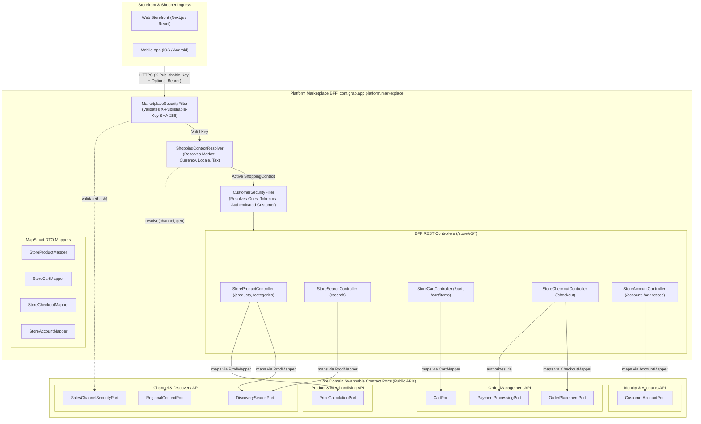

<!-- TEMPLATE INSTRUCTIONS
─────────────────────────────────────────────────────────────────
This document bridges the System Design (002) to implementation details
for Feature 5: Platform Marketplace BFF Implementation.
─────────────────────────────────────────────────────────────────
-->

# Feature: Platform Marketplace BFF Implementation

> **System Design:** [Ecommerce Platform Services and Domain Architecture System Design](../system-design/002-ecommerce_platform_services_and_domain_architecture_system_design.md)

---

## 1. What & Why

### What does this feature do?

This feature establishes a dedicated, secure, and high-throughput **Backend-for-Frontend (BFF)** application namespace (`com.grab.app.platform.marketplace`) and API endpoint group (`/store/v1/*`) tailored specifically for public customer storefronts, mobile apps, and headless sales channels. It physically decouples public shopper traffic—catalog discovery, regional price resolution, shopping cart mutations, customer checkout, and order placement—from administrative merchant management (`/seller/v1/*`).

The Marketplace BFF acts as the edge entrypoint and orchestration tier for end-customers:
1. **Sales Channel & Edge Key Verification**: Validates public API credentials (`X-Publishable-Key`) using irreversible SHA-256 digests via `SalesChannelSecurityPort`, ensuring requests originate from active and enabled selling destinations.
2. **Multi-Regional Shopping Context Resolution**: Determines the customer's active market, geographic country, currency code, locale, and tax jurisdiction via `RegionalContextPort` using Geo-IP headers or explicit channel configuration.
3. **Dual-State Customer Identity**: Transparently supports both anonymous guest shoppers (via guest session tokens) and authenticated customers (via Bearer JWT / `HttpOnly` cookies) without requiring login for basic browsing or cart assembly.
4. **Contextual Discovery & Factual Search**: Serves high-speed catalog searches and category browsing from denormalized factual projections (`DiscoverySearchPort`), enriching presentations with regional pricing and discounts (`PriceCalculationPort`) in a single unified response.
5. **Cart & Checkout Orchestration**: Coordinates multi-domain shopping cart operations and order placement by delegating to `CartPort`, `OrderPlacementPort`, and `PaymentProcessingPort` via compile-time MapStruct mappers with zero entity leakage.

### Why is it needed?

- **Traffic Contention & Conflated Ingress**: In the legacy monolith, administrative seller endpoints, heavy reporting queries, and public customer storefront browsing shared a flat `/api/v1/*` namespace. A spike in flash-sale storefront browsing caused thread-pool starvation and database connection exhaustion for administrative merchant operations.
- **Insecure Public Key & Channel Tampering**: Legacy storefront controllers accepted channel and currency identifiers as unverified client parameters (e.g. `?channelId=...&currency=USD`). Attackers could spoof sales channels or bypass region-specific tax/currency invariants.
- **Cross-Domain Friction in Storefront UI**: Storefront web clients (Next.js/React) require composite responses (e.g. product title + localized price + real-time stock availability). Without an edge BFF, frontend clients are forced to make multiple sequential HTTP calls to low-level internal services, increasing page load latency and mobile battery drain.
- **JPA Entity Leakage & Performance Traps**: Direct controller returns of internal JPA entities caused `LazyInitializationException` errors outside transactional sessions and serialized unnecessary database columns over mobile networks.
- **Microservice-Ready Storefront Seams**: As domains evolve into autonomous microservices, the Marketplace BFF remains the stable gateway for public clients. Swapping in-process port adapters for remote gRPC or REST clients requires **zero changes** to frontend applications.

### What's in scope / out of scope?

| In Scope | Out of Scope |
|:---------|:-------------|
| Dedicated REST controller package (`com.grab.app.platform.marketplace.controller`) exposing `/store/v1/*` endpoints. | Administrative seller portal endpoints (`/seller/v1/*`, handled in [Feature 4](feat_012-platform-seller-central-bff.md)). |
| Ingress filter (`MarketplaceSecurityFilter`) enforcing `X-Publishable-Key` (SHA-256 digest validation). | Merchant product workflow sagas (`create-sellable-product`, handled in [Feature 4](feat_012-platform-seller-central-bff.md)). |
| Stateless shopping context resolution (`ShoppingContextResolver`) injecting `ShoppingContext` (channel, region, currency, locale, tax rules). | Internal database schema DDL or Flyway migrations (handled in [Feature 2](feat_010-service-level-database-consolidation.md)). |
| Dual-mode customer authentication filter (`CustomerSecurityFilter`) supporting anonymous guests and logged-in customers. | Payment gateway network integrations (e.g. Stripe, 2C2P webhooks/redirect handlers). |
| Catalog discovery and faceted search endpoints (`/store/v1/products`, `/store/v1/search`, `/store/v1/categories`). | Background projection reconciliation logic (handled in [Feature 6](feat_006-discovery-wiring-projection-reconciliation.md)). |
| Shopping cart mutation endpoints (`/store/v1/cart`, `/store/v1/cart/items`, `/store/v1/cart/coupon`). | Physical microservice extraction or Kubernetes deployment configurations. |
| Checkout and order placement orchestration endpoints (`/store/v1/checkout`, `/store/v1/orders/{id}`). | Warehouse bin replenishment and inventory receiving operations. |
| Customer account and address book endpoints (`/store/v1/account`, `/store/v1/account/addresses`). | Merchant KYC verification and business registration approvals. |
| Pure Hexagonal Port Delegation using MapStruct mappers and immutable Java `record` contracts. | |
| Public HTTP caching headers (`ETag`, `Cache-Control`) and storefront CORS configuration. | |

---

## 2. Acceptance Criteria

> This feature is **done** when all criteria below pass. Each criterion must be testable — no vague language.

| # | Criteria | How to Verify |
|:--|:---------|:--------------|
| **AC-1** | **Dedicated `/store/v1/*` Ingress Namespace**: All public storefront endpoints are grouped under `/store/v1/*` within package `com.grab.app.platform.marketplace.controller`. Administrative merchant endpoints and seller JWTs are completely barred from this namespace. | Inspect Spring MVC request mappings via `/actuator/mappings`; verify all public operations resolve under `/store/v1/*`. |
| **AC-2** | **Publishable Key Validation**: Requests to `/store/v1/*` without a valid `X-Publishable-Key` header (or containing an inactive/revoked key) are rejected with `HTTP 401 Unauthorized` adhering to RFC 7807 Problem Details. | Send request `GET /store/v1/products` without header; verify `401 Unauthorized` with `invalidPublishableKey` error code. |
| **AC-3** | **Regional Shopping Context Resolution**: Every request with a valid publishable key automatically resolves an immutable `ShoppingContext` (containing `salesChannelId`, `regionId`, `countryCode`, `currencyCode`, and `locale`). Requests for unserved regions receive `HTTP 422 Unprocessable Entity` without silent fallback. | Send request with header `X-Publishable-Key: pk_test_123` and header `X-Country-Code: ZZ`; verify response is `422 Unprocessable Entity` with `regionNotServed`. |
| **AC-4** | **Dual-State Customer Identity**: Unauthenticated requests to `/store/v1/cart` operate anonymously using a server-issued guest session token. Requests providing a valid customer Bearer JWT (or cookie) automatically attach an `AuthenticatedCustomerPrincipal` to the cart and order. | Create cart as guest; inspect response for guest session header; send authenticated request to `/store/v1/account/me` with customer JWT; verify `200 OK` with customer profile. |
| **AC-5** | **Factual Discovery & Regional Pricing Composition**: `GET /store/v1/products` and `GET /store/v1/products/{slug}` return denormalized catalog presentation facts enriched with active regional currency prices in a single request. Queries invoke exclusively `DiscoverySearchPort` and `PriceCalculationPort`. | Execute `GET /store/v1/products/cotton-tshirt`; verify response contains localized title, image media, variant matrix, and calculated price in the active region currency. |
| **AC-6** | **Shopping Cart Mutation Lifecycle**: Shoppers can create carts, add SKU items, update line quantities, remove lines, and apply coupon codes via `/store/v1/cart/*`. Out-of-stock items or disabled variants are rejected with `HTTP 409 Conflict` or `HTTP 400 Bad Request`. | Execute cart lifecycle sequence (`POST /store/v1/cart/items` -> `PUT /store/v1/cart/items/{id}` -> `DELETE /store/v1/cart/items/{id}`); verify cart aggregate updates accurately via `CartPort`. |
| **AC-7** | **Checkout Readiness & Order Placement**: Shoppers can validate checkout readiness, submit shipping address and payment method, and complete order placement via `POST /store/v1/checkout`. Successful submission converts the cart into an immutable order aggregate returning `HTTP 201 Created` with order details. | Submit valid checkout payload to `POST /store/v1/checkout`; verify `201 Created` with `orderId`, and confirm inventory reservations are finalized in Order Management domain. |
| **AC-8** | **Customer Account & Address Book**: Authenticated shoppers can retrieve order history (`GET /store/v1/orders`), manage personal profiles, and update saved shipping destinations (`/store/v1/account/addresses`). Cross-customer inspection is strictly forbidden (`HTTP 403 Forbidden`). | Send request with Customer A credentials to inspect Customer B's order; verify request is rejected with `HTTP 403 Forbidden`. |
| **AC-9** | **Pure Hexagonal Port Delegation**: All `/store/v1` controllers inject exclusively public domain port interfaces (`DiscoverySearchPort`, `PriceCalculationPort`, `CartPort`, `OrderPlacementPort`, `PaymentProcessingPort`, `CustomerAccountPort`, `SalesChannelSecurityPort`). Zero `@Repository`, `@Entity`, or domain `internal` use cases are imported. | Run `mvn test -Dtest=MarketplaceBffArchitectureTest -pl app`; ArchUnit tests pass with 0 forbidden import violations. |
| **AC-10** | **Public Caching & Storefront CORS**: Public catalog endpoints return `ETag` and `Cache-Control: public, max-age=60` headers. CORS configuration permits requests originating from whitelisted storefront domains (`http://localhost:3000`, `https://*.grabstore.com`) with exposed headers. | Send `GET /store/v1/products` with `If-None-Match`; verify `HTTP 304 Not Modified` when content is unchanged; verify `Access-Control-Allow-Origin` header matches request origin. |

---

## 3. Solution Design

### How does this feature work?

---

### Key Design Decisions

| Decision | Choice | Rationale |
|:---------|:-------|:----------|
| **Dedicated BFF Ingress (`/store/v1/*`)** | Dedicated `platform.marketplace` namespace | Physically partitions high-volume anonymous shopper traffic from administrative merchant traffic (`/seller/v1/*`), enabling independent autoscaling, distinct rate-limits, and optimized caching. |
| **API Credential Model** | `X-Publishable-Key` with SHA-256 Digest | Allows public web/mobile apps to embed public keys safely without exposing private API secrets, while enabling seamless instant key rotation without downtime. |
| **Edge Shopping Context Resolution** | Stateless Request Filter (`ShoppingContextResolver`) | Resolves active sales channel, country, currency, and tax rules once at the edge, injecting an immutable `ShoppingContext` into all downstream domain queries. |
| **Dual-Mode Shopper Authentication** | Guest Session Token + Customer Bearer JWT | Guarantees friction-free checkout: anonymous guests can assemble shopping carts immediately, while returning customers can log in to access saved addresses and order histories. |
| **Catalog Read Optimization** | Factual Projection + Dynamic Regional Pricing | Separates static product presentation facts (titles, images, descriptions) from volatile pricing rules, enabling edge caching for catalog data while guaranteeing accurate real-time currency pricing. |
| **Inter-Module Communication** | Hexagonal Contract Ports & MapStruct | The BFF depends strictly on immutable Java `record` interfaces defined in core domain `api` packages. Prevents `LazyInitializationException` and keeps the BFF 100% extractable to microservices. |
| **Cart & Checkout Lifecycle** | Atomic Order Placement Port | Coordinates checkout validation, price verification, inventory reservation, and payment authorization behind a single clean port method, avoiding complex client-side multi-call sagas. |
| **Storefront Caching Strategy** | HTTP `ETag` + `Cache-Control: public, max-age=60` | Minimizes server load during traffic surges by offloading static catalog browsing to browser and CDN caches. |

---

## 4. Implementation Specifications

> Blueprints developers code against for this feature:

### Domain Specs (Data Models & Business Rules)

- None; the Marketplace BFF is an edge API gateway and presentation orchestration tier. It owns zero database entities and delegates strictly through Hexagonal Contract Ports.

### Workflow Specs (Process Flows)

- [Browse Contextual Storefront Offers](../spec/workflows/browse-contextual-storefront-offers-workflow.md)

### Tech Specs (Technology Decisions & Rules)

- [Marketplace BFF Ingress Security Tech Spec](../spec/system/marketplace-bff-security-tech-spec.md)
- [Marketplace BFF Endpoints & Contract Mapping Tech Spec](../spec/system/marketplace-bff-endpoints-tech-spec.md)
- [Four Core Domains Contract Ports Tech Spec](../spec/system/four-core-domains-contract-ports-tech-spec.md)
- [Shopping Context Resolution Tech Spec](../spec/system/shopping-context-resolution-tech-spec.md)
- [Publishable Key Lifecycle Tech Spec](../spec/system/publishable-key-lifecycle-tech-spec.md)
- [Storefront Query and Discovery Facts Boundary](../spec/system/storefront-query-tech-spec.md)
