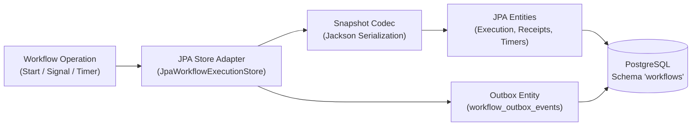

# Feature: Multi-Schema Persistence, Receipts & Timer Leases

> **System Design:** [Workflow Orchestration & Durable Saga Runtime System Design](../system-design/004-workflow_orchestration_system_design.md)

---

## 1. What & Why

### What does this feature do?

This feature implements the durable relational persistence layer for the workflow orchestration engine within the dedicated PostgreSQL schema `workflows`. It provides typed snapshot serialization for complex execution graphs, cryptographic SHA-256 idempotency receipts for start requests (`workflow_start_receipt`) and participant signals (`workflow_signal_receipt`), sequential audit history logs (`workflow_history`), and pessimistic lease-based timer scheduling (`workflow_timer`) with zero native SQL queries.

### Why is it needed?

Distributed e-commerce sagas span multiple asynchronous steps and can run over minutes or hours. In-memory state cannot survive node restarts or cluster failovers. Furthermore, network retries and duplicate events risk executing operations multiple times or corrupting state through payload drift. This feature guarantees that all workflow executions, branch states, and dispatch receipts are durably stored in PostgreSQL with ACID guarantees, enforces at-most-once idempotency via cryptographic receipts, and provides race-free timer execution using pessimistic row-level leases without requiring external distributed locking services like Redis or Zookeeper.

### What's in scope / out of scope?

| In Scope | Out of Scope |
|:---------|:-------------|
| Dedicated PostgreSQL schema `workflows` with Flyway migrations (`V1`, `V2`, `V3`) | Cross-schema foreign keys or joins to `catalog`, `"order"`, `account`, or `channel` |
| JPA entities and Spring Data JPA repositories using derived queries only | Native SQL queries (`nativeQuery = true`) in persistence repositories |
| Cryptographic SHA-256 start receipts and signal receipts enforcing deduplication | In-memory only caching layers or unpersisted state machines |
| Typed JSON snapshot serialization for node outputs, choices, and accepted signals | Unstructured, untyped String-to-String context maps |
| Pessimistic row-level timer claiming (`claim_token` and `lease_expires_at`) | External distributed coordination clusters (e.g., Redis, Consul, Zookeeper) |
| Transactional outbox table (`workflow_outbox_events`) committed in the workflow TX | Dual-write direct REST or message broker dispatches outside transactions |

---

## 2. Acceptance Criteria

> This feature is **done** when all criteria below pass. Each criterion is strictly testable.

| # | Criteria | How to Verify |
|:--|:---------|:--------------|
| AC-1 | Storing start receipts **MUST** enforce uniqueness on `(caller_scope, idempotency_key)`; duplicate starts with identical input fingerprints return the existing execution ID; duplicate starts with different fingerprints throw `WorkflowIdempotencyConflictException`. | Multi-threaded PostgreSQL integration tests in `WorkflowRuntimePostgresTest` verifying idempotency handling. |
| AC-2 | Storing signal receipts **MUST** enforce primary key on `transport_message_id` and unique correlation on `(execution_id, logical_operation_id, payload_fingerprint)`; duplicate signals are marked `PROCESSED` without re-transitioning; conflicting digests throw `WorkflowIdempotencyConflictException`. | PostgreSQL integration tests in `WorkflowRuntimePostgresTest` testing signal deduplication and tamper rejection. |
| AC-3 | All Spring Data JPA repositories in `workflow-infrastructure` **MUST NOT** use native queries (`@Query(nativeQuery = true)`). Derived queries or JPQL must be used exclusively. | ArchUnit architecture test `WorkflowArchitectureTest` asserting zero native queries on all repository methods. |
| AC-4 | Typed execution state snapshots (inputs, outputs, choices, accepted signals) **MUST** survive round-trip Jackson serialization/deserialization without data loss or type corruption. | Unit and Testcontainers tests in `JpaWorkflowExecutionStoreTest` clearing persistence context and asserting snapshot equality. |
| AC-5 | Due timers **MUST** be claimed using pessimistic row-level leases (`claim_token` and `lease_expires_at`); expired leases from dead workers **MUST** be safely reclaimable by surviving worker nodes. | Concurrency tests in `WorkflowRuntimePostgresTest` simulating worker lease expiration and successful timer reclaim. |
| AC-6 | Every workflow state mutation, history log entry, start/signal receipt, and outbox dispatch event **MUST** commit atomically inside the `@WorkflowTransactional` boundary. | Testcontainers failure injection test verifying atomic rollback of all entities when an error occurs during persistence. |

---

## 3. Solution Design

### How does this feature work?

> When a workflow command or signal is received, the runtime coordinates persistence across dedicated JPA repositories in the `workflows` schema. State snapshots are serialized into typed JSON columns, idempotency receipts are checked and written, and outgoing dispatch intents are committed to the outbox table in the same local database transaction.

### Key Design Decisions

| Decision | Choice | Rationale |
|:---------|:-------|:----------|
| **Schema Isolation** | Dedicated `workflows` Schema | Conforms to multi-schema architectural boundaries, preventing cascading pool exhaustion and cross-domain data coupling. |
| **Pessimistic Timer Leases** | Row-Level Leases with Expiration | Eliminates the operational complexity of distributed lock managers (Redis/Zookeeper) while preventing duplicate timer triggers. |
| **Derived JPA Queries** | No Native SQL Queries | Enforces repository architectural invariants (R11/R20) and ensures database-agnostic compatibility. |
| **Typed Snapshot Serialization** | Jackson Binary/JSON Codecs | Enables flexible, polymorphic node execution outputs while maintaining strict type safety during execution replay. |

---

## 4. Implementation Specifications

> Technical blueprints and rules for this feature:

### Domain Specs (Data Models & Business Rules)
- Flyway Migration Schema: [V1__workflow_schema.sql](file:///Users/khinemyaezin/Repository/grab-ecommerce/grab/app/src/main/resources/db/migration/workflows/V1__workflow_schema.sql)
- Reliability & Lease Updates: [V2__workflow_reliability.sql](file:///Users/khinemyaezin/Repository/grab-ecommerce/grab/app/src/main/resources/db/migration/workflows/V2__workflow_reliability.sql)
- Fingerprint Schema Migrations: [V3__workflow_fingerprint_format.sql](file:///Users/khinemyaezin/Repository/grab-ecommerce/grab/app/src/main/resources/db/migration/workflows/V3__workflow_fingerprint_format.sql)

### Workflow Specs (Process Flows)
- Pessimistic Timer Lease Scheduler: [JpaWorkflowTimerScheduler.java](file:///Users/khinemyaezin/Repository/grab-ecommerce/grab/workflow-infrastructure/src/main/java/com/grab/workflow/infrastructure/service/JpaWorkflowTimerScheduler.java)
- JPA Execution Store Adapter: [JpaWorkflowExecutionStore.java](file:///Users/khinemyaezin/Repository/grab-ecommerce/grab/workflow-infrastructure/src/main/java/com/grab/workflow/infrastructure/adapter/JpaWorkflowExecutionStore.java)

### Tech Specs (Technology Decisions & Rules)
- Dedicated Persistence Tech Spec: [Workflow Persistence, Receipts & Timer Leases Tech Spec](../spec/system/workflow-persistence-and-timer-leases-tech-spec.md)
- Primary Framework Tech Spec: [Custom Ecommerce Workflow Orchestration Framework](../spec/system/workflow-framework-tech-spec.md)
