# Feature: Headless CQRS Runtime & Universal Port Protocol

> **System Design:** [Workflow Orchestration & Durable Saga Runtime System Design](../system-design/004-workflow_orchestration_system_design.md)

---

## 1. What & Why

### What does this feature do?

This feature establishes the headless application core and universal communication protocol for the workflow orchestration engine under package `com.grab.app.workflow`. It exposes public Java port interfaces (`WorkflowRuntimeCommandPort`, `WorkflowRuntimeQueryPort`, `WorkflowRuntimeSignalPort`, and `WorkflowTimerProcessingPort`) with nested immutable records, connects them to group-scoped CQRS buses (`workflowCommandBus`, `workflowQueryBus`), coordinates transactions via `@WorkflowTransactional`, publishes task dispatches to the Transactional Outbox, and listens for domain task outcome events via `WorkflowTaskOutcomeEventListener`.

### Why is it needed?

Previously, the workflow module hosted Spring WebMvc REST controllers directly, entangling web transport concerns and HTTP annotations with internal saga orchestration logic. This violated hexagonal layering and headless architecture rules, and prevented clean testing and extraction. By adopting the platform's Tier-2 Universal Java Port Protocol and group-scoped CQRS pipelines, Platform BFFs can invoke workflows in-process today, while preserving a zero-code-change drop-in migration path to gRPC / Protocol Buffers when extracting workflows into a dedicated microservice.

### What's in scope / out of scope?

| In Scope | Out of Scope |
|:---------|:-------------|
| Universal Java Port Interfaces in `com.grab.app.workflow.port.message` using immutable records | Hosting Spring WebMvc REST controllers (`@RestController`, `@RequestMapping`) in `app/workflow` |
| Inbound Port Adapters delegating port invocations to group CQRS command/query buses | Direct injection of `CommandBus` or `QueryBus` by external caller modules |
| Scoped `workflowCommandBus` and `workflowQueryBus` beans with isolated handler registration | Cross-calling between `workflowCommandBus` and `workflowQueryBus` |
| CQRS Command and Query handlers demarcated with `@WorkflowTransactional` and `@WorkflowReadTransactional` | Demarcating `@Transactional` on controllers, services, mappers, or assemblers |
| Transactional outbox event publishing (`WorkflowTaskDispatchEvent`) via `OutboxWorkflowDispatchPublisher` | Direct RPC or network message broker publishing outside local database transactions |
| Background timer worker (`WorkflowTimerWorker`) processing due timers via ShedLock | Distributed external job schedulers (e.g., Quartz, Kubernetes CronJobs) |
| Inbound integration event listener (`WorkflowTaskOutcomeEventListener`) routing signals to the signal port | Direct synchronous cross-domain entity mutations from workflow handlers |

---

## 2. Acceptance Criteria

> This feature is **done** when all criteria below pass. Each criterion is strictly testable.

| # | Criteria | How to Verify |
|:--|:---------|:--------------|
| AC-1 | The workflow core module (`com.grab.app.workflow`) **MUST NOT** import or contain any Spring WebMvc annotations (`@RestController`, `@RequestMapping`, `@PathVariable`, `@RequestParam`). | ArchUnit architecture test `WorkflowArchitectureTest` asserting zero WebMvc imports in `com.grab.app.workflow`. |
| AC-2 | Command handlers and services **MUST NOT** inject or dispatch `workflowQueryBus`; query handlers and services **MUST NOT** inject or dispatch `workflowCommandBus`. | ArchUnit architecture test `WorkflowArchitectureTest` asserting strict CQRS bus separation. |
| AC-3 | All port interfaces in `com.grab.app.workflow.port.message` **MUST** declare operations exclusively using immutable Java `record` types without web or persistence annotations. | Code inspection and compilation checks verifying record types across all port method signatures. |
| AC-4 | Starting a workflow via `WorkflowRuntimeCommandPort.startWorkflow()` **MUST** dispatch `StartWorkflowRuntimeCommand` through `workflowCommandBus` and return `RuntimeStartResult` with execution ID and status. | Integration test in `WorkflowRuntimePostgresTest` executing workflow starts via the command port. |
| AC-5 | Outgoing task dispatches **MUST** be written to `workflow_outbox_events` by `OutboxWorkflowDispatchPublisher` within the same database transaction as the command handler. | PostgreSQL transaction rollback test verifying outbox event rollback upon command handler failure. |
| AC-6 | `WorkflowTaskOutcomeEventListener` **MUST** consume `WorkflowTaskOutcomeEvent` emitted by domain participants and route them to `WorkflowRuntimeSignalPort.acceptSignal()` without direct coupling to domain beans. | Event-driven integration test verifying that publishing `WorkflowTaskOutcomeEvent` triggers signal handling and advances the workflow. |
| AC-7 | Background timer polling by `WorkflowTimerWorker` **MUST** delegate to `WorkflowTimerProcessingPort` under ShedLock coordination, firing due timers safely without duplicate task dispatch. | Unit and scheduling tests asserting timer worker execution and ShedLock annotation configuration. |

---

## 3. Solution Design

### How does this feature work?

> External callers (e.g., Seller Platform BFF) invoke `WorkflowRuntimeCommandPort`. The inbound adapter maps the request record to a CQRS command, dispatches it to `workflowCommandBus`, and executes the command handler under `@WorkflowTransactional`. The handler invokes `WorkflowRuntime`, persists state and outbox dispatches, and returns an immutable result. When domain services finish their tasks, they emit `WorkflowTaskOutcomeEvent`, which `WorkflowTaskOutcomeEventListener` receives and routes to `WorkflowRuntimeSignalPort`.

```mermaid
flowchart LR
    Caller["Platform BFF\n(External Caller)"] --> Port["WorkflowRuntimeCommandPort\n(Universal Java Port)"]
    Port --> Adapter["CommandPortAdapter\n(Inbound Message Adapter)"]
    Adapter --> Bus["workflowCommandBus\n(Group-Scoped CQRS Bus)"]
    Bus --> Handler["StartWorkflowCommandHandler\n(@WorkflowTransactional)"]
    Handler --> Runtime["WorkflowRuntime\n(Coordinator)"]
    Runtime --> Outbox["Transactional Outbox\n(workflow_outbox_events)"]
    Outbox -.-> Event["WorkflowTaskOutcomeEvent\n(Domain Participant)"]
    Event --> Listener["WorkflowTaskOutcomeEventListener"]
    Listener --> SignalPort["WorkflowRuntimeSignalPort"]
```

### Key Design Decisions

| Decision | Choice | Rationale |
|:---------|:-------|:----------|
| **Headless Architecture** | Zero Web Controllers in Core | Keeps workflow business logic pure, easily testable in memory, and decoupled from client presentation protocols. |
| **Universal Java Port Protocol** | In-Process Java Port with Nested Records | Zero latency in-process execution today, with an identical drop-in interface for future gRPC/Protobuf migration. |
| **Group-Scoped CQRS Buses** | Dedicated `workflowCommandBus` / `workflowQueryBus` | Prevents handler collisions, guarantees bus isolation, and strictly enforces single-responsibility separation between reads and writes. |
| **Event Choreography Ingress** | Decoupled Listener via Shared Event | Decouples downstream domain participants (`catalog`, `inventory`, etc.) from workflow internal beans, routing task outcomes cleanly. |

---

## 4. Implementation Specifications

> Technical blueprints and rules for this feature:

### Domain Specs (Data Models & Business Rules)
- Universal Command Port: [WorkflowRuntimeCommandPort.java](file:///Users/khinemyaezin/Repository/grab-ecommerce/grab/app/src/main/java/com/grab/app/workflow/port/message/WorkflowRuntimeCommandPort.java)
- Universal Query Port: [WorkflowRuntimeQueryPort.java](file:///Users/khinemyaezin/Repository/grab-ecommerce/grab/app/src/main/java/com/grab/app/workflow/port/message/WorkflowRuntimeQueryPort.java)
- Universal Signal Port: [WorkflowRuntimeSignalPort.java](file:///Users/khinemyaezin/Repository/grab-ecommerce/grab/app/src/main/java/com/grab/app/workflow/port/message/WorkflowRuntimeSignalPort.java)

### Workflow Specs (Process Flows)
- Inbound Outcome Event Listener: [WorkflowTaskOutcomeEventListener.java](file:///Users/khinemyaezin/Repository/grab-ecommerce/grab/app/src/main/java/com/grab/app/workflow/internal/adapter/inbound/event/WorkflowTaskOutcomeEventListener.java)
- Background Timer Worker: [WorkflowTimerWorker.java](file:///Users/khinemyaezin/Repository/grab-ecommerce/grab/app/src/main/java/com/grab/app/workflow/internal/service/WorkflowTimerWorker.java)

### Tech Specs (Technology Decisions & Rules)
- Dedicated Runtime Tech Spec: [Workflow Headless Runtime & Universal Port Protocol Tech Spec](../spec/system/workflow-headless-runtime-and-protocol-tech-spec.md)
- Platform Communication Tech Spec: [Workflow Service Communication Protocol Tech Spec](../spec/system/workflow-service-communication-protocol-tech-spec.md)
