<!-- TEMPLATE INSTRUCTIONS
─────────────────────────────────────────────────────────────────
This document bridges the System Design (002) to implementation details
for Feature 6: Microservice Seam Enforcement & Spring Modulith ArchUnit Verification.
─────────────────────────────────────────────────────────────────
-->

# Feature: Microservice Seam Enforcement & Spring Modulith ArchUnit Verification

> **System Design:** [Ecommerce Platform Services and Domain Architecture System Design](../system-design/002-ecommerce_platform_services_and_domain_architecture_system_design.md)

---

## 1. What & Why

### What does this feature do?

This feature establishes an automated, continuous verification harness that guarantees the architectural invariants of the Modular Monolith (`app`) and its 4 Core Domain Clusters (`Product & Merchandising`, `Order Management`, `Identity & Accounts`, `Channel & Discovery`). It introduces automated **ArchUnit Architecture Tests**, **Spring Modulith Modularity Verification**, and **Transactional Outbox Event Serialization Tests** as mandatory build gates in CI/CD.

This automated verification ensures that:
1. **Hexagonal Boundaries Remain Impermeable**: ArchUnit tests enforce that `{bc}-domain` modules remain pure Java with zero framework annotations, `{bc}-application` modules only depend inward on domain entities and framework ports, and `{bc}-adapter-persistence` modules perform strictly intra-domain persistence with zero cross-module queries.
2. **Platform BFF Ingress Isolation**: ArchUnit tests verify that both `platform.seller` and `platform.marketplace` communicate exclusively through public contract ports (`*Port`), with zero imports of domain `@Entity`, `@Repository`, or internal use cases.
3. **Modulith Boundary Integrity**: Spring Modulith's `ApplicationModules.verify()` runs against `EcommerceApplication`, validating that no module accesses another module's unexposed internal packages and verifying zero circular package dependencies.
4. **Kafka & Microservice Extraction Readiness**: Serialization verification suites ensure that all integration events written to the Transactional Outbox are self-contained, fully serializable to JSON without Hibernate proxy attachments, and ready for remote event streaming (Kafka/RabbitMQ) without code modification.

### Why is it needed?

- **Architectural Erosion in Monoliths**: Without automated compile-time and test-time enforcement, modular boundaries degrade rapidly. Developers under delivery pressure inevitably add convenient shortcuts: injecting an internal `@Repository` from another domain, importing a foreign JPA entity, or querying across database schemas. Over time, the modular monolith degenerates back into a tightly coupled "Big Ball of Mud".
- **Broken Microservice Extractability**: The core business value of System Design 002 is that any domain cluster (e.g., `Order Management`) can be extracted into an autonomous microservice tomorrow with zero business logic rewrites. If cross-domain entity relationships or in-memory bean injection are permitted to slip in, extraction requires massive, high-risk refactoring.
- **Runtime `LazyInitializationException` & Serialization Crashes**: When integration events or web DTOs contain unmapped ORM entities, serializing them outside the database transaction throws runtime exceptions or triggers N+1 query storms. Automated serialization tests catch these failures before code reaches staging.
- **Manual Code Review Inconsistency**: Architectural governance cannot rely on human vigilance during pull request reviews. Automated tests provide instant, objective, machine-enforced compliance feedback on every commit.

### What's in scope / out of scope?

| In Scope | Out of Scope |
|:---------|:-------------|
| Dedicated ArchUnit test suite (`com.grab.app.architecture`) verifying hexagonal layering, forbidden imports, and BFF port delegation. | Physically extracting domain modules into independent microservices or deploying them to Kubernetes. |
| Spring Modulith test suite (`ApplicationModularityTests`) executing `ApplicationModules.of(EcommerceApplication.class).verify()`. | Configuring external distributed tracing collectors (e.g. OpenTelemetry collector daemons, Jaeger). |
| Outbox event JSON serialization verification tests ensuring all events are flat, self-contained, and Kafka-ready. | Setting up or maintaining production Kafka clusters or broker infrastructure. |
| Maven CI/CD test phase integration failing the build on any architectural or modularity violation (`mvn test`). | Unit testing individual domain business logic rules (handled in respective domain libraries). |
| Generating living architecture documentation (C4 component diagrams, Modulith canvas) via Spring Modulith Documenter. | Performance benchmarking or load testing database connection pools. |

---

## 2. Acceptance Criteria

> This feature is **done** when all criteria below pass. Each criterion must be testable — no vague language.

| # | Criteria | How to Verify |
|:--|:---------|:--------------|
| **AC-1** | **Hexagonal Layer Direction Enforcement**: ArchUnit tests verify that classes in `*-domain` import zero Spring Framework, Jakarta Persistence, or Jackson annotations. Domain code depends strictly on pure Java and framework primitives. | Run `mvn test -Dtest=HexagonalLayeringArchitectureTest -pl app`; test suite passes with 0 violations. |
| **AC-2** | **Zero Cross-Domain Entity & Repository Leakage**: ArchUnit tests verify that no class outside a domain's own persistence adapter imports its JPA entities (`*Entity`) or Spring Data repositories (`*JpaRepository`). Cross-domain access is strictly barred. | Run `mvn test -Dtest=DomainBoundaryArchitectureTest -pl app`; test suite passes with 0 forbidden imports. |
| **AC-3** | **BFF Port-Only Delegation Enforcement**: ArchUnit tests verify that controllers and services in `com.grab.app.platform.seller` and `com.grab.app.platform.marketplace` inject exclusively public `*Port` interfaces and workflow services. Direct imports of domain repositories, JPA entities, or domain application use cases are rejected. | Run `mvn test -Dtest=PlatformBffSeamArchitectureTest -pl app`; test suite passes with 0 violations. |
| **AC-4** | **Spring Modulith Structural Verification**: `ApplicationModularityTests` initializes `ApplicationModules.of(EcommerceApplication.class)` and executes `.verify()`. The test passes with zero package boundary violations, zero unexposed internal imports, and zero circular dependencies. | Run `mvn test -Dtest=ApplicationModularityTests -pl app`; test passes successfully. |
| **AC-5** | **BFF Mutual Isolation**: ArchUnit tests verify that `com.grab.app.platform.seller` and `com.grab.app.platform.marketplace` have zero dependencies on each other. Neither BFF may import classes, DTOs, or controllers from the other. | Run `mvn test -Dtest=BffMutualIsolationArchitectureTest -pl app`; test passes with 0 cross-BFF references. |
| **AC-6** | **Transactional Outbox Event Serialization Verification**: Automated reflection tests inspect every event class published to `outbox_events` and verify they serialize to JSON and deserialize back without errors, containing zero Hibernate proxies, zero cyclic references, and zero non-serializable fields. | Run `mvn test -Dtest=OutboxEventSerializationTest -pl app`; all published integration event classes pass bidirectional JSON serialization. |
| **AC-7** | **Event Schema Metadata & Versioning**: All integration event classes inherit or implement the standard `IntegrationEvent` contract, providing non-null `eventId`, `occurredAt`, `eventVersion`, `aggregateType`, and `aggregateId`. | Run `mvn test -Dtest=EventSchemaMetadataTest -pl app`; all event classes satisfy metadata requirements. |
| **AC-8** | **Living Architecture Documentation Generation**: Running the modularity verification build generates up-to-date C4 component PlantUML diagrams and Markdown module canvases in `target/spring-modulith-docs/`. | Run `mvn test -Dtest=ApplicationModularityTests -pl app`; inspect `app/target/spring-modulith-docs/` and verify generated `.puml` and `.canvas` files exist. |
| **AC-9** | **CI Build Gate Enforcement**: Any pull request or commit that introduces a forbidden import, circular module dependency, or invalid event schema immediately breaks `mvn clean test` with descriptive failure output pointing directly to the offending class. | Introduce a simulated forbidden import in a test branch; run `mvn test -pl app`; build fails with standard ArchUnit assertion error. |

---

## 3. Solution Design

### How does this feature work?

```mermaid
flowchart TD
    subgraph MavenReactor ["Maven Build Pipeline: mvn clean test"]
        direction TB
        CompileStep["mvn test-compile"] --> ArchUnitRun["Run ArchUnit Test Suite"]
        CompileStep --> ModulithRun["Run Spring Modulith Tests"]
        CompileStep --> OutboxRun["Run Outbox Serialization Tests"]
    end

    subgraph ArchUnitSuite ["ArchUnit Seam Enforcement (com.grab.app.architecture)"]
        direction TB
        LayerRule["HexagonalLayeringArchitectureTest<br/>(domain <- app <- adapter)"]
        PortRule["PlatformBffSeamArchitectureTest<br/>(BFFs inject only *Port interfaces)"]
        NoEntityRule["DomainBoundaryArchitectureTest<br/>(Zero cross-domain entity/repo imports)"]
        BffIsoRule["BffMutualIsolationArchitectureTest<br/>(Zero seller <-> marketplace references)"]
    end

    subgraph ModulithSuite ["Spring Modulith Verification"]
        direction TB
        VerifyRule["ApplicationModules.of(EcommerceApplication.class).verify()<br/>(Zero circular dependencies, verifies @NamedInterface)"]
        DocGenerator["Documenter(modules).writeDocumentation()<br/>(Generates C4 Component Diagrams)"]
    end

    subgraph OutboxSuite ["Outbox Event & Kafka Readiness"]
        direction TB
        JsonRule["OutboxEventSerializationTest<br/>(Bidirectional Jackson JSON test)"]
        MetaRule["EventSchemaMetadataTest<br/>(Verifies eventId, version, aggregateId)"]
        NoProxyRule["ZeroHibernateProxyAssertion<br/>(Fails on ByteBuddy / CGLIB proxies)"]
    end

    ArchUnitRun --> ArchUnitSuite
    ModulithRun --> ModulithSuite
    OutboxRun --> OutboxSuite

    ArchUnitSuite -->|"Any Violation"| BuildFail["BUILD FAILURE: Architectural Regression Detected"]
    ModulithSuite -->|"Any Violation"| BuildFail
    OutboxSuite -->|"Any Violation"| BuildFail

    ArchUnitSuite -->|"Pass"| BuildSuccess["BUILD SUCCESS: 100% Microservice-Ready"]
    ModulithSuite -->|"Pass"| BuildSuccess
    OutboxSuite -->|"Pass"| BuildSuccess
```

---

### Key Design Decisions

| Decision | Choice | Rationale |
|:---------|:-------|:----------|
| **Verification Strategy** | Unit-Test Driven (`mvn test`) rather than external linters | ArchUnit and Spring Modulith run directly inside standard JUnit 5 test harnesses. Requires no separate CLI installations, runs natively in IDEs, and executes automatically on every `git push` or CI run. |
| **Living Documentation** | Spring Modulith `Documenter` | Automatically generates architectural C4 component diagrams and module catalogs from active Java code during test execution, ensuring documentation never drifts from reality. |
| **Event Serialization Standard** | Jackson Polymorphic Type-Safe JSON | Guarantees that outbox events written to PostgreSQL today can be picked up by Kafka Connect or Debezium tomorrow without requiring custom deserializers or schema conversions. |
| **Seam Strictness Policy** | Zero Exceptions / Zero Allow-lists | Banning whitelisting or `@SuppressFBWarnings` for architectural violations prevents gradual entropy. If an interface seam is needed, developers must declare a formal contract port. |
| **BFF Decoupling Enforcement** | Explicit package isolation rules | Enforces that `platform.seller` and `platform.marketplace` remain completely oblivious to each other, allowing either BFF to be extracted or scaled independently. |

---

## 4. Implementation Specifications

> Blueprints developers code against for this feature:

### Domain Specs (Data Models & Business Rules)

- None; this feature is an automated testing, architectural governance, and verification harness.

### Workflow Specs (Process Flows)

- None

### Tech Specs (Technology Decisions & Rules)

- [ArchUnit Seam Enforcement Tech Spec](../spec/system/archunit-seam-enforcement-tech-spec.md)
- [Spring Modulith Verification & Outbox Serialization Tech Spec](../spec/system/spring-modulith-verification-tech-spec.md)
- [Four Core Domains Contract Ports Tech Spec](../spec/system/four-core-domains-contract-ports-tech-spec.md)
- [Transactional Outbox Tech Spec](../spec/system/transactional-outbox-tech-spec.md)
