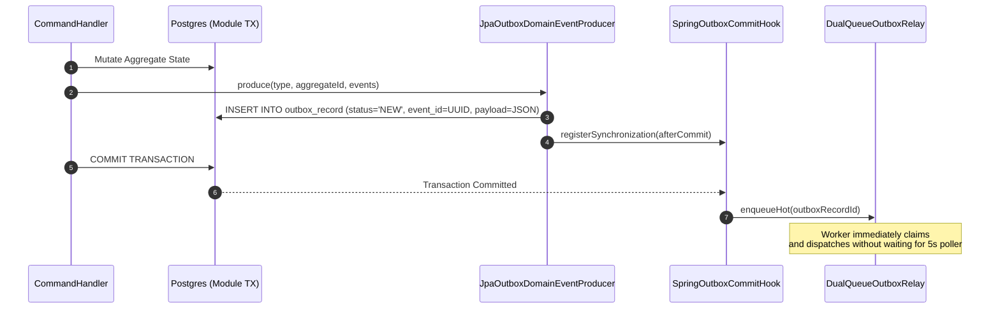
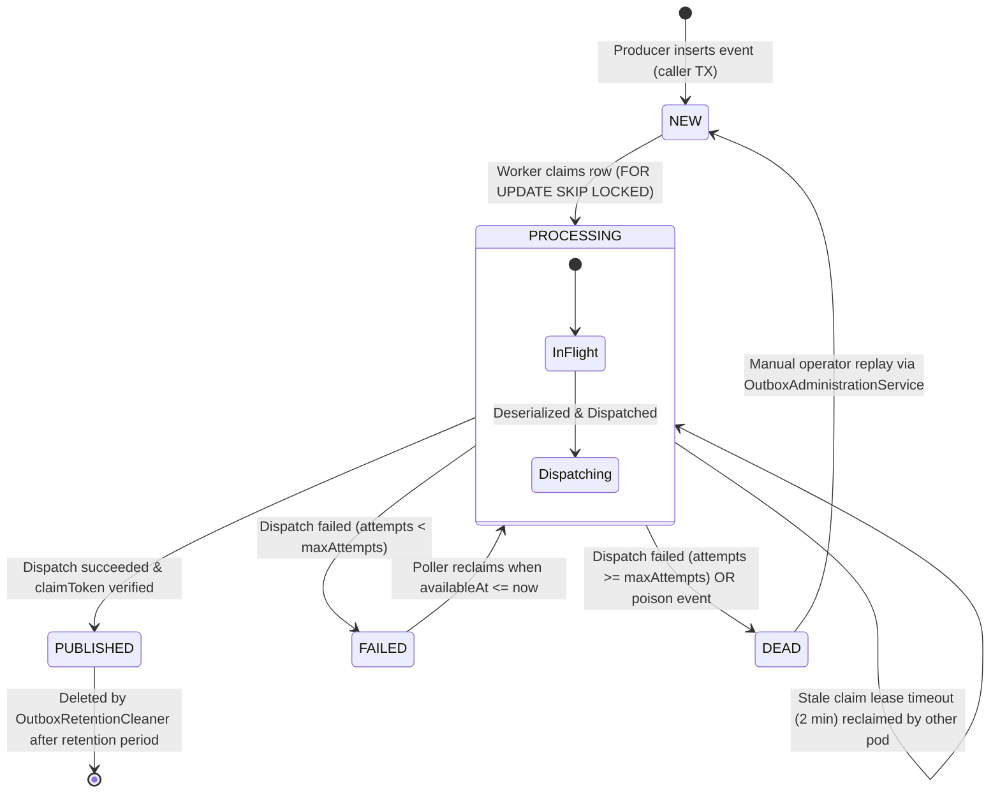
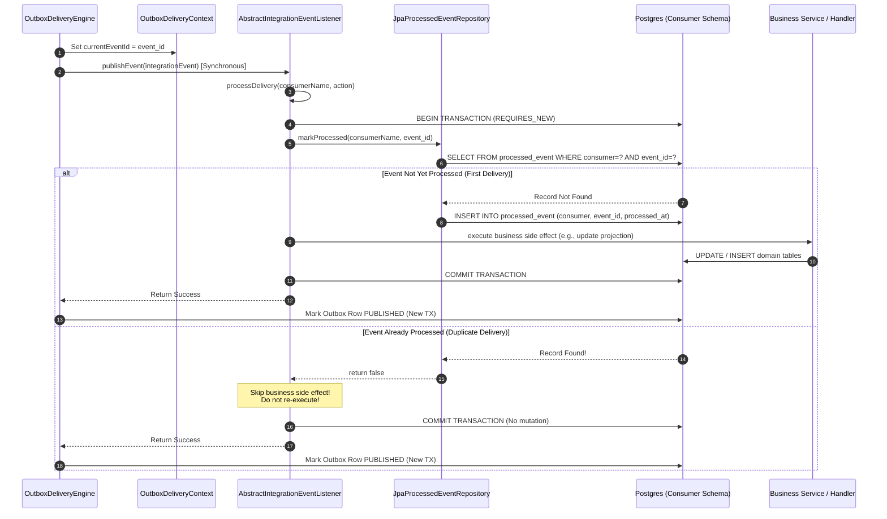
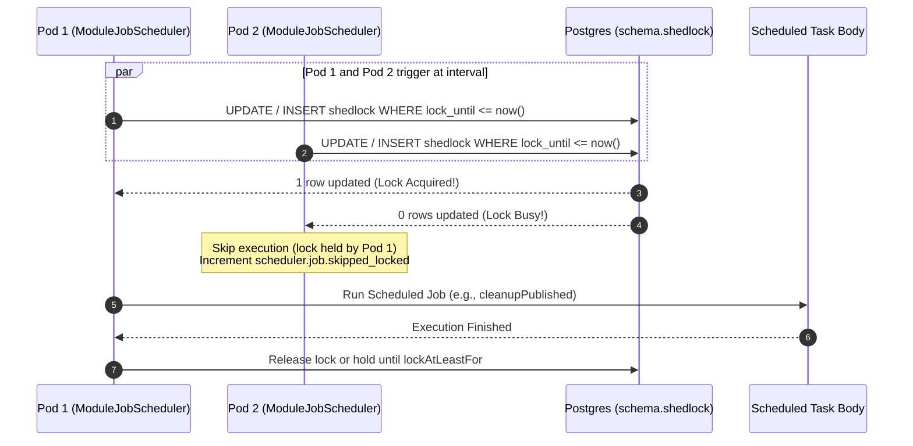
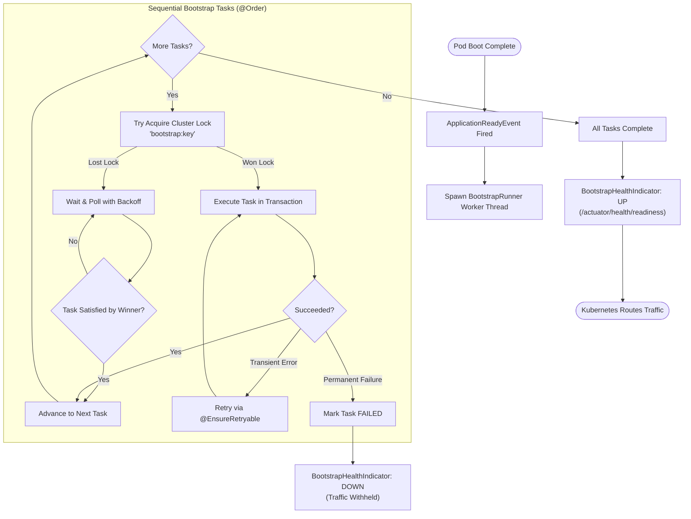
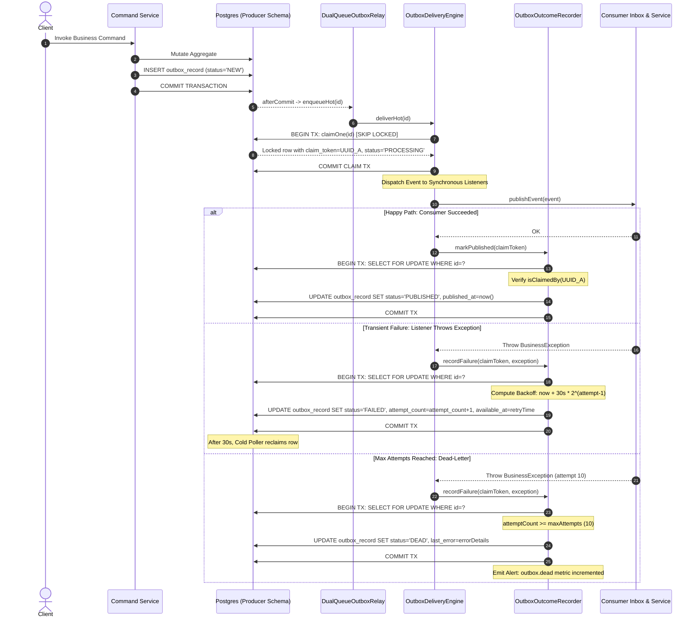

# Technical Documentation: Transactional Outbox, Consumer Inbox, and Distributed Scheduling Subsystems

> **Module Scope**: `framework`, `outbox-infrastructure`, `scheduling-infrastructure`, and module compositions in `app`  
> **Target Audience**: Backend Engineers, System Architects, DevOps/SRE, and Code Reviewers  
> **Status**: Production Reference Implementation  

---

## 1. Architectural Overview & System Context

In a distributed, modular e-commerce platform composed of autonomous bounded contexts (Catalog, Inventory, Pricing, Customer, Merchant, Identity, Cart, Channel, Order, Workflow), business transactions must frequently emit integration events across service boundaries without introducing:
1. **Dual-write anomalies**: Writing to a database and publishing to a message broker in separate uncoordinated operations risks permanent divergence if either action fails or crashes mid-way.
2. **Distributed transactions (2PC / XA)**: Heavyweight two-phase commit protocols introduce extreme latency, coordinator single points of failure, and lock contention.
3. **Cross-schema database coupling**: Direct cross-schema foreign keys or joins violate bounded context autonomy (enforced by `AGENTS.md` Rule 5).
4. **Cluster race conditions**: In multi-pod deployments ($N \ge 2$), competing instances running background jobs or startup tasks can cause lock storms, duplicate event dispatch, and database deadlocks.

To solve these challenges in a clean, microservice-extractable manner, the platform provides two foundational decoupled subsystems:
- **Transactional Outbox & Consumer Inbox**: Guarantees **at-least-once delivery** from producers and **exactly-once execution** in consumers across isolated PostgreSQL schemas.
- **Three-Tier Distributed Scheduling Framework**: Classifies and manages all background work into **Class A (Competing Workers)**, **Class B (Cluster Singletons)**, and **Class C (Bootstrap Tasks)** with dedicated thread pool isolation per module and distributed lease/lock mechanisms.

---

### 1.1 High-Level Component & Interaction Topology

The following diagram illustrates how domain commands, transactional outbox production, dual-queue dispatching, consumer inbox verification, and the three-tier scheduler interact across isolated schemas.

```mermaid
flowchart TD
    subgraph ClientAndBFF["Client & BFF Layer"]
        HTTP["HTTP Client / REST Ingress"] --> Controller["REST Controller (Platform BFF)"]
        Controller -->|Dispatch Command| CommandHandler["Domain CommandHandler"]
    end

    subgraph ModuleProducer["Producer Domain Module (e.g. Catalog)"]
        CommandHandler -->|1. Mutate Aggregate| Aggregate["Domain Aggregate"]
        CommandHandler -->|2. Produce Event| EventProducer["DomainEventProducer\n(JpaOutboxDomainEventProducer)"]
        EventProducer -->|3. Save in Caller TX| OutboxTable[("catalog.outbox_record\nstatus=NEW, event_id=UUID")]
        CommandHandler -.->|4. afterCommit Hook| HotRelayHook["SpringOutboxCommitHook"]
    end

    subgraph OutboxEngine["Outbox Delivery Infrastructure (OutboxModule)"]
        HotRelayHook -->|5. Non-blocking Enqueue| HotQueue["Hot Queue (RAM)\nArrayBlockingQueue"]
        ColdPoller["ModuleJobScheduler\n(Class A Competing Worker)"] -->|6. Periodic Poll (SKIP LOCKED)| OutboxStore["JpaOutboxStore\n(SkipLockedClaimStrategy)"]
        OutboxStore -->|7. Enqueue Batches| ColdQueue["Cold Queue (RAM)\nArrayBlockingQueue"]
        
        Relay["DualQueueOutboxRelay\nWorker Pool"] -->|Pulls 2:1 Hot/Cold| Engine["OutboxDeliveryEngine"]
        Engine -->|8. Claim Fencing & Deserialization| Dispatcher["InProcessOutboxEventDispatcher"]
        Engine -->|9. Outcome TX: markPublished\nor markFailed/DEAD| OutboxTable
    end

    subgraph ConsumerModule["Consumer Domain Module (e.g. Inventory)"]
        Dispatcher -->|10. Synchronous In-Process Event| Listener["AbstractIntegrationEventListener\n(No @Async)"]
        Listener -->|11. Verify Inbox in REQUIRES_NEW TX| InboxRepo["ProcessedEventRepository\n(JpaProcessedEventRepository)"]
        InboxRepo -->|Insert Key| InboxTable[("inventory.processed_event\n(consumer, event_id)")]
        InboxRepo -->|If Absent (First Time)| ExecSideEffect["Execute Business Side Effect\n(e.g., Update Projection)"]
        InboxRepo -->|If Exists (Duplicate)| DropDelivery["Discard / No-Op"]
    end

    subgraph DistributedScheduling["Distributed Scheduling & Cluster Locks"]
        ShedLockTable[("schema.shedlock\n(DB Time)")]
        ShedLockExecutor["ShedLockSingletonJobExecutor"] <--> ShedLockTable
        OutboxCleaner["Outbox Retention Cleaner\n(Class B Singleton)"] -.-> ShedLockExecutor
        InboxCleaner["Inbox Retention Cleaner\n(Class B Singleton)"] -.-> ShedLockExecutor
        BootRunner["BootstrapRunner (Class C)\nStartup Tasks & Probes"] -.-> ShedLockExecutor
    end
```

---

## 2. Transactional Outbox Subsystem Architecture

The outbox subsystem is structured as a pure **Hexagonal (Ports and Adapters)** architecture within `outbox-infrastructure`, enforcing complete separation between core delivery logic, persistence adapters, and framework-specific glue.

```
outbox-infrastructure/
├── core/                                # Framework-free domain & application core
│   ├── port/
│   │   ├── in/                          # Inbound Driving Ports
│   │   │   ├── DeliverOutboxEventsUseCase.java
│   │   │   ├── OutboxAdministrationPort.java
│   │   │   └── OutboxBacklog.java
│   │   └── out/                         # Outbound Driven Ports (Interface Segregation)
│   │       ├── OutboxClaimRequest.java
│   │       ├── OutboxClaimStore.java
│   │       ├── OutboxMaintenanceStore.java
│   │       ├── OutboxObserver.java
│   │       ├── OutboxTransactions.java
│   │       └── OutboxWriter.java
│   └── service/                         # Use Case Implementations
│       ├── OutboxDeliveryEngine.java
│       ├── OutboxOutcomeRecorder.java
│       ├── OutboxRetentionCleaner.java
│       └── OutboxAdministrationService.java
├── adapter/
│   ├── in/relay/                        # Inbound Driving Adapter: Threaded Workers
│   │   ├── DualQueueOutboxRelay.java
│   │   └── OutboxRelays.java
│   ├── out/jpa/                         # Outbound Driven Adapter: Multi-schema JPA & Locking
│   │   ├── JpaOutboxStore.java
│   │   ├── JpaOutboxDomainEventProducer.java
│   │   ├── JpaOutboxEventEntity.java
│   │   ├── OutboxRowFactory.java
│   │   └── claim/                       # Claim Locking Strategies
│   │       ├── OutboxClaimStrategy.java
│   │       ├── SkipLockedClaimStrategy.java
│   │       ├── ConditionalUpdateClaimStrategy.java
│   │       ├── OutboxClaimStrategies.java
│   │       └── OutboxClaimStrategyCheck.java
│   ├── out/spring/                      # Outbound Driven Adapter: Spring Transactions & Dispatch
│   │   ├── SpringOutboxTransactions.java
│   │   ├── SpringOutboxCommitHook.java
│   │   └── InProcessOutboxEventDispatcher.java
│   └── out/micrometer/                  # Outbound Driven Adapter: Telemetry
│       ├── MicrometerOutboxObserver.java
│       └── OutboxBacklogGauges.java
├── inbox/                               # Consumer-Side Inbox Pattern
│   ├── AbstractIntegrationEventListener.java
│   ├── ProcessedEventRetention.java
│   ├── ObservedProcessedEventRepository.java
│   └── jpa/
│       ├── JpaProcessedEventRepository.java
│       ├── JpaProcessedEventEntity.java
│       └── ProcessedEventKey.java
└── module/                              # Composition Root
    ├── OutboxModule.java
    └── OutboxProcessorSettings.java
```

---

### 2.1 Database Schema Design (`outbox_record`)

Each module schema (e.g. `catalog`, `inventory`, `customer`) maintains its own dedicated `outbox_record` table. There are **zero foreign keys** to other tables, enabling seamless horizontal database partitioning or microservice extraction.

```sql
CREATE TABLE outbox_record (
    id              BIGINT GENERATED BY DEFAULT AS IDENTITY PRIMARY KEY,
    event_id        UUID NOT NULL DEFAULT gen_random_uuid(),
    aggregate_type  VARCHAR(255) NOT NULL,
    aggregate_id    VARCHAR(255) NOT NULL,
    event_type      VARCHAR(255) NOT NULL,
    event_version   INTEGER NOT NULL,
    status          VARCHAR(32) NOT NULL 
                    CHECK (status IN ('NEW', 'PROCESSING', 'PUBLISHED', 'FAILED', 'DEAD')),
    attempt_count   INTEGER NOT NULL DEFAULT 0,
    claim_token     VARCHAR(255),
    occurred_at     TIMESTAMP(6) WITH TIME ZONE NOT NULL,
    available_at    TIMESTAMP(6) WITH TIME ZONE NOT NULL,
    claimed_at      TIMESTAMP(6) WITH TIME ZONE,
    published_at    TIMESTAMP(6) WITH TIME ZONE,
    headers         OID NOT NULL,
    payload         OID NOT NULL,
    last_error      OID
);

-- Crucial indexes for performance and concurrency
CREATE UNIQUE INDEX uq_outbox_event_id ON outbox_record (event_id);
CREATE INDEX idx_outbox_batch_claim ON outbox_record (status, available_at, id) 
    WHERE status IN ('NEW', 'FAILED');
CREATE INDEX idx_outbox_stale_claim ON outbox_record (status, claimed_at) 
    WHERE status = 'PROCESSING';
CREATE INDEX idx_outbox_dead ON outbox_record (id) 
    WHERE status = 'DEAD';
```

#### Field Responsibilities
- `id`: Monotonically increasing sequential primary key. Enables deterministic batch ordering (`ORDER BY event.id ASC`).
- `event_id`: Immutable RFC 4122 UUID representing the integration event identity across the cluster. Handed to consumers for deduplication.
- `status`: Finite state machine state (`NEW`, `PROCESSING`, `PUBLISHED`, `FAILED`, `DEAD`).
- `claim_token`: Ephemeral UUID generated on each claim attempt. Used as an **optimistic fencing token** to prevent split-brain overwrites if processing exceeds lease timeout.
- `attempt_count`: Delivery attempt counter used by [`OutboxRetryPolicy`](file:///Users/khinemyaezin/Repository/grab-ecommerce/grab/framework/src/main/java/com/grab/framework/outbox/OutboxRetryPolicy.java) to compute exponential backoff and dead-letter boundaries.
- `occurred_at`, `available_at`, `claimed_at`, `published_at`: Standardized as PostgreSQL `TIMESTAMPTZ` and Java `Instant` in UTC to prevent JVM timezone drift across pods.

---

### 2.2 The Write Path: Atomic Event Persistence

The write path is driven by [`JpaOutboxDomainEventProducer`](file:///Users/khinemyaezin/Repository/grab-ecommerce/grab/outbox-infrastructure/src/main/java/com/grab/outbox/infrastructure/adapter/out/jpa/JpaOutboxDomainEventProducer.java) which implements the pure domain port [`DomainEventProducer`](file:///Users/khinemyaezin/Repository/grab-ecommerce/grab/framework/src/main/java/com/grab/framework/event/DomainEventProducer.java):

1. **Transactional Enlistment**: When an application use case executes, the producer serializes domain events into JSON payloads and inserts them into `outbox_record` with `status = NEW` inside the **caller's existing database transaction**.
2. **Context Stamping**: The producer captures MDC `traceId` (or generates one) and serializes it into `headers` along with timestamps and metadata.
3. **Transaction Commit Synchronization**: The producer registers a `TransactionSynchronization.afterCommit()` callback via [`SpringOutboxCommitHook`](file:///Users/khinemyaezin/Repository/grab-ecommerce/grab/outbox-infrastructure/src/main/java/com/grab/outbox/infrastructure/adapter/out/spring/SpringOutboxCommitHook.java).
4. **Hot Queue Notification**: Immediately upon successful database commit, the generated record `id` is offered to the module's [`DualQueueOutboxRelay`](file:///Users/khinemyaezin/Repository/grab-ecommerce/grab/outbox-infrastructure/src/main/java/com/grab/outbox/infrastructure/adapter/in/relay/DualQueueOutboxRelay.java). Delivery begins within **milliseconds**, eliminating cold-poller latency.



---

### 2.3 DualQueueOutboxRelay: Low-Latency Hot Path & Resilient Cold Polling

To combine real-time throughput with bulletproof crash recovery, [`DualQueueOutboxRelay`](file:///Users/khinemyaezin/Repository/grab-ecommerce/grab/outbox-infrastructure/src/main/java/com/grab/outbox/infrastructure/adapter/in/relay/DualQueueOutboxRelay.java) manages two in-memory bounded queues processed by dedicated daemon worker threads:

1. **Hot Queue (`ArrayBlockingQueue<Long>`)**:
   - Holds row IDs received via `afterCommit()` hooks.
   - Workers attempt to claim each ID using `claimById(id)`.
   - If the hot queue is full during high-traffic bursts, items are dropped and counted via `outbox.hot_queue.dropped`. The cold poller automatically recovers them.
2. **Cold Queue (`ArrayBlockingQueue<ClaimedOutboxEvent>`)**:
   - Holds pre-claimed event batches fetched by the scheduled periodic poller ([`DeliverOutboxEventsUseCase.pollOnce()`](file:///Users/khinemyaezin/Repository/grab-ecommerce/grab/outbox-infrastructure/src/main/java/com/grab/outbox/infrastructure/core/port/in/DeliverOutboxEventsUseCase.java)).
   - Items in this queue already hold a database claim and `claim_token`.
3. **Turn-Taking Scheduler**:
   - Workers fetch work via a round-robin turn counter (`pollTick % 3`): **2 hot turns for every 1 cold turn**.
   - This prioritizes newly produced real-time events while guaranteeing that cold retries and backlog items are not starved.
4. **In-Flight Deduplication ([`InFlightTracker`](file:///Users/khinemyaezin/Repository/grab-ecommerce/grab/framework/src/main/java/com/grab/framework/outbox/InFlightTracker.java))**:
   - Uses a concurrent hash set to track IDs currently being processed by local threads.
   - Prevents a hot worker and a cold worker in the same JVM from redundantly attempting to process the same row.

---

### 2.4 Safe Concurrency: Row Claiming and Fencing Tokens

In a multi-replica Kubernetes cluster ($N \ge 2$), multiple pods run outbox pollers simultaneously. Traditional `SELECT ... FOR UPDATE` causes serialization lock waits and deadlocks.

The outbox subsystem solves this via [`SkipLockedClaimStrategy`](file:///Users/khinemyaezin/Repository/grab-ecommerce/grab/outbox-infrastructure/src/main/java/com/grab/outbox/infrastructure/adapter/out/jpa/claim/SkipLockedClaimStrategy.java):

```java
// JpaOutboxStore.java & SkipLockedClaimStrategy.java
static final String LOCK_TIMEOUT_HINT = "jakarta.persistence.lock.timeout";
static final int SKIP_LOCKED = -2; // Hibernate 6 translates -2 to PostgreSQL 'FOR UPDATE SKIP LOCKED'

@Override
public List<ClaimedOutboxEvent<ID>> claimBatch(OutboxClaimContext<T> context, OutboxClaimRequest request) {
    String jpql = """
            select event
            from %s event
            where (event.status in :retryableStatuses and event.availableAt <= :now)
               or (event.status = :processingStatus and event.claimedAt <= :staleBefore)
            order by event.id asc
            """.formatted(context.entityName());

    TypedQuery<T> query = context.entityManager().createQuery(jpql, context.entityType());
    query.setLockMode(LockModeType.PESSIMISTIC_WRITE);
    query.setHint(LOCK_TIMEOUT_HINT, SKIP_LOCKED);
    query.setMaxResults(request.limit());
    
    List<T> lockedRows = query.getResultList();
    return lockedRows.stream().map(event -> claim(event, request.now())).toList();
}
```

#### Claim Transition and Token Generation
When a row is selected under lock:
1. A fresh `claimToken = UUID.randomUUID().toString()` is generated.
2. `event.setStatus(OutboxStatus.PROCESSING)`.
3. `event.setClaimedAt(now)`.
4. `event.setClaimToken(claimToken)`.
5. The claim transaction commits, releasing the row lock while leaving the record logically leased to that worker.

#### Stale Lease Recovery
If a pod crashes while processing an event, the row remains in `PROCESSING`. When another pod's poller runs, it queries:
```sql
WHERE status = 'PROCESSING' AND claimed_at <= (now - claimTimeout)
```
Default `claimTimeout` is 2 minutes (`120s`). The stale row is reclaimed by another pod with a new `claimToken` and safely redelivered.

#### Claim Fencing (Preventing Split-Brain Overwrites)
Before marking an event `PUBLISHED` or `FAILED`, [`OutboxOutcomeRecorder`](file:///Users/khinemyaezin/Repository/grab-ecommerce/grab/outbox-infrastructure/src/main/java/com/grab/outbox/infrastructure/core/service/OutboxOutcomeRecorder.java) locks the row in a new transaction (`findByIdForUpdate`) and verifies:
```java
if (!event.isClaimedBy(claim.claimToken())) {
    // Another pod reclaimed this row because our processing exceeded claimTimeout!
    outcomes.reportClaimLost(claim, "after dispatch");
    return; // Rollback and discard!
}
```
This guarantees that a slow pod that took longer than 2 minutes cannot overwrite the state of a row that has already been reclaimed by another pod.



---

### 2.5 Retry Policy, Dead-Lettering, and Replay

Error handling and retries are managed by [`OutboxRetryPolicy`](file:///Users/khinemyaezin/Repository/grab-ecommerce/grab/framework/src/main/java/com/grab/framework/outbox/OutboxRetryPolicy.java):

- **Exponential Backoff Formula**:
  $$\text{delay} = \min\left(\text{baseDelay} \times 2^{\text{attempt} - 1} \times (1 \pm \text{jitter}),\, \text{maxDelay}\right)$$
  - Default `baseDelay`: 30 seconds (`30000ms`).
  - Default `maxDelay`: 15 minutes (`900000ms`).
  - Default `maxAttempts`: 10 attempts.
  - Jitter: $\pm 20\%$ to prevent thundering herds across pods.
- **Poison Payload Detection**:
  If JSON deserialization fails (e.g. invalid class or broken JSON payload), the engine catches [`OutboxPoisonEventException`](file:///Users/khinemyaezin/Repository/grab-ecommerce/grab/framework/src/main/java/com/grab/framework/outbox/OutboxPoisonEventException.java) and transitions the record directly to `DEAD` without wasting 10 retry cycles.
- **Operator Replay**:
  [`OutboxAdministrationService`](file:///Users/khinemyaezin/Repository/grab-ecommerce/grab/outbox-infrastructure/src/main/java/com/grab/outbox/infrastructure/core/service/OutboxAdministrationService.java) provides programmatic replay:
  ```java
  int replayed = adminService.replayDead(fromId, toId, limit);
  ```
  This flips dead rows back to `status = NEW`, resets `attempt_count = 0`, sets `available_at = now`, and clears `claim_token`.

---

## 3. Consumer-Side Reliability: Consumer Inbox Pattern

The Outbox guarantees **at-least-once delivery**. If network hiccups, pod crashes, or multi-listener partial failures occur, an event can be delivered more than once.

To ensure **exactly-once execution of business side effects**, consumers implement the **Inbox Pattern** backed by [`ProcessedEventRepository`](file:///Users/khinemyaezin/Repository/grab-ecommerce/grab/framework/src/main/java/com/grab/framework/inbox/ProcessedEventRepository.java) and [`AbstractIntegrationEventListener`](file:///Users/khinemyaezin/Repository/grab-ecommerce/grab/outbox-infrastructure/src/main/java/com/grab/outbox/infrastructure/inbox/AbstractIntegrationEventListener.java).

---

### 3.1 Database Schema (`processed_event`)

Every consumer schema contains a dedicated table:
```sql
CREATE TABLE processed_event (
    consumer     VARCHAR(150) NOT NULL,
    event_id     UUID NOT NULL,
    processed_at TIMESTAMP(6) WITH TIME ZONE NOT NULL DEFAULT now(),
    CONSTRAINT pk_processed_event PRIMARY KEY (consumer, event_id)
);

CREATE INDEX idx_processed_event_processed_at ON processed_event (processed_at);
```

### 3.2 Processing Flow & Synchronous Dispatch Guarantees

1. **Removal of `@Async` on Integration Listeners**:
   Annotating `@EventListener` with `@Async` causes events to be dispatched to an in-memory thread pool while the outbox worker immediately marks the event `PUBLISHED`. If the pod crashes before the async thread completes, the event is permanently lost (**at-most-once delivery**). All integration event listeners run **synchronously** within the outbox dispatch thread.
2. **Atomic Inbox Check-and-Insert**:
   The consumer runs inside a new transaction (`PROPAGATION_REQUIRES_NEW`).
   [`JpaProcessedEventRepository`](file:///Users/khinemyaezin/Repository/grab-ecommerce/grab/outbox-infrastructure/src/main/java/com/grab/outbox/infrastructure/inbox/jpa/JpaProcessedEventRepository.java) checks if `(consumer, event_id)` exists.
   - If not found, it persists `processed_event` and executes the domain logic in the **same transaction**.
   - If found, it immediately skips execution (No-op) and returns success to the outbox dispatcher.



---

## 4. Distributed Scheduling Framework

In multi-pod environments, running uncoordinated `@Scheduled` jobs causes database contention, duplicate report/email generation, and data corruption. The platform enforces a strict **Three-Tier Scheduling Taxonomy**.

---

### 4.1 The Three-Tier Scheduling Taxonomy

| Class | Classification | Execution Semantics | Concurrency Mechanism | Code Implementation | Example Jobs |
|:---|:---|:---|:---|:---|:---|
| **Class A** | **Competing Worker** | Runs concurrently across **every pod**; work is partitioned at the row level. | `FOR UPDATE SKIP LOCKED` or database claim leases | [`CompetingWorkerTask`](file:///Users/khinemyaezin/Repository/grab-ecommerce/grab/scheduling-infrastructure/src/main/java/com/grab/scheduling/infrastructure/CompetingWorkerTask.java) | Outbox cold poller (`<module>.outbox.poll`), Workflow timer worker (`WorkflowTimerWorker`) |
| **Class B** | **Cluster Singleton** | Runs on **at most one pod** in the entire cluster per execution interval. | ShedLock table lock using **Database Time** | [`ClusterSingletonTask`](file:///Users/khinemyaezin/Repository/grab-ecommerce/grab/scheduling-infrastructure/src/main/java/com/grab/scheduling/infrastructure/ClusterSingletonTask.java) & [`ShedLockSingletonJobExecutor`](file:///Users/khinemyaezin/Repository/grab-ecommerce/grab/scheduling-infrastructure/src/main/java/com/grab/scheduling/infrastructure/ShedLockSingletonJobExecutor.java) | Outbox published row cleanup, Inbox retention cleanup, Security manifest repair |
| **Class C** | **Bootstrap Task** | Runs **once per rollout** during pod boot; gates Kubernetes readiness. | ShedLock `bootstrap:<key>` + automatic retry + readiness probe gating | [`BootstrapTask`](file:///Users/khinemyaezin/Repository/grab-ecommerce/grab/framework/src/main/java/com/grab/framework/bootstrap/BootstrapTask.java) & [`BootstrapRunner`](file:///Users/khinemyaezin/Repository/grab-ecommerce/grab/app/src/main/java/com/grab/app/shared/bootstrap/BootstrapRunner.java) | Default sales channel creation, Security manifest registration, Role declarations |

---

### 4.2 ModuleJobScheduler: Per-Module Thread Pool Bulkheading

Instead of a single global Spring scheduler thread pool where one slow module can starve background jobs across the entire application, each bounded context configures its own [`ModuleJobScheduler`](file:///Users/khinemyaezin/Repository/grab-ecommerce/grab/scheduling-infrastructure/src/main/java/com/grab/scheduling/infrastructure/ModuleJobScheduler.java):

```java
@Bean("catalogJobScheduler")
public ModuleJobScheduler catalogJobScheduler(
        @Qualifier("catalogOutboxModule") OutboxModule<CatalogOutboxEvent> outbox,
        @Qualifier("catalogSingletonJobExecutor") SingletonJobExecutor executor,
        @Qualifier("catalogProcessedEventRetention") ProcessedEventRetention inbox,
        Environment environment
) {
    DeliverOutboxEventsUseCase<Long> delivery = outbox.delivery();
    List<ScheduledJob> outboxJobs = OutboxScheduledJobs.of("catalog", delivery::pollOnce, outbox.cleanupJob(),
            delivery::cleanupPublished, executor, environment);
    List<ScheduledJob> jobs = new ArrayList<>(outboxJobs);
    jobs.add(InboxScheduledJobs.of("catalog", inbox::purgeExpired, executor, environment));
    return ModuleJobScheduler.fromProperties("catalog", jobs, environment);
}
```

#### Key Architecture Features of ModuleJobScheduler
- **Isolated Thread Pool**: Creates a dedicated `ThreadPoolTaskScheduler` per module (e.g. `catalog-jobs-1`, `catalog-jobs-2`).
- **Clean Execution Lifecycle**: Implements `SmartLifecycle`, starting after persistence and outbox modules are ready and cleanly stopping before database connection pools shut down.
- **Polymorphic Job Dispatch**: Handles `CompetingWorkerTask` by executing the raw runnable directly, and `ClusterSingletonTask` by wrapping the runnable in `singleton.executor().execute(singleton.job(), singleton.body())`.

---

### 4.3 ShedLockSingletonJobExecutor: Cluster Locking via DB Time

Cluster singleton execution is powered by [`ShedLockSingletonJobExecutor`](file:///Users/khinemyaezin/Repository/grab-ecommerce/grab/scheduling-infrastructure/src/main/java/com/grab/scheduling/infrastructure/ShedLockSingletonJobExecutor.java) backed by per-schema `shedlock` tables:

```sql
CREATE TABLE shedlock (
    name       VARCHAR(64)  NOT NULL PRIMARY KEY,
    lock_until TIMESTAMP(3) NOT NULL,
    locked_at  TIMESTAMP(3) NOT NULL,
    locked_by  VARCHAR(255) NOT NULL
);
```

#### Why Database Time (`usingDbTime()`)?
1. **Clock Skew Immunity**: Pod clocks in Kubernetes clusters often drift by tens or hundreds of milliseconds. ShedLock computes lock expiration using the database's internal clock (`now()`), eliminating premature lock releases caused by JVM clock skew.
2. **PgBouncer & Connection Pool Friendly**: Unlike PostgreSQL advisory locks (which are bound to physical TCP database sessions and break under PgBouncer transaction pooling), table-based ShedLock acquires and releases locks via plain SQL queries, working cleanly with connection pooling.
3. **Lock Parameters**:
   - `lockAtMostFor`: Maximum duration a lock is held if a pod crashes mid-execution (prevents permanent deadlocks).
   - `lockAtLeastFor`: Minimum duration a lock is held, preventing fast-executing tasks from being picked up multiple times in the same interval by other pods.



---

### 4.4 Class C: Bootstrap Tasks & Kubernetes Readiness Probes

When multiple pods boot up during a deployment or rolling release, startup tasks (such as ensuring default marketplace channels or registering security manifests) must run safely without race conditions.

#### The Problem Solved
If multiple pods execute startup inserts concurrently without coordination, one pod succeeds while the others crash with unique constraint violations (`PSQLException: duplicate key value violates unique constraint`). If this occurs in an `ApplicationReadyEvent` listener, the application crashes and enters a **Kubernetes CrashLoopBackOff**.

#### The Bootstrap Framework Solution
1. **[`BootstrapTask`](file:///Users/khinemyaezin/Repository/grab-ecommerce/grab/framework/src/main/java/com/grab/framework/bootstrap/BootstrapTask.java)**: Contract defining `key()`, `required()`, `timeout()`, and `execute()`.
2. **[`BootstrapRunner`](file:///Users/khinemyaezin/Repository/grab-ecommerce/grab/app/src/main/java/com/grab/app/shared/bootstrap/BootstrapRunner.java)**:
   - Executes after Spring's `ApplicationReadyEvent` on a dedicated background thread.
   - Tasks execute sequentially in `@Order`.
   - Each task acquires a cluster lock `bootstrap:<key>` via `ShedLockSingletonJobExecutor`.
   - If another pod holds the lock, the current pod waits and checks if the task is satisfied.
   - Transient database errors are retried using [`@EnsureRetryable`](file:///Users/khinemyaezin/Repository/grab-ecommerce/grab/app/src/main/java/com/grab/app/shared/bootstrap/EnsureRetryable.java) inside a fresh transaction.
3. **Readiness Gating ([`BootstrapHealthIndicator`](file:///Users/khinemyaezin/Repository/grab-ecommerce/grab/app/src/main/java/com/grab/app/shared/bootstrap/BootstrapHealthIndicator.java))**:
   - Integrated into Spring Boot's `/actuator/health/readiness` probe group.
   - The probe returns `STATUS: DOWN` until all required bootstrap tasks complete successfully.
   - Kubernetes delays routing ingress traffic to the pod until initialization is complete, eliminating transient `403 Forbidden` or `500 Internal Server Error` during rolling updates.



---

### 4.5 Workflow Engine Timer Subsystem

The workflow runtime (`WorkflowTimerWorker` and `JpaWorkflowTimerScheduler`) represents another key scheduled job implementation combining Class A competing worker semantics with durable lease tracking.

1. **Table Schema (`workflow_timer`)**:
   Tracks due timers with `(execution_id, node_id, node_generation, purpose, phase)` uniqueness, `due_at`, `status` (`SCHEDULED`, `CLAIMED`, `FIRED`, `CANCELLED`), `claim_token`, and `lease_expires_at`.
2. **Polling & Leases**:
   [`WorkflowTimerWorker`](file:///Users/khinemyaezin/Repository/grab-ecommerce/grab/app/src/main/java/com/grab/app/workflow/internal/service/WorkflowTimerWorker.java) polls every 1 second:
   ```java
   @Scheduled(fixedDelayString = "${workflow.timer.fixed-delay-ms:1000}")
   public void poll() {
       for (int index = 0; index < MAX_TIMERS_PER_POLL; index++) {
           Optional<WorkflowTimerClaim> claim = timers.claim();
           if (claim.isEmpty()) return;
           timers.process(claim.get());
       }
   }
   ```
3. **Pessimistic Locking**:
   [`JpaWorkflowTimerScheduler`](file:///Users/khinemyaezin/Repository/grab-ecommerce/grab/workflow-infrastructure/src/main/java/com/grab/workflow/infrastructure/service/JpaWorkflowTimerScheduler.java) executes `claimDue()` under `LockModeType.PESSIMISTIC_WRITE`, fetching overdue timers or expired claims (`lease_expires_at <= now`), stamping a new `claimToken` and lease expiration, and transitioning workflow step state machines reliably.

---

## 5. Component Responsibilities & Interface Specifications

Below is a detailed responsibility matrix of all key interfaces, classes, and components across the outbox and scheduler subsystems.

| Layer | Component Name | Stereotype / Pattern | Primary Responsibilities |
|:---|:---|:---|:---|
| `framework` | [`DomainEventProducer`](file:///Users/khinemyaezin/Repository/grab-ecommerce/grab/framework/src/main/java/com/grab/framework/event/DomainEventProducer.java) | Outbound Domain Port | Framework-agnostic port used by domain command handlers to emit integration events. |
| `framework` | [`OutboxEntry`](file:///Users/khinemyaezin/Repository/grab-ecommerce/grab/framework/src/main/java/com/grab/framework/outbox/OutboxEntry.java) | Domain Contract | Common entity interface for outbox records across all schemas (ID, status, timestamps, claims). |
| `framework` | [`OutboxRetryPolicy`](file:///Users/khinemyaezin/Repository/grab-ecommerce/grab/framework/src/main/java/com/grab/framework/outbox/OutboxRetryPolicy.java) | Domain Service | Computes exponential backoff with jitter and enforces maximum retry attempts. |
| `framework` | [`ProcessedEventRepository`](file:///Users/khinemyaezin/Repository/grab-ecommerce/grab/framework/src/main/java/com/grab/framework/inbox/ProcessedEventRepository.java) | Outbound Port | Contract for consumer-side inbox idempotency checking and retention deletion. |
| `framework` | [`SingletonJobExecutor`](file:///Users/khinemyaezin/Repository/grab-ecommerce/grab/framework/src/main/java/com/grab/framework/scheduling/SingletonJobExecutor.java) | Scheduling Port | Abstraction for executing a runnable under a named cluster-wide singleton lock. |
| `framework` | [`BootstrapTask`](file:///Users/khinemyaezin/Repository/grab-ecommerce/grab/framework/src/main/java/com/grab/framework/bootstrap/BootstrapTask.java) | Lifecycle Port | Defines boot-time startup tasks, idempotency keys, requirements, and timeouts. |
| `outbox-infrastructure` | [`OutboxModule`](file:///Users/khinemyaezin/Repository/grab-ecommerce/grab/outbox-infrastructure/src/main/java/com/grab/outbox/infrastructure/module/OutboxModule.java) | Composition Root | Instantiates, wires, and manages the lifecycle (`SmartLifecycle`) of all outbox services for a module. |
| `outbox-infrastructure` | [`JpaOutboxDomainEventProducer`](file:///Users/khinemyaezin/Repository/grab-ecommerce/grab/outbox-infrastructure/src/main/java/com/grab/outbox/infrastructure/adapter/out/jpa/JpaOutboxDomainEventProducer.java) | Outbound Adapter | Implements `DomainEventProducer`. Serializes events to JSON, inserts into `outbox_record`, and triggers afterCommit hooks. |
| `outbox-infrastructure` | [`JpaOutboxStore`](file:///Users/khinemyaezin/Repository/grab-ecommerce/grab/outbox-infrastructure/src/main/java/com/grab/outbox/infrastructure/adapter/out/jpa/JpaOutboxStore.java) | Outbound Adapter | JPA implementation of outbox storage, batch claiming, and backlog counting. |
| `outbox-infrastructure` | [`SkipLockedClaimStrategy`](file:///Users/khinemyaezin/Repository/grab-ecommerce/grab/outbox-infrastructure/src/main/java/com/grab/outbox/infrastructure/adapter/out/jpa/claim/SkipLockedClaimStrategy.java) | Claim Strategy | Executes non-blocking PostgreSQL batch claims using JPQL lock hint `-2` (`FOR UPDATE SKIP LOCKED`). |
| `outbox-infrastructure` | [`DualQueueOutboxRelay`](file:///Users/khinemyaezin/Repository/grab-ecommerce/grab/outbox-infrastructure/src/main/java/com/grab/outbox/infrastructure/adapter/in/relay/DualQueueOutboxRelay.java) | Inbound Adapter | Manages hot and cold queues, dedicated worker threads, fair turn-taking, and local in-flight deduplication. |
| `outbox-infrastructure` | [`OutboxDeliveryEngine`](file:///Users/khinemyaezin/Repository/grab-ecommerce/grab/outbox-infrastructure/src/main/java/com/grab/outbox/infrastructure/core/service/OutboxDeliveryEngine.java) | Core Service | Drives event polling, claim validation, payload deserialization, synchronous dispatch, and outcome logging. |
| `outbox-infrastructure` | [`OutboxOutcomeRecorder`](file:///Users/khinemyaezin/Repository/grab-ecommerce/grab/outbox-infrastructure/src/main/java/com/grab/outbox/infrastructure/core/service/OutboxOutcomeRecorder.java) | Core Service | Records `PUBLISHED`, `FAILED`, and `DEAD` states in separate transactions under claim fencing validation. |
| `outbox-infrastructure` | [`OutboxRetentionCleaner`](file:///Users/khinemyaezin/Repository/grab-ecommerce/grab/outbox-infrastructure/src/main/java/com/grab/outbox/infrastructure/core/service/OutboxRetentionCleaner.java) | Core Service | Purges old `PUBLISHED` events in batches to bound database disk storage. |
| `outbox-infrastructure` | [`AbstractIntegrationEventListener`](file:///Users/khinemyaezin/Repository/grab-ecommerce/grab/outbox-infrastructure/src/main/java/com/grab/outbox/infrastructure/inbox/AbstractIntegrationEventListener.java) | Inbound Base Class | Base class for event consumers. Runs in `REQUIRES_NEW` and performs atomic inbox de-duplication before business actions. |
| `outbox-infrastructure` | [`JpaProcessedEventRepository`](file:///Users/khinemyaezin/Repository/grab-ecommerce/grab/outbox-infrastructure/src/main/java/com/grab/outbox/infrastructure/inbox/jpa/JpaProcessedEventRepository.java) | Outbound Adapter | Persists and checks `processed_event` rows, gracefully avoiding transaction poisoning on duplicate delivery. |
| `scheduling-infrastructure` | [`ModuleJobScheduler`](file:///Users/khinemyaezin/Repository/grab-ecommerce/grab/scheduling-infrastructure/src/main/java/com/grab/scheduling/infrastructure/ModuleJobScheduler.java) | Scheduling Engine | Dedicated `ThreadPoolTaskScheduler` per module. Dispatches CompetingWorker and ClusterSingleton tasks cleanly. |
| `scheduling-infrastructure` | [`ShedLockSingletonJobExecutor`](file:///Users/khinemyaezin/Repository/grab-ecommerce/grab/scheduling-infrastructure/src/main/java/com/grab/scheduling/infrastructure/ShedLockSingletonJobExecutor.java) | Outbound Adapter | ShedLock implementation using JDBC template and database time (`usingDbTime()`) on `<schema>.shedlock`. |
| `app/shared` | [`BootstrapRunner`](file:///Users/khinemyaezin/Repository/grab-ecommerce/grab/app/src/main/java/com/grab/app/shared/bootstrap/BootstrapRunner.java) | Orchestrator | Runs all `BootstrapTask` beans sequentially under cluster locks upon startup with retries. |
| `app/shared` | [`BootstrapHealthIndicator`](file:///Users/khinemyaezin/Repository/grab-ecommerce/grab/app/src/main/java/com/grab/app/shared/bootstrap/BootstrapHealthIndicator.java) | Health Indicator | Gates Spring Actuator `/actuator/health/readiness` until all required bootstrap tasks succeed. |

---

## 6. End-to-End Sequence Walkthroughs

### 6.1 Complete Outbox Delivery Lifecycle: Happy Path vs Failure & Dead-Letter



---

## 7. Configuration Reference & Operational Runbook

### 7.1 Configuration Properties Reference

Every module configures its outbox and scheduling under its own namespace (e.g. `catalog.outbox.*`, `catalog.scheduling.*`):

```yaml
catalog:
  outbox:
    # Polling frequency for cold safety net
    fixed-delay-ms: 5000
    # Batch size claimed per polling iteration
    batch-size: 50
    # Lease timeout before stale PROCESSING rows are reclaimed
    claim-timeout-ms: 120000
    # Locking strategy: skip-locked (PostgreSQL) or conditional-update (H2/MySQL 5.7)
    claim-strategy: skip-locked
    # Verification mode at startup: fail | warn | disabled
    claim-strategy-check: fail
    
    hot-queue:
      enabled: true
      workers: 2
      capacity: 1000
      drain-timeout-ms: 5000
      
    retry:
      base-delay-ms: 30000
      max-delay-ms: 900000
      max-attempts: 10
      jitter-ratio: 0.20
      
    cleanup:
      # Retention period for PUBLISHED rows (default 7 days)
      retention-ms: 604800000
      cleanup-batch-size: 1000
      cleanup-fixed-delay-ms: 300000
      lock-at-most-for: 10m
      lock-at-least-for: 2m

  inbox:
    # Retention period for consumer deduplication records (default 14 days)
    retention-ms: 1209600000
    cleanup-batch-size: 1000
    cleanup-fixed-delay-ms: 3600000

  scheduling:
    # Dedicated thread pool size for catalog background jobs
    pool-size: 2
    # Lock provider: jdbc (Postgres DB time) | jdbc-app-time | local
    lock-provider: jdbc
    lock-table: catalog.shedlock
```

---

### 7.2 Telemetry & Observability Metrics

The outbox and scheduler modules publish rich Micrometer metrics with Prometheus tags:

| Metric Name | Type | Tags | Purpose |
|:---|:---|:---|:---|
| `outbox.published` | Counter | `module` | Total successfully published events. |
| `outbox.failed` | Counter | `module` | Transient event delivery failures (retried). |
| `outbox.dead` | Counter | `module` | Terminal failures dead-lettered after max attempts or poison payload. **Alert threshold: > 0**. |
| `outbox.claim.lost` | Counter | `module`, `phase` | Fenced claims lost because processing exceeded lease timeout. |
| `outbox.hot_queue.dropped` | Counter | `module` | Hot queue overflow count. Items recover via cold poller. |
| `outbox.backlog.pending` | Gauge | `module` | Number of uncommitted / retrying events (`NEW`, `FAILED`). |
| `outbox.backlog.oldest.age.seconds` | Gauge | `module` | Age of the oldest pending event. **Alert threshold: > 300s**. |
| `scheduler.job.skipped_locked` | Counter | `job` | Times a singleton job was skipped because another pod held the lock. |
| `scheduler.job.duration` | Timer | `job`, `outcome` | Execution duration of scheduled tasks. |
| `bootstrap.task.status` | Gauge | `task`, `required` | 1 for satisfied, 0 for pending/failed. |

#### MDC Logging Integration
Every outbox delivery and scheduled job execution stamps diagnostic context into SLF4J MDC:
- `traceId`: Propagated from original producer command to consumer execution.
- `eventId`: Unique UUID of the outbox record being delivered.
- `job`: Name of the scheduled task.

---

### 7.3 Operational Runbooks

#### Incident 1: High Outbox Backlog Alert (`outbox.backlog.oldest.age.seconds > 300`)
1. **Identify the lagging module**:
   Check Prometheus metrics: `outbox_backlog_pending{module="..."}`.
2. **Inspect worker logs**:
   Filter logs by `logger="com.grab.outbox.infrastructure"` and `level="WARN"|"ERROR"`. Look for recurring listener exceptions.
3. **Check database locks**:
   Run `SELECT * FROM pg_stat_activity WHERE wait_event_type = 'Lock';` to ensure no long-running analytical query is blocking `outbox_record`.
4. **Verify consumer status**:
   Ensure downstream consumer handlers are not hung on remote service calls (ensure all remote HTTP/gRPC calls have strict timeouts).

#### Incident 2: Dead-Letter Events Detected (`outbox.dead > 0`)
1. **Query Dead Events**:
   ```sql
   SELECT id, event_id, event_type, aggregate_id, attempt_count, convert_from(last_error, 'UTF-8') 
   FROM catalog.outbox_record 
   WHERE status = 'DEAD' 
   ORDER BY id ASC;
   ```
2. **Resolve Root Cause**:
   Fix the bug in the failing listener or fix corrupted data in downstream schemas.
3. **Execute Operator Replay**:
   Trigger replay via application context or admin shell:
   ```java
   OutboxAdministrationPort admin = applicationContext.getBean("catalogOutboxModule", OutboxModule.class).administration();
   // Replay dead events in range [startId, endId] up to 100 at a time:
   int replayed = admin.replayDead(startId, endId, 100);
   ```
   The replayed records flip to `status = NEW` and the cold poller immediately reprocesses them.

---

## 8. Summary of Guarantees

| Invariant | Guarantee | Enforced By |
|:---|:---|:---|
| **Atomicity** | Event is recorded if and only if business state change commits. | Producer writes to `outbox_record` in caller's local database transaction. |
| **At-Least-Once Delivery** | No event is lost even if pods crash mid-dispatch. | Persistent outbox state machine, stale lease reclamation, synchronous dispatch. |
| **Exactly-Once Processing** | Duplicate event deliveries produce no duplicate side effects. | Consumer-side `processed_event` inbox table checked and updated atomically in `REQUIRES_NEW`. |
| **No Split-Brain Overwrites** | Slow pods cannot overwrite state if lease expired. | Optimistic claim fencing tokens (`claim_token` verified before outcome transition). |
| **Zero Cross-Schema Coupling** | Any module can be extracted into an independent microservice. | Isolated schemas, dedicated HikariCP pools, zero cross-schema foreign keys or joins. |
| **Cluster Concurrency Safety** | Competing workers and cluster singletons run without lock contention. | `FOR UPDATE SKIP LOCKED` for competing workers, ShedLock table locks using DB time for singletons. |
| **Zero Rolling-Deploy Downtime** | Pods do not receive traffic until initial state is valid. | `BootstrapRunner` cluster-locked startup tasks gating Kubernetes readiness probes. |
