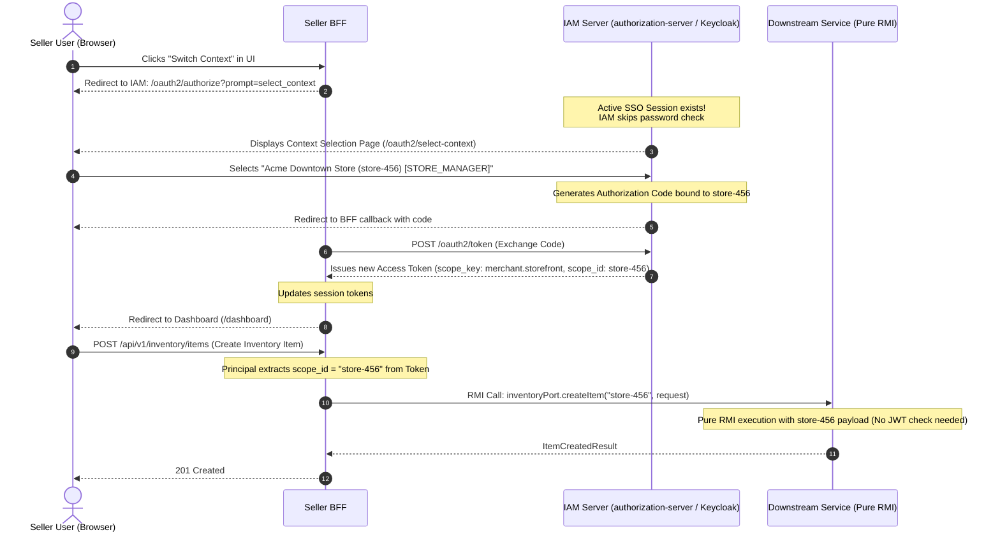

# Master Migration Plan: Pure OAuth 2.0 / OIDC Architecture, SCIM 2.0 Synchronization, In-IAM Context Selection, and Pure RMI Downstream Integration

## Executive Architecture Summary

This master plan establishes the complete target security and identity architecture across the platform, tailored for the current phase:
1. **IAM-Led Authentication & Direct Registration**: The IAM server (`service/authorization-server` as the self-contained alternative, or Keycloak) is the sole authority for user registration (`/register`), password hashing, credential storage, and OIDC protocol handling.
2. **Generalized Multi-Tenant Context Model**: Context is generalized beyond merchants to any domain boundary:
   - `scopeKey`: Defines the tenant dimension (e.g., `merchant.account`, `merchant.storefront`, `platform`).
   - `scopeId`: Identifies the specific resource instance (e.g., `merchant-123`, `store-456`).
   - `role`: Role code within that context (e.g., `MERCHANT_OWNER` in `merchant.account`, `STORE_MANAGER` in `merchant.storefront`).
   - `authorities`: Effective fine-grained permissions granted by that role.
3. **In-IAM Context Selection Prompt (Delayed Token Issuance)**:
   - **Strict Rule**: **No OAuth 2.0 token is generated until a context is selected.**
   - Selection happens **inside the IAM server's authentication flow** (`authorization-server` or Keycloak) *before* the authorization code is issued.
   - The resulting Access Token is **cryptographically bound** to `scopeKey` and `scopeId`.
4. **Bi-Directional SCIM 2.0 Synced Attribute Engine**:
   - `IAM ➔ account-service`: Newly registered users are provisioned into `account-service` via standard SCIM `POST /scim/v2/Users`.
   - `account-service ➔ IAM`: When `account-service` creates or updates an `AccessAssignment`, it syncs the user's available contexts to the IAM server as SCIM extended attributes (`urn:grab:params:scim:schemas:extension:AccessContexts`).
   - **Zero Runtime Dependency**: During login and context selection, the IAM server reads its **local database**. It does **not** call `account-service` over the network.
5. **Provider-Agnostic BFF (`seller-bff`)**:
   - Pure Spring OAuth 2.0 / OIDC Client with auto-discovery via `issuer-uri`.
   - Decommissions custom Redis Lua token slots, RMI auth calls, and proprietary token management.
   - Extracts `platform_user_id`, `scope_key`, `scope_id`, `role`, and `authorities` directly from validated OIDC token claims.
6. **Pure RMI Downstream Integration (Zero Downstream Security Overhead)**:
   - **Downstream domain services (`merchandising`, `inventory`, `checkout`, `channel`) require NO security configuration in this phase.**
   - They remain headless domain services communicating via **pure Java RMI calls** (`com.grab.service.contract.message.*`).
   - The BFF's outbound message adapters extract the necessary payload (`scopeId` e.g. `merchantId`, `storefrontId`, and `platformUserId`) from the authenticated `SellerSecurityPrincipal` (which derives them directly from the cryptographically validated token) and pass them as standard method arguments in the RMI invocation.

```mermaid
flowchart TD
    subgraph Browser ["User Browser"]
        U["Seller User"]
    end

    subgraph IAM ["IAM Server (authorization-server / Keycloak)"]
        REG["Direct User Registration (/register)"]
        AUTH["OIDC Auth Code + PKCE (/oauth2/authorize)"]
        STORE[("IAM Local DB\n(users, authorities, user_access_contexts)")]
        CTX_PROMPT["In-IAM Context Selector Page\n(/oauth2/select-context)\n[Delayed Token Issuance]"]
        SCIM_CLIENT["SCIM Sync Bridge"]
        TOKENS["Token Generator (JWT)\n(Claims: sub, platform_user_id,\nscope_key, scope_id, role, authorities)"]
    end

    subgraph AccountDomain ["Account Service (System of Record)"]
        SCIM_ENDPOINT["SCIM 2.0 Endpoints\n(/scim/v2/Users, /scim/v2/Groups)"]
        ACCT_CORE["Account Core Domain\n(Users, AccessAssignments, Roles)"]
        ACCT_DB[("Account Database\n(NO passwords)")]
        OUTBOX["Transactional Outbox / IAM Sync Worker"]
    end

    subgraph BFF ["Seller BFF"]
        CLIENT["Spring OAuth2 Client (oauth2Login)\n(Auto-discovered via issuer-uri)"]
        PRINCIPAL["SellerSecurityPrincipal\n(Extracts scopeId, platformUserId from Token)"]
        ADAPTERS["Outbound RMI Message Adapters\n(CatalogProductMessageAdapter, InventoryMessageAdapter)"]
    end

    subgraph Downstream ["Downstream Headless Services (Catalog, Inventory, Checkout)"]
        RMI_SERVICES["Pure Java RMI Stubs\n(No security starter, No JWT check,\nReceives merchantId/storefrontId in payload)"]
    end

    %% Registration & User Sync
    U -->|1. Register & Set Password| REG
    REG --> STORE
    REG -->|2. Outbound SCIM POST| SCIM_CLIENT
    SCIM_CLIENT -->|3. POST /scim/v2/Users| SCIM_ENDPOINT
    SCIM_ENDPOINT --> ACCT_CORE --> ACCT_DB

    %% Assignment Sync (Account -> IAM)
    ACCT_CORE -->|4. AccessAssignment Created| OUTBOX
    OUTBOX -->|5. Sync Contexts (PATCH SCIM)| STORE

    %% Authentication & Delayed Token Issuance
    U -->|6. Login| AUTH
    AUTH --> STORE
    AUTH -->|7. Verify Pass & Check Contexts| CTX_PROMPT
    CTX_PROMPT -->|8. User Selects Context| TOKENS
    TOKENS --> CLIENT

    %% API Calls & Downstream Pure RMI
    U -->|9. API Requests (Session Cookie)| CLIENT
    CLIENT --> PRINCIPAL --> ADAPTERS
    ADAPTERS -->|10. Pure RMI Invocation with scopeId payload\ne.g. createProduct(merchantId, request)| RMI_SERVICES
```

---

## 1. Generalized Context Model (`scopeKey` and `scopeId`)

In the Grab Ecommerce platform, context represents a discrete authorization boundary:

| Field | Description | Example 1 (Merchant Account) | Example 2 (Storefront) | Example 3 (Platform Admin) |
| :--- | :--- | :--- | :--- | :--- |
| **`assignmentId`** | Unique identifier of the grant | `asgn-1001` | `asgn-1002` | `asgn-1003` |
| **`scopeKey`** | The authorization domain / dimension | `merchant.account` | `merchant.storefront` | `platform` |
| **`scopeId`** | The specific entity ID within that domain | `merchant-123` | `store-456` | `platform` |
| **`role`** | Role assigned in this scope | `MERCHANT_OWNER` | `STORE_MANAGER` | `PLATFORM_ADMIN` |
| **`authorities`** | Fine-grained permissions granted | `CATALOG_WRITE`, `PRICING_WRITE`, `MERCHANT_MEMBER_WRITE` | `INVENTORY_READ`, `INVENTORY_WRITE`, `STOREFRONT_READ` | `MERCHANT_LIFECYCLE_WRITE`, `CATEGORY_WRITE` |
| **`displayName`** | Human-readable label for UI prompt | `Acme Retail (Merchant Owner)` | `Acme Downtown (Store Manager)` | `Platform Super Admin` |

### SCIM 2.0 Extended Attribute Schema (`urn:grab:params:scim:schemas:extension:AccessContexts`)
When `account-service` updates an assignment, it synchronizes this list to the IAM server using a standard SCIM extension:
```json
{
  "schemas": [
    "urn:ietf:params:scim:schemas:core:2.0:User",
    "urn:grab:params:scim:schemas:extension:AccessContexts"
  ],
  "urn:grab:params:scim:schemas:extension:AccessContexts": {
    "contexts": [
      {
        "assignmentId": "asgn-1001",
        "scopeKey": "merchant.account",
        "scopeId": "merchant-123",
        "role": "MERCHANT_OWNER",
        "displayName": "Acme Retail (Merchant Owner)",
        "authorities": ["CATALOG_READ", "CATALOG_WRITE", "PRICING_READ", "PRICING_WRITE"]
      },
      {
        "assignmentId": "asgn-1002",
        "scopeKey": "merchant.storefront",
        "scopeId": "store-456",
        "role": "STORE_MANAGER",
        "displayName": "Acme Downtown Store (Store Manager)",
        "authorities": ["INVENTORY_READ", "INVENTORY_WRITE"]
      }
    ]
  }
}
```

---

## 2. In-IAM Context Selection & Delayed Token Issuance

### Strict Rule: No Token Without Context
1. **Password Authentication**: The user enters their email and password on the IAM server. Credentials are confirmed against the IAM local database.
2. **Context Evaluation**:
   * **Case A (Zero Contexts / Brand New User)**:
     * User has just registered and has no assignments yet.
     * The IAM server issues a token restricted to **onboarding**:
       * `scope`: `openid profile email seller:onboarding`
       * `scope_key`: `null`
       * `scope_id`: `null`
     * This token allows access **only** to the onboarding route (`POST /api/v1/merchants/applications`). All operational APIs (`/api/v1/products`, `/api/v1/inventory`) reject it.
   * **Case B (Exactly One Context)**:
     * The IAM server auto-selects this context without interrupting the user.
     * The token is minted immediately with that context's `scope_key`, `scope_id`, `role`, and `authorities`.
   * **Case C (Multiple Contexts)**:
     * The IAM server halts the authorization flow and displays the **Context Selection Page** (`/oauth2/select-context` in `authorization-server` or `SelectContextAuthenticator` in Keycloak).
     * The user is presented with a choice:
       * `( ) Acme Retail [merchant.account: merchant-123] — Role: MERCHANT_OWNER`
       * `( ) Acme Downtown Store [merchant.storefront: store-456] — Role: STORE_MANAGER`
     * **No authorization code and no token is issued** until the user selects an option and submits the form.
3. **Token Minting**:
   * The IAM server injects the chosen context into the JWT Access Token claims:
     ```json
     {
       "iss": "http://localhost:9000",
       "sub": "kc-user-uuid-84920482",
       "platform_user_id": "usr-88219",
       "email": "seller@example.com",
       "assignment_id": "asgn-1001",
       "scope_key": "merchant.account",
       "scope_id": "merchant-123",
       "role": "MERCHANT_OWNER",
       "authorities": [
         "CATALOG_READ",
         "CATALOG_WRITE",
         "PRICING_READ",
         "PRICING_WRITE"
       ]
     }
     ```

---

## 3. Switch-Context Workflow (Re-Auth / Selection Flow)

When an authenticated user wants to switch context (e.g. from `merchant.account: merchant-123` to `merchant.storefront: store-456`):



---

## Phase-by-Phase Implementation Plan

### Phase 1: Contract Standards, Generalized Schemas & Dependency Hygiene [COMPLETED & VERIFIED]

#### Step 1.1: Define SCIM 2.0 Extended Schemas
In `account-message-contract`, defined the immutable data models:
- `ScimAccessContext`:
  - `assignmentId`: String
  - `scopeKey`: String (`merchant.account`, `merchant.storefront`, `platform`)
  - `scopeId`: String
  - `role`: String
  - `displayName`: String
  - `authorities`: Set<String>
- `ScimAccessContextExtension`:
  - Schema URI: `urn:grab:params:scim:schemas:extension:AccessContexts`
  - List of `ScimAccessContext` objects.

#### Step 1.2: Standardize OIDC Token Claims
Defined standard token claim keys in `GrabOidcClaims`:
- `sub`: IAM UUID.
- `platform_user_id`: Internal platform user ID.
- `email`: User email.
- `assignment_id`: Active assignment ID.
- `scope_key`: Active scope dimension.
- `scope_id`: Active scope instance ID.
- `role`: Active role code.
- `authorities`: List of effective authority strings.
- `seller:onboarding`: Claim indicating new user onboarding when no active assignments exist.

#### Step 1.3: Clean Up `seller-bff` Dependencies
- Removed `io.jsonwebtoken` (`jjwt-api`, `jjwt-impl`, `jjwt-jackson`) from `service/seller-bff/pom.xml`.

---

### Phase 2: Decouple Authentication & Implement SCIM Inbound in `account-service` [COMPLETED & VERIFIED]

#### Step 2.1: Purge All Authentication Logic from `account-service`
1. **Deprecated Verification Ports & Adapters**: Marked legacy authentication verification methods deprecated in `account-message-contract`.
2. **Decoupled User Entity**: Added `User.createExternal(id, email)` for identity provisioning without passwords.
3. **External Identity Repository**: Added `findByUserId(Id userId)` port and adapter in `identity-adapter-persistence`.

#### Step 2.2: Implement Inbound SCIM 2.0 User Provisioning
1. **Universal Java Port (`ScimUserPort`)**:
   - `provisionUser(ScimUser)`: provisions external user, associates with platform `User`, and links `ExternalIdentity`.
   - `getUser(idOrExternalId)`: retrieves user projection along with active access assignments.
   - `updateUserStatus(idOrExternalId, active)`: activates/deactivates user.
   - `getUserAccessContexts(idOrExternalId)`: returns all mapped access contexts.
2. **Use Cases & Handlers**:
   - `ProvisionExternalUserService` / `ProvisionExternalUserCommandHandler`
   - `UpdateExternalUserService` / `UpdateExternalUserStatusCommandHandler`
   - `GetUserAccessContextsService` / `GetUserAccessContextsQueryHandler`
   - `GetExternalUserService` / `GetExternalUserQueryHandler`
3. **Inbound Adapters**:
   - `ScimUserReadAdapter`, `ScimUserWriteAdapter`, and `ScimUserPortAdapter`. Exported over mTLS RMI in `SellerAuthenticationTransportConfig`.

---

### Phase 3: Implement In-IAM Context Selection in `authorization-server` [COMPLETED & VERIFIED]

#### Step 3.1: Database Schema for Local Credentials & Contexts
Flyway migration `V3__local_users_and_access_contexts.sql`:
- `iam_users`: `id`, `username`, `email`, `password_hash`, `first_name`, `last_name`, `enabled`, `platform_user_id`, `authentication_version`, `created_at`, `updated_at`.
- `iam_user_authorities`: `user_id`, `authority`.
- `iam_user_access_contexts`: `id`, `user_id`, `assignment_id`, `scope_key`, `scope_id`, `role`, `display_name`, `authorities`, `synced_at`.

#### Step 3.2: Self-Service Registration & Outbound SCIM Client
1. **Self-Service Registration (`/register`)**:
   - `RegistrationController` with Thymeleaf template `register.html`.
   - Hashes passwords with `PasswordEncoder` (BCrypt).
   - Direct provisioning to `account-service` via `ScimClientPort` / `RmiScimUserAdapter`.
   - Updates local user record with platform `User.id` returned from SCIM.
2. **Local Authentication**:
   - `AccountFormAuthenticationProvider` authenticates credentials against local `IamUserRepository`.
   - `LiveIssuerSessionFilter` validates active session against local `IamUserRepository`.

#### Step 3.3: In-IAM Context Selection Engine & Deferred Token Issuance
1. **Context Synchronization & Selection Service (`ContextSelectionService`)**:
   - Fetches active contexts via SCIM RMI from `account-service`, cached locally in `iam_user_access_contexts`.
   - Falls back gracefully to cached contexts if `account-service` is temporarily unreachable.
2. **Context Selection Filter (`ContextSelectionFilter`)**:
   - Intercepts `/oauth2/authorize` before authorization code generation:
     - If `prompt=select_context`: resets active session context.
     - 0 contexts: automatically sets `SelectedContext.onboarding(platformUserId)`.
     - 1 context: automatically selects single available context.
     - >1 contexts: saves authorization request in `HttpSessionRequestCache` and redirects to `/oauth2/select-context`.
3. **Selection Prompt UI (`/oauth2/select-context`)**:
   - `ContextSelectionController` renders `select-context.html` showing account/storefront name, role badge, scope key, and scope ID.
   - Form POST validates assignment and resumes saved authorization request.
4. **Context-Aware Authorization Persistence (`ContextAwareOAuth2AuthorizationService`)**:
   - Attaches `SelectedContext` decomposed native string attributes to `OAuth2Authorization`.
5. **Token Claim Enrichment (`AuthorizationJwtCustomizer`)**:
   - Injects `sub`, `platform_user_id`, `email`, `assignment_id`, `scope_key`, `scope_id`, `role`, `authorities` (or `seller:onboarding = "true"`) into JWT Access Tokens and ID Tokens.
   - `AuthorizationUserInfoService` enriched with matching claims.

---

### Phase 4: Refactor `seller-bff` into a Provider-Agnostic Client & Token Relay [COMPLETED & VERIFIED]

1. **`SellerSecurityPrincipal`**: Implements `OidcUser`, `UserDetails`, and `Serializable`. Extracts `GrabOidcClaims` (`platform_user_id`, `scope_key`, `scope_id`, `assignment_id`, `role`, `authorities`) directly from OIDC claims via `SellerSecurityPrincipal.from(oidcUser, issuer)`.
2. **Standard Spring Security `oauth2Login()`**:
   - Uses `SellerOidcUserService` to construct `SellerSecurityPrincipal`.
   - Native authorization request resolver supporting PKCE and passing `prompt=select_context` through to authorization server.
   - Decommissioned manual `SellerOidcBrowserFilter`, `SellerOidcTokenSlots`, and `SellerPendingRevocations` in favor of Spring Security `OAuth2AuthorizedClientManager` and Redis session repository.
3. **Switch-Context Endpoints**:
   - `GET` and `POST /api/v1/identity/session/contexts/switch` and `/select` trigger redirect (HTTP 303) to `/oauth2/authorization/seller?prompt=select_context`.
4. **Registration Redirection & Cleanup**:
   - `GET /api/v1/identity/auth/register-url` returns the IAM registration page URL.
   - `POST /api/v1/identity/auth/register` redirects (HTTP 303) to the IAM registration URL.
   - `POST /api/v1/identity/auth/logout` invalidates the Spring Session.
5. **Verification**:
   - All 15 tests in `seller-bff` pass (`SellerOidcPropertiesTest`, `SellerOAuthClientTest`, `SellerOidcBrowserIntegrationTest`).

---

### Phase 5: Verification, Documentation & Hexagonal Governance [COMPLETED & VERIFIED]

1. **Full Reactor Build & Test Suite Verification**:
   - Verified 8 core modules in single reactor build with 0 failures and 0 errors:
     - `framework`: 15 tests passed
     - `identity-domain`: 84 tests passed
     - `identity-application`: 43 tests passed
     - `identity-adapter-persistence`: PostgreSQL Testcontainers tests passed
     - `account-message-contract`: up to date
     - `account-service`: Spring Modulith tests & persistence tests passed
     - `seller-bff`: 15 tests passed (Redis Testcontainers)
     - `authorization-server`: 27 tests passed (PostgreSQL + Redis Testcontainers)
2. **ArchUnit & Hexagonal Governance**:
   - Added `ServiceArchitectureTest` in `account-service` enforcing headless domain architecture (no web controllers, no app dependencies, and strict CQRS bus scoping `accountCommandBus`/`accountQueryBus`).
   - Verified all architecture constraints pass.
3. **Service Documentation**:
   - Updated `service/authorization-server/README.md` documenting self-contained IAM role, SCIM outbound provisioning, in-IAM context selection, and claim minting.
   - Updated `service/seller-bff/README.md` documenting standard OIDC client configuration, context-aware principal, and pure RMI downstream integration.

---

### Phase 6: Keycloak Parity & Production Cutover [READY FOR DEPLOYMENT / OPTIONAL KEYCLOAK SPI]

When deploying Keycloak as the alternative IAM provider:
1. **Client Setup**: Register `seller-bff` as confidential client with PKCE S256.
2. **Context Authenticator SPI (`SelectContextAuthenticator`)**:
   - Custom Keycloak Authenticator SPI deployed into Browser Authentication Flow:
     - Reads user attribute `urn:grab:params:scim:schemas:extension:AccessContexts`.
     - Prompts user to pick context if multiple are present or if `prompt=select_context` was requested.
     - Sets user session notes: `selected_assignment_id`, `selected_scope_key`, `selected_scope_id`, `selected_role`.
3. **Protocol Mappers**:
   - Add User Session Note Mappers injecting `scope_key`, `scope_id`, `assignment_id`, and `role` into Access Token and ID Token.
4. **Provider Portability ("The Acid Test")**:
   - Run the exact same compiled BFF JAR pointing to either `authorization-server` (`OIDC_ISSUER_URI=http://localhost:9000`) or Keycloak (`OIDC_ISSUER_URI=http://localhost:8080/realms/grab-ecommerce`). Zero code modifications required.

#### Step 6.1: SCIM & Registration Verification
1. Register user on `authorization-server` `/register`.
2. Verify credentials in `users` table and verify SCIM `POST /scim/v2/Users` received in `account-service`.
3. Create `AccessAssignment` in `account-service`. Verify reverse sync updates `user_access_contexts` on `authorization-server`.

#### Step 6.2: In-IAM Context Selection Verification
1. User with 0 contexts: logs in -> receives onboarding token -> accesses only `/merchants/applications`.
2. User with 1 context: logs in -> auto-selected -> token contains `scope_key` and `scope_id`.
3. User with multiple contexts: logs in -> halts -> renders `/oauth2/select-context` -> user selects -> token issued with selected `scope_key` and `scope_id`.

#### Step 6.3: Switch-Context Verification
1. User initiates switch context in BFF (`/api/v1/identity/session/contexts/switch`).
2. Verify redirect to IAM with `prompt=select_context`.
3. Verify IAM skips password, displays context picker, and issues new token upon selection.

#### Step 6.4: Downstream RMI Execution Verification
1. Verify BFF controllers extract `scopeId` from `SellerSecurityPrincipal`.
2. Verify RMI calls to downstream services (`merchandising`, `inventory`, etc.) execute successfully with the payload.

#### Step 6.5: Provider Portability ("The Acid Test")
Run the full test suite twice against the exact same compiled BFF JAR:
- **Run A**: `OIDC_ISSUER_URI=http://localhost:9000` (`authorization-server`).
- **Run B**: `OIDC_ISSUER_URI=http://localhost:8080/realms/grab-ecommerce` (Keycloak).
*Both must pass 100% with zero code modifications.*

---

## Master Architecture Mapping Table

| Capability | Current State | Target State (`authorization-server` or Keycloak) |
| :--- | :--- | :--- |
| **Registration** | BFF `/register` takes raw passwords -> RMI call | **IAM-Led**: Self-service `/register` directly on the IAM server |
| **Credential Storage** | BCrypt password hashes in `account-service` `users` table | Stored strictly in IAM server (`users` table in Auth Server or Keycloak DB) |
| **Account Sync** | Proprietary RMI `account.resolve(...)` on every request | **SCIM 2.0 (RFC 7643/7644)**: Bi-directional user and context provisioning |
| **Context Model** | Tied to merchant ID path matching in BFF filter | **Generalized Scope**: `scopeKey` (`merchant.account`, `merchant.storefront`, etc.) + `scopeId` |
| **Context Selection** | BFF session variable mutation | **In-IAM Selection**: Token is **delayed and NOT generated until context is selected** |
| **Token Claims** | Anemic (`sub`, `aud`, `authentication_version`) | Enriched: `sub`, `platform_user_id`, `scope_key`, `scope_id`, `role`, `authorities` |
| **BFF Token Storage** | Custom Redis Lua token slots (`SellerOidcTokenSlots`) | Standard Spring Security `OAuth2AuthorizedClientManager` |
| **Downstream Integration** | RMI stubs with plain domain payload | **Pure RMI calls with necessary payload** (`scopeId`, `platformUserId`). Zero downstream security overhead. |
