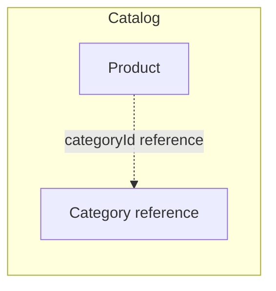
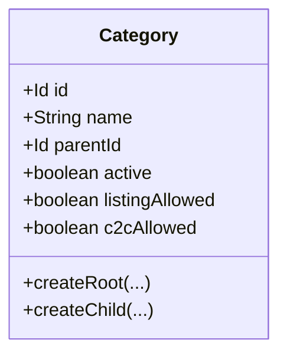
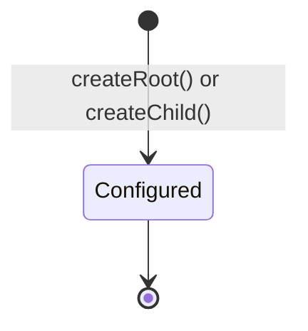

# Domain Specification: Catalog Category

> **Bounded Context:** Catalog
> **Primary Purpose:** Provides the category reference and listing-eligibility flags used by product creation and catalog workflows.
> **Module Root:** `catalog-domain` / `catalog-application` / `catalog-adapter-persistence` / `store/catalog`

## 1. Boundary & Context Map

### Ownership

- **This aggregate OWNS:** Category identity, name, parent identifier, and active/listing eligibility flags.
- **This aggregate DOES NOT OWN:** Product data, product assignments, mutable category-tree administration, slugs, or sibling ordering.

## 2. Ubiquitous Language

| Business Term | Domain Concept | Business Definition |
|---|---|---|
| Category | `Category` | A reference used to classify a product and determine listing eligibility. |
| Parent category | `parentId` | Optional identifier for the category's parent; the aggregate stores the identifier rather than a parent object. |
| Listing eligibility | `listingAllowed`, `c2cAllowed` | Flags consumed by catalog policy when deciding which listings a category permits. |

## 3. Domain Aggregate Model

| Property | Type | Belongs To | Business Rationale |
|---|---|---|---|
| `id` | `Id` | Category | Stable category reference used by products. |
| `name` | `String` | Category | Human-readable category label. |
| `parentId` | `Id` or absent | Category | Identifies a parent category without object navigation. |
| `active` | `boolean` | Category | Indicates whether catalog policies should treat the category as active. |
| `listingAllowed` | `boolean` | Category | Indicates whether standard product listings are allowed. |
| `c2cAllowed` | `boolean` | Category | Indicates whether consumer-to-consumer listings are allowed. |

## 4. Business Invariants & Rules

| Rule ID | Invariant Rule | Violation Outcome | Enforced By |
|---|---|---|---|
| INV-01 | A category name is required. | Construction rejects a null name. | `Category` constructor |
| INV-02 | A child category must be created with a parent category. | Construction rejects a missing parent object. | `Category.createChild()` |
| INV-03 | Catalog creation validates the selected category's listing policy before creating a product. | Product creation is rejected when category policy does not permit it. | `CatalogPolicyValidator` |

The aggregate exposes no rename, reparent, ordering, delete, slug-uniqueness, or cycle-validation operations. Those behaviors are not part of the current domain contract.

## 5. State Lifecycle & Transitions

| Current State | Trigger | Next State | Guard |
|---|---|---|---|
| Absent | `createRoot()` | Configured | Name is required. |
| Absent | `createChild()` | Configured | Name and parent are required. |

The active and eligibility booleans are construction-time category attributes; the current aggregate exposes no lifecycle transition methods.

## 6. Domain Events

The current `Category` aggregate emits no domain events, and no Category-specific integration event or workflow signal is emitted by this model. Product category changes emit `CategoryChangedEvent` from the Product aggregate; that event is not a Category lifecycle event.

Implementation references: `catalog-domain/src/main/java/com/catalog/domain/aggregate/Category.java` and `catalog-application/src/main/java/com/catalog/application/service/CatalogPolicyValidator.java`.
