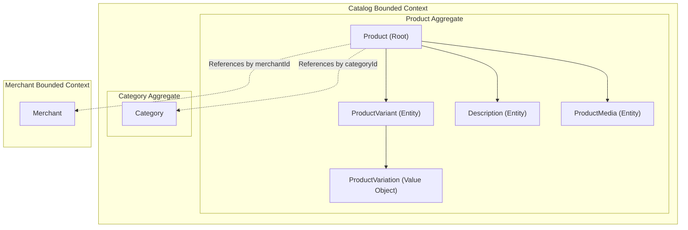
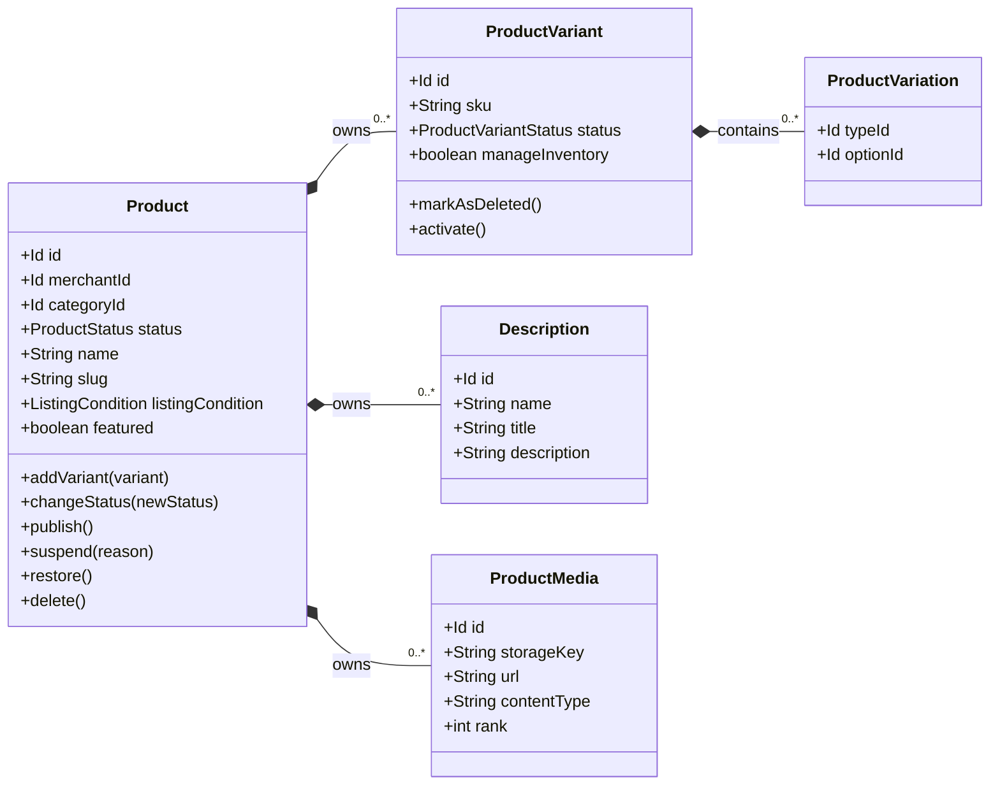
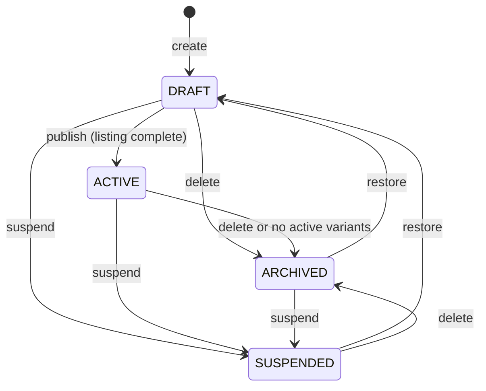

# Domain Specification: Catalog Product

> **Bounded Context:** Catalog
> **Primary Purpose:** Manages the lifecycle, variants, descriptions, and media of sellable products.
> **Module Root:** `catalog-domain` / `catalog-application` / `catalog-adapter-persistence` / `store/catalog`
> **Related Domain Spec:** [Catalog Product Publication](product-publication-domain-spec.md)
> **Related Workflows:** [Create Sellable Product](../../../workflows/create-sellable-product-workflow.md), [Update Sellable Product](../../../workflows/update-sellable-product-workflow.md), [Update Product Variant](../../../workflows/update-product-variant-workflow.md)

---

## 1. Boundary & Context Map

### Ownership

- **This aggregate OWNS:** Product core details, variants, descriptions, media, and product lifecycle status (draft, active, archived).
- **This aggregate DOES NOT OWN:** Variant types/options definition (Variant Reference Model), pricing details, inventory levels, category structures, or channel publication records. Catalog stores each variant/channel publication as a separate `ProductPublication` aggregate.

### Context Map

---

## 2. Ubiquitous Language

| Business Term | Domain Concept | Business Definition |
| :--- | :--- | :--- |
| **Product** | `Product` (Aggregate Root) | The parent entity grouping a cohesive set of sellable variations, containing common descriptions and media. |
| **Variant** | `ProductVariant` (Entity) | A specific, purchasable iteration of a product identified by a unique SKU and a set of variations (e.g., Color: Red, Size: S). |
| **Variation** | `ProductVariation` (Value Object) | A key-value pair specifying a single dimension of a variant (e.g., Color = Red). |
| **Standalone Product** | Business Concept | A product with no explicit variants provided by the merchant; the system auto-materializes a single default variant behind the scenes. |
| **Slug** | `slug` (Property) | An SEO-friendly, human-readable URL identifier generated from the product name. |
| **Active Listing** | `ProductStatus.ACTIVE` | A product whose catalog status permits storefront publication when it also has an active variant. |

---

## 3. Domain Aggregate Model

### Model Diagram

### Property & Attribute Rationale

| Property | Type | Belongs To | Business Rationale |
| :--- | :--- | :--- | :--- |
| `id` | `Id` | Root | Unique aggregate identity across the platform. |
| `merchantId` | `Id` | Root | Associates the product with its merchant owner for multi-tenant isolation. |
| `categoryId` | `Id` | Root | Links the product to a category for browsing and filtering. |
| `status` | `ProductStatus` | Root | Controls lifecycle visibility (e.g., only ACTIVE products appear on storefronts). |
| `name` | `String` | Root | Primary product identity displayed to customers. |
| `slug` | `String` | Root | SEO-friendly URL identifier, auto-generated from name. |
| `featured` | `boolean` | Root | Marks products for curated storefront promotion (e.g., homepage highlights). |
| `listingCondition`| Enum | Root | Captures product condition (`NEW`, `USED`, `REFURBISHED`) for buyer expectations. |
| `id` | `Id` | Variant | Stable identity for the sellable variant. |
| `sku` | `String` | Variant | Merchant SKU used to track inventory and fulfillment. It is unique within a merchant. |
| `manageInventory` | `boolean` | Variant | Indicates whether stock is tracked for this variant. |
| `status` | `ProductVariantStatus` | Variant | Controls whether the variant is active or soft-deleted. |
| `typeId` | `Id` | Variation | Identifies the variation dimension. |
| `optionId` | `Id` | Variation | Identifies the selected option for that dimension. |
| `id` | `Id` | Description | Stable identity for a product description entry. |
| `name` | `String` | Description | Identifies the kind of descriptive content. |
| `title` | `String` | Description | Provides a title for the description entry. |
| `description` | `String` | Description | Stores the descriptive content shown with a listing. |
| `id` | `Id` | ProductMedia | Stable identity for product media. |
| `storageKey` | `String` | ProductMedia | Identifies the stored media asset. |
| `url` | `String` | ProductMedia | Supplies a display URL when available. |
| `contentType` | `String` | ProductMedia | Describes the media format. |
| `rank` | `int` | ProductMedia | Controls media ordering. |

---

## 4. Business Invariants & Rules

| Rule ID | Invariant Rule | Violation Outcome | Enforced By |
| :--- | :--- | :--- | :--- |
| **INV-01** | A product can be activated only with at least one active variant, at least one description, and at least one media item. | Activation rejected. | `Product.ensurePublishable()` |
| **INV-02** | A product's variants cannot share the same SKU or variation set. | Variant add/update is rejected. | `Product.addVariant()` / `Product.updateVariant()` |
| **INV-03** | A merchant cannot reuse a SKU already assigned to another product in that merchant's catalog. | Product creation/update is rejected. | `CreateProductSetService` / SKU persistence constraint |
| **INV-04** | The last active variant cannot be removed or soft-deleted. | Removal is rejected. | `Product.ensureLastActiveVariantIsNotRemoved()` |
| **INV-05** | A product status change must follow the supported status transition table. | Transition is rejected. | `Product.changeStatus()` |

A Product can be constructed without variants, but product creation flows materialize the requested/default variant set. The aggregate does not model a moderation-review requirement.

---

## 5. State Lifecycle & Transitions

### State Machine

### Transition Matrix

| Current State | Trigger / Event | Next State | Guard Condition / Prerequisite |
| :--- | :--- | :--- | :--- |
| `DRAFT` | `publish()` | `ACTIVE` | At least one active variant, a description, and media are present. |
| `DRAFT`, `ACTIVE`, or `SUSPENDED` | `delete()` | `ARCHIVED` | Product emits a deletion event; already archived products may emit it again. |
| `ACTIVE` | Last active variant removed | `ARCHIVED` | Automatic `archiveIfUnsellable()` check. |
| `DRAFT`, `ACTIVE`, or `ARCHIVED` | `suspend(reason)` | `SUSPENDED` | Transition must be allowed by `ProductStatus`. |
| `ARCHIVED` or `SUSPENDED` | `restore()` | `DRAFT` | Transition must be allowed by `ProductStatus`. |
| Any status | `changeStatus(target)` | Supported target | Allowed transitions are `DRAFT -> ACTIVE/ARCHIVED/SUSPENDED`, `ACTIVE -> ARCHIVED/SUSPENDED`, `ARCHIVED -> DRAFT/SUSPENDED`, and `SUSPENDED -> DRAFT/ARCHIVED`. |

There is no `IN_REVIEW` state. `restore()` returns an archived or suspended product to `DRAFT`, not directly to `ACTIVE`.

---

## 6. Domain Events

### Emitted Events (What Happened)

| Event Name | Trigger | Key Attributes | Target Consumers |
| :--- | :--- | :--- | :--- |
| `ProductStatusChangedEvent` | Product status changes | Product ID, previous status, new status | Catalog projections and integration bridge |
| `ProductSuspendedEvent` | `suspend(reason)` | Product ID, reason | Catalog lifecycle consumers |
| `ProductRestoredEvent` | `restore()` to `DRAFT` | Product ID | Catalog lifecycle consumers |
| `ProductDeletedEvent` | `delete()` archives the product | Product ID, category ID, variant IDs | Catalog bridge; inventory discontinuation |
| `ProductVariantAddedEvent` | Variant added | Product ID, variant ID, SKU, product name, inventory-management flag | Catalog projections and integration bridge |
| `ProductVariantChangeEvent` | Variant SKU or inventory-management setting changed | Product ID, variant ID, SKU, inventory-management flag | Catalog projections and integration bridge |
| `ProductVariantDeletedEvent` | Variant removed or soft-deleted | Product ID, category ID, variant ID | Catalog bridge; inventory discontinuation |
| `ProductVariantRestoredEvent` | Soft-deleted variant restored | Product ID, variant ID | Catalog bridge |
| `ProductUpdatedEvent` | Product metadata, descriptions, or media changes | Product ID and updated product name/category reference | Catalog projections and integration bridge |
| `ProductMediaChangedEvent` | Product media replaced | Product ID | Catalog media projections |
| `VariantMediaChangedEvent` | Variant media assignment changed | Product ID, variant ID | Catalog media projections |

### Related Publication Events

Publication domain events, integration records, and workflow signals belong to the separate [ProductPublication specification](product-publication-domain-spec.md#6-domain-events).

### Store Integration Events

`CatalogIntegrationEventPublisher` maps selected Product aggregate events to `ProductStatusChangedIntegrationEvent`, `ProductDeletedIntegrationEvent`, `ProductNameChangedIntegrationEvent`, `ProductVariantAddedIntegrationEvent`, `ProductVariantUpdatedIntegrationEvent`, `ProductVariantDeletedIntegrationEvent`, and `ProductVariantRestoredIntegrationEvent`. These are store-level messages, not Product domain events.

### Workflow Signals

`SellableProductProductCreatedEvent` and inventory/workflow acknowledgements such as `InventoryItemCreatedEvent` are store-level workflow signals, not Product aggregate domain events.

### Implementation References

- Product model: `catalog-domain/src/main/java/com/catalog/domain/aggregate/Product.java` and `catalog-domain/src/main/java/com/catalog/domain/valueobject/ProductStatus.java`.
- Integration bridge: `store/src/main/java/com/grab/store/catalog/internal/event/CatalogIntegrationEventPublisher.java`.
