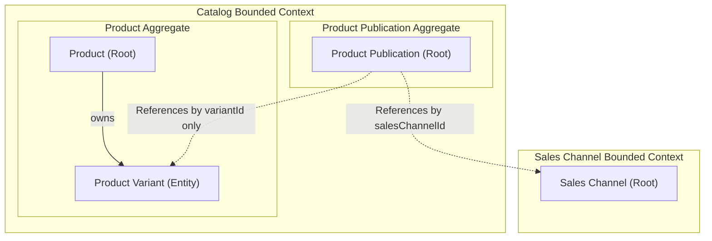
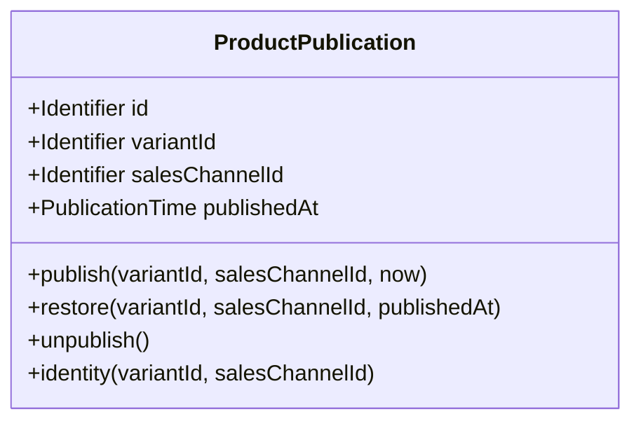
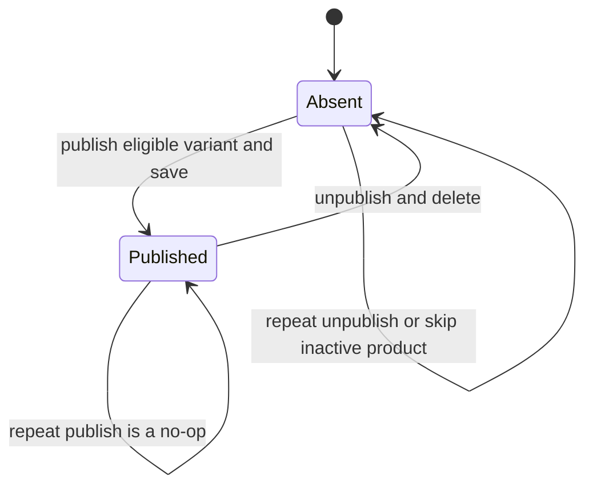

# Domain Specification: Catalog Product Publication

- **Bounded Context:** Catalog
- **Primary Purpose:** Models publication of one product variant to one sales channel independently of Product content and lifecycle.
- **Discovery Features:** [DiscoveryProduct baseline](../../../../features/feat_002-discovery_product.md), [Discovery Wiring & Projection Reconciliation](../../../../features/feat_006-discovery-wiring-projection-reconciliation.md)
- **Module Root:** `catalog-domain` / `catalog-application` / `catalog-adapter-persistence` / `store/catalog`
- **Related Domain Specs:** [Catalog Product](product-domain-spec.md), [Sales Channel](../../sales-channel/architecture/sales-channel-domain-spec.md)
- **Related Workflows:** [Create Sellable Product](../../../workflows/create-sellable-product-workflow.md), [Update Sellable Product](../../../workflows/update-sellable-product-workflow.md)

- **Discovery Workflow:** [Browse, Project, and Rebuild](../../../workflows/browse-and-discover-products-workflow.md)
- **Discovery Tech:** [Currency-Agnostic Projection](../../../system/storefront-query-tech-spec.md)

---

## 1. Boundary & Context Map

### Ownership

- **This aggregate OWNS:** One variant/channel publication, its identity derived from that pair, and publication/unpublication domain events.
- **This aggregate DOES NOT OWN:** Product or variant data and lifecycle, merchant ownership, sales channel configuration, prices, inventory, or storefront buyability decisions.

`ProductPublication` references a variant inside the Product aggregate by `variantId` and a Sales Channel aggregate by `salesChannelId`; it holds no cross-aggregate object references. The application use case resolves the product and checks variant membership before publishing or unpublishing.

### Context Map

---

## 2. Ubiquitous Language

| Business Term | Domain Concept | Business Definition |
| :--- | :--- | :--- |
| **Product Publication** | `ProductPublication` (Aggregate Root) | An independent record that publishes one product variant to one sales channel. |
| **Publication Identity** | `ProductPublication.identity()` | A stable identity derived from `variantId:salesChannelId`, allowing the same variant to be published independently to multiple channels. |
| **Published** | Publication exists | The variant/channel pair has a publication record; storefront buyability also depends on other contexts. |
| **Unpublished** | Publication absent | The variant/channel publication record does not exist; no unpublished status or retained publication history is modeled. |

---

## 3. Domain Aggregate Model

### Model Diagram

This aggregate has no child entities or value objects containing other aggregates. Its variant and sales channel references are identifiers only; Product content remains in the [Product aggregate](product-domain-spec.md).

### Property & Attribute Rationale

| Property | Type | Belongs To | Business Rationale |
| :--- | :--- | :--- | :--- |
| `id` | `Id` | ProductPublication | Identifies the variant/channel pair consistently across publication events and persistence operations. |
| `variantId` | `Id` | ProductPublication | Identifies the sellable variant being published without owning its product data. |
| `salesChannelId` | `Id` | ProductPublication | Identifies the channel receiving the variant publication. |
| `publishedAt` | `Instant` (nullable) | ProductPublication | Captures the supplied publication time on creation; it is not currently persisted and is restored as `null`. |

---

## 4. Business Invariants & Rules

| Rule ID | Invariant Rule | Violation Outcome | Enforced By |
| :--- | :--- | :--- | :--- |
| **PUB-01** | A publication must identify both a variant and a sales channel. | Construction rejects a missing identifier. | `ProductPublication.restore()` / constructor |
| **PUB-02** | Only one publication may exist for a given variant/channel pair. | Repeated publish returns `written=false` without saving or emitting another domain event. | `ProductPublication.identity()` / `PublishProductToChannelService.execute()` / composite persistence key |
| **PUB-03** | A new publication is permitted only when the parent Product is `ACTIVE`. | Publish use case returns `written=false` for an inactive product. | `ProductPublicationPolicy.isPublishable()` invoked by `PublishProductToChannelService.execute()` |
| **PUB-04** | Publish and unpublish must target a product belonging to the supplied merchant and a variant on that product. | Operation fails with `ProductNotFound` or `VariantNotFound`. | Publish/unpublish use cases load through `ProductRepository.find(productId, merchantId)` and call `requireVariantOnProduct()` |

`ProductPublicationPolicy.requirePublishable()` provides a throwing guard, but the publish use case uses the boolean guard above. The publication factory itself does not load or validate Product or Sales Channel aggregates.

Sales channel assertions and inventory-route checks belong to the related workflows, not this aggregate. The current publish use case checks variant membership without separately checking variant status, prices, stock, or channel eligibility.

---

## 5. State Lifecycle & Transitions

### State Machine

### Transition Matrix

The publication lifecycle is **Absent → Published → Absent**; these are existence states, not enum values. `ProductPublication.restore()` reconstitutes an existing publication without emitting events and does not republish an unpublished pair.

| Current State | Trigger / Event | Next State | Guard Condition / Prerequisite |
| :--- | :--- | :--- | :--- |
| Absent | Publish use case calls `ProductPublication.publish()` and saves it. | Published | Product belongs to the merchant, variant belongs to the product, and Product is `ACTIVE`. |
| Published | Publish requested again. | Published | Existing pair returns `written=false` without a new domain event. |
| Absent | Publish requested for an inactive product. | Absent | Valid product/variant membership; returns `written=false` without a domain event. |
| Published | Unpublish use case calls `unpublish()` and deletes it. | Absent | Valid product/variant membership; no `ACTIVE` prerequisite. |
| Absent | Unpublish requested again. | Absent | Valid product/variant membership; returns `deleted=false` without a domain event. |

`unpublish()` only records the domain event; the application use case removes the publication through `ProductPublicationRepository.delete()`. Neither publication operation saves or changes the Product aggregate's status.

---

## 6. Domain Events

### Emitted Events (What Happened)

| Event Name | Trigger | Key Attributes | Target Consumers |
| :--- | :--- | :--- | :--- |
| `ProductPublishedToChannelEvent` | `ProductPublication.publish()` creates a publication. | `variantId`, `salesChannelId` | Catalog integration bridge |
| `ProductUnpublishedFromChannelEvent` | `ProductPublication.unpublish()` before removal. | `variantId`, `salesChannelId` | Catalog integration bridge |

The persistence adapter pulls these domain events on save/delete and passes them to `DomainEventProducer`; restoration emits none. Event durability and delivery follow the [Transactional Outbox specification](../../../system/transactional-outbox-tech-spec.md).

### Store Integration Events

`CatalogIntegrationEventPublisher` maps publication domain events to the following integration records.

| Publication Domain Event | Published Integration Event | Consumer / Business Impact |
| :--- | :--- | :--- |
| `ProductPublishedToChannelEvent` | `ProductPublishedToChannelIntegrationEvent` | Storefront Query updates the variant/channel buyable-offer projection. |
| `ProductUnpublishedFromChannelEvent` | `ProductUnpublishedFromChannelIntegrationEvent` | Storefront Query marks the variant/channel offer unpublished and recomputes buyability. |

Publication integration records carry variant ID, sales channel ID, occurrence time, and event version. R17 requires cross-module integration records under `store/src/main/java/com/grab/store/shared/events/catalog/`; the current records remain under `store/.../catalog/events/`, which is an existing implementation deviation.

### Workflow Signals

| Consumed Workflow Request | Catalog Action | Completion Signal |
| :--- | :--- | :--- |
| `RequestWritePublicationEvent` | Dispatch publish command through `CommandBus`. | Workflow `ProductPublishedToChannelEvent` |
| `RequestUnpublishProductFromChannelEvent` | Dispatch unpublish command through `CommandBus`. | Workflow `ProductUnpublishedFromChannelEvent` |
| `RequestUnpublishProductCompensationEvent` | Dispatch unpublish command for compensation through `CommandBus`. | Workflow `ProductUnpublishedFromChannelEvent` |

These requests are consumed by the Catalog workflow listener via `@EventListener`, not by the aggregate. Workflow completion records carry workflow and product IDs in addition to the variant/channel pair, and are distinct from the domain events with the same simple names.

The listener emits completion signals after command dispatch even when the use case returns `written=false` or `deleted=false`; a workflow acknowledgement alone does not establish that a new publication was written or removed. Ordinary publish/unpublish exceptions produce `PublishProductStepFailedEvent`; compensation-unpublish exceptions emit no failure signal.

### Consumed Events (Cross-Domain Signals)

The aggregate consumes no external events directly. The Catalog workflow listener handles the requests above through `@EventListener` and dispatches commands through `CommandBus`; channel and inventory assertions remain workflow responsibilities.