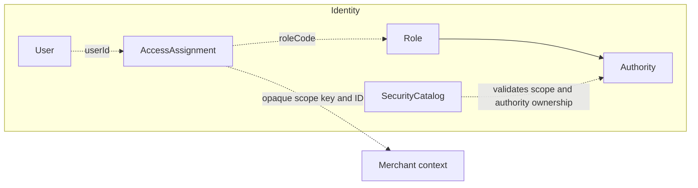
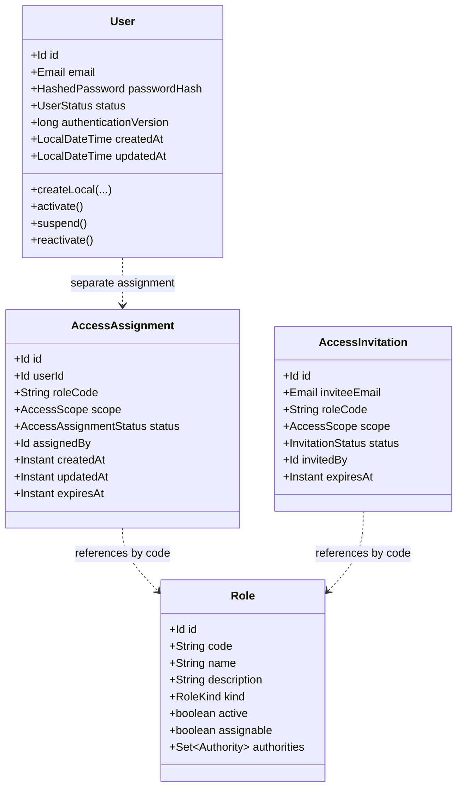
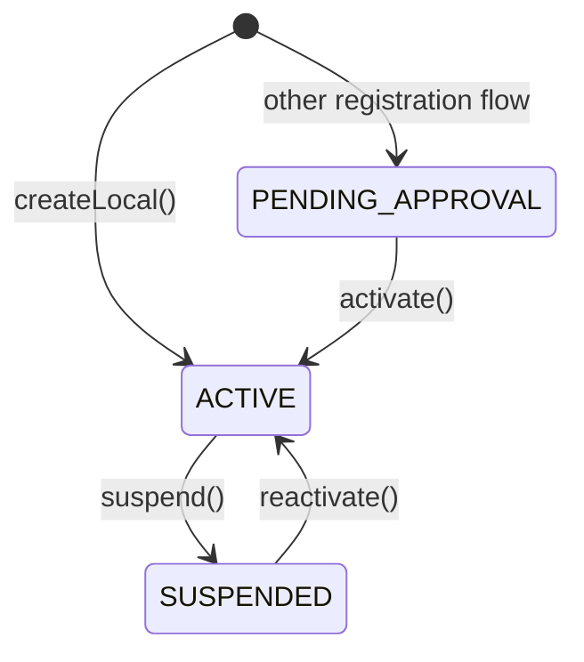

# Domain Specification: Identity & Access

> **Bounded Context:** Identity
> **Primary Purpose:** Manages users, roles, authorities, scoped access assignments, invitations, and the security catalog used to authorize platform requests.
> **Module Root:** `identity-domain` / `identity-application` / `identity-adapter-persistence` / `store/identity`
> **Related Technical Design:** [Security Manifest Consistency](../../../system/security-manifest-consistency-tech-spec.md)

## 1. Boundary & Context Map

### Ownership

- **This bounded context OWNS:** User, Role, AccessAssignment, AccessInvitation, Authority, and SecurityCatalog domain state.
- **This bounded context DOES NOT OWN:** Merchant or storefront records, product data, or the business meaning of a resource identifier in an access scope.

Refresh sessions and external identity links are persistence/authentication records; they are not child entities represented on the current `User` domain aggregate.

## 2. Ubiquitous Language

| Business Term | Domain Concept | Business Definition |
|---|---|---|
| User | `User` | A platform identity with an email, optional local password, status, and authentication version. |
| Role | `Role` | A named set of authorities with a custom or system kind and active/assignable flags. |
| Authority | `Authority` | A permission definition referenced by a role. |
| Access assignment | `AccessAssignment` | A user's role assignment within an `AccessScope` and its lifecycle status. |
| Access scope | `AccessScope` | A validated scope key and opaque resource ID, such as a particular merchant account. |
| Refresh session | Persistence record | A revocable refresh-token family/session; it is persisted separately from `User`. |
| External identity | Persistence record | A link keyed by provider issuer and subject; uniqueness is enforced for that pair. |

## 3. Domain Aggregate Model

| Property | Type | Belongs To | Business Rationale |
|---|---|---|---|
| `id` | `Id` | User | Stable platform identity. |
| `email` | `Email` | User | Contact and local sign-in address. |
| `passwordHash` | `HashedPassword` or absent | User | Supports local authentication without retaining a raw password. |
| `status` | `UserStatus` | User | Controls whether the user may authenticate. |
| `authenticationVersion` | `long` | User | Allows issued authentication to be invalidated after security changes. |
| `createdAt` / `updatedAt` | `LocalDateTime` | User | Record user creation and status/security updates. |
| `id` | `Id` | AccessAssignment | Stable identity for an assignment lifecycle. |
| `userId` | `Id` | AccessAssignment | Identifies the assigned user without aggregate containment. |
| `roleCode` | `String` | AccessAssignment | Identifies the granted role. |
| `scope` | `AccessScope` | AccessAssignment | Limits the assignment to a validated resource scope. |
| `status` | `AccessAssignmentStatus` | AccessAssignment | Tracks whether an assignment is active, suspended, revoked, or expired. |
| `assignedBy` | `Id` or absent | AccessAssignment | Records the actor that granted the assignment when supplied. |
| `createdAt` / `updatedAt` | `Instant` | AccessAssignment | Record creation and the latest lifecycle change. |
| `expiresAt` | `Instant` or absent | AccessAssignment | Limits the duration of an assignment when an expiry is set. |
| `inviteeEmail`, `roleCode`, `scope`, `tokenHash` | `Email`, `String`, `AccessScope`, `String` | AccessInvitation | Identify the intended recipient and scoped grant while retaining only a token hash. |
| `invitedBy`, `status`, `createdAt`, `expiresAt`, `acceptedBy`, `updatedAt` | `Id`, `InvitationStatus`, `Instant` | AccessInvitation | Record who created the invitation and its acceptance, expiry, or cancellation lifecycle. |
| `id` | `Id` | Role | Stable identity for the role definition. |
| `code` | `String` | Role | Stable name used to grant and resolve the role. |
| `name` / `description` | `String` | Role | Describe the role for access administration. |
| `kind` | `RoleKind` | Role | Distinguishes custom roles from protected system roles. |
| `active` | `boolean` | Role | Controls whether the role can contribute effective access. |
| `assignable` | `boolean` | Role | Prevents grants of roles that are not ready for assignment. |
| `authorities` | `Set<Authority>` | Role | Defines the permission records granted by the role. |

The `AccessAssignment` and `Role` are separate aggregates. A role references authorities; a user does not contain assignments or sessions.

## 4. Business Invariants & Rules

| Rule ID | Invariant Rule | Violation Outcome | Enforced By |
|---|---|---|---|
| INV-01 | A suspended user cannot authenticate as active. | Identity resolution denies access. | User status and identity resolver |
| INV-02 | An assignment must identify a user, role code, scope, status, and creation/update times. | Construction is rejected. | `AccessAssignment` |
| INV-03 | A user cannot assign an access assignment to themselves. | Assignment creation/reactivation is rejected. | `AccessAssignment.create()` / `reactivate()` |
| INV-04 | A role must be active and assignable before a new assignment can use it. | Assignment is rejected. | Role `requireAssignable()` and assignment use case |
| INV-05 | External identity issuer/subject pairs are unique. | Duplicate identity link is rejected by persistence constraint. | Identity persistence |

Local registration creates an `ACTIVE` user. `PENDING_APPROVAL` remains a supported state for other identity flows and is not the state produced by `User.createLocal()`.

## 5. State Lifecycle & Transitions

| Current State | Trigger | Next State | Guard |
|---|---|---|---|
| Absent | `createLocal()` | `ACTIVE` | Email and password are supplied. |
| `PENDING_APPROVAL` | `activate()` | `ACTIVE` | User must currently be pending approval. |
| `ACTIVE` | `suspend()` | `SUSPENDED` | User must not already be suspended. |
| `SUSPENDED` | `reactivate()` | `ACTIVE` | User must currently be suspended. |

Suspension and session invalidation are coordinated by Identity application services; session records are separate persistence state.

## 6. Domain Events

The following records are Identity aggregate/domain events, not the store-level integration envelopes that bridge selected changes to other modules.

| Event Name | Trigger | Key Attributes | Target Consumers |
|---|---|---|---|
| `UserRegisteredEvent` | Local user creation | User ID, email, status, time | Identity listeners and downstream registration flows |
| `UserStatusChangedEvent` | User status change | User ID, old/new status, time | Identity listeners and audit consumers |
| `AccessAssignmentChangedEvent` | Assignment create/status change | Assignment ID, user ID, role code, scope, old/new status | Access projections and session coordination |
| `AccessInvitationChangedEvent` | Invitation created or status changed | Invitation ID, email, role, scope, previous/current status | Invitation flows and access projections |
| `RoleCreatedEvent` | Custom or pending system role creation | Role identity, code, kind/flags | Role projections |
| `RoleDetailsUpdatedEvent` | Role name or description changed | Role ID, name, description, time | Role projections |
| `RoleStatusChangedEvent` | Role activated or deactivated | Role ID, active state, time | Role projections and access resolution |
| `RoleAuthorityChangedEvent` | Custom role authority change | Role ID and authority change | Identity projections |
| `SecurityCatalogActivatedEvent` | Security manifest activated | Catalog revision, module, source revision, digest | Identity catalog projections |

### Store Integration Events

`UserRegisteredIntegrationEvent` and `IdentitySecurityCatalogActivatedIntegrationEvent` are store-level integration records published for cross-module or composition-layer consumers. Manifest declarations from Catalog, Merchant, Inventory, and Sales Channel use separate module-scoped integration records. Workflow signals are likewise not Identity aggregate events.

Merchant approval is handled by the Merchant context, which provisions an initial `MERCHANT_ADMIN` member and requests access through the shared Identity access-management interface. Identity does not directly listen to `MerchantApprovedEvent` to grant an `OWNER` role.

Implementation references: `identity-domain/src/main/java/com/identity/domain/aggregate/User.java`, `AccessAssignment.java`, `Role.java`, `AccessInvitation.java`, and `store/src/main/java/com/grab/store/merchant/internal/event/MerchantApprovalAccessGrantListener.java`.
