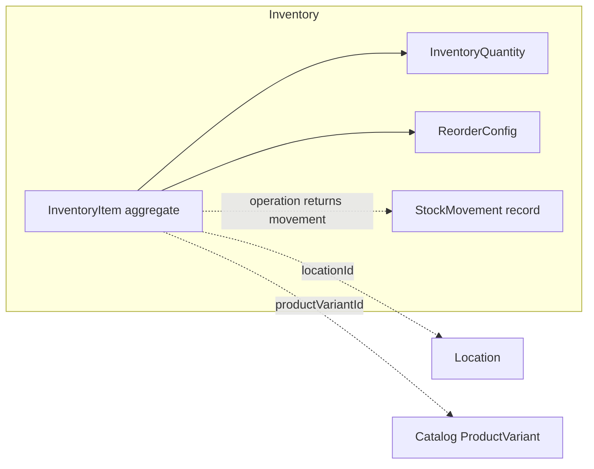
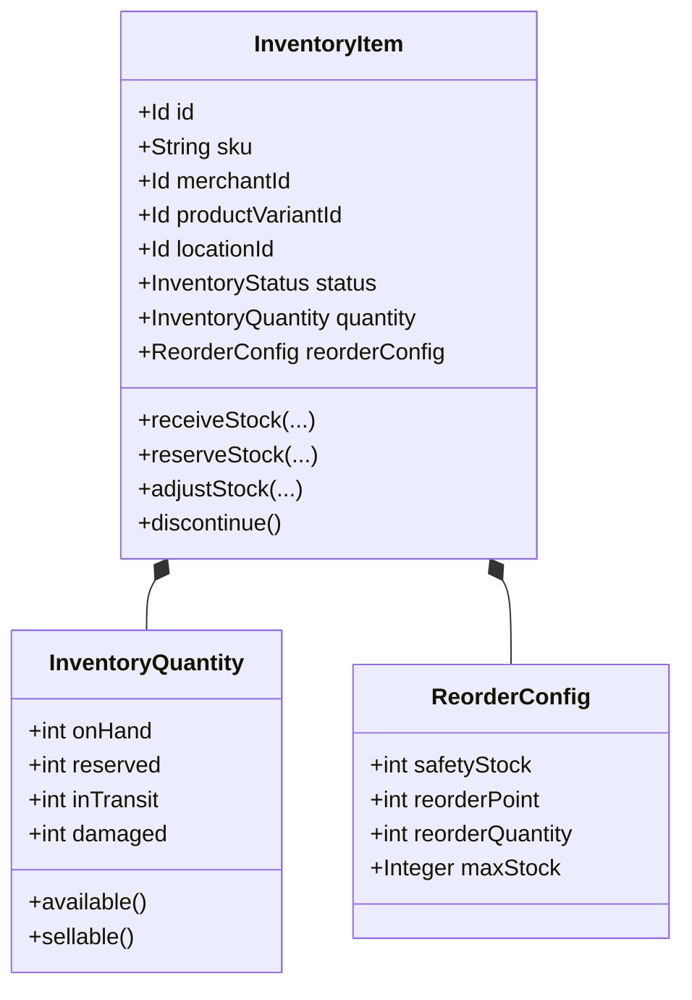
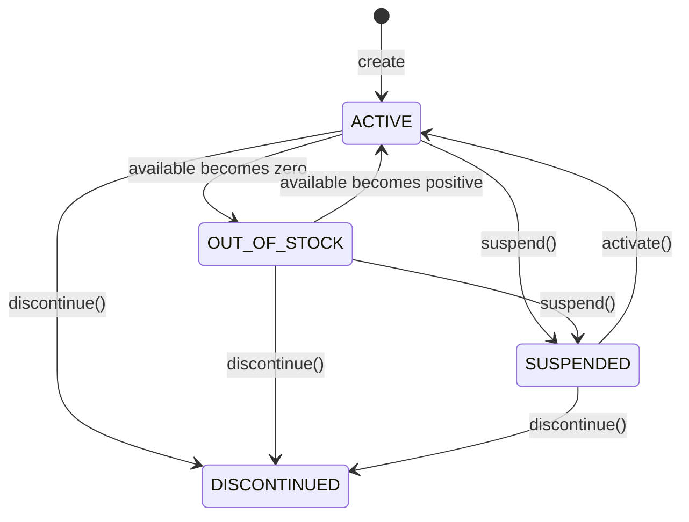

# Domain Specification: Inventory Item

> **Bounded Context:** Inventory
> **Primary Purpose:** Tracks quantities, stock operations, reorder settings, and inventory status for a merchant's product variant at a location.
> **Module Root:** `inventory-domain` / `inventory-application` / `inventory-adapter-persistence` / `store/inventory`
> **Related Workflow:** [Create Sellable Product](../../../workflows/create-sellable-product-workflow.md)

## 1. Boundary & Context Map

### Ownership

- **This aggregate OWNS:** Inventory item identity, merchant and variant identifiers, location identifier, quantity, reorder settings, and status.
- **This aggregate DOES NOT OWN:** Locations, product variants, stock movement persistence, orders, or bins.

Stock movements are separate domain entities persisted through a stock movement repository by application use cases. They are not child entities held by the InventoryItem aggregate.

## 2. Ubiquitous Language

| Business Term | Domain Concept | Business Definition |
|---|---|---|
| Inventory item | `InventoryItem` | Stock state for a merchant, variant, and location combination. |
| On hand | `onHand` | Physical quantity recorded at the location. |
| Available | `available()` | `max(0, onHand - reserved - damaged)`, the quantity available to reserve. |
| Sellable | `sellable()` | `max(0, onHand - damaged)`, excluding the reserved amount. |
| In transit | `inTransit` | Quantity announced for transfer or purchase receipt but not yet received. |
| Stock movement | `StockMovement` | Separately persisted record describing a stock operation and its quantity snapshots. |

## 3. Domain Aggregate Model

| Property | Type | Belongs To | Business Rationale |
|---|---|---|---|
| `id` | `Id` | Root | Stable identity for stock operations at one location. |
| `sku` | `String` | Root | Merchant-facing stock-keeping identifier. |
| `merchantId` | `Id` | Root | Identifies the merchant that owns the inventory. |
| `productVariantId` | `Id` | Root | Optional reference to the catalog variant. |
| `locationId` | `Id` | Root | Identifies the location whose stock is tracked. |
| `status` | `InventoryStatus` | Root | Controls whether stock operations and fulfillment are allowed. |
| `quantity` | `InventoryQuantity` | Root | Holds the on-hand, reserved, in-transit, and damaged dimensions. |
| `reorderConfig` | `ReorderConfig` | Root | Holds low-stock and replenishment thresholds. |

`StockMovement` is persisted separately and is not an aggregate composition in the current model.

## 4. Business Invariants & Rules

| Rule ID | Invariant Rule | Violation Outcome | Enforced By |
|---|---|---|---|
| INV-01 | On-hand, reserved, in-transit, and damaged quantities cannot be negative. | Quantity construction or operation is rejected. | `InventoryQuantity` |
| INV-02 | A reservation cannot exceed currently available quantity. | Reservation is rejected. | `InventoryQuantity.reserve()` |
| INV-03 | Stock operations are blocked while the item is suspended or discontinued. | Operation is rejected. | `InventoryItem.validateNotBlocked()` |
| INV-04 | An initial stock movement is persisted only when initial quantity is greater than zero. | Zero-stock creation has no initial movement record. | `CreateInventoryService` |

Quantity-changing application operations persist the returned movement separately from the InventoryItem. An inventory item may be created with nonzero initial quantity.

## 5. State Lifecycle & Transitions

| Current State | Trigger | Next State | Guard |
|---|---|---|---|
| `ACTIVE` | Stock mutation | `OUT_OF_STOCK` | Available quantity becomes zero. |
| `OUT_OF_STOCK` | Stock mutation | `ACTIVE` | Available quantity becomes positive. |
| `ACTIVE` or `OUT_OF_STOCK` | `suspend()` | `SUSPENDED` | Explicit lifecycle operation. |
| Any non-discontinued state | `discontinue()` | `DISCONTINUED` | Explicit lifecycle operation; used for deleted catalog variants. |
| Any state | `activate()` | `ACTIVE` | Current method sets the status directly; quantity is not an activation guard. |

## 6. Domain Events

| Event Name | Trigger | Key Attributes | Target Consumers |
|---|---|---|---|
| `StockReceivedEvent` | Positive stock receipt or positive initial stock | Item, SKU, quantity, location, time | Inventory projections and downstream listeners |
| `StockReservedEvent` | Reservation | Item, SKU, quantity, order reference, time | Inventory projections and order flows |
| `StockShippedEvent` | Shipment of reserved stock | Item, SKU, quantity, order reference, time | Inventory projections and order flows |
| `StockAdjustedEvent` | Adjustment, damage, or write-off | Item, SKU, before/after quantity, reason | Inventory projections and audit consumers |
| `LowStockAlertEvent` | Stock falls below its configured reorder point | Item, SKU, quantity and reorder details | Inventory alerts and projections |
| `InventoryItemDiscontinuedEvent` | Discontinuation | Item, SKU, variant, location | Catalog/inventory integration flows |

`InventoryItemCreatedEvent` is a workflow acknowledgement, not a domain event emitted by this aggregate. The store layer maps selected stock events to integration records such as `StockReceivedIntegrationEvent`, `StockReservedIntegrationEvent`, `StockShippedIntegrationEvent`, and `StockAdjustedIntegrationEvent`. A `ProductDeletedIntegrationEvent` from Catalog is consumed asynchronously and causes associated inventory items to be discontinued while their quantities remain recorded. Location, zone, and bin events belong to their own Inventory aggregates and are outside this InventoryItem event table.

Implementation references: `inventory-domain/src/main/java/com/inventory/domain/aggregate/InventoryItem.java`, `inventory-domain/src/main/java/com/inventory/domain/valueobject/InventoryQuantity.java`, `inventory-application/src/main/java/com/inventory/application/service/CreateInventoryService.java`, and `store/src/main/java/com/grab/store/inventory/internal/event/ProductVariantDeletedInventoryCascadeEventListener.java`.
