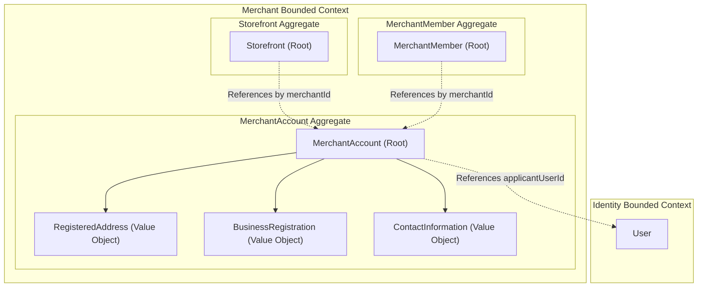
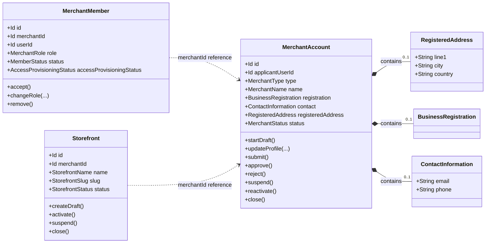
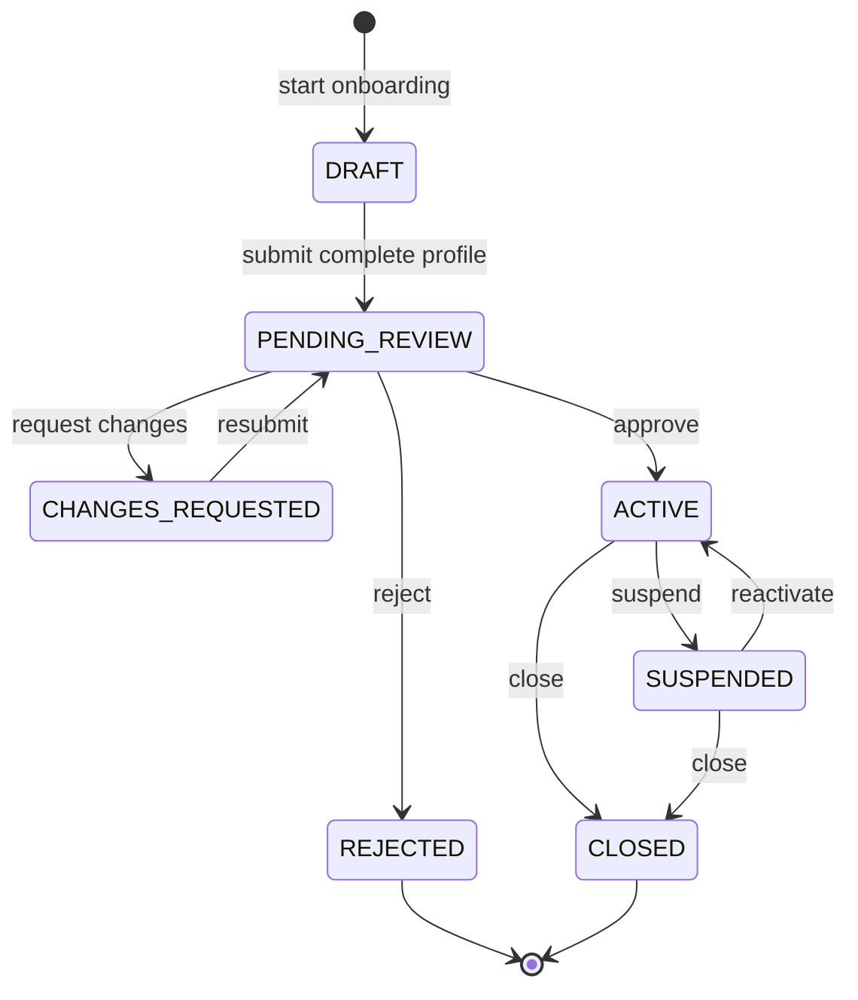

# Domain Specification: Merchant

> **Bounded Context:** Merchant
> **Primary Purpose:** Manages merchant business onboarding, merchant membership, storefront branding, and seller lifecycle statuses.
> **Module Root:** `merchant-domain` / `merchant-application` / `merchant-adapter-persistence` / `store/merchant`
> **Foundation Feature:** [Default Sales Channel](../../../../features/feat_001-default_saleschannel_provisioning.md)
> **Regional Feature:** [Edge Shopping-Context Resolution](../../../../features/feat_004-edge-shopping-context-resolution.md)
> **Related Workflows:** [Default Sales Channel Provisioning](../../../workflows/default-sales-channel-provisioning-workflow.md)

---

## 1. Boundary & Context Map

### Ownership

- **This aggregate OWNS:** The `MerchantAccount`, `MerchantMember`, and `Storefront` aggregates, each with its own lifecycle.
- **This aggregate DOES NOT OWN:** `User` accounts or authentication (Identity), Products/Listings (Catalog), or Physical fulfillment centers (Inventory).

### Context Map

---

## 2. Ubiquitous Language

| Business Term | Domain Concept | Business Definition |
| :--- | :--- | :--- |
| **Merchant Account** | `MerchantAccount` (Aggregate Root) | The business entity/profile representing a seller on the platform. Acts as the primary authorization scope. |
| **Storefront** | `Storefront` (Aggregate Root) | A branded, customer-facing sales presence with its own lifecycle. |
| **Merchant member** | `MerchantMember` (Aggregate Root) | A user's membership in a merchant, with a merchant role, membership status, and access-provisioning status. |
| **Open application** | `DRAFT`, `PENDING_REVIEW`, or `CHANGES_REQUESTED` | An application not yet rejected, activated, suspended, or closed. |
| **Applicant** | `applicantUserId` | The Identity user who originally initiated the merchant onboarding process. |
| **Business Registration** | `BusinessRegistration` (VO) | Immutable government/tax identity details (e.g. tax ID, company registration number). |
| **Draft Onboarding** | `MerchantStatus.DRAFT` | A merchant profile that is actively being filled out by the applicant but not yet submitted for review. |

---

## 3. Domain Aggregate Model

### Model Diagram

### Property & Attribute Rationale

| Property | Type | Belongs To | Business Rationale |
| :--- | :--- | :--- | :--- |
| `id` | `Id` | MerchantAccount | Stable identity for the merchant account. |
| `applicantUserId` | `Id` | MerchantAccount | Links the business account back to the physical person who created it. Identity manages actual access control. |
| `type` | `MerchantType` | MerchantAccount | Differentiates between Retailer, Third-Party, or Consumer sellers for distinct business rules. |
| `status` | `MerchantStatus` | MerchantAccount | Tracks application review and merchant lifecycle. |
| `name` | `MerchantName` | MerchantAccount | Stores the merchant's legal/display identity. |
| `registration` | `BusinessRegistration` or absent | MerchantAccount | Holds registration details when required for the merchant type. |
| `contact` | `ContactInformation` or absent | MerchantAccount | Identifies the merchant's contact information. |
| `registeredAddress` | `RegisteredAddress` or absent | MerchantAccount | Records the address when supplied by the merchant. |
| `id` | `Id` | MerchantMember | Stable identity for membership and invitations. |
| `merchantId` | `Id` | MerchantMember | Identifies the merchant whose membership is represented. |
| `userId` | `Id` | MerchantMember | Identifies the user in the merchant membership. |
| `role` | `MerchantRole` | MerchantMember | Controls the member's merchant capabilities. |
| `status` | `MemberStatus` | MerchantMember | Tracks invited, active, or removed membership. |
| `accessProvisioningStatus` | `AccessProvisioningStatus` | MerchantMember | Tracks pending, active, or failed Identity access provisioning. |
| `id` | `Id` | Storefront | Stable identity for a storefront. |
| `name` | `StorefrontName` | Storefront | Customer-facing storefront name. |
| `status` | `StorefrontStatus` | Storefront | Tracks storefront activation, suspension, and closure. |
| `merchantId` | `Id` | Storefront | A Storefront must belong to a MerchantAccount (cross-aggregate ID reference). |
| `slug` | `StorefrontSlug` | Storefront | SEO-friendly URL path for the storefront. |
| `line1`, `city`, `country` | `String` | RegisteredAddress | Identify the merchant's supplied address. |
| `email`, `phone` | `String` | ContactInformation | Provide the merchant's validated contact channels. |

---

## 4. Business Invariants & Rules

| Rule ID | Invariant Rule | Violation Outcome | Enforced By |
| :--- | :--- | :--- | :--- |
| **INV-01** | A Storefront can be activated only from `DRAFT`. | Transition rejected. | `Storefront.activate()` |
| **INV-02** | A MerchantAccount cannot be submitted unless its legal name and contact exist and any required business registration is present. | State transition rejected. | `MerchantAccount.submit()` |
| **INV-03** | Only one open application is allowed per applicant and merchant type at a time. | Registration rejected. | `MerchantRegistrationPolicy.requireNoOpenApplication()` and repository query |
| **INV-04** | A Storefront slug must be available across storefronts. | Create/rename rejected. | `StorefrontSlugPolicy.requireAvailable()` |

---

## 5. State Lifecycle & Transitions

### State Machine (MerchantAccount)

### Transition Matrix (MerchantAccount)

| Current State | Trigger / Event | Next State | Guard Condition / Prerequisite |
| :--- | :--- | :--- | :--- |
| `DRAFT` or `CHANGES_REQUESTED` | `submit()` | `PENDING_REVIEW` | Legal name and contact are required; registration is required for merchant types that require it. |
| `PENDING_REVIEW` | `approve(reviewerId, ...)` | `ACTIVE` | Reviewer identity is required and recorded; authorization is enforced outside this aggregate transition. |
| `ACTIVE` | `suspend()` | `SUSPENDED` | A lifecycle reason is required; lifecycle listeners revoke merchant-scoped member sessions and update Catalog availability. |
| `SUSPENDED` | `reactivate()` | `ACTIVE` | Explicit operator action. |
| `ACTIVE` or `SUSPENDED` | `close()` | `CLOSED` | A lifecycle reason is required. |

### Merchant Member Lifecycle

| Current membership state | Trigger | Next state | Guard |
|---|---|---|---|
| New admin membership | Merchant approval provisioning | `ACTIVE` | The Merchant application listener provisions the initial `MERCHANT_ADMIN` member. |
| New invitation | `invite()` | `INVITED` | Admin role cannot be assigned through a regular invitation; inviter is required. |
| `INVITED` | `accept(actor, now)` | `ACTIVE` | Actor must be the invited user and invitation must not be expired. |
| `INVITED` or `ACTIVE` | `remove(now)` | `REMOVED` | Removal is idempotent. |

Access provisioning is tracked separately as `PENDING`, `ACTIVE`, or `FAILED`. A MerchantMember records provisioning outcomes while Identity assignments remain owned by Identity.

---

## 6. Domain Events

### Emitted Events (What Happened)

The listed records are Merchant domain events. Separate integration events are published from selected lifecycle events for Catalog and other consumers; Merchant approval provisioning is coordinated by a Merchant listener through the shared Identity access-management interface.

| Event Name | Trigger | Key Attributes | Target Consumers |
| :--- | :--- | :--- | :--- |
| `MerchantApplicationStartedEvent` | Draft application created | `merchantId`, applicant, time | Merchant application flows |
| `MerchantApplicationSubmittedEvent` | `submit()` | `merchantId`, applicant, status, version, time | Backoffice review queues |
| `MerchantChangesRequestedEvent` | Reviewer requests changes | Merchant, reviewer, reason, status, version, time | Merchant application flows |
| `MerchantApprovedEvent` | `approve()` | Merchant, applicant, reviewer, status, version, time | Merchant listener provisions an initial `MERCHANT_ADMIN` member and requests scoped access through Identity's shared interface; approval integration also starts seller Website provisioning. |
| `MerchantRejectedEvent` | `reject()` | Merchant, reviewer, reason, status, version, time | Merchant application flows |
| `MerchantSuspendedEvent` | `suspend()` | Merchant lifecycle data, reason, actor, time | Merchant lifecycle listeners; Catalog availability bridge |
| `MerchantReactivatedEvent` | `reactivate()` | Merchant lifecycle data, actor, time | Merchant lifecycle listeners |
| `MerchantClosedEvent` | `close()` | Merchant lifecycle data, reason, actor, time | Merchant lifecycle listeners; Catalog availability bridge |
| `MerchantProfileUpdatedEvent` | `updateProfile()` | Merchant, display name, version, time | Merchant profile projections |
| `MerchantMemberCreatedEvent` | Member or invitation created | Member, merchant, user, role, status | Merchant membership projections |
| `MerchantMemberRoleChangedEvent` | Member role changed | Member, merchant, user, previous/new role | Merchant membership and access-provisioning flows |
| `MerchantMemberRemovedEvent` | Member removed | Member, merchant, user, role | Merchant membership and access-revocation flows |
| `StorefrontCreatedEvent` / `StorefrontStatusChangedEvent` | Storefront created or lifecycle changed | Storefront, merchant, status | Storefront integration bridge |
| `StorefrontRenamedEvent` | Storefront name or slug changed | Storefront, merchant, previous/new name and slug, version, time | Storefront projections |

### Store Integration Events

The store composition layer publishes selected events under integration-specific record names; these records are not Merchant aggregate domain events. Current examples include `MerchantApplicationStartedIntegrationEvent`, `MerchantSuspendedIntegrationEvent`, `MerchantReactivatedIntegrationEvent`, `MerchantClosedIntegrationEvent`, `MerchantProfileUpdatedIntegrationEvent`, `StorefrontCreatedIntegrationEvent`, `StorefrontStatusChangedIntegrationEvent`, and `StorefrontRenamedIntegrationEvent`. Merchant approval also drives a store listener that provisions membership and requests Identity access through the shared interface. Workflow requests and acknowledgements, where used, are a third event category.

Implementation references: `merchant-domain/src/main/java/com/merchant/domain/aggregate/MerchantAccount.java`, `MerchantMember.java`, `merchant-domain/src/main/java/com/merchant/domain/service/MerchantRegistrationPolicy.java`, and `store/src/main/java/com/grab/store/merchant/internal/event/MerchantApprovalAccessGrantListener.java`.
