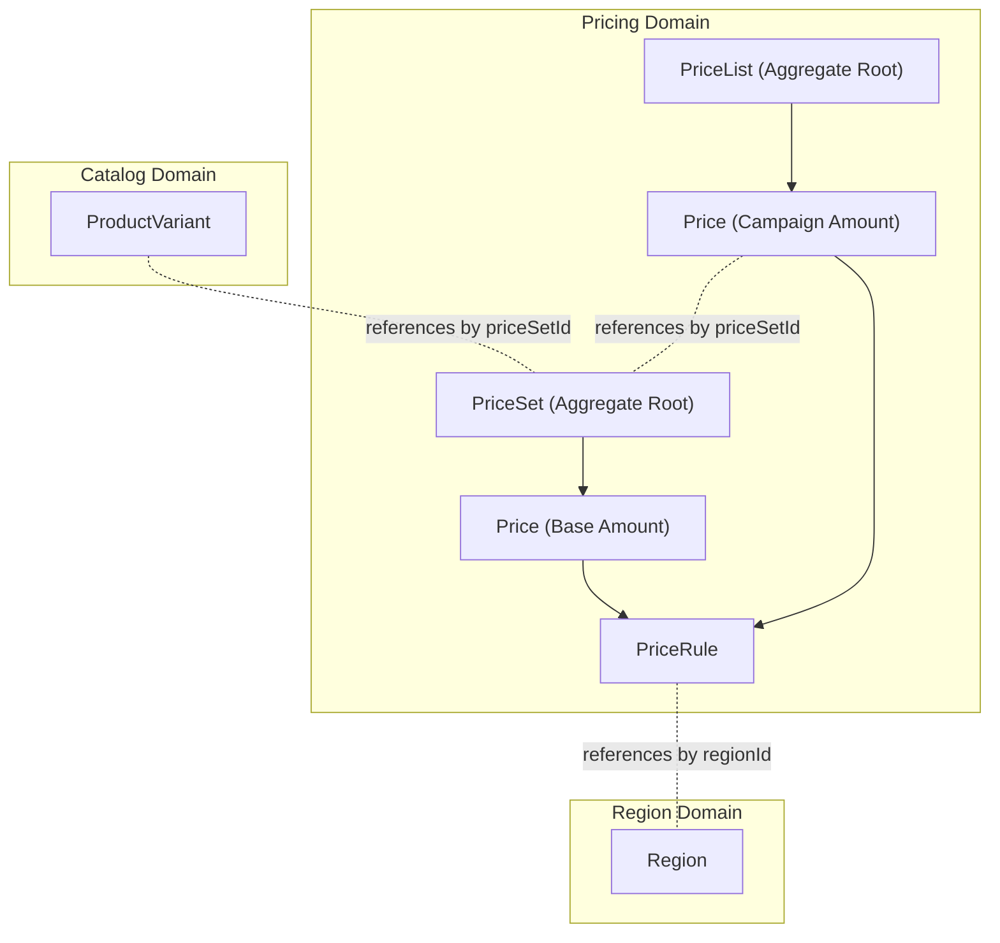
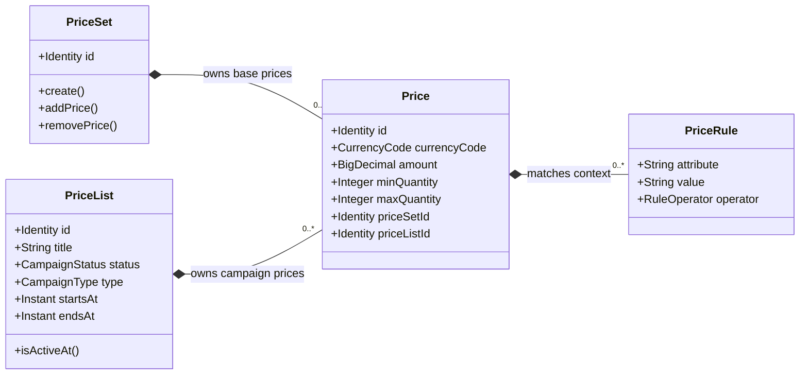
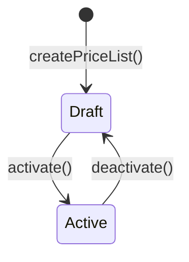

# Domain Spec: Pricing

- **Domain:** Pricing
- **Purpose:** Defines price-set ownership, promotional campaign price lists, regional market rules, and deterministic contextual price calculations.
- **Feature Spec:** [Vectorized Batch Regional Pricing](../../../../features/feat_005-vectorized-batch-regional-pricing.md)

---

## 1. Ownership & Boundaries

### What does this domain own?

- **Owns:** `PriceSet` containers, base currency amounts, promotional `PriceList` campaigns (`OVERRIDE` or `SALE`), contextual `PriceRule` matchers, and tax inclusion `PricePreference` configurations.
- **Does NOT own:** Catalog product taxonomy or variant lifecycles (`Catalog`), regional market definitions or currencies (`Region`), sales channel bindings (`SalesChannel`), or storefront presentation read models.

### Boundary Diagram

> Show this entity, its internal parts, and how it relates to other domains (ID references only — no direct object navigation).

---

## 2. Domain Model

### Model Diagram

> Show the entity structure — attributes and key operations. Keep it to ~7–9 nodes.

### Property Rationale

> Every property must exist for a business reason — not "because the database needs it."

| Property | Type | Belongs To | Why It Exists |
|:---------|:-----|:-----------|:--------------|
| `id` | Identifier | `PriceSet` | Unique container ID referenced by catalog product variants. |
| `id` | Identifier | `Price` | Distinguishes individual candidate prices and resolves deterministic tie-breaking. |
| `currencyCode` | CurrencyCode | `Price` | Limits monetary amount to one specific ISO 4217 settlement currency. |
| `amount` | BigDecimal | `Price` | Non-negative commercial price charged to customers. |
| `minQuantity` | Integer (nullable) | `Price` | Defines volume discount threshold lower bound. |
| `maxQuantity` | Integer (nullable) | `Price` | Defines volume discount threshold upper bound. |
| `priceSetId` | Identifier | `Price` | References the parent `PriceSet` container. |
| `priceListId` | Identifier (nullable) | `Price` | Identifies campaign ownership; null for standard base prices. |
| `attribute` | String | `PriceRule` | Context dimension being evaluated (e.g., `regionId`, `salesChannelId`). |
| `value` | String | `PriceRule` | Expected matching attribute value. |
| `status` | CampaignStatus | `PriceList` | Lifecycle flag (`DRAFT` or `ACTIVE`) controlling promotion participation. |
| `type` | CampaignType | `PriceList` | Dictates promotional synthesis behavior (`SALE` markdown vs `OVERRIDE` price). |
| `startsAt` / `endsAt` | Instant (nullable) | `PriceList` | Schedule window defining when a promotional campaign is in effect. |

### Key Terms

| Business Term | Technical Name | Meaning |
|:--------------|:---------------|:--------|
| Price Set | `PriceSet` | Aggregate root holding all base price candidates for a variant. |
| Price List | `PriceList` | Aggregate root managing a promotional campaign and its override rules. |
| Specificity Ranking | 4-Tier Ranking | Deterministic priority: `Channel+Region > Region > Channel > Base`. |
| Campaign Type | `CampaignType` | Promotional behavior: `SALE` (discounted) vs `OVERRIDE` (fixed price). |

---

## 3. Business Rules (Invariants)

> These rules can **never** be violated. If any rule is broken, the system **rejects** the action immediately.

| Rule | What Must Be True | If Violated | Enforced By |
|:-----|:-------------------|:------------|:------------|
| **INV-01** | Price amounts MUST be non-negative; configured zero (0.00) MUST remain a valid price. | Rejected with `NEGATIVE_PRICE_AMOUNT` | `Price` constructor |
| **INV-02** | Base prices MUST belong to a `PriceSet` and MUST NOT reference a `PriceList`. | Rejected with `INVALID_PRICE_CONTAINER` | `Price.createBase()` |
| **INV-03** | Campaign prices MUST belong to a `PriceList` and reference a target `PriceSet` by ID. | Rejected with `INVALID_CAMPAIGN_REFERENCE` | `Price.createCampaign()` |
| **INV-04** | Minimum quantity MUST NOT exceed maximum quantity when both are configured. | Rejected with `INVALID_QUANTITY_RANGE` | `Price.replaceDetails()` |
| **INV-05** | Only `ACTIVE` campaigns within inclusive time boundaries (`startsAt <= now <= endsAt`) MUST participate in quotes. | Campaign candidate excluded from calculation | Price Calculation Engine |
| **INV-06** | Specificity ranking MUST prioritize: `Channel+Region > Region > Channel > Base`. | Lower tier candidates excluded | Specificity Ranking Policy |
| **INV-07** | Distinct regional markets sharing a currency (e.g., US and Ecuador in USD) MUST remain strictly isolated. | Rejection of cross-region rule matching | Price Rule Matcher |
| **INV-08** | Within the winning tier, ranking MUST prefer campaign prices over base, higher rule count, lower amount, and lowest `priceId`. | Deterministic tie-breaking executed | Price Ranking Policy |
| **INV-09** | `OVERRIDE` campaigns MUST replace the base price; `SALE` campaigns MUST select the lower of the sale or base amount. | Price synthesis calculation | Price Synthesis Policy |

---

## 4. State Lifecycle

### State Diagram

> Show all states and the transitions between them. Label transitions with the action that triggers them.

### Transition Rules

| Current State | Action | Next State | Conditions |
|:--------------|:-------|:-----------|:-----------|
| `—` (new) | `createPriceList()` | `Draft` | Valid title, campaign type, and valid time windows. |
| `Draft` | `activate()` | `Active` | Eligible for request-time quote evaluation. |
| `Active` | `deactivate()` | `Draft` | Immediately excluded from quote evaluation. |

---

## 5. Events *(optional — include only if this domain emits or consumes events)*

### Events This Domain Emits

| Event | When It's Emitted | Key Data | Who Consumes It |
|:------|:-------------------|:---------|:----------------|
| `PriceSetCreatedEvent` | Upon `PriceSet` creation | `priceSetId`, `occurredAt` | Local audit listeners |
| `PriceSetUpdatedEvent` | When prices are added or removed | `priceSetId`, `occurredAt` | Local audit listeners |
| `PriceListCreatedEvent` | Upon promotional campaign creation | `priceListId`, `type`, `status` | Promotional indexing listeners |

### Events This Domain Reacts To

| Event | Emitted By | What This Domain Does | Business Impact |
|:------|:-----------|:----------------------|:----------------|
| None | — | Operates as a calculation engine without subscribing to external events. | Decoupled and high-throughput. |
