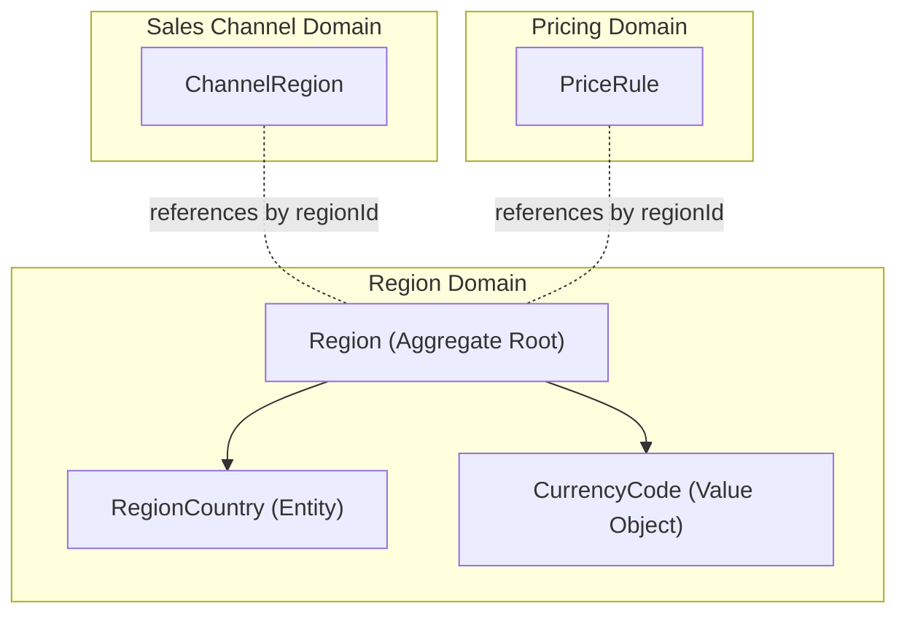
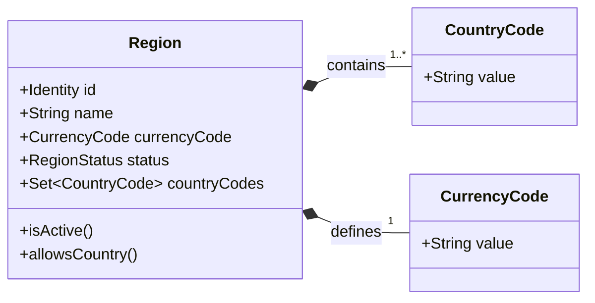
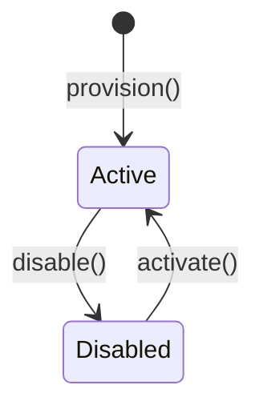

# Domain Spec: Region

- **Domain:** Region
- **Purpose:** Defines exclusive geographic country membership and authoritative settlement currency independently of sales channel configurations.
- **Feature Spec:** [Edge Shopping-Context Resolution](../../../../features/feat_004-edge-shopping-context-resolution.md)

---

## 1. Ownership & Boundaries

### What does this domain own?

- **Owns:** Market identity, human-readable market name, ISO 4217 settlement currency, market status (`ACTIVE` or `DISABLED`), and exclusive ISO 3166-1 alpha-2 country code membership.
- **Does NOT own:** Sales channel bindings or default selections (`SalesChannel`), monetary pricing amounts (`Pricing`), stock inventory (`Inventory`), or customer addresses.

### Boundary Diagram

> Show this entity, its internal parts, and how it relates to other domains (ID references only — no direct object navigation).

---

## 2. Domain Model

### Model Diagram

> Show the entity structure — attributes and key operations. Keep it to ~7–9 nodes.

### Property Rationale

> Every property must exist for a business reason — not "because the database needs it."

| Property | Type | Belongs To | Why It Exists |
|:---------|:-----|:-----------|:--------------|
| `id` | Identifier | `Region` | Uniquely identifies a legal market across the platform. |
| `name` | String | `Region` | Operator-facing market label (e.g., "Singapore & Malaysia"). |
| `currencyCode` | CurrencyCode | `Region` | Sole authoritative settlement currency for transactions in this market. |
| `status` | RegionStatus | `Region` | Determines if the market is operational (`ACTIVE`) or retired (`DISABLED`). |
| `countryCodes` | Set~CountryCode~ | `Region` | Set of ISO 3166-1 alpha-2 codes mapped exclusively to this market. |

### Key Terms

| Business Term | Technical Name | Meaning |
|:--------------|:---------------|:--------|
| Region | `Region` | An aggregate root establishing legal market boundaries and currency. |
| Member Country | `CountryCode` | Normalized ISO alpha-2 country code belonging to exactly one Region. |
| Settlement Currency | `CurrencyCode` | The official ISO 4217 currency required for commercial transactions in this market. |
| Active Region | `ACTIVE` | Operational state allowing requests and channel bindings. |

---

## 3. Business Rules (Invariants)

> These rules can **never** be violated. If any rule is broken, the system **rejects** the action immediately.

| Rule | What Must Be True | If Violated | Enforced By |
|:-----|:-------------------|:------------|:------------|
| **RG-01** | Identity, nonblank name, valid status, and uppercase ISO 4217 currency MUST be present. | Rejected with `INVALID_REGION_CONFIG` | `Region` constructor |
| **RG-02** | Member countries MUST be valid uppercase 2-letter ISO 3166-1 alpha-2 codes. | Rejected with `INVALID_COUNTRY_CODE` | `CountryCode` value object |
| **RG-03** | Each country code MUST belong to at most one Region across the entire platform. | Rejected with `DUPLICATE_COUNTRY_MEMBERSHIP` | Database Unique Constraint |
| **RG-04** | Only active regions MUST be eligible for new sales channel bindings or resolved shopping context. | Rejected with `422 Unprocessable Entity` | Edge Context Resolver & Region SPI |
| **RG-05** | Region MUST be the sole settlement-currency authority; markets sharing a currency MUST remain isolated. | Prohibited from merging or currency substitution | Pricing Engine & Context Resolver |

---

## 4. State Lifecycle

### State Diagram

> Show all states and the transitions between them. Label transitions with the action that triggers them.

### Transition Rules

| Current State | Action | Next State | Conditions |
|:--------------|:-------|:-----------|:-----------|
| `—` (new) | `provision()` | `Active` | Configured with unique ID, valid ISO currency, and non-overlapping country codes. |
| `Active` | `disable()` | `Disabled` | Administrative deactivation; rejects subsequent storefront discovery resolution. |
| `Disabled` | `activate()` | `Active` | Re-enables commercial discovery for member countries. |

---

## 5. Events *(optional — include only if this domain emits or consumes events)*

### Events This Domain Emits

| Event | When It's Emitted | Key Data | Who Consumes It |
|:------|:-------------------|:---------|:----------------|
| None | — | Region definitions are configured through administrative management. | Read synchronously by Edge Context Resolver. |

### Events This Domain Reacts To

| Event | Emitted By | What This Domain Does | Business Impact |
|:------|:-----------|:----------------------|:----------------|
| None | — | Operates as an authoritative reference dataset. | High availability and low read latency. |
