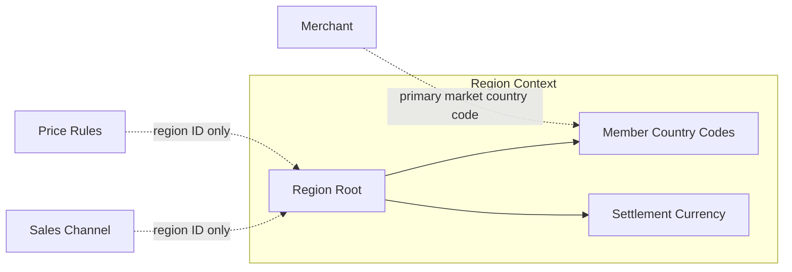
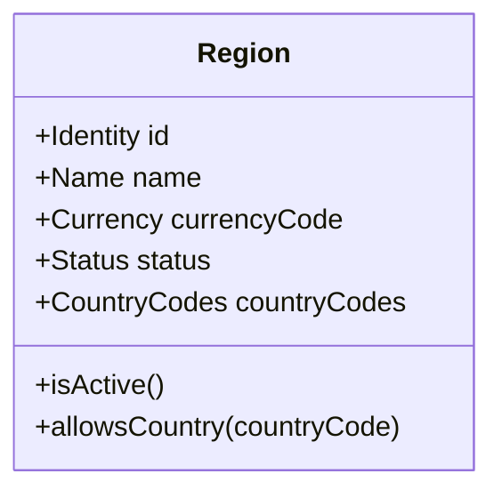
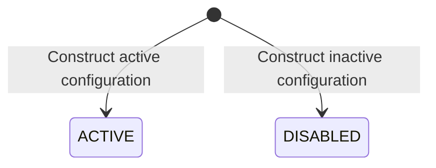

# Domain Specification: Region

> **Bounded Context:** Region
> **Primary Purpose:** Defines legal market membership and its settlement currency independently of a channel's commercial configuration.
> **Module Root:** `region-domain` / `region-application` / `region-adapter-persistence` / `store/region`
> **Related Features:** [Edge Shopping-Context Resolution](../../../../features/feat_004-edge-shopping-context-resolution.md), [Storefront API Cutover & Response Contract Refactoring](../../../../features/feat_007-storefront-api-cutover-contract-refactoring.md), [Automated Verification & Zero-Downtime Rollout](../../../../features/feat_008-automated-verification-zero-downtime-rollout.md)
> **Related Domain Specs:** [Sales Channel](../../sales-channel/architecture/sales-channel-domain-spec.md), [Pricing](../../pricing/architecture/pricing-domain-spec.md)
> **Related Workflows:** [Browse and Discover](../../../workflows/browse-and-discover-products-workflow.md), [Default Channel Provisioning](../../../workflows/default-sales-channel-provisioning-workflow.md)
> **Related Tech:** [Shopping Context](../../../system/shopping-context-resolution-tech-spec.md), [Batch Pricing](../../../system/batch-regional-pricing-tech-spec.md), [Rollout](../../../system/contextual-discovery-rollout-tech-spec.md)
> **Status:** Existing read model plus planned validation completion; not a claim of a Region management API.

## 1. Boundary & Context Map

### Ownership

- Region owns market identity, name, active status, settlement currency, and country membership.
- Sales Channel owns served/default region references; Pricing owns amounts and rules, while Merchant owns its primary-market country choice.

Country membership is currently represented by a set of strings in the aggregate and separate persistence records. No cross-context object graph is introduced.

## 2. Ubiquitous Language

| Term | Concept | Definition |
| :--- | :--- | :--- |
| Region | Aggregate root | A legal market containing countries and one settlement currency. |
| Member country | ISO alpha-2 code | A country assigned exclusively to one region. |
| Settlement currency | ISO currency code | The currency storefront quotes must request for that market. |
| Active region | `RegionStatus.ACTIVE` | A region eligible for contextual discovery and new channel bindings. |
| Served region | Sales Channel binding | A channel's enabled commercial association to a region. |

## 3. Domain Aggregate Model

### Property & Attribute Rationale

| Property | Type | Belongs to | Business rationale |
| :--- | :--- | :--- | :--- |
| `id` | `Id` | Region | Stable market reference shared without importing a region object. |
| `name` | String | Region | Identifies the market to operators. |
| `currencyCode` | String | Region | Supplies the market's settlement currency without channel-specific copies. |
| `status` | Region status | Region | Controls whether the market can be used for shopping. |
| `countryCodes` | Immutable set of strings | Region | Defines which country inputs resolve to this market. |

## 4. Business Invariants & Rules

| ID | Invariant | Violation outcome | Enforcement / completion status |
| :--- | :--- | :--- | :--- |
| **RG-01** | Identity, nonblank name, status and valid uppercase ISO currency MUST be present. | Invalid market configuration is rejected. | Constructor currently checks non-null name/currency/status; nonblank and ISO validation remain required. |
| **RG-02** | Member countries MUST be valid normalized uppercase ISO alpha-2 codes. | Invalid or ambiguous membership is rejected. | Constructor currently copies the set without validation; completion requires validation before storage and reconstitution. |
| **RG-03** | One normalized country MUST belong to at most one region. | Conflicting assignment fails without moving the country implicitly. | `uq_region_countries_country_code` exists; normalization and PostgreSQL verification remain required. |
| **RG-04** | Only an active region MUST be eligible for new channel bindings or resolved shopping contexts. | Binding fails with RegionNotActive; request resolution follows context errors. | `Region.isActive()` and binding validation exist; contextual policy is planned. |
| **RG-05** | Region MUST remain the only source of settlement currency; distinct region identities MUST remain distinct even when currencies match. | No channel fallback, FX substitution or currency-only region lookup is allowed. | Published Region read interface exists; context/pricing integration remains planned. |

A country lookup may return an inactive record; consumers must check its status rather than assume the lookup implies eligibility. Changes to country membership or currency require explicit configuration migration; no aggregate mutation API is currently exposed.

## 5. State Lifecycle & Transitions

The current aggregate is constructed/reconstituted with a fixed status and has no activation/deactivation methods.

| Current state | Trigger | Next state | Guard |
| :--- | :--- | :--- | :--- |
| Absent | Construct/reconstitute configured market | ACTIVE or DISABLED | Region invariants must hold. |
| ACTIVE or DISABLED | Read market | Unchanged | Reads cannot mutate market configuration. |

## 6. Domain Events

No aggregate domain events, Region integration records, workflow completion signals, or event-consuming mutations are currently implemented. Region outbox infrastructure exists but does not establish a market lifecycle publisher.

Country/ID resolution is synchronous through `RegionQuery`, whose provider adapter delegates to inbound read use cases under the Region read transaction. New consumers must define their own application outbound ports and use store-level adapters.
