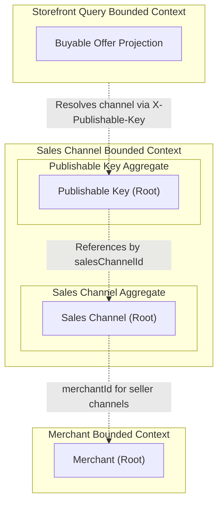
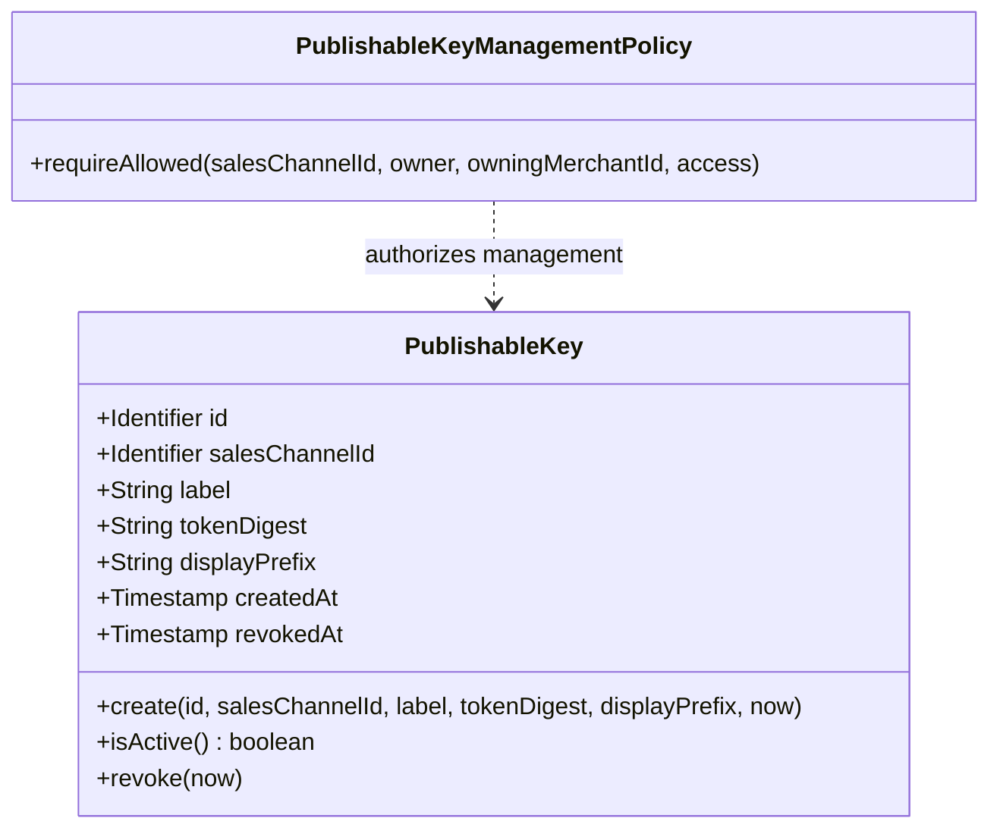
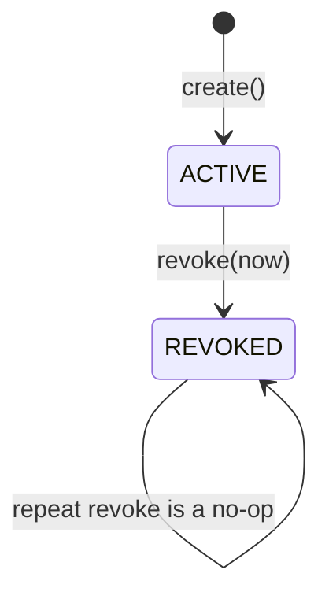

# Domain Specification: Publishable Key

> **Bounded Context:** Sales Channel
> **Primary Purpose:** Models revocable, channel-scoped public credentials used by storefronts to identify the sales channel without revealing merchant credentials or granting administrative authority.
> **Module Root:** `sales-channel-domain` / `sales-channel-application` / `sales-channel-adapter-persistence` / `store/saleschannel`
> **Related Domain Specs:** [Sales Channel](sales-channel-domain-spec.md), [Merchant](../../merchant/architecture/merchant-domain-spec.md)
> **Related Feature Specs:** [Publishable Keys for Sales Channels](../../../features/feat_003-sales-channel-publishable-keys.md)
> **Related Technical Specs:** [Storefront Query tech spec](../../../system/storefront-query-tech-spec.md), [API Security & Authentication tech spec](../../../system/api-security-tech-spec.md), [Security manifest consistency tech spec](../../../system/security-manifest-consistency-tech-spec.md)

---

## 1. Boundary & Context Map

### Ownership

- **This aggregate OWNS:** Publishable key identity, sales channel identifier reference (`salesChannelId`), merchant-assigned label, one-way token digest, non-secret display prefix, creation timestamp, and revocation timestamp.
- **This aggregate DOES NOT OWN:** Raw secret token generation or transmission, sales channel configuration or status lifecycle, merchant identity, catalog product publication, pricing, inventory, or storefront buyability projections.

`PublishableKey` is an independent aggregate root within the Sales Channel bounded context. It references its parent channel by `salesChannelId` only, maintaining strict aggregate separation without object graph navigation.

### Context Map

---

## 2. Ubiquitous Language

| Business Term | Domain Concept | Business Definition |
| :--- | :--- | :--- |
| **Publishable Key** | `PublishableKey` (Aggregate Root) | A revocable, channel-scoped credential used by public storefronts to select a sales channel for read operations. |
| **Active Key** | `PublishableKey.isActive()` | A key whose `revokedAt` timestamp is absent; eligible to resolve requests for an enabled sales channel. |
| **Revoked Key** | `revokedAt != null` | A permanently deactivated key; all subsequent resolution attempts fail closed. |
| **Token Digest** | `tokenDigest` | A one-way 64-character hex SHA-256 hash stored in place of the raw token for secure verification. |
| **Display Prefix** | `displayPrefix` | A non-secret prefix (`pk_` + 8 characters) retained for administrative identification and audits. |
| **Key Label** | `label` | A human-readable description (up to 100 characters) identifying the deployment target or environment. |
| **Management Access** | `PublishableKeyManagementAccess` (Value Object) | Caller context representing either platform administrative privileges or a specific merchant actor identity. |
| **Management Policy** | `PublishableKeyManagementPolicy` (Domain Policy) | Invariant policy enforcing that only owning merchants or platform administrators can create, list, or revoke keys. |

---

## 3. Domain Aggregate Model

### Model Diagram

### Property & Attribute Rationale

| Property | Type | Belongs To | Business Rationale |
| :--- | :--- | :--- | :--- |
| `id` | `Id` | Root | Stable domain identity identifying the publishable key record. |
| `salesChannelId` | `Id` | Root | Binds the key strictly to one sales channel by identifier. |
| `label` | `String` | Root | Operator-friendly label (1–100 chars) distinguishing client deployments. |
| `tokenDigest` | `String` | Root | Stores the SHA-256 digest so token verification occurs without persisting raw secrets. |
| `displayPrefix` | `String` | Root | Safe prefix (`pk_` + 8 chars) shown in management consoles without exposing secrets. |
| `createdAt` | `Instant` | Root | Immutable timestamp recording when the key was provisioned. |
| `revokedAt` | `Instant` (nullable) | Root | Timestamp recording when the key was revoked; absence indicates the key is active. |

---

## 4. Business Invariants & Rules

| Rule ID | Invariant Rule | Violation Outcome | Enforced By |
| :--- | :--- | :--- | :--- |
| **PK-01** | A key must reference an existing sales channel by ID and have a non-blank, trimmed label of at most 100 characters. | Construction rejects invalid or missing fields with `InvalidPublishableKey("label")`. | `PublishableKey` constructor / `requireLabel()` |
| **PK-02** | A key record must store a valid 64-hex-character digest and display prefix, never the raw token. | Rejects non-conforming digests or prefixes with `InvalidPublishableKey`. | `PublishableKey` constructor / `requirePattern()` |
| **PK-03** | Token digests must be globally unique across all publishable keys. | Creation fails with `PublishableKeyDigestConflict` so that a new unique token can be generated. | `PublishableKeyRepository.existsByDigest()` and DB unique constraint |
| **PK-04** | A key is active when `revokedAt` is absent; revocation time cannot precede creation time. | Revocation or reconstitution rejects chronological violation with `InvalidPublishableKey("revokedAt")`. | `PublishableKey.revoke()` / constructor |
| **PK-05** | Repeating revocation on an already revoked key must be a safe, idempotent no-op without timestamp update or event emission. | Returns without changing state, updating timestamps, or emitting events. | `PublishableKey.revoke()` |
| **PK-06** | A merchant may manage keys only for its own seller-owned channels; an administrator may manage keys for any channel. | Access forbidden guard raises `PublishableKeyManagementForbidden`. | `PublishableKeyManagementPolicy.requireAllowed()` |
| **PK-07** | A channel may have multiple active publishable keys concurrently to support zero-downtime key rotation. | Supported by repository design and database schema. | Aggregate structure / persistence index |
| **PK-08** | A publishable key authorizes only public storefront read queries for its designated sales channel; it conveys no admin or write rights. | Storefront query fails closed if key is invalid, inactive, or targets a disabled channel. | API Gateway / `ResolvePublishableKeyUseCase` / Storefront Query |

---

## 5. State Lifecycle & Transitions

### State Machine

### Transition Matrix

| Current State | Trigger / Action | Next State | Guard Condition / Prerequisite |
| :--- | :--- | :--- | :--- |
| Absent | `PublishableKey.create()` | `ACTIVE` | Channel exists, label valid, digest and prefix conform, caller authorized. Emits `PublishableKeyCreatedEvent`. |
| `ACTIVE` | `revoke(now)` | `REVOKED` | Caller authorized by management policy, `now >= createdAt`. Sets `revokedAt` and emits `PublishableKeyRevokedEvent`. |
| `REVOKED` | `revoke(now)` | `REVOKED` | Key already revoked; operation returns immediately with no state change or event. |

---

## 6. Domain Events

### Emitted Events (What Happened)

| Event Name | Trigger | Key Attributes | Target Consumers |
| :--- | :--- | :--- | :--- |
| `PublishableKeyCreatedEvent` | Aggregate factory creates a new key. | `keyId`, `salesChannelId`, `occurredAt` | Sales channel audit / telemetry |
| `PublishableKeyRevokedEvent` | Active key is transitioned to revoked. | `keyId`, `salesChannelId`, `occurredAt` | Sales channel audit / edge cache eviction |

Aggregate domain events are appended during state mutation and dispatched via `DomainEventProducer` following the [Transactional Outbox specification](../../../system/transactional-outbox-tech-spec.md).

### Store Integration Events

No asynchronous cross-module integration events are currently published for publishable key lifecycle changes. Storefront queries resolve key tokens synchronously through the internal read query port (`PublishableKeyQuery`).

### Workflow Signals

Publishable key provisioning and revocation are direct synchronous CQRS operations (`CreatePublishableKeyCommand`, `RevokePublishableKeyCommand`) invoked via REST controllers. They do not participate in asynchronous multi-step saga workflows.

### Consumed Events (Cross-Domain Signals)

The `PublishableKey` aggregate does not consume cross-domain events directly.

### Implementation References

- Aggregate Root: `grab/sales-channel-domain/src/main/java/com/saleschannel/domain/aggregate/PublishableKey.java`
- Management Policy: `grab/sales-channel-domain/src/main/java/com/saleschannel/domain/policy/PublishableKeyManagementPolicy.java`
- Domain Events: `grab/sales-channel-domain/src/main/java/com/saleschannel/domain/event/PublishableKeyCreatedEvent.java`, `PublishableKeyRevokedEvent.java`
- Outbound Ports: `PublishableKeyRepository.java`, `PublishableTokenGeneratorPort.java`, `PublishableKeyQueryPort.java`
- Inbound Use Cases: `CreatePublishableKeyService.java`, `RevokePublishableKeyService.java`, `ListPublishableKeysService.java`, `ResolvePublishableKeyService.java`
- Persistence Adapter & Entity: `PublishableKeyRepositoryAdapter.java`, `PublishableKeyJpaEntity.java`
- REST Controller & Module Query Port: `PublishableKeyController.java`, `PublishableKeyQuery.java`
