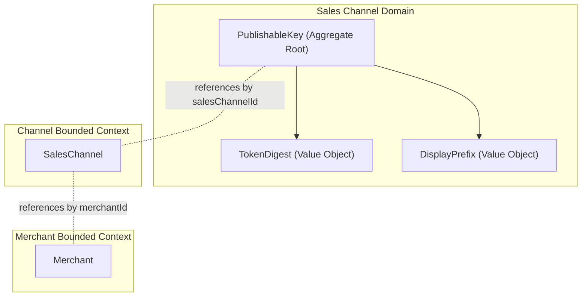
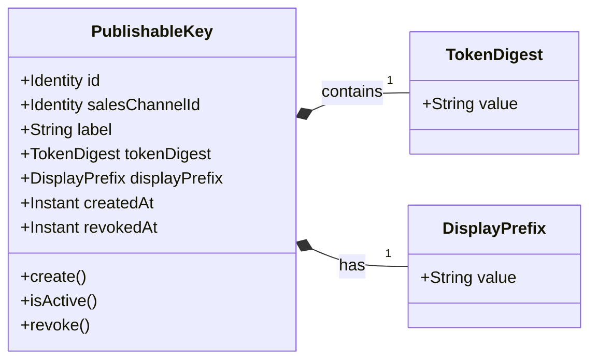
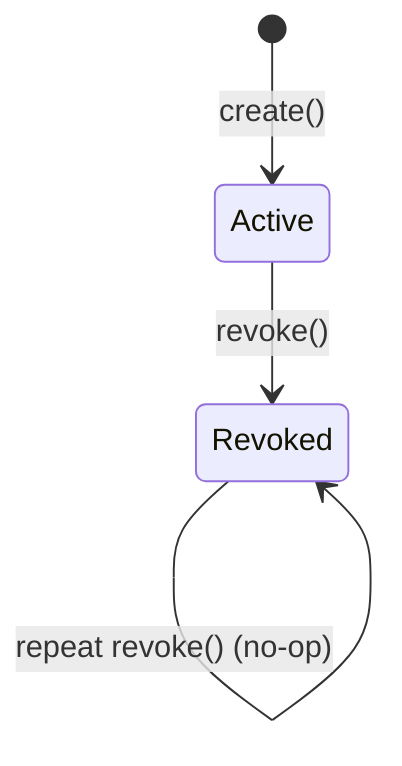

# Domain Spec: PublishableKey

- **Domain:** Sales Channel
- **Purpose:** Models revocable public credentials bound to a specific sales channel without granting merchant or administrative authority.
- **Feature Spec:** [Sales-Channel Key Lifecycle Management](../../../../features/feat_003-sales-channel-key-lifecycle-management.md)

---

## 1. Ownership & Boundaries

### What does this domain own?

- **Owns:** Key identity, channel binding, merchant label, SHA-256 token digest, safe display prefix, creation timestamp, and revocation timestamp.
- **Does NOT own:** Raw token generation and delivery (Edge/Application), channel operational status (`SalesChannel`), merchant identity (`Merchant`), or catalog pricing/inventory.

### Boundary Diagram

> Show this entity, its internal parts, and how it relates to other domains (ID references only — no direct object navigation).

---

## 2. Domain Model

### Model Diagram

> Show the entity structure — attributes and key operations. Keep it to ~7–9 nodes.

### Property Rationale

> Every property must exist for a business reason — not "because the database needs it."

| Property | Type | Belongs To | Why It Exists |
|:---------|:-----|:-----------|:--------------|
| `id` | Identifier | `PublishableKey` | Unique identity for this credential across the platform. |
| `salesChannelId` | Identifier | `PublishableKey` | Scopes this credential strictly to one commercial sales channel. |
| `label` | String | `PublishableKey` | Human-readable descriptor for merchants to distinguish client deployments (e.g., "Production Web"). |
| `tokenDigest` | TokenDigest | `PublishableKey` | Irreversible 64-character SHA-256 hash enabling verification without storing raw secrets. |
| `displayPrefix` | DisplayPrefix | `PublishableKey` | Safe identification prefix (`pk_` + 8 characters) for operators to inspect in UI and logs without disclosure. |
| `createdAt` | Instant | `PublishableKey` | Audit timestamp tracking when this credential was issued. |
| `revokedAt` | Instant (nullable) | `PublishableKey` | Records revocation timestamp; presence marks the key as permanently inactive. |

### Key Terms

| Business Term | Technical Name | Meaning |
|:--------------|:---------------|:--------|
| Publishable Key | `PublishableKey` | Public API credential representing a storefront client channel selector. |
| Active Key | `ACTIVE` | A key without a `revokedAt` timestamp, eligible for query resolution. |
| Revoked Key | `REVOKED` | A permanently deactivated key that rejects all incoming requests. |
| Safe Display Prefix | `displayPrefix` | The `pk_` prefix plus first 8 random characters safe for operator display. |

---

## 3. Business Rules (Invariants)

> These rules can **never** be violated. If any rule is broken, the system **rejects** the action immediately.

| Rule | What Must Be True | If Violated | Enforced By |
|:-----|:-------------------|:------------|:------------|
| **R-01** | A key MUST reference one existing channel and have a trimmed, nonblank label of at most 100 characters. | Rejected with `INVALID_KEY_METADATA` | `PublishableKey.create()` |
| **R-02** | A key MUST contain a 64-hex-character digest and `pk_` plus 8-character display prefix, never the raw secret token. | Rejected with `INVALID_DIGEST_FORMAT` | `TokenDigest` and `DisplayPrefix` constructors |
| **R-03** | Token digests MUST be globally unique across all publishable keys. | Rejected with `DUPLICATE_KEY_DIGEST` | Database Unique Constraint & Key Creation Service |
| **R-04** | Activity MUST mean absent revocation timestamp, and revocation timestamp MUST NOT precede creation timestamp. | Rejected with `INVALID_REVOCATION_CHRONOLOGY` | `PublishableKey.revoke()` |
| **R-05** | Repeated revocation MUST preserve the original timestamp and emit no new events. | Operation treated as idempotent no-op | `PublishableKey.revoke()` |
| **R-06** | Only an owning merchant or authorized platform administrator MUST be allowed to manage or revoke a key. | Rejected with `403 Forbidden` | Key Management Security Policy |
| **R-07** | A channel MUST permit concurrent active keys; revoking one key MUST NOT revoke or alter another. | Maintained via independent aggregate identities | `PublishableKeyRepository` |
| **R-08** | Public key identity MUST NOT grant administrative or write authority. | Privileged actions rejected with `403 Forbidden` | Storefront Security Interceptor |

---

## 4. State Lifecycle

### State Diagram

> Show all states and the transitions between them. Label transitions with the action that triggers them.

### Transition Rules

| Current State | Action | Next State | Conditions |
|:--------------|:-------|:-----------|:-----------|
| `—` (new) | `create()` | `Active` | Authorized caller, existing channel ID, valid label (1–100 chars), and unique 64-char SHA-256 digest. |
| `Active` | `revoke()` | `Revoked` | Authorized caller, revocation instant must be equal to or greater than `createdAt`. |
| `Revoked` | `revoke()` | `Revoked` | Idempotent; existing `revokedAt` timestamp is preserved unchanged. |

---

## 5. Events *(optional — include only if this domain emits or consumes events)*

### Events This Domain Emits

| Event | When It's Emitted | Key Data | Who Consumes It |
|:------|:-------------------|:---------|:----------------|
| `PublishableKeyCreatedEvent` | After key is created and digest persisted | `keyId`, `salesChannelId`, `createdAt` | Audit Logger |
| `PublishableKeyRevokedEvent` | Upon first successful revocation | `keyId`, `salesChannelId`, `revokedAt` | Audit Logger |

### Events This Domain Reacts To

| Event | Emitted By | What This Domain Does | Business Impact |
|:------|:-----------|:----------------------|:----------------|
| None | — | The aggregate does not subscribe to asynchronous domain events. | Keys remain independently manageable. |
