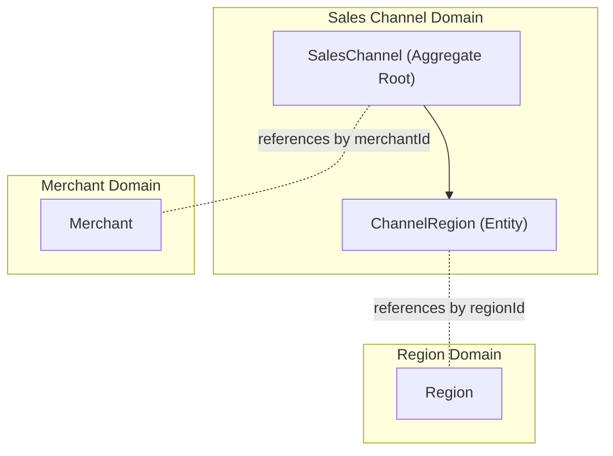
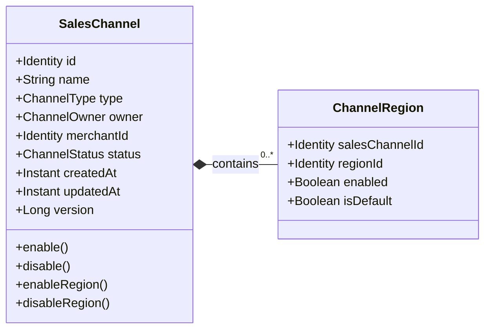
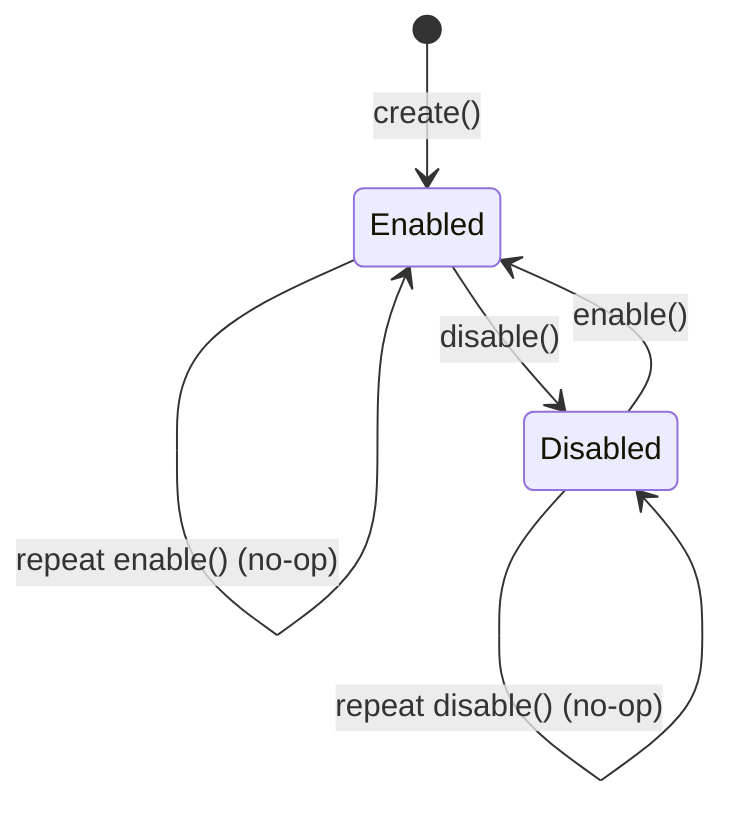

# Domain Spec: SalesChannel

- **Domain:** Sales Channel
- **Purpose:** Defines a commercial selling destination, its ownership hierarchy, active status, and regional market bindings.
- **Feature Spec:** [Edge Shopping-Context Resolution](../../../../features/feat_004-edge-shopping-context-resolution.md)

---

## 1. Ownership & Boundaries

### What does this domain own?

- **Owns:** Channel identity, display name, channel type (Website, Marketplace, POS), ownership classification, merchant reference, operational status, and `ChannelRegion` market bindings.
- **Does NOT own:** Merchant lifecycle (`Merchant`), regional definitions or currencies (`Region`), product publications (`Catalog`), or publishable credentials (`PublishableKey`).

### Boundary Diagram

> Show this entity, its internal parts, and how it relates to other domains (ID references only — no direct object navigation).

---

## 2. Domain Model

### Model Diagram

> Show the entity structure — attributes and key operations. Keep it to ~7–9 nodes.

### Property Rationale

> Every property must exist for a business reason — not "because the database needs it."

| Property | Type | Belongs To | Why It Exists |
|:---------|:-----|:-----------|:--------------|
| `id` | Identifier | `SalesChannel` | Uniquely identifies a commercial selling channel across the platform. |
| `name` | String | `SalesChannel` | Operator-facing title for administrative identification and reporting. |
| `type` | Enum | `SalesChannel` | Differentiates channel capabilities (`WEBSITE`, `MARKETPLACE`, `POINT_OF_SALE`). |
| `owner` | Enum | `SalesChannel` | Distinguishes merchant-owned channels from platform-owned channels. |
| `merchantId` | Identifier (nullable) | `SalesChannel` | References the owning merchant; null for platform-owned marketplaces. |
| `status` | Enum | `SalesChannel` | Lifecycle state (`ENABLED` or `DISABLED`) controlling public storefront usability. |
| `version` | Long | `SalesChannel` | Optimistic locking version preventing concurrent configuration conflicts. |
| `salesChannelId` | Identifier | `ChannelRegion` | Foreign key binding the regional rule to its parent sales channel. |
| `regionId` | Identifier | `ChannelRegion` | Reference to the authoritative `Region` entity. |
| `enabled` | Boolean | `ChannelRegion` | Controls whether the sales channel commercially serves the specified region. |
| `isDefault` | Boolean | `ChannelRegion` | Flags the designated fallback region when a shopper's country is omitted. |

### Key Terms

| Business Term | Technical Name | Meaning |
|:--------------|:---------------|:--------|
| Sales Channel | `SalesChannel` | An aggregate root representing an independent commercial selling surface. |
| Served Region | `ChannelRegion (enabled=true)` | A regional market where this channel is legally and commercially open for business. |
| Default Region | `ChannelRegion (isDefault=true)` | The single enabled market resolved when an incoming request provides no country code. |
| Channel Status | `ChannelStatus` | Controls whether the channel is active (`ENABLED`) or suspended (`DISABLED`). |

---

## 3. Business Rules (Invariants)

> These rules can **never** be violated. If any rule is broken, the system **rejects** the action immediately.

| Rule | What Must Be True | If Violated | Enforced By |
|:-----|:-------------------|:------------|:------------|
| **SC-01** | Name MUST be nonblank; type, owner, status, and timestamps MUST be present. | Rejected with `INVALID_CHANNEL_ATTRIBUTES` | `SalesChannel` constructor |
| **SC-02** | `WEBSITE` and `POINT_OF_SALE` channels MUST be merchant-owned with a valid `merchantId`. | Rejected with `MERCHANT_OWNERSHIP_REQUIRED` | `SalesChannel` factory methods |
| **SC-03** | `MARKETPLACE` channels MUST be platform-owned and MUST NOT have a `merchantId`. | Rejected with `MARKETPLACE_MERCHANT_DISALLOWED` | `SalesChannel.createMarketplace()` |
| **SC-04** | A seller-owned channel MUST restrict management strictly to its owning merchant. | Rejected with `403 Forbidden` | `SalesChannel.requireOwnedBy()` |
| **SC-05** | A disabled channel MUST reject all storefront query and commercial read requests. | Rejected with `400 ChannelDisabled` | `SalesChannel.requireEnabled()` |
| **SC-06** | A channel MUST contain at most one `ChannelRegion` binding per `regionId`. | Rejected with `DUPLICATE_CHANNEL_REGION` | Database Unique Constraint & Entity Map |
| **SC-07** | At most one regional binding per channel MUST be default, and disabled regions MUST NOT be default. | Rejected with `INVALID_DEFAULT_REGION` | `SalesChannel.enableRegion()` |
| **SC-08** | Setting a new default region MUST atomically unset the previous default region. | Concurrent attempts retry or fail; never permits dual defaults | `SalesChannel.enableRegion()` |

---

## 4. State Lifecycle

### State Diagram

> Show all states and the transitions between them. Label transitions with the action that triggers them.

### Transition Rules

| Current State | Action | Next State | Conditions |
|:--------------|:-------|:-----------|:-----------|
| `—` (new) | `create()` | `Enabled` | Valid name, type, and ownership rules satisfied. |
| `Enabled` | `disable()` | `Disabled` | Effective status change emits `SalesChannelDisabledEvent`. |
| `Disabled` | `enable()` | `Enabled` | Effective status change emits `SalesChannelEnabledEvent`. |
| `Enabled` / `Disabled` | Idempotent repeat | Unchanged | No timestamp modifications or events emitted. |

---

## 5. Events *(optional — include only if this domain emits or consumes events)*

### Events This Domain Emits

| Event | When It's Emitted | Key Data | Who Consumes It |
|:------|:-------------------|:---------|:----------------|
| `SalesChannelCreatedEvent` | Upon channel creation | `channelId`, `name`, `type`, `owner`, `merchantId` | Audit / Provisioning listeners |
| `SalesChannelEnabledEvent` | When channel transitions to `ENABLED` | `channelId`, `merchantId`, `occurredAt` | Discovery Projection Reconciler |
| `SalesChannelDisabledEvent` | When channel transitions to `DISABLED` | `channelId`, `merchantId`, `occurredAt` | Discovery Projection Reconciler |

### Events This Domain Reacts To

| Event | Emitted By | What This Domain Does | Business Impact |
|:------|:-----------|:----------------------|:----------------|
| None | — | Synchronous commands drive aggregate state changes. | High transactional consistency. |
