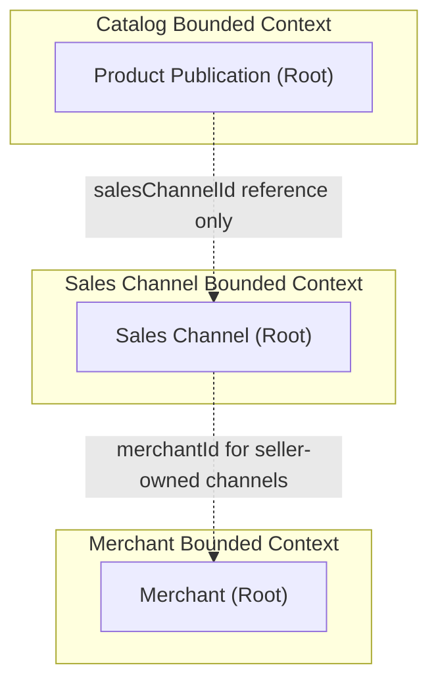
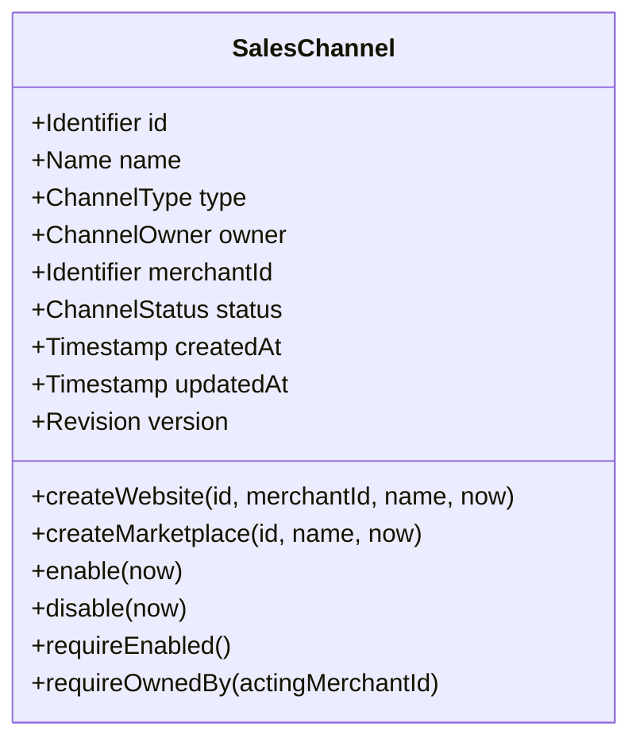
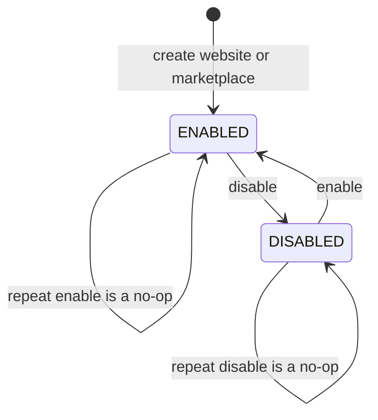

# Domain Specification: Sales Channel

> **Bounded Context:** Sales Channel
> **Primary Purpose:** Defines a selling destination, its platform or merchant ownership, and whether it is enabled for use.
> **Module Root:** `sales-channel-domain` / `sales-channel-application` / `sales-channel-adapter-persistence` / `store/saleschannel`
> **Related Domain Specs:** [Merchant](../../merchant/architecture/merchant-domain-spec.md), [Catalog Product Publication](../../catalog/architecture/product-publication-domain-spec.md)
> **Related Workflows:** [Default Sales Channel Provisioning](../../../features/default-sales-channel-provisioning-workflow.md), [Create Sellable Product](../../../workflows/create-sellable-product-workflow.md), [Update Sellable Product](../../../workflows/update-sellable-product-workflow.md)

---

## 1. Boundary & Context Map

### Ownership

- **This aggregate OWNS:** Channel identity, name, type, ownership classification, merchant reference, enabled/disabled status, and lifecycle timestamps.
- **This aggregate DOES NOT OWN:** Merchant lifecycle, product data, variant/channel publication records, prices, inventory locations, routing, or storefront buyability projections.

A Sales Channel has no child entities and references its merchant by `merchantId` only. Catalog owns [ProductPublication](../../catalog/architecture/product-publication-domain-spec.md), which references this aggregate by `salesChannelId`.

### Context Map

---

## 2. Ubiquitous Language

| Business Term | Domain Concept | Business Definition |
| :--- | :--- | :--- |
| **Sales Channel** | `SalesChannel` (Aggregate Root) | A destination through which products may be offered to customers. |
| **Website** | `ChannelType.WEBSITE` | A seller-owned channel associated with one merchant. |
| **Marketplace** | `ChannelType.MARKETPLACE` | A platform-owned channel without a merchant owner. |
| **Point of Sale** | `ChannelType.POS` | A seller-owned point-of-sale channel requiring a merchant reference. |
| **Seller Ownership** | `ChannelOwner.SELLER` | Ownership that restricts channel use to the referenced merchant. |
| **Platform Ownership** | `ChannelOwner.PLATFORM` | Ownership that permits any merchant to pass the channel ownership guard. |
| **Enabled** | `ChannelStatus.ENABLED` | Channel status that passes the enabled guard. |
| **Disabled** | `ChannelStatus.DISABLED` | Channel status that prevents a successful usability assertion. |
| **Usable Channel** | `CheckSalesChannelUsableResult.usable()` | A channel that exists, is enabled, and is platform-owned or belongs to the acting merchant. |

---

## 3. Domain Aggregate Model

### Model Diagram

Diagram attribute types describe business concepts; the implementation types are listed below. Type, owner, and merchant reference are fixed after construction, and no rename operation is currently exposed by the aggregate.

### Property & Attribute Rationale

| Property | Type | Belongs To | Business Rationale |
| :--- | :--- | :--- | :--- |
| `id` | `Id` | SalesChannel | Provides a stable reference for publications and channel lookups. |
| `name` | `String` | SalesChannel | Names the selling destination for merchants and operators. |
| `type` | `ChannelType` | SalesChannel | Distinguishes website, marketplace, and point-of-sale destinations. |
| `owner` | `ChannelOwner` | SalesChannel | Determines whether use is merchant-specific or platform-wide. |
| `merchantId` | `Id` (nullable) | SalesChannel | Identifies the seller owner and is absent for a platform marketplace. |
| `status` | `ChannelStatus` | SalesChannel | Controls whether the destination is enabled for use. |
| `createdAt` | `Instant` | SalesChannel | Records when the channel was established. |
| `updatedAt` | `Instant` | SalesChannel | Records the latest effective enable/disable transition. |
| `version` | `long` | SalesChannel | Supports detection of concurrent changes to the same channel. |

---

## 4. Business Invariants & Rules

| Rule ID | Invariant Rule | Violation Outcome | Enforced By |
| :--- | :--- | :--- | :--- |
| **SC-01** | Channel name must be nonblank, and type, owner, status, and construction timestamps must be present. | Construction rejects invalid or missing values. | `SalesChannel` constructor / `requireName()` |
| **SC-02** | Website and POS channels must be seller-owned and identify a merchant. | Construction rejects invalid ownership with `MerchantRequired`; website factory rejects a null merchant. | `SalesChannel.validateOwnership()` / `createWebsite()` |
| **SC-03** | Marketplace channels must be platform-owned and have no merchant reference. | Construction rejects invalid ownership with `MarketplaceMustBePlatformOwned`. | `SalesChannel.validateOwnership()` / `createMarketplace()` |
| **SC-04** | A seller-owned channel may be used only by its owning merchant. | Ownership guard raises `ChannelOwnershipForbidden`. | `SalesChannel.requireOwnedBy()` |
| **SC-05** | A disabled channel must fail the enabled guard. | Guard raises `ChannelDisabled`. | `SalesChannel.requireEnabled()` |
| **SC-06** | Repeating enable or disable on the current status must not create another lifecycle event. | Operation returns without changing state or timestamps. | `SalesChannel.enable()` / `disable()` |

### Cross-Aggregate Uniqueness Guards

| Business Rule | Guard | Violation Outcome |
| :--- | :--- | :--- |
| One website channel per merchant. | `SalesChannelUniquenessService.requireWebsiteAvailable(merchantId)` | `DuplicateWebsite` when a website already exists, including a disabled one. |
| One marketplace channel across the platform. | `SalesChannelUniquenessService.requireMarketplaceAvailable()` | `DuplicateMarketplace` when a marketplace already exists, including a disabled one. |

These repository-backed guards are separate from the aggregate factories. Current production application services do not invoke them, so factory construction alone does not establish cross-channel uniqueness; no POS uniqueness guard is defined.

The workflow usability check reads a `SalesChannelView` through `SalesChannelQueryPort` and evaluates existence, enabled status, and ownership without loading or mutating the aggregate.

---

## 5. State Lifecycle & Transitions

### State Machine

### Transition Matrix

| Current State | Trigger / Event | Next State | Guard Condition / Prerequisite |
| :--- | :--- | :--- | :--- |
| New | `createWebsite()` | `ENABLED` | Nonblank name, merchant reference, and creation time are supplied. |
| New | `createMarketplace()` | `ENABLED` | Nonblank name and creation time are supplied; ownership is platform-wide. |
| `ENABLED` | `disable(now)` | `DISABLED` | Updates `updatedAt` and emits `SalesChannelDisabledEvent`. |
| `DISABLED` | `enable(now)` | `ENABLED` | Updates `updatedAt` and emits `SalesChannelEnabledEvent`. |
| `ENABLED` | `enable(now)` | `ENABLED` | No state change, timestamp change, or event. |
| `DISABLED` | `disable(now)` | `DISABLED` | No state change, timestamp change, or event. |

The constructor can reconstitute either supported status without emitting events. POS is a supported type with constructor ownership validation, but has no dedicated creation factory; no draft, archive, or deletion lifecycle is modeled.

Disabling a channel does not delete Catalog publication records. Its integration event causes Storefront Query to update channel eligibility in the buyable-offer projection.

---

## 6. Domain Events

### Emitted Events (What Happened)

| Event Name | Trigger | Key Attributes | Target Consumers |
| :--- | :--- | :--- | :--- |
| `SalesChannelCreatedEvent` | Website or marketplace factory creates the aggregate. | Channel ID, name, type, owner, merchant ID, status, occurrence time | No current creation integration bridge or listener. |
| `SalesChannelEnabledEvent` | Effective transition from disabled to enabled. | Channel ID, type, merchant ID, occurrence time | Sales Channel integration bridge |
| `SalesChannelDisabledEvent` | Effective transition from enabled to disabled. | Channel ID, type, merchant ID, occurrence time | Sales Channel integration bridge |

`SalesChannelRepositoryAdapter.save()` persists the aggregate and passes its pulled events to `DomainEventProducer`. Durable dispatch follows the [Transactional Outbox specification](../../../system/transactional-outbox-tech-spec.md).

### Store Integration Events

| Domain Event | Integration Record | Consumer / Business Impact |
| :--- | :--- | :--- |
| `SalesChannelEnabledEvent` | `SalesChannelEnabledIntegrationEvent` | Storefront Query refreshes channel eligibility for affected offers. |
| `SalesChannelDisabledEvent` | `SalesChannelDisabledIntegrationEvent` | Storefront Query marks affected offers as ineligible through the disabled channel. |

`SalesChannelIntegrationEventPublisher` adds an event version and preserves channel ID, type, merchant ID, and occurrence time. Creation has no corresponding integration record in the current bridge.

R17 requires cross-module integration records under `store/src/main/java/com/grab/store/shared/events/saleschannel/`; the lifecycle records currently reside under `store/.../saleschannel/events/`, an existing implementation deviation. Security manifest publication is a separate module capability and does not represent SalesChannel aggregate creation or status changes.

### Workflow Signals

| Consumed Request | Read-Only Action | Emitted Signal |
| :--- | :--- | :--- |
| `RequestAssertChannelEvent` | Check that the channel exists, is enabled, and is usable by the merchant. | `ChannelAssertedEvent` on success. |
| `RequestAssertChannelEvent` | Usability assertion fails or its execution raises an exception. | `PublishProductStepFailedEvent` with step `assert-channel`. |

The Sales Channel workflow listener consumes requests via `@EventListener` and dispatches `CheckSalesChannelUsableQuery` through `QueryBus`. These workflow records carry workflow correlation and remain separate from aggregate domain events; they do not enable, disable, or publish products to the channel.

### Consumed Events (Cross-Domain Signals)

The SalesChannel aggregate consumes no cross-domain events directly. Workflow requests above are handled at the store boundary, and shared-interface consumers use `SalesChannelQuery`, whose provider adapter delegates to an inbound read use case under `@SalesChannelReadTransactional`.