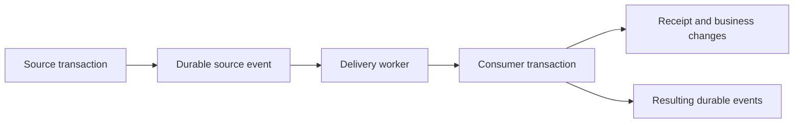

# Feature: Reliable Event Consumption and Isolated Java Ports

> **System Design:** [Consumer inbox and port transaction isolation](../system/consumer-inbox-and-port-isolation-tech-spec.md)
> **Status:** Proposed implementation plan · 2026-11-15

## 1. What & Why

Event redelivery must not repeat a committed consumer operation. Calls between bounded contexts must have independent commit and rollback behavior while they still run in the same JVM.

The existing outbox supplies stable event identifiers and some consumers already use an inbox. This feature completes that coverage and establishes a provider transaction boundary that can survive a later move to remote services.

| In scope | Out of scope |
|:---|:---|
| Atomic consumer inbox, business writes, and resulting outbox writes | Global exactly-once delivery |
| Listener-owned event deduplication | Introducing a broker or gRPC runtime |
| Independent provider transactions for read and write Java ports | Distributed transactions or cross-schema joins |
| Repairing cross-context bus bypasses and mixed read/write adapters | Moving every database into group schemas in this change |
| Replay retention, concurrency tests, and migration coverage | Changing domain business rules without a separate workflow specification |

## 2. Acceptance Criteria

The requirement IDs below refer to the linked technical specification.

| ID | Criterion | Verification / contract |
|:---|:---|:---|
| AC-1 | A persisted event retains its identity across retry, lease takeover, and manual replay. | T1; R-01 |
| AC-2 | Every durable event consumer requires event metadata and a stable logical consumer identity. | T2, T11; R-02, R-03 |
| AC-3 | Consumer receipt, business mutation, and resulting outbox writes commit or roll back together. | T3; R-04 |
| AC-4 | Concurrent copies of one event cause at most one committed application per logical consumer. | T4; R-05 |
| AC-5 | Separate consumers each apply the event once, including after partial fan-out failure. | T5; R-06 |
| AC-6 | Provider success remains committed after caller rollback; a caught provider failure does not mark the caller rollback-only. | T6, T7; R-07, R-08 |
| AC-7 | Provider queries do not join caller transactions or observe caller uncommitted changes. | T8; R-07, R-09 |
| AC-8 | Cross-context calls go through public provider ports with separate read/write adapters and scoped buses. | T11; R-10 |
| AC-9 | Repeated retryable port writes reuse a stable operation identity and return the original outcome without repeating effects. | T9; R-11 |
| AC-10 | A permitted replay cannot outlive the consumer's deduplication guarantee. | T10; R-12 |
| AC-11 | Transient consumer failures reach the relay; only committed terminal workflow outcomes suppress further execution. | T5, T12; R-13 |
| AC-12 | Thread reuse, nesting, and provider calls cannot leak event-consumption state into unrelated work. | T2, T7; R-14 |
| AC-13 | Bounded concurrency respects pool budgets and transaction/lock deadlines. | T13; R-15 |

## 3. Solution Design

| Decision | Choice | Reason |
|:---|:---|:---|
| Delivery guarantee | At-least-once transport with atomic consumer deduplication | A crash can separate consumer commit from source acknowledgement. |
| Transaction ownership | Destination listener owns event consumption. Public provider adapter owns synchronous port entry. | Each boundary has a visible local unit of work. |
| Metadata | Persisted outbox UUID read by the listener at synchronous ingress | The command contains operation input and joins the listener transaction. |
| Cross-context consistency | Independently committed calls, with durable workflow compensation where required | Provider success cannot depend on a caller transaction that a remote service would never share. |

## 4. Implementation Specifications

- [Technical specification, source review, delivery phases, and test matrix](../system/consumer-inbox-and-port-isolation-tech-spec.md).
- [Existing transactional outbox specification](../system/transactional-outbox-tech-spec.md).
- [Existing multi-schema design](../system/multi-schema-database-isolation-tech-spec.md).

No aggregate changes are proposed here. Any call site that currently relies on atomic writes across contexts must receive a workflow-specific compensation or reconciliation design before its isolation migration is released.
