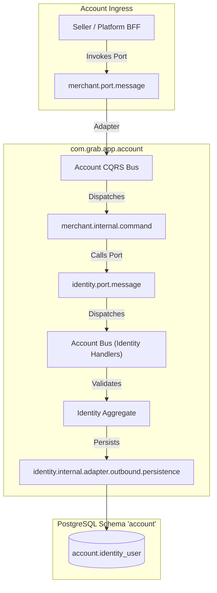
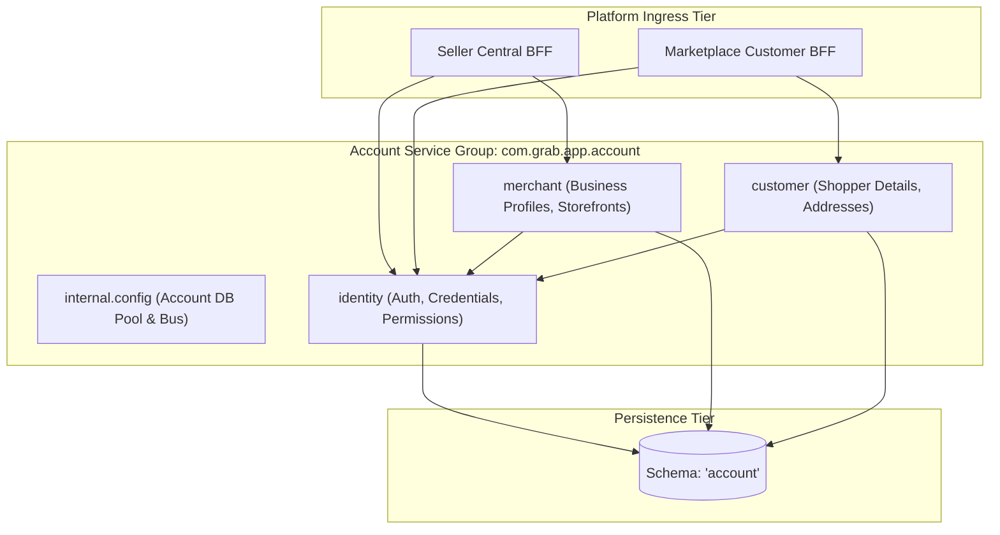
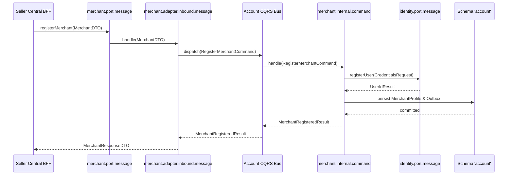

# Tech Spec: Account Service Group Hexagonal Packaging

- **Summary:** Defines the hexagonal package structure, ports, adapters, and CQRS boundaries for the Account Service Group (`identity`, `merchant`, `customer`) within `com.grab.app.account`.
- **Type:** Architecture Pattern
- **Feature Spec:** [Modular Hexagonal Package Structure](../../features/feat_009-modular-hexagonal-package-structure.md)

---

## 1. Problem & Decision

### What breaks without this?

The account group governs user authentication, merchant commercial profiles, and customer shopper identities. Without explicit hexagonal packaging boundaries, sensitive password hashes and authentication tokens leak into public merchant profiles, customer address mutations bypass identity validation policies, and external controllers query raw customer tables directly. This compromises security compliance (GDPR/PCI), creates privilege escalation risks, and entangles customer data with merchant operations.

### Decision

| Option | Decision | Why |
|:-------|:---------|:----|
| **Hexagonal Packaging per Bounded Context in `com.grab.app.account`** | Adopted | Enforces strict isolation between `identity`, `merchant`, and `customer` behind explicit public ports while sharing connection resources in schema `'account'`. |
| Unified Account Profile Package | Rejected | Blurs the line between authentication credentials, merchant business records, and customer personal data, leading to security breaches. |
| Standalone Auth Microservice | Deferred | Avoids premature operational and distributed network complexity while identity logic stabilizes within the modular monolith. |

### Trade-offs

| Benefits | Trade-offs |
|:---------|:-----------|
| Authentication credentials and tokens remain strictly encapsulated within the `identity` context. | Inter-context identity lookups (e.g., verifying merchant user permissions) require port invocations. |
| Customer and merchant contexts can evolve independent domain policies without cross-coupling. | Additional mapper records required to project sanitized identity views to caller BFFs. |

---

## 2. How It Works

### Core Concept

The Account Service Group structures `identity`, `merchant`, and `customer` into decoupled bounded contexts under `com.grab.app.account`. Each context exposes public ports (`port.message` and `port.event`), processes commands and queries via dedicated handlers in `internal/`, and isolates persistence adapters targeting PostgreSQL schema `'account'`.



### How It Works Step by Step

| Step | What Happens | Why |
|:-----|:-------------|:----|
| 1 | Caller invokes `RegisterMerchantUseCase` via `merchant.port.message`. | External interaction starts at a published capability port. |
| 2 | Inbound adapter (`merchant.internal.adapter.inbound.message`) maps request and publishes to `AccountCommandBus`. | Converts transport payloads into immutable domain command records. |
| 3 | Command handler (`merchant.internal.command`) calls `identity.port.message` to create underlying user credentials. | Cross-context dependency is satisfied via a public port rather than internal access. |
| 4 | Identity inbound adapter routes command to create `IdentityUser` and returns assigned `UserId`. | Preserves authentication rules entirely within the `identity` context. |
| 5 | Merchant repository adapter persists merchant profile to schema `'account'` within `@AccountTransactional`. | Ensures atomic state updates across owned tables in schema `'account'`. |

---

## 3. How We Use It

### Where It Fits in Our System / Architecture & Layer Stacking



### Detailed Package Structure

```text
com.grab.app.account
  ├── internal/
  │   └── config/                                   # Shared Account DB Pool, Flyway, and Bus config
  │       ├── AccountDatabaseConfig.java
  │       └── AccountCqrsBusConfig.java
  ├── identity/                                     # Identity Bounded Context
  │   ├── port/
  │   │   ├── message/
  │   │   │   ├── AuthenticateUserUseCase.java
  │   │   │   ├── RegisterUserUseCase.java
  │   │   │   └── IdentityQueryPort.java
  │   │   └── event/
  │   │       └── UserRegisteredEventListener.java
  │   └── internal/
  │       ├── config/IdentityContextConfig.java
  │       ├── command/AuthenticateUserCommandHandler.java
  │       ├── query/FindUserByIdQueryHandler.java
  │       └── adapter/
  │           ├── inbound/
  │           │   ├── message/IdentityInboundMessageAdapter.java
  │           │   └── event/UserRegisteredEventInboundAdapter.java
  │           └── outbound/
  │               ├── event/IdentityOutboxEventAdapter.java
  │               ├── message/AuditLogOutboundAdapter.java
  │               └── persistence/
  │                   ├── IdentityRepositoryAdapter.java
  │                   ├── entity/UserJpaEntity.java
  │                   ├── repository/UserJpaRepository.java
  │                   └── mapper/IdentityPersistenceMapper.java
  ├── merchant/                                     # Merchant Bounded Context
  │   ├── port/
  │   │   ├── message/
  │   │   │   ├── RegisterMerchantUseCase.java
  │   │   │   ├── UpdateMerchantProfileUseCase.java
  │   │   │   └── MerchantQueryPort.java
  │   │   └── event/
  │   │       └── MerchantSuspendedEventListener.java
  │   └── internal/
  │       ├── config/MerchantContextConfig.java
  │       ├── command/RegisterMerchantCommandHandler.java
  │       ├── query/FindMerchantByIdQueryHandler.java
  │       └── adapter/
  │           ├── inbound/
  │           │   ├── message/MerchantInboundMessageAdapter.java
  │           │   └── event/MerchantSuspendedEventAdapter.java
  │           └── outbound/
  │               ├── event/MerchantOutboxEventAdapter.java
  │               ├── message/IdentityQueryOutboundAdapter.java
  │               └── persistence/
  │                   ├── MerchantRepositoryAdapter.java
  │                   ├── entity/MerchantJpaEntity.java
  │                   ├── repository/MerchantJpaRepository.java
  │                   └── mapper/MerchantPersistenceMapper.java
  └── customer/                                     # Customer Bounded Context
      ├── port/
      │   ├── message/
      │   │   ├── CreateCustomerProfileUseCase.java
      │   │   ├── AddCustomerAddressUseCase.java
      │   │   └── CustomerQueryPort.java
      │   └── event/
      │       └── CustomerAddressUpdatedEventListener.java
      └── internal/
          ├── config/CustomerContextConfig.java
          ├── command/CreateCustomerProfileCommandHandler.java
          ├── query/FindCustomerByIdQueryHandler.java
          └── adapter/
              ├── inbound/
              │   ├── message/CustomerInboundMessageAdapter.java
              │   └── event/CustomerAddressEventAdapter.java
              └── outbound/
                  ├── event/CustomerOutboxEventAdapter.java
                  ├── message/IdentityValidationOutboundAdapter.java
                  └── persistence/
                      ├── CustomerRepositoryAdapter.java
                      ├── entity/CustomerJpaEntity.java
                      ├── repository/CustomerJpaRepository.java
                      └── mapper/CustomerPersistenceMapper.java
```

### Component Responsibilities

| Component | Role | What It Does |
|:----------|:-----|:-------------|
| `identity.port.message` | Auth Capability Port | Exposes user authentication, password verification, and credential issuance. |
| `merchant.port.message` | Merchant Capability Port | Exposes merchant onboarding, store profile updates, and status checks. |
| `customer.port.message` | Customer Capability Port | Exposes shopper registration, profile maintenance, and shipping address management. |
| `internal.config` | Group Shared Infra | Configures `AccountHikariPool` and initializes isolated `AccountCommandBus`/`AccountQueryBus`. |
| `identity.internal.adapter.outbound.persistence` | Identity Persistence | Manages user credentials, salt hashes, and roles in schema `'account'`. |
| `merchant.internal.adapter.outbound.persistence` | Merchant Persistence | Manages merchant store entities and business registration records in schema `'account'`. |
| `customer.internal.adapter.outbound.persistence` | Customer Persistence | Manages shopper customer profiles and address books in schema `'account'`. |

### Runtime Flow



---

## 4. Implementation Rules

> These are **non-negotiable contracts**. An implementation is compliant only when **all** rules are satisfied.

| Rule | Requirement |
|:-----|:------------|
| **R-01** | All account capabilities **MUST** reside within `com.grab.app.account` under `identity`, `merchant`, or `customer`. |
| **R-02** | Sensitive security credentials and password hashes **MUST** remain strictly internal to `identity.internal` and **MUST NOT** be exposed in public DTOs or foreign context models. |
| **R-03** | Communication between `merchant`, `customer`, and `identity` **MUST** pass exclusively through public `port/` contracts. |
| **R-04** | All database mutations across the account group **MUST** be governed by `@AccountTransactional` demarcated on CQRS handlers. |
| **R-05** | Repository adapters in `merchant` or `customer` **MUST NOT** perform SQL joins or direct updates on `identity_user` tables. |
| **R-06** | Outbound integration events **MUST** be written to `account.outbox_record` within the active transaction before publishing. |

