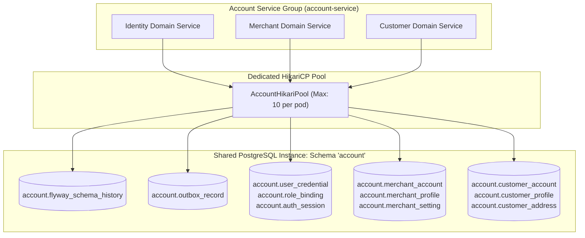
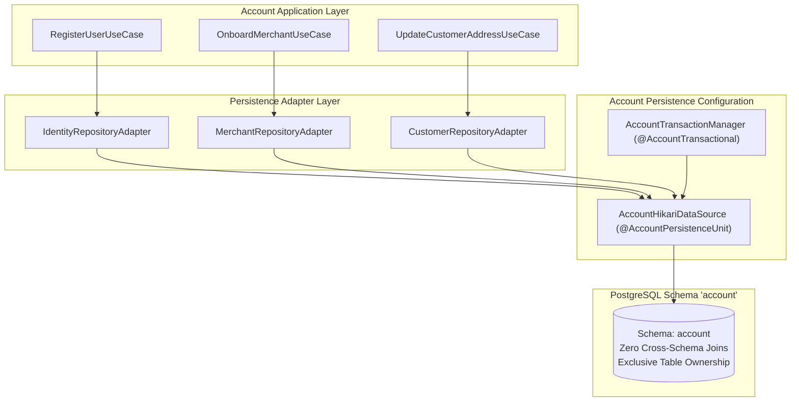
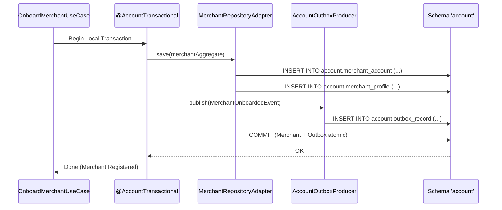

# Tech Spec: Account Service Group Persistence

- **Summary:** Defines the shared relational schema, connection pooling, and Flyway migration stream for the Account Service Group (`identity`, `merchant`, `customer`) on the shared database instance.
- **Type:** Platform Infrastructure
- **Feature Spec:** [Multi-Schema Database Isolation & Connection Budgeting](../../features/feat_010-multi-schema-database-isolation-connection-budgeting.md)

---

## 1. Problem & Decision

### What breaks without this?

If user identity, merchant governance, and customer management were intermingled with high-churn commercial contexts like order carts or browsing catalogs, authentication and merchant onboarding would be vulnerable to table lock contention during large commerce events. Conversely, splitting identity, merchant, and customer into separate physical databases prematurely would introduce complex distributed transactions during seller and customer onboarding flows.

### Decision

| Option | Decision | Why |
|:-------|:---------|:----|
| **Shared Schema `'account'` for Identity, Merchant, and Customer** | Adopted | Consolidates user authentication, merchant records, and customer accounts under a dedicated, secure schema with its own connection pool (`AccountHikariPool`), isolating sensitive user and merchant credentials from public browsing pools. |
| Dedicated Database Instance per Account Context | Rejected | Premature operational complexity; identity, merchant, and customer domains share lifecycle dependencies during user registration. |
| Monolithic Unpartitioned Schema | Rejected | Exposes credential and merchant tables to potential accidental joins and queries from storefront catalog or cart contexts. |

### Trade-offs

| Benefits | Trade-offs |
|:---------|:-----------|
| User credential verification, merchant profile updates, and customer management have dedicated, unstarved database connections. | Bounded contexts within `account` must strictly enforce table isolation through repository adapters without cross-context joins. |
| Sensitive user and merchant tables are encapsulated inside a dedicated PostgreSQL schema with distinct role permissions. | Identity tokens and session tracking share database connection bandwidth with merchant catalog onboarding. |

---

## 2. How It Works

### Core Concept

The Account Service Group (`com.grab.app.account`) groups `identity`, `merchant`, and `customer` bounded contexts under a single logical PostgreSQL schema named `'account'`. The service group operates a dedicated `AccountHikariPool` and runs an independent Flyway migration pipeline targeting `classpath:db/migration/account`.



### How It Works Step by Step

| Step | What Happens | Why |
|:-----|:-------------|:----|
| 1 | Account Service boots and allocates `AccountHikariPool` targeting PostgreSQL schema `'account'`. | Isolates identity and account connections from transactional order bursts. |
| 2 | Flyway migrates scripts from `db/migration/account` and writes history to `account.flyway_schema_history`. | Maintains versioned DDL for credentials, merchant accounts, and customer addresses. |
| 3 | Use cases interact with domain models via their respective repository adapters (`IdentityRepositoryAdapter`, `MerchantRepositoryAdapter`, `CustomerRepositoryAdapter`). | Keeps each domain responsible exclusively for its own persistence tables. |
| 4 | State mutations and account integration events commit atomically within `@AccountTransactional`. | Ensures reliable, at-least-once outbox publishing for account and merchant registrations. |

### Schema Table Allocation & Ownership

| Bounded Context | Owned Tables | Description |
|:----------------|:-------------|:------------|
| **Identity** | `user_credential`, `role_binding`, `auth_session` | User authentication, password hashes, and platform roles. |
| **Merchant** | `merchant_account`, `merchant_profile`, `merchant_setting` | Seller organizations, onboarding status, and store settings. |
| **Customer** | `customer_account`, `customer_profile`, `customer_address` | Shopper identities, profiles, and delivery addresses. |
| **Shared Infrastructure** | `outbox_record`, `flyway_schema_history` | Transactional outbox event store and Flyway version tracking. |

---

## 3. How We Use It

### Where It Fits in Our System / Architecture & Layer Stacking



### Component Responsibilities

| Component | Role | What It Does |
|:----------|:-----|:-------------|
| **`AccountPersistenceConfig`** | Spring Configuration | Defines `DataSource`, `HikariConfig`, `EntityManagerFactory`, and `TransactionManager` targeting `'account'`. |
| **`IdentityRepositoryAdapter`** | Outbound Adapter | Persists user credentials, salt hashes, and role bindings. |
| **`MerchantRepositoryAdapter`** | Outbound Adapter | Persists merchant organization details and legal metadata. |
| **`CustomerRepositoryAdapter`** | Outbound Adapter | Manages customer profile records and shipping addresses. |
| **`AccountOutboxProducer`** | Outbox Infrastructure | Inserts account events (`UserRegistered`, `MerchantApproved`) into `account.outbox_record`. |

### Runtime Flow

> Merchant onboarding flow atomically creates a merchant account and commits an outbox record within schema `'account'`.



### Configuration Specification

```yaml
grab:
  account:
    datasource:
      jdbc-url: jdbc:postgresql://${DB_HOST:localhost}:${DB_PORT:5432}/${DB_NAME:grab_commerce}?currentSchema=account
      username: ${ACCOUNT_DB_USER:account_user}
      password: ${ACCOUNT_DB_PASSWORD:account_secret}
      hikari:
        maximum-pool-size: 10
        minimum-idle: 2
        connection-timeout: 30000
        idle-timeout: 600000
        max-lifetime: 1800000
        pool-name: AccountHikariPool
    flyway:
      schemas: account
      default-schema: account
      table: flyway_schema_history
      locations: classpath:db/migration/account
```

---

## 4. Implementation Rules

> These are **non-negotiable contracts**. An implementation is compliant only when **all** rules are satisfied.

- **RULE-ACC-DB-01: Shared Schema Encapsulation**
  The `identity`, `merchant`, and `customer` bounded contexts MUST reside in schema `'account'`. They MUST NOT access tables in any other schema (such as `catalog` or `"order"`).

- **RULE-ACC-DB-02: Zero Cross-Context Foreign Keys**
  Foreign key constraints between `user_credential` and `merchant_account` or `customer_account` are prohibited. References MUST be maintained using typed IDs (`UserId`, `MerchantId`, `CustomerId`).

- **RULE-ACC-DB-03: Shared Pool Budgeting**
  All three contexts MUST share `AccountHikariPool`. Total connections across replicas ($N \times O \times 10$) must remain within the budgeted allocation.

- **RULE-ACC-DB-04: Atomic Local Outbox Commit**
  All identity, merchant, and customer events MUST be committed to `account.outbox_record` within the local `@AccountTransactional` boundary.
