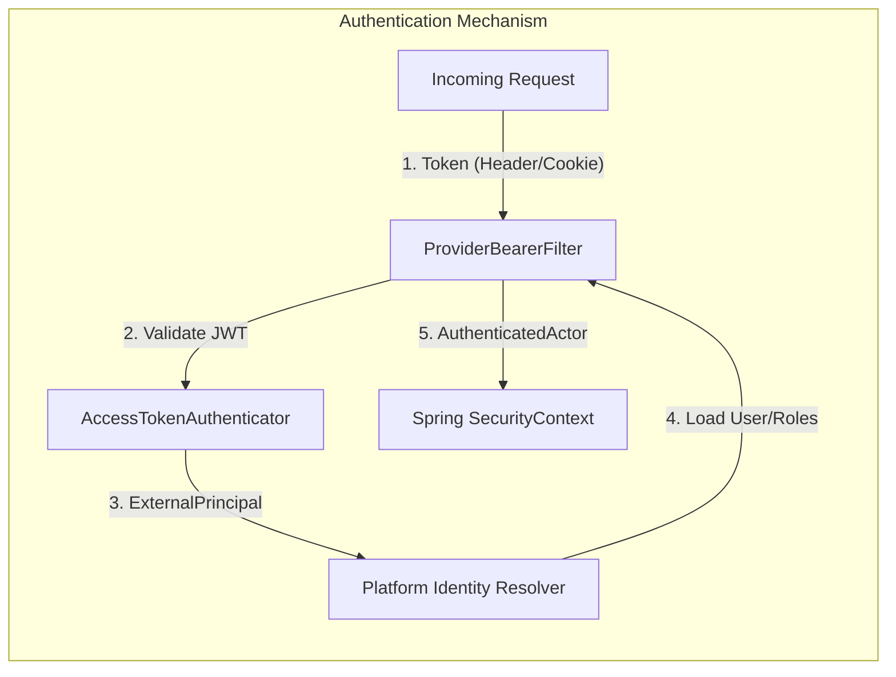
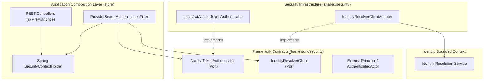
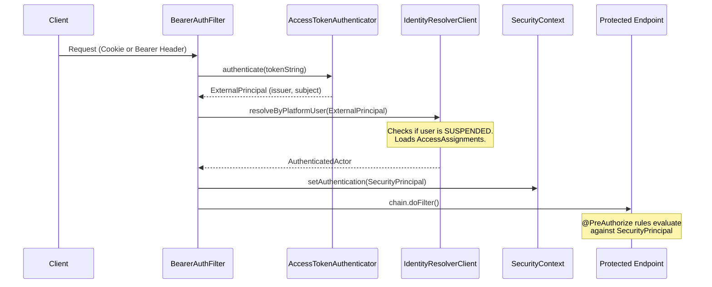

# Tech Specification: API Security & Authentication

> **Summary:** A JWT authentication filter that extracts a Bearer token or access cookie, validates it, and resolves the current platform actor into a Spring `SecurityPrincipal`.
> **Classification:** Architectural Pattern / Platform Infrastructure
> **Supporting Modules:** `store/shared/security` / `identity-domain`
> **Related Architecture ADRs:** [ADR-005](../../dev/system/ADR_005-Api_security_architecture.md), [ADR-001 (Identity)](../../dev/domain/identity/architecture/ADR_001-Identity-module-architecture.md), [ADR-002 (Identity)](../../dev/domain/identity/architecture/ADR_002-API_security&cookie_architecture.md)
> **Related Technical Design:** [Security manifest consistency](security-manifest-consistency-tech-spec.md)
> **Related Feature Spec:** [Publishable Keys for Sales Channels](../features/feat_003-sales-channel-publishable-keys.md)

---

## 1. Why We Need It

### The Problem

If authentication logic is hardcoded to a specific JWT format or Identity Provider (like a local database), the platform becomes tightly coupled to that provider, making migration to enterprise OAuth2/OIDC (Keycloak, Auth0, Cognito) impossible. Furthermore, storing raw JWTs in browser `localStorage` exposes users to XSS token theft.

### Technology Decision & Alternatives

| Technology Option | Decision | Evaluation Rationale |
| :--- | :--- | :--- |
| **JWT Filter + HttpOnly Cookies** | **Adopted** | Separates token validation from platform identity resolution and prevents browser scripts from reading the cookie value. |
| Classic Spring Security Session (JSessionId) | Rejected | The platform requires stateless API scaling and needs to support mobile clients via Bearer headers alongside web browsers. |
| Exposing Raw JWTs to Frontend | Rejected | High risk of XSS token theft. |

### Key Benefits & Trade-offs

**Core Benefits:**
- Decouples token validation (signature, expiry) from business identity resolution (roles, account status, scopes).
- Easily swaps local JWT issuance for external OAuth2 providers without touching business code.
- The access and refresh tokens are issued as `HttpOnly` cookies for browser clients.

**Known Trade-offs:**
- Increased complexity with multiple abstraction layers (`ExternalPrincipal`, `AuthenticatedActor`, `SecurityPrincipal`).
- Browser clients require CORS settings compatible with credentialed requests.

---

## 2. What It Is

### Core Concept

The authentication process uses a custom Spring Security filter. It reads a Bearer token from the `Authorization` header first and reads the `accessToken` cookie only when the header is absent. An `AccessTokenAuthenticator` validates the token and returns an `ExternalPrincipal`. The filter passes that principal to the platform identity resolver, which resolves an `AuthenticatedActor` for the current request.



### Internal Mechanics & Lifecycle

> N/A: Authentication filters are stateless and execute per-request.

---

## 3. How We Use It in This System

### Architecture & Layer Stacking



### Component Responsibilities

| Architectural Role | Layer Location | Responsibility |
| :--- | :--- | :--- |
| `ProviderBearerAuthenticationFilter` | `store` | Intercepts HTTP requests, extracts the token, orchestrates validation, and populates the Security Context. |
| `AccessTokenAuthenticator` | `framework` (Port) | Verifies the token signature, expiry, and audience without accessing the database. |
| `IdentityResolverClient` | `framework` (Port) | Calls the Identity module to verify the user is `ACTIVE` and loads their current `PlatformScope`s and Roles. |
| `Identity Module` | `identity-domain` | The source of truth for account status and access grants. |

### Runtime Flow



---

## 4. Technical Specification & Contracts

Normative specification. An implementation is compliant only when all MUST / MUST NOT statements are satisfied.

### Normative Rules

- **R-01:** The authentication filter **MUST** attempt to extract the token from the `Authorization: Bearer` header first. If absent, it MUST fallback to extracting it from an `HttpOnly` cookie.
- **R-02:** The `AccessTokenAuthenticator` **MUST NOT** perform database lookups. Its sole responsibility is cryptographic validation and claim extraction.
- **R-03:** The platform identity resolver **MUST** resolve the actor through the Identity provider during authentication; authorization facts are not inferred from raw token role claims.
- **R-04:** API controllers and services **MUST NOT** parse raw JWTs to determine identity. They MUST retrieve the `AuthenticatedActor` exclusively from the Spring `SecurityContext`.
- **R-05:** The cookie helper sets `HttpOnly`, `Secure` according to `security.api.cookie.secure`, and `SameSite` according to `security.api.cookie.same-site`. The development profile overrides these to `Secure=false` and `SameSite=Lax`.

### Storage & Data Contract

> Tokens are not stored in the database by this module (managed by Identity's `RefreshSession`). The internal data contract is the `AuthenticatedActor` exposed to controllers.

```java
public record AuthenticatedActor(
    String platformUserId,
    String issuer,
    String subject,
    String email,
    Set<String> roles,
    Set<String> authorities,
    AccessContext accessContext,
    long authenticationVersion
) {}
```

The filter reads the access cookie with the fixed name `accessToken`; there is no configurable cookie-name binding. The actor carries issuer and subject, role and authority sets, an optional access context, and an authentication version. It does not guarantee an `activeContextScopeKey` field.

### Configuration Knobs

| Binding | Development profile value | Unit / format | Description |
| :--- | :--- | :--- | :--- |
| `security.local-jwt.issuer` | `https://identity.local.grab` | String | Required issuer claim for local JWT validation. |
| `security.local-jwt.audience` | `grab-commerce-api` | String | Required audience claim. |
| `security.local-jwt.access-token-ttl` | `PT15M` | ISO-8601 duration | Local access token lifetime. |
| `security.local-jwt.refresh-token-ttl` | `P7D` | ISO-8601 duration | Local refresh token lifetime. |
| `security.api.cors` | Environment-backed; development fallback is `*` | List of origins | Allowed origins for credentialed CORS requests. |
| `security.api.cookie.secure` | `false` in development; fallback `true` | Boolean | Sets the Secure cookie attribute. |
| `security.api.cookie.same-site` | `Lax` in development; fallback `Strict` | SameSite value | Sets the SameSite cookie attribute. |
| `security.api.cookie.refresh-token-max-age-days` | `7` | Days | Refresh-cookie lifetime; configurable, with a seven-day code fallback. |
| `security.api.cookie.refresh-token-path` | Code fallback `/api/v1/identity/auth/refresh` | Path | Limits the refresh cookie to the refresh endpoint path. |

`LocalJwtProperties` requires issuer, audience, and positive access/refresh TTL values; those values are supplied by environment-backed profile configuration. Cookie name is fixed by the filter/helper, while Secure and SameSite have code fallbacks overridden in development. The CORS origin property is environment-backed and defaults to a wildcard in the development profile.

Implementation references: `framework/src/main/java/com/grab/framework/security/AuthenticatedActor.java`, `store/src/main/java/com/grab/store/shared/security/filters/ProviderBearerAuthenticationFilter.java`, `store/src/main/java/com/grab/store/shared/security/LocalJwtProperties.java`, and `store/src/main/java/com/grab/store/shared/security/util/AuthCookieHelper.java`.
