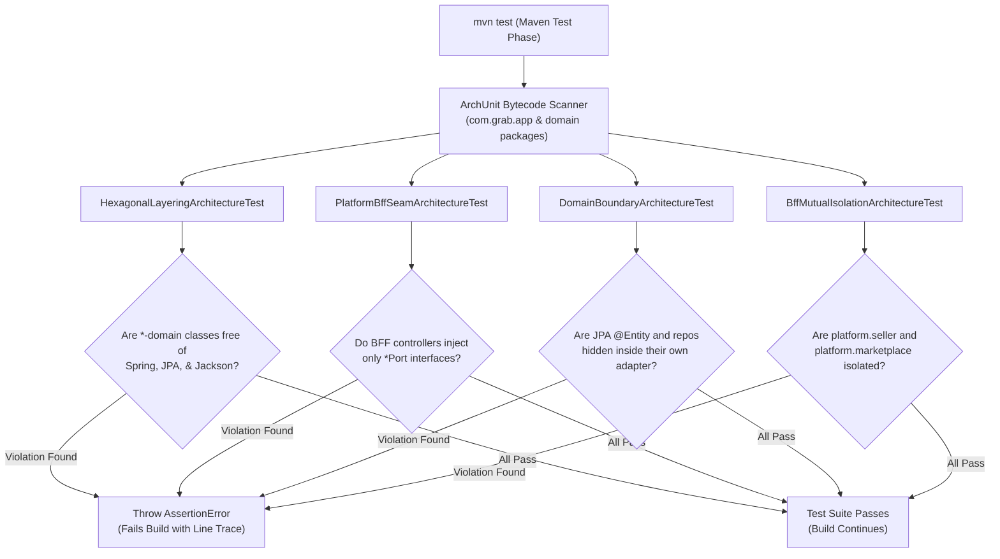

# Tech Spec: ArchUnit Seam Enforcement & Architectural Rules

- **Summary:** Enforces hexagonal boundaries, package dependency direction, zero cross-domain repository/entity leakage, and platform BFF port-only injection via automated ArchUnit rules.
- **Type:** Architecture Pattern / Automated Quality & Governance
- **Feature Spec:** [Microservice Seam Enforcement & Spring Modulith ArchUnit Verification](../../features/feat_014-microservice-seam-archunit-verification.md)

---

## 1. Problem & Decision

### What breaks without this?

In a multi-module modular monolith, architectural guidelines written only in documentation or style guides degrade over time. Developers facing deadlines introduce shortcuts: importing a domain repository from a web controller, traversing a cross-domain JPA entity relationship, or introducing circular dependencies between domains. Without automated verification, these violations accumulate silently until the codebase becomes a monolithic "Big Ball of Mud", making extraction of domains into autonomous microservices virtually impossible without a massive, multi-month rewrite.

### Decision

| Option | Decision | Why |
|:-------|:---------|:----|
| **ArchUnit Architecture Test Suite inside `mvn test`** | **Adopted** | Java-native, unit-test-based architectural verification using reflection and bytecode analysis. Fails the build immediately when an invariant is breached. Requires zero external daemon or tooling. |
| Manual Code Reviews Alone | Rejected | Inconsistent, prone to human error, subjective, and fails to catch indirect transitive dependency leaks. |
| SonarQube / Static Linters Alone | Rejected | Linters catch general code quality issues (null pointers, complexity) but lack deep understanding of domain-driven hexagonal seams, Spring Modulith modules, and contract port patterns. |
| Post-Commit Sonar Quality Gates | Rejected | Feedback is delayed; violations are committed to branches before developers are notified, slowing down the development feedback loop. |

### Trade-offs

| Benefits | Trade-offs |
|:---------|:-----------|
| Mathematical enforcement of architectural purity: violations fail the build instantly in the developer's IDE and CI pipeline. | Analyzing thousands of compiled `.class` files adds approximately 3–6 seconds to the `mvn test` cycle. |
| Zero configuration drift: ArchUnit rules are written in standard Java code, version-controlled with the application itself. | Developers must understand hexagonal concepts and contract ports to fix rule violations rather than applying quick hacks. |
| Living architectural contract: Test code explicitly documents allowable dependency directions and package boundaries. | Refactoring module package structures requires updating corresponding ArchUnit package pattern strings. |

---

## 2. How It Works

### Core Concept

ArchUnit analyzes compiled Java bytecode (`.class` files) using reflection, constructing a graph of all classes, method calls, field accesses, and package imports. Test classes annotated with `@AnalyzeClasses(packages = "com.grab")` declare fluent assertions that define what packages can access what other packages. If any class violates an assertion, ArchUnit throws an `AssertionError` with a complete, line-numbered trace of the offending import or call.



### How It Works Step by Step

| Step | What Happens | Why |
|:-----|:-------------|:----|
| 1 | Developer runs `mvn test` or triggers a CI build. | Executes tests in the same test lifecycle phase as standard unit tests. |
| 2 | ArchUnit imports all compiled classes under package `com.grab` into a `JavaClasses` model. | Prepares full in-memory dependency graph of classes, annotations, and call paths. |
| 3 | ArchUnit evaluates layer assertions (e.g., `classes().that().resideInAPackage("..domain..").should().onlyDependOnClassesThat()...`). | Enforces pure domain logic with zero framework leakage. |
| 4 | ArchUnit evaluates port boundary assertions (e.g., `noClasses().that().resideInAPackage("..platform..").should().accessClassesThat().resideInAPackage("..internal..")`). | Guarantees BFFs communicate strictly through public contract ports. |
| 5 | ArchUnit evaluates persistence isolation assertions (e.g. `classes().that().areAnnotatedWith(Entity.class).should().onlyBeAccessedByClassesThat().resideInAPackage("..adapter.persistence..")`). | Ensures database tables and ORM entities cannot be touched across domains. |
| 6 | If 0 violations are found, test suite passes; if any violation is detected, build aborts with an actionable error report. | Protects the architecture from regression prior to merge or deployment. |

---

## 3. How We Use It

### Test Suite Structure in `app`

All architecture tests reside in `app/src/test/java/com/grab/app/architecture/`:

```text
app/src/test/java/com/grab/app/architecture/
├── HexagonalLayeringArchitectureTest.java       # Verifies domain <- app <- adapter layering
├── PlatformBffSeamArchitectureTest.java         # Verifies BFFs inject ONLY *Port interfaces
├── DomainBoundaryArchitectureTest.java          # Verifies ZERO cross-domain entity/repo leakage
├── BffMutualIsolationArchitectureTest.java      # Verifies seller and marketplace cannot touch each other
└── CodingRulesArchitectureTest.java             # Verifies no System.out, no native SQL queries, etc.
```

### Core ArchUnit Rule Definitions

#### 1. Pure Domain Rule (`HexagonalLayeringArchitectureTest`)
```java
@ArchTest
static final ArchRule pure_domain_should_not_depend_on_frameworks =
    classes()
        .that().resideInAPackage("..domain..")
        .should().onlyDependOnClassesThat()
        .resideInAnyPackage(
            "..domain..",
            "com.grab.framework..",
            "java..",
            "org.slf4j.."
        );
```

#### 2. Platform BFF Seam Rule (`PlatformBffSeamArchitectureTest`)
```java
@ArchTest
static final ArchRule bff_controllers_should_only_depend_on_ports_and_dtos =
    noClasses()
        .that().resideInAPackage("com.grab.app.platform..")
        .should().dependOnClassesThat()
        .resideInAnyPackage(
            "..internal..",
            "..repository..",
            "..entity..",
            "..adapter.persistence.."
        );
```

#### 3. JPA Entity Hiding Rule (`DomainBoundaryArchitectureTest`)
```java
@ArchTest
static final ArchRule jpa_entities_must_not_be_accessed_outside_their_persistence_module =
    classes()
        .that().areAnnotatedWith(jakarta.persistence.Entity.class)
        .should().onlyBeAccessed().byClassesThat()
        .resideInAPackage("..adapter.persistence..");
```

#### 4. BFF Mutual Isolation Rule (`BffMutualIsolationArchitectureTest`)
```java
@ArchTest
static final ArchRule seller_and_marketplace_bffs_must_be_isolated =
    noClasses()
        .that().resideInAPackage("com.grab.app.platform.seller..")
        .should().dependOnClassesThat()
        .resideInAPackage("com.grab.app.platform.marketplace..");
```

---

## 4. Implementation Rules

| Rule | Requirement |
|:-----|:------------|
| **R-01** | Architecture test classes **MUST** be located under `com.grab.app.architecture` in the `app` test source tree and execute as part of standard `mvn test`. |
| **R-02** | The test suite **MUST NOT** use `@ArchIgnore` or exclusion filter allow-lists to bypass failed checks. Architectural violations must be resolved by fixing code structure or declaring formal contract ports. |
| **R-03** | Classes in `*-domain` **MUST NOT** import Spring Framework (`org.springframework..`), Jakarta Persistence (`jakarta.persistence..`), or Jackson (`com.fasterxml.jackson..`). |
| **R-04** | Classes in `*-application` **MUST NOT** import persistence adapter implementations, JPA repositories, or web controllers. They depend only on `domain` and outbound port interfaces. |
| **R-05** | Classes in `com.grab.app.platform.seller` and `com.grab.app.platform.marketplace` **MUST NOT** import classes from other domains' `internal` packages. All cross-module access **MUST** route through public `*Port` interfaces or outbox integration events. |
| **R-06** | JPA entities (`@Entity`) and Spring Data repositories (`@Repository`) **MUST NOT** be referenced by any class outside their owning `{bc}-adapter-persistence` package. |
| **R-07** | Spring Data JPA repository interfaces **MUST NOT** declare native queries (`@Query(nativeQuery = true)`). Repository methods must use JPQL, derived query methods, or Criteria Specifications. |
| **R-08** | Platform BFF packages (`platform.seller` and `platform.marketplace`) **MUST** remain mutually isolated with zero cross-dependencies. |
| **R-09** | Architecture tests **MUST** fail if any cyclic package dependency is detected across the 4 core domain clusters. |
| **R-10** | CI/CD build pipelines **MUST** treat any ArchUnit test failure as an immediate, blocking build failure that halts PR merging. |
