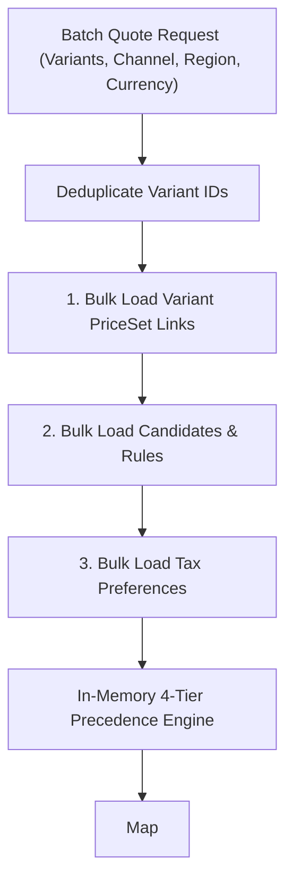
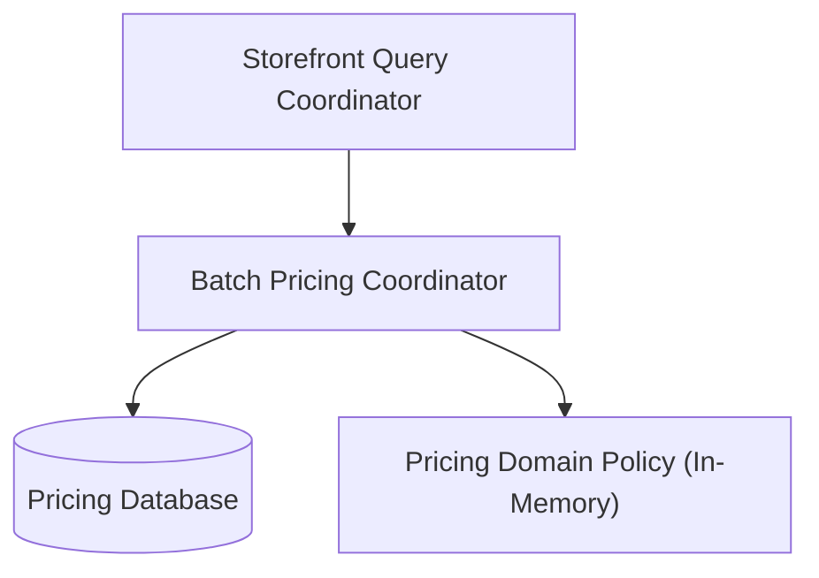
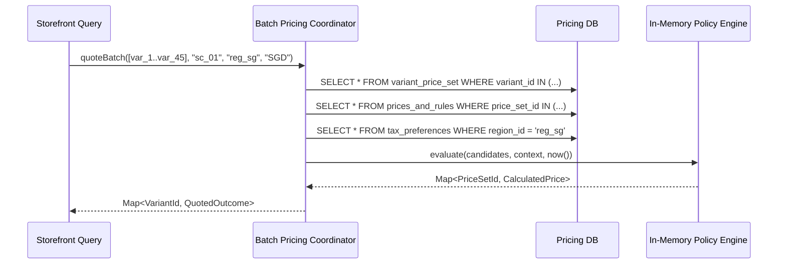

# Tech Spec: Batch Regional Pricing

- **Summary:** Quotes every distinct requested product variant in a target market using bulk database reads and deterministic in-memory rule evaluation.
- **Type:** Architecture Pattern
- **Feature Spec:** [Vectorized Batch Regional Pricing](../../features/feat_005-vectorized-batch-regional-pricing.md)

---

## 1. Problem & Decision

### What breaks without this?

Evaluating pricing rules one variant at a time introduces $N+1$ database query loops, degrading browse page response times to over 200ms. Conversely, pre-materializing every regional price permutation in storage causes Cartesian explosion ($O(P \times C \times R)$) and triggers massive database re-indexing storms whenever prices, taxes, or foreign exchange rates change.

### Decision

| Option | Decision | Why |
|:-------|:---------|:----|
| **Bulk Reads & In-Memory Precedence Evaluation** | Adopted | Bounds persistence round trips to constant SQL queries while evaluating all variant prices dynamically in under 15ms. |
| Repeated Single-Variant Queries ($N+1$) | Rejected | Unacceptable latency overhead scaling linearly with the number of variants displayed on a browse page. |
| Pre-Materialized Multi-Region Search Documents | Rejected | Triggers database re-indexing write storms and combinatorial storage explosion ($500,000+$ documents). |

### Trade-offs

| Benefits | Trade-offs |
|:-----------|:-------------|
| Zero write amplification when prices or promotional campaigns change | Storefront browse requests incur a lightweight in-memory batch pricing calculation hop |
| Strict market and currency isolation across all evaluated variants | Requires bounded page sizes (e.g., up to 50 items) to guarantee latency ceilings |

---

## 2. How It Works

### Core Concept

The batch pricing coordinator accepts an array of variant IDs, channel ID, region ID, settlement currency, and quantity. It deduplicates variant IDs, loads variant-to-price-set associations in a single SQL query, loads candidate prices and contextual rules in bulk, and executes an in-memory 4-tier specificity ranking algorithm (`Channel+Region > Region > Channel > Base`) to calculate prices for all variants at a single evaluation instant.

### How It Works Step by Step

| Step | What Happens | Why |
|:-----|:-------------|:----|
| 1 | Coordinator receives batch quote request and deduplicates variant IDs | Prevents redundant calculations for shared price sets or repeated IDs |
| 2 | Loads variant-to-price-set links in a single `WHERE variant_id IN (...)` query | Bounded single round-trip database read |
| 3 | Loads all active base and campaign prices for distinct `priceSetId` values | Single bulk SQL query loading rules and amounts |
| 4 | Loads tax inclusion preferences once for the target region and currency | Constant single read avoiding per-variant preference queries |
| 5 | Evaluates eligibility: currency match, quantity bounds, active campaign window | Filters out non-matching candidates before ranking |
| 6 | Evaluates 4-tier specificity ranking: `Channel+Region > Region > Channel > Base` | Selects highest-priority merchant price candidate |
| 7 | Synthesizes final amount (`SALE` vs `OVERRIDE`) and produces variant outcome map | Returns deterministic decimal prices or null for unpriced variants |

---

## 3. How We Use It

### Where It Fits in Our System

### Component Responsibilities

| Component | Role | What It Does |
|:----------|:-----|:-------------|
| Batch Pricing Coordinator | Application Service | Deduplicates inputs, orchestrates bulk SQL queries, and captures a single evaluation instant. |
| Pricing Repository Adapter | Persistence SPI | Executes bulk queries for variant links, candidate prices, rules, and tax preferences. |
| Pricing Domain Policy | Domain Logic | Evaluates candidate eligibility, 4-tier specificity ranking, and campaign synthesis in memory. |

### Runtime Flow

---

## 4. Implementation Rules

| Rule | Requirement |
|:-----|:------------|
| **R-01** | Input **MUST** include variant IDs, channel ID, region ID, authoritative settlement currency, and positive quantity; output **MUST** return an explicit priced or unpriced outcome for every distinct variant. |
| **R-02** | Link lookup **MUST** be bulk, candidate price lookup **MUST** cover distinct price sets in bulk, and tax preferences **MUST** be read once; database round trips **MUST** remain bounded for a page without per-variant queries. |
| **R-03** | Empty input **MUST** return empty output without database reads; duplicate variants and shared price sets **MUST** be evaluated once using a single batch evaluation instant. |
| **R-04** | Eligible candidates **MUST** rank `Channel+Region > Region > Channel > Base`; distinct regions sharing a currency (e.g., dual-USD markets) **MUST NOT** match one another's scoped rules. |
| **R-05** | Quantity bounds, complete rule matching, campaign status/window, deterministic ranking, and `SALE`/`OVERRIDE` synthesis **MUST** follow the Pricing domain policy. |
| **R-06** | Missing links or matching prices **MUST** yield null amounts; configured zero (0.00) **MUST** remain a valid price, and automatic foreign exchange rate conversions **MUST NOT** occur. |
| **R-07** | Pricing provider failures **MUST** propagate as operational service exceptions (`500`) and **MUST NOT** be masked as unpriced or absent variants. |
